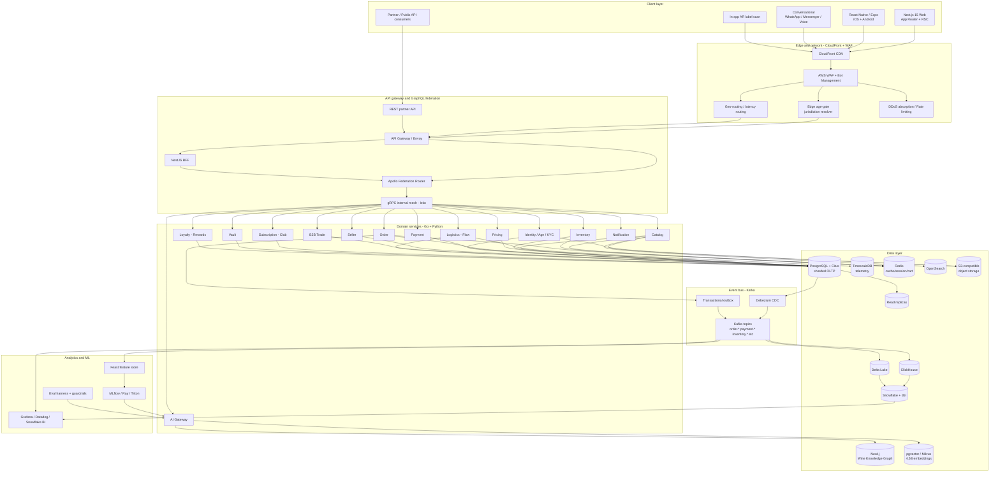
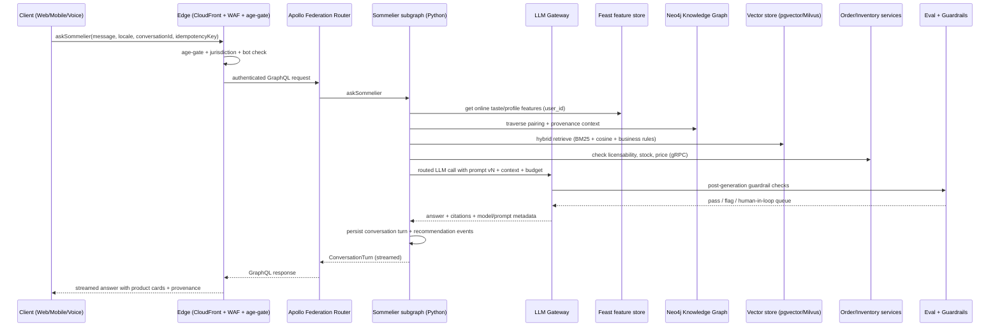

# VINTORA — Technical Architecture

> **Companion documents:** `01-business-plan.md`, `02-revenue-model.md`, `04-database-design.md`, `README.md`.
> This document is the system-level design authority. Data-level detail lives in `04-database-design.md`; commercial assumptions live in `01-business-plan.md`.

---

## Canon snapshot (binding)

| Dimension | Canonical fact |
|---|---|
| Brand | VINTORA (prose: "Vintora"); *The World's Cellar, Intelligent.* |
| Mission | Democratize discovery, trade and enjoyment of fine wine and spirits worldwide through applied AI — protecting provenance, safety and responsible consumption. |
| Founded / HQ | 2026 (Q4 incorporation). Dual HQ Singapore (APAC/ops) + New York City (Americas/commercial). Hubs: London, Paris, Amsterdam, Dubai, Tokyo, Sydney, São Paulo, Cape Town. |
| Modules | Vintora Market, Vintora Trade, Vintora Sommelier, Vintora Assist, Vintora Studio, Vintora Seller, Vintora Flow, Vintora Club, Vintora Vault, Vintora Rewards. |
| Surfaces | Next.js 15 web (App Router, RSC, TypeScript, Turborepo); React Native (Expo) mobile; WhatsApp/Messenger/voice (Alexa, Google Assistant)/in-app AR label scan; 24 → 60+ languages; 135+ currencies; RTL (Arabic, Hebrew). |
| Languages | TypeScript (web/mobile/BFF), Go (high-throughput services), Python (AI/ML/data), SQL. |
| Backend | Kubernetes (EKS + GKE, multi-region active-active), NestJS BFF, Go microservices, gRPC internal, Kafka event bus, Istio service mesh. |
| API | GraphQL (Apollo Federation) for clients, REST for public/partner API, gRPC service-to-service. |
| Data | PostgreSQL + Citus, TimescaleDB, Redis, OpenSearch, ClickHouse, Neo4j, S3-compatible object storage + CloudFront CDN, dbt + Snowflake, Delta Lake. |
| AI/ML | Multi-model LLM gateway (frontier + self-hosted open-weight), RAG over Wine Knowledge Graph, pgvector/Milvus, two-tower + transformer recommenders, XGBoost/LightGBM forecasting, CV (label OCR, authenticity, condition grading), ASR/TTS, RL pricing/inventory, anomaly fraud detection; MLflow, Feast, Ray, Triton. |
| Payments | Stripe + Adyen, local methods (Alipay, WeChat Pay, iDEAL, Klarna, Pix, UPI, SEPA, Apple/Google Pay), USDC settlement for Vault, locked-rate FX engine. |
| Observability | OpenTelemetry, Grafana, Prometheus, Datadog, PagerDuty, SLO-driven. |
| Security | Zero-trust, mTLS, SOC 2 Type II, ISO 27001, PCI DSS L1, GDPR/CCPA/LGPD/PIPL, KYC/AML, global age verification, per-jurisdiction licensing, responsible-drinking guardrails. |
| Scale | 100M registered / 60M MAU by 2034; 10M SKU target, 250k producers, 200+ countries, 40+ licensed warehouses; 1.2M orders/day, 50k req/s at edge, p95 < 200ms, 99.99% availability; 4.5B embeddings, 300M graph edges. |
| Roadmap | Phase 0 Q4 2026 → Phase 5 2030–2034 (see §18). |

---

## 1. Architecture principles

These seven principles are decision rules, not slogans. Any design that conflicts with them is rejected at architecture review.

1. **AI-native, not AI-bolted-on.** The taste profile → discovery → purchase → consumption → review → better profile loop is a first-class data flow. Every module emits learning signals to the feature platform, and every AI surface (Vintora Sommelier, Vintora Assist, Vintora Studio) is built on one LLM gateway, one RAG pipeline, and one evaluation harness. No module owns a private model endpoint.
2. **Compliance-by-design.** Age assurance, KYC/AML, licensing checks and responsible-drinking guardrails execute before an order is accepted, not after. Compliance is a synchronous dependency of the order state machine and an asynchronous audit stream. A jurisdiction without a valid licence is a hard business rule, not a feature flag.
3. **Multi-region active-active.** EKS (Americas/APAC primaries) and GKE (EMEA and secondary regions) run simultaneous read/write traffic. No warm standby that has never served real requests. Regions are independently failable; cell routing keeps blast radius bounded.
4. **Tenant-aware at every layer.** Tenant identity (`tenant_id`) is a mandatory partition dimension in OLTP, search, cache keys, object prefixes, feature-store keys and observability labels. Seller isolation is enforced in the data access layer, not in application conditionals.
5. **Observability-first.** Every service ships with OpenTelemetry traces, Prometheus RED/USE metrics, structured logs and an SLO dashboard before it is allowed into production. "It works" is not a deploy criterion; "we can see it working and page on it breaking" is.
6. **Progressive delivery.** Trunk-based development, feature flags, schema registry checks, canary rollouts at 1% → 5% → 25% → 100%, and automated rollback on SLO burn. Database migrations are expand/contract and never coupled to application deploy.
7. **Boring where it matters, novel where it pays.** Postgres, Kafka, Redis and HTTP are deliberately conservative. Novelty is reserved for the knowledge graph, vector retrieval, and the cellar-liquidity layer (Vintora Vault), where they are differentiators (see `01-business-plan.md` §differentiators).

---

## 2. High-level system diagram



Traffic enters through two paths: human clients terminate at CloudFront and are age/jurisdiction-resolved at the edge before any origin call; partners terminate at the REST gateway with OAuth 2.0 client credentials and per-contract quotas. Both paths converge on the Apollo Federation router for graph clients and on gRPC for internal fan-out. The event bus decouples write-side services from read models, analytics and ML; nothing in the analytics plane writes back to OLTP except through explicit, versioned commands.

---

## 3. Client layer detail

### 3.1 Web — Next.js 15

Next.js 15 App Router, TypeScript and React Server Components run in a Turborepo monorepo. Catalog and editorial pages render at the edge and regenerate on SKU changes, giving sub-100ms TTFB for 10M SKU target without matching origin load. Client components are limited to cart, checkout, chat and AR label scan; the NestJS BFF aggregates federation calls so the browser never sees internal topology.

### 3.2 Mobile — React Native / Expo

One Expo codebase produces iOS and Android apps; navigation, design tokens, analytics and the offline queue are shared with web via `packages/`. Native modules cover camera (AR label scan, KYC document capture), biometrics (Vault and high-value payment confirmation) and push. OTA updates ship non-native changes; native binaries ship quarterly or on regulatory change.

### 3.3 Offline-first

Cart, wishlists, taste edits, recently viewed items and Sommelier drafts persist encrypted (SQLite mobile, IndexedDB web). Mutations queue with client idempotency keys and replay on reconnect with backoff. Price, stock and age eligibility are never trusted from cache; they are revalidated at checkout. Offline reading is allowed, offline purchase is not.

### 3.4 Design system, i18n and accessibility

| Concern | Standard |
|---|---|
| Design system | Single token set (colour, spacing, typography, motion) consumed by web and mobile; versioned as a package with visual regression tests. |
| Localization | 24 launch languages → 60+ by 2030; 135+ currencies with locked-rate display; ICU message formatting; no string concatenation. |
| RTL | Arabic and Hebrew full layout mirroring, including charts, map interfaces and AR overlays; logical CSS properties only. |
| Accessibility | WCAG 2.2 AA: keyboard paths for every flow, 44px minimum touch targets, focus-visible states, contrast ≥ 4.5:1, captions for all video, semantic labels for voice agents. |
| Age gate UI | Persistent, non-dismissible age and jurisdiction affordance; state stored server-side and re-checked on device fingerprint change. |

---

## 4. Edge and network

CloudFront is the sole public ingress. AWS WAF with Bot Management inspects every request; rules are tiered by route — catalog reads are permissive, checkout and Vault require low bot scores and proof-of-work. The CDN plus Shield-class protection absorbs DDoS; origin IPs are private and origin traffic uses private links.

Geo-routing maps IP to jurisdiction and cell, driving currency/language defaults from the 135+ currency table, age-gate threshold and method (21 in US, 18 in most EU markets, 19 in parts of Canada), and licence availability. Without a valid licence only non-transactional surfaces render. The edge gate is coarse control; the authoritative check is Identity/Age/KYC at order time (§10).

Edge compute handles A/B assignment, image transforms and headers. TLS 1.3 and HSTS are enforced; Istio mTLS covers all service hops with locality-weighted balancing so cross-region calls are exceptional.

---

## 5. API strategy

### 5.1 GraphQL federation schema outline

Clients consume one Apollo Federation supergraph composed from domain subgraphs. Entities are extended via `@key`; the router handles query planning and per-fetch tracing.

```graphql
# ---- Catalog subgraph ----
type Product @key(fields: "id") {
  id: ID!
  slug: String!
  name: String!
  producer: Producer!
  vintage: Vintage
  skus: [Sku!]!
  media: [ProductMedia!]!
  tasteProfile: TasteProfile
  ageRestricted: Boolean!
  availability(region: RegionInput): Availability!
}

type Producer @key(fields: "id") {
  id: ID!
  name: String!
  region: Region
  appellation: Appellation
  products(first: Int = 20, after: String): ProductConnection!
}

type Query {
  product(id: ID!): Product
  searchProducts(query: String!, filter: ProductFilter, first: Int = 24, after: String): ProductConnection!
}

# ---- Inventory subgraph extends Product ----
extend type Product @key(fields: "id") {
  id: ID! @external
  inventory: InventorySummary!
}

# ---- Order subgraph ----
type Order @key(fields: "id") {
  id: ID!
  buyer: Buyer!
  lines: [OrderLine!]!
  status: OrderStatus!
  totals: OrderTotals!
  shipments: [Shipment!]!
}

type Mutation {
  createOrder(input: CreateOrderInput!, idempotencyKey: String!): Order!
  cancelOrder(id: ID!, reason: CancelReason!): Order!
}

# ---- Sommelier subgraph ----
type SommelierConversation @key(fields: "id") {
  id: ID!
  turns: [ConversationTurn!]!
  recommendations: [Recommendation!]!
  guardrailFlags: [GuardrailFlag!]!
}

type Recommendation {
  product: Product!
  score: Float!
  rationale: String!
  provenance: ProvenanceChain!
}

input SommelierAskInput {
  conversationId: ID
  message: String!
  context: SommelierContext
  locale: String!
}

type Mutation {
  askSommelier(input: SommelierAskInput!, idempotencyKey: String!): ConversationTurn!
}

type Subscription {
  sommelierStream(conversationId: ID!): ConversationTurn!
}
```

### 5.2 REST partner API

The public REST API (Vintora Trade feeds, Vintora Studio publishing, 3PL, tax/compliance integrations) is OpenAPI 3.1 specified, OAuth 2.0 client-credentials authenticated and URL-versioned (`/v1`, `/v2`). Breaking changes require a new major version with 12-month overlap. Responses carry `request_id`, idempotency echo and RFC 9457 problem details.

### 5.3 gRPC internal

Service-to-service calls use gRPC over Istio mTLS with protobuf schemas in a central registry. Unary calls for point lookups; server-streaming for search and bulk inventory sync; client-streaming for telemetry ingest. Deadlines are mandatory and default to 250ms for synchronous fan-out paths so that p95 < 200ms at the API remains achievable.

### 5.4 Versioning, rate limiting, idempotency

| Mechanism | Rule |
|---|---|
| GraphQL | Field-level deprecation with `@deprecated(reason:)`; schema checks block removal while client usage > 0; 90-day minimum sunset. |
| REST | URL major version, additive minor changes, 12-month overlap. |
| gRPC | Backward-compatible protobuf evolution only; reserved field numbers; no field renames. |
| Rate limiting | Token bucket at edge (per IP + device), at gateway (per API key), and per tenant in-service. Quotas from contract: free 60 req/min, Seller $399 tier 600 req/min, Vintora Trade enterprise negotiated. |
| Idempotency | All money-moving and order mutations require `Idempotency-Key`; 24h server-side dedupe with request fingerprint; replay returns original result. |

---

## 6. Service catalogue

| Service | Language | Ownership | SLA (availability / p95) | Scaling trigger | Datastore |
|---|---|---|---|---|---|
| Catalog | Go | Market team | 99.99% / 80ms | CPU > 55% or RPS > 4k | PostgreSQL+Citus, Redis, OpenSearch, S3 |
| Inventory | Go | Market team | 99.99% / 60ms | Queue lag > 200ms | PostgreSQL+Citus, Redis |
| Pricing & FX | Go | Revenue team | 99.99% / 50ms | CPU > 60% | PostgreSQL+Citus (reference), Redis |
| Order | Go | Commerce team | 99.99% / 150ms | Orders/s > 300 | PostgreSQL+Citus (tenant_id) |
| Payment | Go | Payments team | 99.99% / 200ms | Attempt rate > 500/s | PostgreSQL+Citus, PCI-scoped vault |
| Identity / Age / KYC | Go + Python | Trust team | 99.99% / 120ms | Verification queue > 1k | PostgreSQL+Citus (user_id), S3 |
| Seller | TypeScript/NestJS | Seller team | 99.9% / 180ms | CPU > 60% | PostgreSQL+Citus (tenant_id) |
| B2B Trade | Go | Trade team | 99.9% / 200ms | RFQ rate > 100/s | PostgreSQL+Citus (tenant_id) |
| Logistics (Flow) | Go | Flow team | 99.9% / 200ms | Telemetry ingest > 50k/s | PostgreSQL+Citus, TimescaleDB |
| Subscription (Club) | Go | Club team | 99.9% / 180ms | Box build jobs > 10k/min | PostgreSQL+Citus (user_id) |
| Vault | Go | Vault team | 99.99% / 150ms | Trade rate > 100/s | PostgreSQL+Citus, Ledger, USDC rails |
| Loyalty (Rewards) | Go | Growth team | 99.9% / 80ms | CPU > 60% | PostgreSQL+Citus (user_id), Redis |
| Notification | Go | Platform team | 99.9% / async | Queue depth > 50k | Kafka, provider APIs |
| AI Gateway | Python | AI Platform team | 99.9% / 2s (stream) | Token rate > 100k/min | Neo4j, vector store, Feast |
| BFF | TypeScript/NestJS | Web team | 99.99% / 100ms | RPS > 8k | Stateless; Redis session |
| Federation Router | Go (Apollo) | Platform team | 99.99% / 40ms | CPU > 50% | Supergraph config |

All services are stateless; all durable state is in the datastores above. Services with 99.99% SLA run a minimum of three pods per region across three availability zones, with pod disruption budgets allowing only one voluntary disruption at a time.

---

## 7. Data layer

PostgreSQL + Citus is the OLTP backbone. Distribution columns follow bounded context: `tenant_id` for seller/B2B, `user_id` for carts/orders/loyalty/subscriptions, `product_id` for catalog/inventory. Low-cardinality dimensions (countries, currencies, exchange rates, carriers, club plans, feature flags) are Citus **reference tables** on every node, keeping joins local. Full DDL and shard keys are in `04-database-design.md`.

| Store | Role | Canonical use |
|---|---|---|
| PostgreSQL + Citus | Sharded OLTP | Orders, payments, users, listings, inventory, Vault lots. |
| Read replicas | Read scaling | Product detail, order history, seller analytics; bounded 50ms replica lag with read-your-writes routing. |
| Redis | Cache / session / cart | SKU summaries, stock counters, rate-limit buckets, idempotency keys, cart state; cluster mode with tenant-prefixed keys. |
| OpenSearch | Search | 10M SKU target faceted search, autocomplete, synonym handling across 24→60 languages. |
| ClickHouse | Analytics | Event facts, funnels, seller dashboards; sub-second aggregation over billions of rows. |
| TimescaleDB | Telemetry | Temperature/humidity logs for Vintora Flow, device and AR scan telemetry, hypertables with retention policies. |
| Neo4j | Wine Knowledge Graph | Provenance chain, pairing, similarity; 300M edges at scale. |
| pgvector / Milvus | Vector index | 4.5B embeddings (taste, product, conversation); HNSW with metadata filters. |
| S3-compatible + CloudFront | Object storage / CDN | Media, KYC documents, certificates of provenance, Delta/backup artifacts. |
| Snowflake + dbt | Warehouse | Finance-grade reporting, LTV/GMV/take-rate semantic layer. |
| Delta Lake | Lakehouse | Immutable event history, ML training datasets, audit retention. |
| Kafka | Event bus | Domain events, CDC, feature pipeline; exactly-once semantics where required. |

Cross-store consistency is achieved with the transactional outbox and Debezium CDC: a service writes state and outbox event in one local transaction; Debezium publishes to Kafka; consumers upsert read models idempotently. This pattern is detailed in `04-database-design.md` §9.

---

## 8. AI platform architecture

### 8.1 LLM gateway

Every AI surface — Vintora Sommelier, Assist, Studio, Seller insights and the Phase 4 licensed API — calls one multi-model LLM gateway with an OpenAI-compatible internal API:

| Capability | Implementation |
|---|---|
| Model routing | Task classifier picks frontier models for complex pairing/negotiation and self-hosted fine-tuned open-weight models for high-volume classification, extraction and simple chat. |
| Fallback | Primary → secondary frontier → open-weight fallback with circuit breaker; degraded responses are labelled. |
| Cost controls | Per-tenant token budgets, prompt caching, semantic cache for repeated questions, max output tokens, and hard spend caps with alerting at 50/80/100%. |
| Streaming | Server-sent events to clients; first-token latency SLO 800ms. |
| Guardrails | Pre/post classifiers for age-restricted content, responsible-drinking language, medical claims, PII, prompt injection and off-topic drift. |
| Prompt management | Versioned prompt templates in git-backed store; canary prompt rollouts; every response records model ID, prompt version and retrieval set. |
| Human-in-the-loop | Low-confidence pairing, authenticity disputes and Vault provenance claims route to certified sommeliers or Trust ops via a review queue; decisions become labelled training data. |

### 8.2 RAG pipeline

The corpus combines the Wine Knowledge Graph (`04-database-design.md` §4), catalog records and editorial content. Documents are chunked, embedded at 1,536 dimensions and written to pgvector for tenant-local workloads and Milvus for the 4.5B index. Graph traversal supplies relational context (region → appellation → producer → vintage) that vector search cannot express. Hybrid retrieval scores BM25 + cosine + business rules before reranking; the formula is in `04-database-design.md`.

### 8.3 Feature, training and inference platform

Feast is the online/offline feature store: offline features from Delta Lake and Snowflake, online from Redis at < 10ms. Features include taste vectors, purchase cadence, price sensitivity, cellar holdings and inventory velocity. MLflow tracks experiments; Ray trains; Triton serves open-weight models with dynamic batching; XGBoost/LightGBM forecast demand; two-tower and transformer recommenders rank; RL tunes pricing/inventory; CV handles label OCR, authenticity and condition grading; ASR/TTS powers voice; anomaly detection scores fraud.

### 8.4 Evaluation harness

Every model, prompt and retrieval change passes a frozen eval set of 5,000 conversations and 20,000 ranking pairs. Metrics: faithfulness, pairing acceptance, NDCG@10, hallucination (< 0.5%), guardrail precision/recall, p95 latency and cost per resolved conversation. Regressions block promotion; nightly adversarial suites probe prompt injection and policy bypass.

### 8.5 Sommelier request sequence



Every turn emits `sommelier.asked`, `recommendation.shown`, `recommendation.clicked` and `product.added_to_cart` events, closing the learning loop described in `01-business-plan.md`.

---

## 9. Payments and FX architecture

One internal Payments API orchestrates Stripe and Adyen in a live 60/40 split with routing by success rate, cost and jurisdiction. Local methods — Alipay, WeChat Pay, iDEAL, Klarna, Pix, UPI, SEPA, Apple Pay and Google Pay — are processor capabilities selected by country, currency and buyer history. Smart retries use network tokens and issuer cascades; 3DS2 follows SCA rules and risk score, preferring frictionless flow.

The FX engine quotes a **locked rate** valid 15 minutes at checkout. The quote is stored with the cart/order and hedged with treasury; margin uses the 135+ currency table and daily `exchange_rates`. Expiry re-pricing is explicit. No order captures at a stale rate.

The double-entry ledger (`04-database-design.md`) posts balanced entries: buyer debit / Vintora clearing credit at authorization, clearing → seller payable at capture, plus commission, processing fee, tax, shipping and FX spread. Refunds add reversing postings, never deletes. Daily reconciliation compares processor settlements; breaks page Payments.

Vintora Vault uses **USDC settlement**. Regulated partners run fiat ramps; wallet keys sit in HSM custody with multi-party approval. Lot purchases, custody events and trades post to the same ledger with `settlement_asset = USDC`, unifying fiat and stablecoin reporting. Fractional minimum is $25.

---

## 10. Identity, age verification and compliance architecture

Identity is a bounded context and the authoritative source for age and KYC state:

1. **Account creation** — email/phone OTP, passwordless options, device binding. Region resolved from edge and IP.
2. **Age assurance** — the jurisdiction engine selects method: declared DOB + device signals for low-risk, government ID document verification for high-risk/high-value, third-party age assurance for specific markets. Document capture reuses the AR/CV pipeline with liveness detection.
3. **KYC/AML** — KYC vendors perform IDV, sanctions, PEP and adverse-media screening. Risk scores are stored in `kyc_records`; enhanced due diligence is triggered for Vault, high-value lots and seller payouts above threshold.
4. **Licensing checks** — the registry maps entity, category (beer/wine/spirits), channel (B2C/B2B) and delivery model to allowed operations; checkout calls it synchronously and a missing licence blocks the order.
5. **Responsible-drinking guardrails** — applied in Sommelier/Assist outputs, purchase velocity limits and Vintora Studio marketing suppression.
6. **Audit log** — every decision, intervention and override writes to append-only `audit_logs` with actor, reason, evidence hash and retention class.

GDPR/CCPA/LGPD/PIPL erasure uses crypto-shredding and PII vaulting (`04-database-design.md`). SOC 2 Type II, ISO 27001 and PCI DSS L1 are covered in §14.

---

## 11. Multi-tenancy and seller isolation

Consumers are users; sellers (Vintora Seller) and wholesale buyers (Vintora Trade) are organisational tenants. Shared tables carry `tenant_id`; consumer tables distribute on `user_id` and include `tenant_id = 'consumer'` for uniform policy evaluation. Isolation is enforced in four places:

| Layer | Mechanism |
|---|---|
| Network / mesh | Istio AuthorizationPolicy binds service identity to tenant scope; cross-tenant calls denied by default. |
| Data access | Repository layer injects mandatory tenant predicate; queries without tenant context fail closed. Postgres row-level security is defence in depth. |
| Search / cache | OpenSearch indices are per-tenant aliases; Redis keys are `tenant:{id}:...`; no cross-tenant key reuse. |
| Object storage | Prefix `s3://vintora/{tenant_id}/...` with per-tenant IAM roles and signed URLs. |

**Design target only:** seller payouts are isolated in the ledger: each seller has a payable sub-ledger; a compromise of one seller's API key cannot read another's orders or inventory. Platform staff access is a break-glass, time-boxed, approved and audit-logged design target. This target is not implemented in the prototype.

---

## 12. Scalability plan to 100M users

### 12.1 Shard count math

At 100M registered users and 60M MAU, the user-partitioned OLTP estate is sized as follows. Assume 2,000 bytes average per user across `users`, `user_profiles`, age/KYC summaries and loyalty rows, plus order/listing growth.

| Dataset | Rows at 2034 | Bytes/row | Logical TB | Shards (Citus) | Nodes |
|---|---:|---:|---:|---:|---:|
| Users + profiles | 100M | 2 KB | 0.2 TB | 64 | 8 |
| Orders + order items | 1.2M/day × 8y ≈ 3.5B | 1.5 KB | 5.3 TB | 256 | 32 |
| Listings + inventory | 10M SKU target × ~5 sellers ≈ 50M | 2 KB | 0.1 TB | 64 | 8 |
| Payments + ledger | ~4B postings | 400 B | 1.6 TB | 128 | 16 |
| Vault lots / custody / trades | 50M | 1 KB | 0.05 TB | 32 | 4 |
| **Total OLTP (incl. indexes & replicas)** | — | — | **~28 TB** | **544** | **~68** |

Start Phase 1 with 32 shards on 4 Citus worker nodes; re-shard to 64 in Phase 2, 128 in Phase 3 and the full distribution in Phase 5. Reference tables stay on every node. Re-sharding is done online with Citus's shard migration during low-traffic windows.

### 12.2 QPS capacity model

| Layer | Peak capacity | Calculation |
|---|---:|---|
| Edge (CloudFront + WAF) | 50,000 req/s | Canonical target; static/SSR cache absorbs ~85%. |
| Origin after CDN | ~7,500 req/s | 50,000 × (1 − 0.85) cache miss. |
| Federation router | 10,000 req/s | Headroom 33%; p95 40ms. |
| Catalog service | 4,000 req/s | Postgres read replicas + Redis 90% hit. |
| Cart/session (Redis) | 20,000 ops/s | Cluster of 12 shards, 3 replicas. |
| Order service | 500 orders/s | 1.2M/day = 13.9/s avg; 10× diurnal peak ≈ 139/s; 3.6× safety margin. |
| Payment attempts | 500/s | Multi-processor split; 200ms p95. |
| Kafka ingest | 250k events/s | 24 partitions on core topics; consumer lag < 1s. |

Cache hit ratios: CDN 85% for content, Redis 90% for SKU summaries, 95% for FX quotes within the 15-minute window, 70% for personalized recommendations (semantic cache). Every 1% improvement in CDN offload removes ~500 req/s of origin load.

### 12.3 Peak order throughput

1.2M orders/day on ~$15B GMV implies ~$34 average order value, with luxury/Vault lots far higher. Only inventory reservation and payment authorization are synchronous; fulfillment, customs, loyalty and notifications are async. Flash events use an edge waiting room and Lua-atomic Redis stock counters.

### 12.4 Cost per 1,000 requests

| Scenario | Blended cost / 1k requests | Notes |
|---|---:|---|
| CDN-served static/SSR | $0.01 | CloudFront + WAF dominated. |
| Cached API read (Redis hit) | $0.06 | Compute + Redis. |
| Uncached catalog read (DB + search) | $0.19 | Includes OpenSearch and replica. |
| Checkout (order + payment + ledger) | $0.42 | Processor fees excluded. |
| Sommelier turn (frontier model) | $0.85 | 2k input / 500 output tokens, routed; open-weight fallback $0.09. |

FinOps target: blended platform cost under $0.12 per 1k requests at scale, with AI cost governed separately by per-tenant token budgets (§15).

### 12.5 Cell-based architecture, backpressure, load shedding

Regions are subdivided into cells (typically 2–4 per region), each containing a full slice of stateless services and a Citus shard subset. A cell serves up to ~5M MAU; cell routing is deterministic by `tenant_id`/`user_id` hash. Failure of a cell affects only its slice; traffic is drained and reassigned.

Backpressure is applied in layers: Kafka consumer lag pauses non-critical consumers; gRPC servers advertise flow-control windows; NestJS BFF applies concurrency limits. Load shedding drops, in order: analytics reads, recommendation enrichment, non-essential media transforms, then AI streaming upgrades — never checkout, payment or age verification. Return codes 429/503 with `Retry-After` and a reason header are standard.

---

## 13. Reliability

### 13.1 SLOs and error budgets

| SLI | SLO | Error budget / 30d |
|---|---:|---:|
| API availability | 99.99% | ~4.3 min downtime |
| API latency p95 | < 200ms | < 0.1% of requests above |
| Checkout success | 99.5% | 0.5% of attempts |
| Payment authorization p95 | < 200ms | — |
| Sommelier first-token p95 | < 800ms | — |
| Kafka consumer lag | < 1s (critical topics) | — |

Burn-rate alerts (1h/6h windows) page PagerDuty; error-budget exhaustion freezes feature rollouts except reliability fixes. SLO dashboards live in Grafana with Datadog synthetics as an independent probe.

### 13.2 Multi-region failover, RPO/RTO

| Workload | Topology | RPO | RTO |
|---|---|---:|---:|
| OLTP (Citus) | Active-active per region + async cross-region logical replication | < 30s | < 5 min (cell drain) |
| Redis | Cluster with cross-region replication; cold rebuild acceptable for cache | N/A (cache) | < 10 min |
| Kafka | MirrorMaker 2 / cluster linking across regions | < 10s | < 5 min |
| Object storage | Cross-region replication, versioned | 0 | < 1 min (DNS) |
| Neo4j / vector | Snapshot + incremental rebuild from event log | < 15 min | < 30 min |

Region evacuation is a rehearsed runbook executed quarterly. Writes are fenced to avoid split-brain: a region that loses quorum stops accepting writes and returns 503 rather than diverging.

### 13.3 Chaos engineering, DR, backups

Chaos experiments (pod kill, node drain, partition, latency injection, processor failover) run weekly against small cells with automatic abort on SLO breach. Backups: hourly incremental + daily full for Citus (35-day retention), PITR, quarterly restore drills. Transaction-path RPO is 30s and RTO 5min; graph/ML targets are relaxed. Integrity is verified by checksum and restore tests.

---

## 14. Security

Zero trust uses Istio mTLS, SPIFFE-style workload identities and default-deny policies. Human access requires SSO with hardware MFA and just-in-time elevation. Secrets sit in a managed store with envelope encryption; rotation is 90-day and immediate on exposure. AES-256 KMS keys protect data at rest, TLS 1.3 in transit, HSM keys protect Vault custody and payment tokenization.

Certification and regulatory control set:

| Framework | Scope | Key controls |
|---|---|---|
| SOC 2 Type II | All production services | Change management, access reviews, incident response, audit logging. |
| ISO 27001 | ISMS across dual HQ + hubs | Risk register, Annex A controls, annual surveillance audits. |
| PCI DSS L1 | Payment path | Tokenization, segmented CDE, quarterly ASV scans, penetration tests. |
| GDPR / CCPA / LGPD / PIPL | Consumer data | Consent, DSAR, data residency, crypto-shredding, DPIAs. |
| KYC / AML | Identity, Vault, seller payouts | IDV, sanctions/PEP screening, transaction monitoring, SAR processes. |

Penetration testing is annual (accredited third party) plus continuous bug bounty; critical findings have a 72-hour remediation SLA. Supply chain: signed images, SLSA provenance, CycloneDX SBOM per artifact, dependency scanning with auto-upgrade PRs, admission control rejecting unsigned images. Fraud detection combines device fingerprints, velocity rules, Neo4j ring detection and anomaly models; scores drive step-up auth and manual review.

---

## 15. Observability and FinOps

OpenTelemetry spans all TypeScript, Go and Python services; traces sample 100% on checkout/payment and 10% elsewhere with tail-based error sampling. Prometheus scrapes RED/USE metrics, Grafana hosts SLO dashboards, Datadog provides APM/synthetics and PagerDuty escalation. Logs are JSON with `trace_id`, `tenant_id`, pseudonymous `user_id`, `request_id` and `module`; 30 days hot, 1 year cold.

Every resource is tagged `module` (one of the ten canonical modules), `tenant_id`, `environment` and `region`. dbt models allocate shared cost by usage (credits, Kafka bytes, AI tokens, GB-month). The gateway enforces token budgets, semantic caching, model downgrade paths and a daily cost anomaly detector. Monthly FinOps review compares cost per 1k requests and per order to §12.4 targets.

---

## 16. CI/CD and developer experience

The Turborepo holds web, mobile, BFF, design system and infrastructure. Trunk-based branches run typecheck, lint, unit/contract tests, schema checks and Terraform plan per PR. Merges deploy to staging, then canary 1% → 5% → 25% → 100% with SLO-based rollback. Flags decouple deploy from release and support per-tenant rollout for Vintora Seller/Trade.

Database changes follow expand/contract (`04-database-design.md`): additive migration, dual-write/backfill, switchover, then later cleanup. Protobuf/OpenAPI schemas are compatibility-checked in CI; supergraph composition is required. Each PR gets an ephemeral preview with anonymised seeds plus a local `docker compose` stack.

---

## 17. Build vs buy

| Capability | Decision | Rationale |
|---|---|---|
| Web/mobile framework | Build (Next.js 15, Expo) | Canonical; shared design system is a differentiator. |
| API gateway / mesh | Buy/open-source (Envoy, Apollo Router, Istio) | Commodity infrastructure; no moat. |
| Sharded OLTP | Build on PostgreSQL + Citus | Canonical; control over shard keys and compliance. |
| Search | Buy/open-source (OpenSearch) | Faceted multilingual search is solved. |
| Knowledge graph | Build (Neo4j schema + ontology) | Provenance graph is a canonical differentiator. |
| Vector store | Hybrid (pgvector + Milvus) | 4.5B embeddings need Milvus scale, pgvector for tenant-local. |
| LLM gateway | Build thin layer over bought models | Routing/cost/guardrails are strategic; model training is not. |
| Feature store / MLOps | Buy/open-source (Feast, MLflow, Ray, Triton) | Canonical stack; avoid platform reinvention. |
| Payments orchestration | Buy + build routing (Stripe, Adyen) | Regulatory burden; custom router preserves margin. |
| KYC / age verification | Buy (vendors) + build rules engine | Vendors cover document/IDV; jurisdiction logic is ours. |
| Observability | Buy (Datadog, PagerDuty) + OSS (Grafana, Prometheus, OTel) | Speed of incident response. |
| Warehouse / lakehouse | Buy (Snowflake) + build dbt/Delta models | Canonical; focus on semantic layer. |

---

## 18. Evolution roadmap (canonical phases)

| Phase | Period | Architecture milestone |
|---|---|---|
| Phase 0 | Q4 2026 | Foundation, licensing registry, age/KYC pipeline, Citus cluster (32 shards), first EKS region, supplier signing. |
| Phase 1 | Q1–Q2 2027 | MVP Vintora Market + Sommelier + Assist in US, UK, Singapore; closed beta → launch; single-region active with second region following. |
| Phase 2 | Q3–Q4 2027 | Vintora Trade, Seller, Flow, Rewards v1; EU expansion (FR/DE/IT/ES/NL); multi-region active-active; Kafka + Debezium read models. |
| Phase 3 | 2028 | iOS/Android apps, Club, Studio v1, 12 languages, 10 currencies; Japan/UAE/Australia; TimescaleDB telemetry, feature store GA. |
| Phase 4 | 2029 | Vault launch with USDC settlement; AI API licensing; 24 languages, LatAm; graph + vector scale-up, 128 shards. |
| Phase 5 | 2030–2034 | Global scale, 60+ languages, 100M users, profitability, IPO readiness; full 544-shard estate, cells in all hubs, 4.5B embeddings. |

---

## 19. ADR index

| ADR | Title | Decision |
|---|---|---|
| ADR-001 | API style for clients | Apollo Federation GraphQL for clients; REST for partners; gRPC internal. Reject a single REST BFF to avoid over-fetching across ten modules. |
| ADR-002 | OLTP sharding | PostgreSQL + Citus with `tenant_id` / `user_id` / `product_id` distribution columns and reference dimensions; no MongoDB. |
| ADR-003 | Region topology | Multi-region active-active on EKS + GKE with cell-based isolation; no warm-standby DR. |
| ADR-004 | AI model strategy | One multi-model gateway: frontier models for reasoning, self-hosted fine-tuned open-weight for volume; never embed model SDKs in domain services. |
| ADR-005 | Event backbone | Kafka + transactional outbox + Debezium CDC; at-least-once delivery with idempotent consumers, exactly-once where ledger requires. |
| ADR-006 | Provenance representation | Neo4j Wine Knowledge Graph as system of record for relationships; relational OLTP remains system of record for transactional attributes. |
| ADR-007 | Search & recommendations | OpenSearch for lexical/faceted search, vector store for semantic retrieval, hybrid scoring with business rules; single ranking service. |
| ADR-008 | Compliance enforcement point | Age/KYC/licensing checks synchronous in order state machine at edge + service; audit log append-only; compliance cannot be bypassed by feature flag. |

---

*End of `03-technical-architecture.md`. See `04-database-design.md` for table-level schemas, shard keys, graph model, vector index and capacity estimates, and `01-business-plan.md` for the financial model these capacity numbers serve.*
