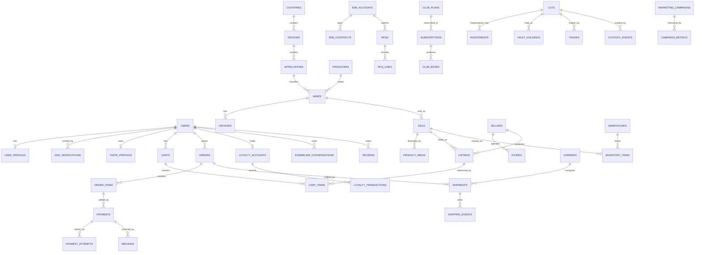

# VINTORA — Database Design

> **Companion documents:** `01-business-plan.md`, `02-revenue-model.md`, `03-technical-architecture.md`, `README.md`.
> This document owns table schemas, shard keys, graph/vector models, data lifecycle and capacity. System topology is in `03-technical-architecture.md`; financial assumptions are in `01-business-plan.md`.

---

## Canon snapshot (binding)

| Dimension | Canonical fact |
|---|---|
| Brand | VINTORA (prose: "Vintora"); *The World's Cellar, Intelligent.* |
| Modules | Vintora Market, Vintora Trade, Vintora Sommelier, Vintora Assist, Vintora Studio, Vintora Seller, Vintora Flow, Vintora Club, Vintora Vault, Vintora Rewards. |
| Stack | PostgreSQL + Citus (sharded OLTP), TimescaleDB (telemetry), Redis (cache/session/cart), OpenSearch (search), ClickHouse (analytics), Neo4j (wine knowledge graph), S3-compatible object storage + CloudFront, dbt + Snowflake, Delta Lake. |
| AI data | pgvector/Milvus vector store; 4.5B embeddings; 300M edges in the wine knowledge graph; Feast feature store; MLflow/Ray/Triton. |
| Payments | Stripe + Adyen, local methods (Alipay, WeChat Pay, iDEAL, Klarna, Pix, UPI, SEPA, Apple/Google Pay), USDC settlement for Vintora Vault, FX engine with locked rates. |
| Scale | 100M registered users / 60M MAU by 2034; 10M SKU target, 250k producers, 200+ countries, 40+ licensed warehouses; 1.2M orders/day; 50k req/s edge; p95 < 200ms; 99.99% availability. |
| Compliance | SOC 2 Type II, ISO 27001, PCI DSS L1, GDPR/CCPA/LGPD/PIPL, KYC/AML, global age verification, per-jurisdiction licensing, responsible-drinking guardrails. |
| Roadmap | Phase 0 Q4 2026 → Phase 5 2030–2034. |

---

## 1. Data architecture overview and boundary contexts

The estate follows the ten canonical modules across eleven boundary contexts. Each owns its tables and publishes events; no mutable tables are shared.

| Context | Owns | Primary store | Distribution column |
|---|---|---|---|
| Catalog | producers, regions, appellations, wines, vintages, skus, product_media, reviews | PostgreSQL+Citus, OpenSearch, S3, Neo4j | `product_id` / `sku_id` |
| Commerce | carts, cart_items, orders, order_items, payments, payment_attempts, refunds, addresses | PostgreSQL+Citus | `user_id` for carts/orders; `tenant_id` for payments |
| Identity | users, user_profiles, age_verifications, kyc_records, taste_profiles | PostgreSQL+Citus, encrypted PII vault | `user_id` |
| Seller | sellers, stores, listings, inventory_items, warehouses | PostgreSQL+Citus | `tenant_id` |
| B2B | b2b_accounts, b2b_contracts, rfqs, rfq_lines | PostgreSQL+Citus | `tenant_id` |
| Logistics | carriers, shipments, shipping_events, warehouse telemetry | PostgreSQL+Citus, TimescaleDB | `tenant_id` / `shipment_id` time |
| Subscription | club_plans, subscriptions, club_boxes | PostgreSQL+Citus | `user_id` |
| Vault | investments, lots, vault_holdings, trades, custody_events | PostgreSQL+Citus, ledger, USDC rails | `tenant_id` / `lot_id` |
| Loyalty | loyalty_accounts, loyalty_transactions, rewards | PostgreSQL+Citus | `user_id` |
| AI | taste_embeddings, product_embeddings, conversation_embeddings, sommelier_conversations, ai_recommendations | pgvector/Milvus, Neo4j, Feast | `user_id` / `product_id` |
| Analytics | marketing_campaigns, campaign_metrics, audit_logs, feature_flags, dbt marts | ClickHouse, Snowflake, Delta Lake | event-time partitioning |

Cross-context reads use federated GraphQL (`03-technical-architecture.md` §5) or precomputed read models; direct cross-context SQL joins are prohibited. Reference data (countries, currencies, exchange_rates, carriers, club_plans, feature_flags) is replicated to every Citus worker.

---

## 2. Core SQL schema

Conventions: UUID primary keys; `timestamptz` timestamps; `numeric(19,4)` money; soft deletes via `deleted_at`; `tenant_id` on all multi-tenant tables. Citus distribution columns are annotated inline and applied via `create_distributed_table` / `create_reference_table`.

### 2.1 Identity context

```sql
CREATE TYPE kyc_status AS ENUM ('not_started','pending','verified','rejected','expired','review');
CREATE TYPE age_method AS ENUM ('declared','device_signal','document','third_party','in_person');

CREATE TABLE users (
  id uuid PRIMARY KEY DEFAULT gen_random_uuid(),
  tenant_id uuid NOT NULL DEFAULT '00000000-0000-0000-0000-000000000000',
  email citext UNIQUE,
  phone_e164 text UNIQUE,
  password_hash text,
  status text NOT NULL,
  jurisdiction_code text NOT NULL,
  kyc_status kyc_status NOT NULL DEFAULT 'not_started',
  age_verified boolean NOT NULL,
  pii_key_id uuid NOT NULL,
  deleted_at timestamptz
);
-- Citus distribution column: user_id (users.id)

CREATE TABLE user_profiles (
  user_id uuid PRIMARY KEY REFERENCES users(id) ON DELETE CASCADE,
  display_name text,
  locale text NOT NULL DEFAULT 'en-US',
  currency_code text NOT NULL,
  timezone text NOT NULL DEFAULT 'UTC',
  marketing_consent boolean NOT NULL,
  data_region text NOT NULL,
  avatar_url text
);
-- Citus distribution column: user_id (colocated with users)

CREATE TABLE age_verifications (
  id uuid PRIMARY KEY DEFAULT gen_random_uuid(),
  user_id uuid NOT NULL REFERENCES users(id) ON DELETE CASCADE,
  method age_method NOT NULL,
  jurisdiction_code text NOT NULL,
  declared_dob date,
  document_country text,
  document_type text,
  document_last4 text,
  document_image_key text,
  liveness_score numeric(5,4),
  vendor text,
  vendor_ref text,
  result text NOT NULL,
  verified_at timestamptz,
  expires_at timestamptz,
  evidence_hash bytea
);
-- Citus distribution column: user_id

CREATE TABLE kyc_records (
  id uuid PRIMARY KEY DEFAULT gen_random_uuid(),
  user_id uuid NOT NULL REFERENCES users(id) ON DELETE CASCADE,
  seller_id uuid,
  vendor text NOT NULL,
  vendor_reference text UNIQUE,
  status kyc_status NOT NULL,
  risk_score numeric(5,2),
  sanctions_hit boolean NOT NULL,
  pep_hit boolean NOT NULL,
  adverse_media boolean NOT NULL,
  enhanced_due_diligence boolean NOT NULL,
  reviewed_by uuid,
  reviewed_at timestamptz,
  expires_at timestamptz
);
-- Citus distribution column: user_id

CREATE TABLE taste_profiles (
  user_id uuid PRIMARY KEY REFERENCES users(id) ON DELETE CASCADE,
  sweetness numeric(4,3) NOT NULL.5,
  acidity numeric(4,3) NOT NULL.5,
  tannin numeric(4,3) NOT NULL.5,
  body numeric(4,3) NOT NULL.5,
  oak numeric(4,3) NOT NULL.5,
  preferred_grapes text[] NOT NULL DEFAULT '{}',
  preferred_regions text[] NOT NULL DEFAULT '{}',
  price_band_min numeric(10,2),
  price_band_max numeric(10,2),
  model_version text,
  embedding_id uuid,
);
-- Citus distribution column: user_id
```

### 2.2 Reference geography and currency

```sql
CREATE TABLE countries (
  code text PRIMARY KEY,
  name text NOT NULL,
  iso3 text NOT NULL,
  region text NOT NULL,
  alcohol_legal_age smallint NOT NULL,
  b2c_licence_required boolean NOT NULL,
  b2b_licence_required boolean NOT NULL,
  accepts_dooly boolean NOT NULL,
  data_residency text NOT NULL DEFAULT 'global',
  rtl boolean NOT NULL
);
SELECT create_reference_table('countries');

CREATE TABLE currencies (
  code text PRIMARY KEY,
  name text NOT NULL,
  symbol text NOT NULL,
  decimal_places smallint NOT NULL,
  is_crypto boolean NOT NULL
);
SELECT create_reference_table('currencies');

CREATE TABLE exchange_rates (
  id bigserial PRIMARY KEY,
  base_code text NOT NULL,
  quote_code text NOT NULL,
  rate numeric(20,10) NOT NULL,
  valid_from timestamptz NOT NULL,
  valid_to timestamptz,
  source text NOT NULL,
  UNIQUE (base_code, quote_code, valid_from)
);
SELECT create_reference_table('exchange_rates');
```

### 2.3 Catalog context

```sql
CREATE TABLE regions (
  id uuid PRIMARY KEY DEFAULT gen_random_uuid(),
  country_code text NOT NULL,
  name text NOT NULL,
  parent_region_id uuid REFERENCES regions(id),
  geo_point geography(Point,4326),
  UNIQUE (country_code, name)
);
SELECT create_reference_table('regions');

CREATE TABLE appellations (
  id uuid PRIMARY KEY DEFAULT gen_random_uuid(),
  region_id uuid NOT NULL REFERENCES regions(id),
  name text NOT NULL,
  classification text,
  is_ondc boolean NOT NULL,
  UNIQUE (region_id, name)
);
SELECT create_reference_table('appellations');

CREATE TABLE producers (
  id uuid PRIMARY KEY DEFAULT gen_random_uuid(),
  name text NOT NULL,
  region_id uuid REFERENCES regions(id),
  appellation_id uuid REFERENCES appellations(id),
  founded_year smallint,
  website text,
  description text,
  verified boolean NOT NULL
);
-- Citus distribution column: product_id equivalent (producer_id hashed via first product)

CREATE TABLE wines (
  id uuid PRIMARY KEY DEFAULT gen_random_uuid(),
  producer_id uuid NOT NULL REFERENCES producers(id),
  name text NOT NULL,
  appellation_id uuid REFERENCES appellations(id),
  wine_type text NOT NULL,
  grape_varietals text[] NOT NULL DEFAULT '{}',
  alcohol_pct numeric(4,2),
  description text,
  taste_profile jsonb NOT NULL DEFAULT '{}'::jsonb,
  knowledge_graph_id text,
);
-- Citus distribution column: product_id (wines.id used as product_id root)

CREATE TABLE vintages (
  id uuid PRIMARY KEY DEFAULT gen_random_uuid(),
  wine_id uuid NOT NULL REFERENCES wines(id) ON DELETE CASCADE,
  year smallint NOT NULL,
  is_reserve boolean NOT NULL,
  drink_from smallint,
  drink_to smallint,
  tasting_notes text,
  critic_score numeric(5,2),
  UNIQUE (wine_id, year)
);
-- Citus distribution column: product_id (colocated with wines)

CREATE TABLE skus (
  id uuid PRIMARY KEY DEFAULT gen_random_uuid(),
  product_id uuid NOT NULL REFERENCES wines(id) ON DELETE CASCADE,
  vintage_id uuid REFERENCES vintages(id),
  seller_id uuid NOT NULL,
  sku_code text NOT NULL,
  barcode text,
  bottle_size_ml integer NOT NULL DEFAULT 750,
  case_size smallint NOT NULL,
  condition_grade text NOT NULL DEFAULT 'excellent',
  provenance_verified boolean NOT NULL,
  country_of_origin text,
  is_age_restricted boolean NOT NULL,
  attributes jsonb NOT NULL DEFAULT '{}'::jsonb
);
-- Citus distribution column: product_id
CREATE UNIQUE INDEX uq_sku_code ON skus(seller_id, sku_code);

CREATE TABLE product_media (
  id uuid PRIMARY KEY DEFAULT gen_random_uuid(),
  product_id uuid NOT NULL REFERENCES wines(id) ON DELETE CASCADE,
  media_type text NOT NULL,
  object_key text NOT NULL,
  cdn_url text NOT NULL,
  alt_text text,
  locale text,
  width integer,
  height integer,
  authenticity_checked boolean NOT NULL,
  position smallint NOT NULL
);
-- Citus distribution column: product_id

CREATE TABLE reviews (
  id uuid PRIMARY KEY DEFAULT gen_random_uuid(),
  user_id uuid NOT NULL,
  product_id uuid NOT NULL,
  order_item_id uuid,
  rating smallint NOT NULL CHECK (rating BETWEEN 1 AND 5),
  title text,
  body text,
  taste_notes jsonb NOT NULL DEFAULT '{}'::jsonb,
  verified_purchase boolean NOT NULL,
  moderation_status text NOT NULL,
  helpful_count integer NOT NULL
);
-- Citus distribution column: product_id
```

### 2.4 Seller and inventory context

```sql
CREATE TABLE sellers (
  id uuid PRIMARY KEY DEFAULT gen_random_uuid(),
  tenant_id uuid NOT NULL UNIQUE,
  legal_name text NOT NULL,
  trade_name text,
  country_code text NOT NULL,
  licence_number text,
  licence_expires_at timestamptz,
  licence_jurisdictions jsonb NOT NULL DEFAULT '[]'::jsonb,
  kyc_status kyc_status NOT NULL DEFAULT 'not_started',
  payout_currency text NOT NULL,
  plan_tier text NOT NULL DEFAULT 'free',
  status text NOT NULL
);
-- Citus distribution column: tenant_id

CREATE TABLE stores (
  id uuid PRIMARY KEY DEFAULT gen_random_uuid(),
  tenant_id uuid NOT NULL,
  seller_id uuid NOT NULL REFERENCES sellers(id) ON DELETE CASCADE,
  name text NOT NULL,
  locale text NOT NULL DEFAULT 'en-US',
  currency_code text NOT NULL,
  domain text,
  status text NOT NULL
);
-- Citus distribution column: tenant_id

CREATE TABLE warehouses (
  id uuid PRIMARY KEY DEFAULT gen_random_uuid(),
  tenant_id uuid NOT NULL,
  code text NOT NULL,
  name text NOT NULL,
  country_code text NOT NULL,
  licence_number text,
  is_bonded boolean NOT NULL,
  is_temperature_controlled boolean NOT NULL,
  geo_point geography(Point,4326),
  UNIQUE (tenant_id, code)
);
-- Citus distribution column: tenant_id

CREATE TABLE listings (
  id uuid PRIMARY KEY DEFAULT gen_random_uuid(),
  tenant_id uuid NOT NULL,
  seller_id uuid NOT NULL REFERENCES sellers(id) ON DELETE CASCADE,
  sku_id uuid NOT NULL,
  product_id uuid NOT NULL,
  channel text NOT NULL,
  price_amount numeric(19,4) NOT NULL,
  currency_code text NOT NULL,
  quantity_available integer NOT NULL,
  status text NOT NULL,
  promoted boolean NOT NULL,
  visible_from timestamptz,
  visible_to timestamptz
);
-- Citus distribution column: tenant_id

CREATE TABLE inventory_items (
  id uuid PRIMARY KEY DEFAULT gen_random_uuid(),
  tenant_id uuid NOT NULL,
  sku_id uuid NOT NULL,
  warehouse_id uuid NOT NULL REFERENCES warehouses(id),
  quantity_on_hand integer NOT NULL,
  quantity_reserved integer NOT NULL,
  quantity_available integer GENERATED ALWAYS AS (quantity_on_hand - quantity_reserved) STORED,
  lot_code text,
  received_at timestamptz,
  expiry_at timestamptz,
  UNIQUE (tenant_id, sku_id, warehouse_id, lot_code)
);
-- Citus distribution column: tenant_id
```

### 2.5 Commerce context

```sql
CREATE TABLE addresses (
  id uuid PRIMARY KEY DEFAULT gen_random_uuid(),
  user_id uuid NOT NULL,
  tenant_id uuid NOT NULL,
  label text,
  line1 text NOT NULL,
  line2 text,
  city text NOT NULL,
  region text,
  postal_code text NOT NULL,
  country_code text NOT NULL,
  is_default boolean NOT NULL,
  geo_point geography(Point,4326)
);
-- Citus distribution column: user_id

CREATE TABLE carts (
  id uuid PRIMARY KEY DEFAULT gen_random_uuid(),
  user_id uuid NOT NULL,
  tenant_id uuid NOT NULL DEFAULT '00000000-0000-0000-0000-000000000000',
  status text NOT NULL,
  currency_code text NOT NULL,
  fx_quote_id uuid,
  fx_rate_locked_at timestamptz,
  fx_rate_expires_at timestamptz,
  promo_codes text[] NOT NULL DEFAULT '{}'
);
-- Citus distribution column: user_id

CREATE TABLE cart_items (
  id uuid PRIMARY KEY DEFAULT gen_random_uuid(),
  cart_id uuid NOT NULL REFERENCES carts(id) ON DELETE CASCADE,
  user_id uuid NOT NULL,
  listing_id uuid NOT NULL,
  product_id uuid NOT NULL,
  quantity integer NOT NULL CHECK (quantity > 0),
  unit_price numeric(19,4) NOT NULL,
  added_at timestamptz NOT NULL,
  UNIQUE (cart_id, listing_id)
);
-- Citus distribution column: user_id (colocated with carts)

CREATE TABLE orders (
  id uuid PRIMARY KEY DEFAULT gen_random_uuid(),
  order_number text NOT NULL UNIQUE,
  user_id uuid NOT NULL,
  tenant_id uuid NOT NULL,
  seller_ids uuid[] NOT NULL DEFAULT '{}',
  status text NOT NULL,
  channel text NOT NULL,
  currency_code text NOT NULL,
  subtotal_amount numeric(19,4) NOT NULL,
  discount_amount numeric(19,4) NOT NULL,
  tax_amount numeric(19,4) NOT NULL,
  shipping_amount numeric(19,4) NOT NULL,
  total_amount numeric(19,4) NOT NULL,
  fx_rate numeric(20,10),
  fx_quote_id uuid,
  shipping_address_id uuid REFERENCES addresses(id),
  age_check_result text NOT NULL,
  licence_check_result text NOT NULL,
  idempotency_key text NOT NULL,
  placed_at timestamptz NOT NULL,
  UNIQUE (user_id, idempotency_key)
);
-- Citus distribution column: user_id

CREATE TABLE order_items (
  id uuid PRIMARY KEY DEFAULT gen_random_uuid(),
  order_id uuid NOT NULL REFERENCES orders(id) ON DELETE CASCADE,
  user_id uuid NOT NULL,
  tenant_id uuid NOT NULL,
  listing_id uuid NOT NULL,
  sku_id uuid NOT NULL,
  product_id uuid NOT NULL,
  quantity integer NOT NULL CHECK (quantity > 0),
  unit_price numeric(19,4) NOT NULL,
  commission_amount numeric(19,4) NOT NULL,
  tax_amount numeric(19,4) NOT NULL,
  fulfilment_status text NOT NULL
);
-- Citus distribution column: user_id (colocated with orders)

CREATE TABLE payments (
  id uuid PRIMARY KEY DEFAULT gen_random_uuid(),
  tenant_id uuid NOT NULL,
  order_id uuid NOT NULL,
  user_id uuid NOT NULL,
  processor text NOT NULL,
  method text NOT NULL,
  amount numeric(19,4) NOT NULL,
  currency_code text NOT NULL,
  status text NOT NULL DEFAULT 'requires_action',
  processor_reference text,
  three_ds_version text,
  three_ds_result text,
  idempotency_key text NOT NULL UNIQUE,
  ledger_entries jsonb NOT NULL DEFAULT '[]'::jsonb,
  captured_at timestamptz
);
-- Citus distribution column: tenant_id

CREATE TABLE payment_attempts (
  id uuid PRIMARY KEY DEFAULT gen_random_uuid(),
  payment_id uuid NOT NULL REFERENCES payments(id) ON DELETE CASCADE,
  tenant_id uuid NOT NULL,
  attempt_no smallint NOT NULL,
  processor text NOT NULL,
  result text NOT NULL,
  decline_code text,
  latency_ms integer
);
-- Citus distribution column: tenant_id

CREATE TABLE refunds (
  id uuid PRIMARY KEY DEFAULT gen_random_uuid(),
  payment_id uuid NOT NULL REFERENCES payments(id),
  tenant_id uuid NOT NULL,
  amount numeric(19,4) NOT NULL,
  reason text NOT NULL,
  status text NOT NULL,
  processor_reference text,
  ledger_reversal_id uuid
);
-- Citus distribution column: tenant_id
```

### 2.6 Logistics context

```sql
CREATE TABLE carriers (
  id uuid PRIMARY KEY DEFAULT gen_random_uuid(),
  code text NOT NULL UNIQUE,
  name text NOT NULL,
  service_levels text[] NOT NULL DEFAULT '{}',
  supports_temperature boolean NOT NULL,
  supports_customs boolean NOT NULL
);
SELECT create_reference_table('carriers');

CREATE TABLE shipments (
  id uuid PRIMARY KEY DEFAULT gen_random_uuid(),
  tenant_id uuid NOT NULL,
  order_id uuid NOT NULL,
  carrier_id uuid NOT NULL,
  warehouse_id uuid REFERENCES warehouses(id),
  service_level text NOT NULL,
  tracking_number text,
  status text NOT NULL DEFAULT 'created',
  temperature_min_c numeric(5,2),
  temperature_max_c numeric(5,2),
  customs_declaration jsonb NOT NULL DEFAULT '{}'::jsonb,
  insured_value numeric(19,4),
  insurance_rate numeric(6,5),
  shipped_at timestamptz,
  delivered_at timestamptz
);
-- Citus distribution column: tenant_id

CREATE TABLE shipping_events (
  id bigserial PRIMARY KEY,
  shipment_id uuid NOT NULL,
  tenant_id uuid NOT NULL,
  event_type text NOT NULL,
  status text,
  location text,
  temperature_c numeric(5,2),
  humidity_pct numeric(5,2),
  source text NOT NULL,
  occurred_at timestamptz NOT NULL,
  ingested_at timestamptz NOT NULL
);
-- Citus distribution column: tenant_id
```

### 2.7 B2B Trade context

```sql
CREATE TABLE b2b_accounts (
  id uuid PRIMARY KEY DEFAULT gen_random_uuid(),
  tenant_id uuid NOT NULL UNIQUE,
  legal_name text NOT NULL,
  account_type text NOT NULL,
  country_code text NOT NULL,
  licence_number text,
  licence_expires_at timestamptz,
  credit_limit numeric(19,4),
  payment_terms_days smallint NOT NULL DEFAULT 30,
  kyc_status kyc_status NOT NULL DEFAULT 'not_started',
  status text NOT NULL
);
-- Citus distribution column: tenant_id

CREATE TABLE b2b_contracts (
  id uuid PRIMARY KEY DEFAULT gen_random_uuid(),
  tenant_id uuid NOT NULL,
  account_id uuid NOT NULL REFERENCES b2b_accounts(id),
  seller_id uuid NOT NULL,
  start_at timestamptz NOT NULL,
  end_at timestamptz,
  min_commitment numeric(19,4),
  discount_pct numeric(5,2),
  saas_tier text,
  status text NOT NULL,
  signed_document_key text
);
-- Citus distribution column: tenant_id

CREATE TABLE rfqs (
  id uuid PRIMARY KEY DEFAULT gen_random_uuid(),
  tenant_id uuid NOT NULL,
  account_id uuid NOT NULL REFERENCES b2b_accounts(id),
  requested_by uuid NOT NULL,
  currency_code text NOT NULL,
  status text NOT NULL,
  needed_by date,
  notes text
);
-- Citus distribution column: tenant_id

CREATE TABLE rfq_lines (
  id uuid PRIMARY KEY DEFAULT gen_random_uuid(),
  rfq_id uuid NOT NULL REFERENCES rfqs(id) ON DELETE CASCADE,
  tenant_id uuid NOT NULL,
  product_id uuid,
  description text,
  quantity integer NOT NULL,
  target_price numeric(19,4),
  awarded_listing_id uuid
);
-- Citus distribution column: tenant_id
```

### 2.8 Subscription, Vault and loyalty contexts

```sql
CREATE TABLE club_plans (
  code text PRIMARY KEY,
  monthly_price_usd numeric(10,2) NOT NULL,
  bottle_count smallint NOT NULL,
  includes_experience boolean NOT NULL,
  description text
);
SELECT create_reference_table('club_plans');

CREATE TABLE subscriptions (
  id uuid PRIMARY KEY DEFAULT gen_random_uuid(),
  user_id uuid NOT NULL,
  tenant_id uuid NOT NULL,
  plan_code text NOT NULL,
  status text NOT NULL,
  billing_cycle text NOT NULL DEFAULT 'monthly',
  next_bill_at timestamptz,
  started_at timestamptz NOT NULL,
  cancelled_at timestamptz
);
-- Citus distribution column: user_id

CREATE TABLE club_boxes (
  id uuid PRIMARY KEY DEFAULT gen_random_uuid(),
  subscription_id uuid NOT NULL REFERENCES subscriptions(id),
  user_id uuid NOT NULL,
  month date NOT NULL,
  product_ids uuid[] NOT NULL DEFAULT '{}',
  status text NOT NULL DEFAULT 'planned',
  shipped_at timestamptz,
  UNIQUE (subscription_id, month)
);
-- Citus distribution column: user_id

CREATE TABLE lots (
  id uuid PRIMARY KEY DEFAULT gen_random_uuid(),
  tenant_id uuid NOT NULL,
  product_id uuid NOT NULL,
  seller_id uuid NOT NULL,
  lot_code text NOT NULL,
  quantity integer NOT NULL,
  provenance_verified boolean NOT NULL,
  custodian_id uuid,
  storage_warehouse_id uuid REFERENCES warehouses(id),
  condition_grade text,
  valuation_usd numeric(19,4)
);
-- Citus distribution column: tenant_id

CREATE TABLE investments (
  id uuid PRIMARY KEY DEFAULT gen_random_uuid(),
  user_id uuid NOT NULL,
  tenant_id uuid NOT NULL,
  lot_id uuid NOT NULL REFERENCES lots(id),
  fractional_ownership numeric(12,8) NOT NULL,
  amount_usd numeric(19,4) NOT NULL CHECK (amount_usd >= 25),
  entry_fee_pct numeric(5,4) NOT NULL.015,
  status text NOT NULL,
  opened_at timestamptz NOT NULL
);
-- Citus distribution column: user_id

CREATE TABLE vault_holdings (
  id uuid PRIMARY KEY DEFAULT gen_random_uuid(),
  user_id uuid NOT NULL,
  lot_id uuid NOT NULL REFERENCES lots(id),
  quantity_fraction numeric(12,8) NOT NULL,
  cost_basis_usd numeric(19,4) NOT NULL,
  high_water_mark_usd numeric(19,4) NOT NULL
);
-- Citus distribution column: user_id

CREATE TABLE trades (
  id uuid PRIMARY KEY DEFAULT gen_random_uuid(),
  tenant_id uuid NOT NULL,
  lot_id uuid NOT NULL REFERENCES lots(id),
  buyer_user_id uuid NOT NULL,
  seller_user_id uuid NOT NULL,
  side text NOT NULL,
  quantity_fraction numeric(12,8) NOT NULL,
  price_usd numeric(19,4) NOT NULL,
  settlement_asset text NOT NULL DEFAULT 'USDC',
  settlement_tx_hash text,
  fee_pct numeric(5,4) NOT NULL,
  status text NOT NULL,
  executed_at timestamptz NOT NULL
);
-- Citus distribution column: tenant_id

CREATE TABLE custody_events (
  id bigserial PRIMARY KEY,
  tenant_id uuid NOT NULL,
  lot_id uuid NOT NULL REFERENCES lots(id),
  event_type text NOT NULL,
  from_custodian text,
  to_custodian text,
  condition_grade text,
  evidence_hash bytea,
  evidence_object_key text,
  occurred_at timestamptz NOT NULL,
  recorded_at timestamptz NOT NULL
);
-- Citus distribution column: tenant_id

CREATE TABLE loyalty_accounts (
  user_id uuid PRIMARY KEY,
  tier text NOT NULL DEFAULT 'bronze',
  points_balance integer NOT NULL,
  lifetime_points integer NOT NULL,
  streak_months smallint NOT NULL
);
-- Citus distribution column: user_id

CREATE TABLE loyalty_transactions (
  id uuid PRIMARY KEY DEFAULT gen_random_uuid(),
  user_id uuid NOT NULL,
  account_id uuid NOT NULL REFERENCES loyalty_accounts(user_id),
  type text NOT NULL,
  points integer NOT NULL,
  source_module text NOT NULL,
  reference_id uuid,
  idempotency_key text NOT NULL UNIQUE
);
-- Citus distribution column: user_id

CREATE TABLE rewards (
  id uuid PRIMARY KEY DEFAULT gen_random_uuid(),
  code text NOT NULL UNIQUE,
  name text NOT NULL,
  type text NOT NULL,
  points_cost integer,
  partner_name text,
  active boolean NOT NULL,
  expires_at timestamptz
);
SELECT create_reference_table('rewards');
```

### 2.9 AI, marketing and governance contexts

```sql
CREATE TABLE sommelier_conversations (
  id uuid PRIMARY KEY DEFAULT gen_random_uuid(),
  user_id uuid NOT NULL,
  tenant_id uuid NOT NULL,
  channel text NOT NULL,
  locale text NOT NULL,
  title text,
  status text NOT NULL,
  human_reviewed boolean NOT NULL
);
-- Citus distribution column: user_id

CREATE TABLE ai_recommendations (
  id uuid PRIMARY KEY DEFAULT gen_random_uuid(),
  user_id uuid NOT NULL,
  product_id uuid NOT NULL,
  surface text NOT NULL,
  model_id text NOT NULL,
  prompt_version text NOT NULL,
  score numeric(7,5) NOT NULL,
  rationale text,
  clicked boolean NOT NULL,
  converted boolean NOT NULL
);
-- Citus distribution column: user_id

CREATE TABLE marketing_campaigns (
  id uuid PRIMARY KEY DEFAULT gen_random_uuid(),
  tenant_id uuid NOT NULL,
  owner_seller_id uuid,
  name text NOT NULL,
  channel text NOT NULL,
  source_module text NOT NULL DEFAULT 'studio',
  status text NOT NULL,
  budget_usd numeric(19,4),
  started_at timestamptz,
  ended_at timestamptz
);
-- Citus distribution column: tenant_id

CREATE TABLE campaign_metrics (
  id bigserial PRIMARY KEY,
  campaign_id uuid NOT NULL REFERENCES marketing_campaigns(id),
  tenant_id uuid NOT NULL,
  metric_date date NOT NULL,
  impressions bigint NOT NULL,
  clicks bigint NOT NULL,
  conversions bigint NOT NULL,
  spend_usd numeric(19,4) NOT NULL,
  attributed_gmv_usd numeric(19,4) NOT NULL,
  UNIQUE (campaign_id, metric_date)
);
-- Citus distribution column: tenant_id

CREATE TABLE audit_logs (
  id bigserial PRIMARY KEY,
  tenant_id uuid NOT NULL,
  actor_type text NOT NULL,
  actor_id uuid,
  action text NOT NULL,
  object_type text NOT NULL,
  object_id text,
  jurisdiction_code text,
  reason text,
  evidence_hash bytea,
  decision text NOT NULL,
  request_id uuid,
  occurred_at timestamptz NOT NULL
);
-- Citus distribution column: tenant_id
COMMENT ON TABLE audit_logs IS 'Append-only; UPDATE/DELETE revoked from application role';

CREATE TABLE feature_flags (
  key text PRIMARY KEY,
  description text,
  enabled boolean NOT NULL,
  rollout_pct smallint NOT NULL CHECK (rollout_pct BETWEEN 0 AND 100),
  tenant_allowlist uuid[] NOT NULL DEFAULT '{}',
  module text NOT NULL,
  expires_at timestamptz
);
SELECT create_reference_table('feature_flags');
```

---

## 3. Entity relationship diagram (major entities)



---

## 4. Neo4j wine knowledge graph design

The graph is the system of record for relationships and provenance; relational tables own transactional attributes. At scale: **300M edges**.

### 4.1 Node labels

| Label | Key properties |
|---|---|
| `Producer` | `id`, `name`, `founded_year`, `country`, `verified` |
| `Region` | `id`, `name`, `country`, `geo` |
| `Appellation` | `id`, `name`, `classification`, `is_ondc` |
| `Grape` | `id`, `name`, `color`, `synonyms[]` |
| `Wine` | `id`, `name`, `type`, `alcohol_pct` |
| `Vintage` | `id`, `year`, `critic_score`, `drink_from`, `drink_to` |
| `Bottle` | `id`, `sku_id`, `barcode`, `bottle_size_ml`, `condition_grade` |
| `Person` | `id`, `display_name` (pseudonymised), `taste_vector_id` |
| `Retailer` | `id`, `tenant_id`, `name`, `country`, `licence_status` |
| `Event` | `id`, `type`, `occurred_at`, `location` |
| `Award` | `id`, `name`, `year`, `score` |

### 4.2 Relationship types

| Type | From → To | Properties |
|---|---|---|
| `PRODUCED_IN` | Producer → Region | `since`, `hectares` |
| `MAKES` | Producer → Wine | `vintage_range`, `exclusive` |
| `PLANTED` | Region → Grape | `share_pct`, `year` |
| `BLENDED_FROM` | Wine → Grape | `pct`, `vintage_year` |
| `VINTAGE_OF` | Vintage → Wine | `is_reserve` |
| `BOTTLED_AS` | Vintage → Bottle | `bottled_at`, `lot_code` |
| `SOLD_BY` | Bottle → Retailer | `from`, `to`, `price_usd` |
| `PAIRS_WITH` | Wine → Grape/Wine | `score`, `source`, `model_version` |
| `SIMILAR_TO` | Wine → Wine | `score`, `features[]` |
| `OWNED_BY` | Bottle → Person | `from`, `to`, `ownership_pct` |
| `CUSTODIAN_OF` | Retailer/Event → Bottle | `warehouse_id`, `temperature_range`, `from`, `to` |
| `RATED` | Person → Wine | `rating`, `created_at`, `order_item_id` |

### 4.3 Cypher examples

```cypher
// 1) Find pairings for a user's taste profile, excluding unlicensed retailers
MATCH (g:Grape {name: $grape})<-[:BLENDED_FROM]-(w:Wine)
MATCH (w)-[p:PAIRS_WITH]->(candidate:Wine)
WHERE p.score > 0.82
  AND candidate.type = $preferredType
OPTIONAL MATCH (b:Bottle)-[:BOTTLED_AS]->(:Vintage)-[:VINTAGE_OF]->(candidate)
OPTIONAL MATCH (b)-[s:SOLD_BY]->(r:Retailer)
WHERE r.licence_status = 'valid' AND r.country = $jurisdiction
RETURN candidate.name AS wine, p.score AS score, collect(DISTINCT r.name) AS retailers
ORDER BY score DESC LIMIT 10;

// 2) Trace full provenance chain for a bottle (audit-ready)
MATCH path = (b:Bottle {sku_id: $skuId})<-[:BOTTLED_AS]-(v:Vintage)
             -[:VINTAGE_OF]->(w:Wine)<-[:BLENDED_FROM]-(gr:Grape),
             (pr:Producer)-[:PRODUCED_IN]->(reg:Region),
             (pr)-[:MAKES]->(w)
RETURN [n IN nodes(path) | labels(n)[0] + ':' + coalesce(n.name, n.year)] AS chain,
       [r IN relationships(path) | type(r)] AS links;

// 3) Detect counterfeit / custody loops: same bottle sold twice in overlapping intervals
MATCH (b:Bottle)-[s1:SOLD_BY]->(r1:Retailer),
      (b)-[s2:SOLD_BY]->(r2:Retailer)
WHERE r1 <> r2 AND s1.from < s2.to AND s2.from < s1.to
RETURN b.sku_id, r1.name, r2.name, s1.from, s1.to, s2.from, s2.to;
```

Graph writes come from Debezium CDC plus provenance events; every mutation carries an `evidence_hash` to a signed object-store document.

---

## 5. Vector index design

### 5.1 Embedding tables

```sql
CREATE TABLE taste_embeddings (
  id uuid PRIMARY KEY DEFAULT gen_random_uuid(),
  user_id uuid NOT NULL,
  embedding vector(1536) NOT NULL,
  model_version text NOT NULL,
  locale text NOT NULL
);
-- Citus distribution column: user_id
CREATE INDEX idx_taste_hnsw ON taste_embeddings
  USING hnsw (embedding vector_cosine_ops) WITH (m = 16, ef_construction = 64);

CREATE TABLE product_embeddings (
  id uuid PRIMARY KEY DEFAULT gen_random_uuid(),
  product_id uuid NOT NULL,
  embedding vector(1536) NOT NULL,
  content_type text NOT NULL,
  locale text NOT NULL,
  model_version text NOT NULL,
  chunk_index smallint NOT NULL
);
-- Citus distribution column: product_id
CREATE INDEX idx_product_hnsw ON product_embeddings
  USING hnsw (embedding vector_cosine_ops) WITH (m = 16, ef_construction = 64);

CREATE TABLE conversation_embeddings (
  id uuid PRIMARY KEY DEFAULT gen_random_uuid(),
  conversation_id uuid NOT NULL,
  user_id uuid NOT NULL,
  turn_index integer NOT NULL,
  embedding vector(1536) NOT NULL,
  guardrail_flags text[] NOT NULL DEFAULT '{}'
);
-- Citus distribution column: user_id
CREATE INDEX idx_convo_hnsw ON conversation_embeddings
  USING hnsw (embedding vector_cosine_ops) WITH (m = 16, ef_construction = 64);
```

All vectors are 1,536-dimensional. pgvector serves tenant-local lookups; Milvus holds the 4.5B-embedding index with HNSW `M=32`, `efConstruction=200`, `efSearch=128`, 16 shards, 2 replicas, cosine metric, and metadata filters on `tenant_id`, `locale`, `wine_type`, `price_band`, `licensable`, `in_stock`, `age_eligible`.

**Prototype implementation note (Phase 1 only).** The SQL above is the canonical design target. This repository produces no embeddings and performs no live vector search. For local portability, `EMBEDDING_MODE` selects `pgvector` or a `jsonb` fallback at migration time; the mode is recorded in `schema_migration_metadata` and reported by `/health`, with physical verification against the prototype `skus.embedding` column. In jsonb mode the HNSW indexes and cosine operators above are absent; the prototype migrations do not create those indexes in either mode, so retrieval quality and latency are not equivalent. See `SETUP.md` §3.1 for the tested migration contract and limitations.

### 5.2 Hybrid search scoring formula

```
final_score(d, q) =
    w1 * normalize_BM25(d, q)          # lexical exactness (OpenSearch)
  + w2 * cosine(emb_d, emb_q)          # semantic similarity (vector store)
  + w3 * graph_proximity(d, q)         # Neo4j SIMILAR_TO / PAIRS_WITH path score
  + w4 * business_rules(d, ctx)        # licensable, in_stock, margin, age, locale
  - w5 * guardrail_penalty(d, ctx)     # responsible-drinking, restricted claims
```

Default weights `w1=0.25, w2=0.45, w3=0.15, w4=0.13, w5=0.02`, tuned nightly on the eval set. Business rules are hard filters, so unlicensed products can never outrank licensable ones.

---

## 6. Caching, denormalization and search

### 6.1 Caching layers

| Layer | Key pattern | TTL | Invalidation |
|---|---|---|---|
| CloudFront | `/media/{tenant}/{object}` | 1 year immutable | Cache-bust on media update |
| Redis SKU summary | `sku:{product_id}:summary:{locale}` | 5 min | Kafka `catalog.product.updated` |
| Redis stock | `stock:{tenant_id}:{sku_id}` | 30s | Lua atomic decrement + inventory event |
| Redis FX quote | `fx:{base}:{quote}:{quote_id}` | 15 min (locked window) | Expiry + treasury hedge event |
| Redis session | `session:{user_id}` | 30 min sliding | Logout / age re-verification |
| Redis semantic AI cache | `ai:{hash(question+taste_version)}` | 10 min | Taste profile update |
| Materialized view | See below | Refresh 1 min | Continuous aggregate / scheduled |

Denormalized read models are rebuildable from Postgres + Kafka; price, stock and age eligibility are revalidated synchronously at checkout.

### 6.2 Materialized views

```sql
CREATE MATERIALIZED VIEW mv_product_search AS
SELECT p.id AS product_id, p.name, p.wine_type, p.grape_varietals,
       pr.name AS producer, r.name AS region, a.name AS appellation,
       max(v.year) AS latest_vintage,
       count(DISTINCT s.id) AS sku_count,
       min(l.price_amount) AS min_price,
       bool_or(l.status = 'active') AS available
FROM wines p
JOIN producers pr ON pr.id = p.producer_id
LEFT JOIN regions r ON r.id = pr.region_id
LEFT JOIN appellations a ON a.id = p.appellation_id
LEFT JOIN vintages v ON v.wine_id = p.id
LEFT JOIN skus s ON s.product_id = p.id
LEFT JOIN listings l ON l.sku_id = s.id AND l.status = 'active'
GROUP BY p.id, pr.name, r.name, a.name;
CREATE UNIQUE INDEX ON mv_product_search(product_id);
-- Kafka-triggered refresh every 60s (Phase 1-2); incremental writer from Phase 3.
```

### 6.3 OpenSearch index mapping example

```json
{
  "settings": {
    "number_of_shards": 24,
    "number_of_replicas": 2,
    "analysis": {
      "analyzer": {
        "wine_analyzer": {
          "type": "custom",
          "tokenizer": "standard",
          "filter": ["lowercase", "asciifolding", "wine_synonyms", "stemmer"]
        }
      }
    }
  },
  "mappings": {
    "properties": {
      "product_id": { "type": "keyword" },
      "name": { "type": "text", "analyzer": "wine_analyzer", "fields": { "raw": { "type": "keyword" } } },
      "producer": { "type": "text", "analyzer": "wine_analyzer" },
      "region": { "type": "keyword" },
      "appellation": { "type": "keyword" },
      "grapes": { "type": "keyword" },
      "wine_type": { "type": "keyword" },
      "vintage": { "type": "integer" },
      "price": { "type": "scaled_float", "scaling_factor": 100 },
      "currency": { "type": "keyword" },
      "stock": { "type": "integer" },
      "licensable": { "type": "boolean" },
      "age_restricted": { "type": "boolean" },
      "tenant_id": { "type": "keyword" },
      "locale": { "type": "keyword" },
      "embedding": { "type": "dense_vector", "dims": 1536, "index": true, "similarity": "cosine" }
    }
  }
}
```

Per-tenant aliases (`products-{tenant_id}`) enforce isolation; locale analyzers handle 24→60 languages and RTL.

---

## 7. Time-series and event tables

### 7.1 TimescaleDB hypertables (Vintora Flow telemetry)

```sql
CREATE TABLE warehouse_telemetry (
  time timestamptz NOT NULL,
  warehouse_id uuid NOT NULL,
  sensor_id text NOT NULL,
  temperature_c numeric(5,2),
  humidity_pct numeric(5,2),
  door_open boolean,
  tenant_id uuid NOT NULL
);
SELECT create_hypertable('warehouse_telemetry', 'time',
                         chunk_time_interval => INTERVAL '1 day');
SELECT add_compression_policy('warehouse_telemetry', INTERVAL '7 days');
SELECT add_retention_policy('warehouse_telemetry', INTERVAL '2 years');

CREATE TABLE device_telemetry (
  time timestamptz NOT NULL,
  device_id uuid NOT NULL,
  user_id uuid,
  event_type text,
  payload jsonb NOT NULL
);
SELECT create_hypertable('device_telemetry', 'time',
                         chunk_time_interval => INTERVAL '6 hours');
SELECT add_retention_policy('device_telemetry', INTERVAL '13 months');
```

Continuous aggregates expose 5-minute/hourly temperature bands for Flow alerting and custody evidence.

### 7.2 ClickHouse event tables

```sql
CREATE TABLE events.order_events (
  event_id UUID,
  event_name LowCardinality(String),
  occurred_at DateTime64(3),
  date Date MATERIALIZED toDate(occurred_at),
  tenant_id UUID,
  user_id UUID,
  order_id UUID,
  product_id UUID,
  seller_id UUID,
  module LowCardinality(String),
  currency LowCardinality(String),
  amount Decimal(19,4),
  props Map(String, String)
)
ENGINE = MergeTree
PARTITION BY toYYYYMM(date)
ORDER BY (tenant_id, module, date, occurred_at, event_id)
TTL date + INTERVAL 3 YEAR DELETE
SETTINGS index_granularity = 8192;

CREATE TABLE events.user_funnel (
  event_id UUID,
  session_id UUID,
  user_id UUID,
  step LowCardinality(String),
  occurred_at DateTime64(3),
  date Date MATERIALIZED toDate(occurred_at),
  locale LowCardinality(String),
  referrer String
)
ENGINE = MergeTree
PARTITION BY toYYYYMM(date)
ORDER BY (date, step, occurred_at)
SETTINGS index_granularity = 8192;
```

Kafka → ClickHouse uses Kafka-engine materialized views; `event_id` dedupe via `ReplacingMergeTree` approximates exactly-once for the ledger mirror.

---

## 8. Data lifecycle, retention and privacy

| Data class | Retention | Action |
|---|---|---|
| Orders / payments / ledger | 7 years (tax) | Archive to S3 Glacier-class after 2 years hot; retain checksums. |
| Age / KYC records | 5 years after account closure | PII vaulted; evidence objects crypto-shredded at expiry. |
| Telemetry | 2 years (warehouse), 13 months (device) | Compressed in TimescaleDB, then cold object storage. |
| AI conversations | 24 months | Pseudonymised; opted-out users excluded from training. |
| ClickHouse events | 3 years | Partition drop. |
| Audit logs | 7 years | Append-only; WORM object storage mirror. |

**GDPR/CCPA/LGPD/PIPL erasure with crypto-shredding:** every user row references `pii_key_id`; PII is encrypted with per-user keys wrapped by it. Erasure marks the user deleted, destroys the wrapping key in KMS and emits `privacy.erasure.completed`. Ciphertext remains in backups but is unrecoverable, satisfying the right to be forgotten without rewriting petabytes. A hashed suppression list prevents re-import; non-PII aggregates remain. DSAR exports are signed objects delivered within 30 days. Support sees tokenised PII by default; unmasking is break-glass and audited.

---

## 9. Replication, CDC and consistency

Debezium captures Postgres WAL from each Citus node into Kafka topics `{context}.{entity}.{op}` — e.g. `commerce.order.created`, `catalog.sku.updated`, `vault.trade.executed`, `identity.kyc.verified`. Schema Registry enforces backward compatibility. Read models (OpenSearch, Redis, ClickHouse, Neo4j, Feast) are idempotent upserts keyed by entity ID and source LSN.

Order saga: reserve inventory → authorize payment → re-check age/licence → confirm → capture → ship → accrue loyalty, with compensating actions at every step. The transactional outbox commits state and event atomically; idempotency keys dedupe replays for 24 hours. Exactly-once is used for ledger postings and Vault trades (Kafka transactions + consumer dedupe); elsewhere at-least-once with idempotent handlers suffices.

Cross-region replication: logical replication for Citus (< 30s RPO), MirrorMaker 2 for Kafka (< 10s RPO). Read-your-writes is provided by 5-second primary-region pinning.

---

## 10. Analytics model (dbt + Snowflake)

The dbt flow is `staging (stg_*)` → `intermediate (int_*)` → `marts (fct_*/dim_*)`, with a semantic metrics layer on top.

| Layer | Key models |
|---|---|
| Staging | `stg_orders`, `stg_order_items`, `stg_payments`, `stg_listings`, `stg_users`, `stg_sku`, `stg_vault_trades` |
| Intermediate | `int_order_item_economics` (commission, fee, FX), `int_user_cohorts`, `int_inventory_daily`, `int_conversion_funnel` |
| Facts | `fct_orders`, `fct_order_lines`, `fct_payments`, `fct_inventory_movement`, `fct_vault_trades`, `fct_ai_interactions`, `fct_campaign_performance` |
| Dimensions | `dim_users` (SCD2), `dim_products` (SCD2), `dim_sellers` (SCD2), `dim_date`, `dim_geography`, `dim_currency` |

`dim_users`, `dim_products` and `dim_sellers` use SCD Type 2 (`valid_from`, `valid_to`, `is_current`, `hash_diff`); tier changes in Vintora Rewards and catalog price-band changes are triggers. Facts store surrogate keys to the correct SCD version for historical restatement.

Semantic layer metrics (single definitions, no duplicates across dashboards):

| Metric | Definition |
|---|---|
| GMV | `sum(fct_orders.total_amount)` converted to USD at locked FX rate, excluding cancelled/refunded. |
| Net revenue | GMV × take rate + SaaS + fees, per canonical revenue mix. |
| Take rate | Net revenue ÷ GMV; 15.0% at Y1/Y3/Y5, 13.8% Y2, 16.7% Y8 (canonical). |
| LTV | Cohort-level gross margin × expected lifetime orders − acquisition cost. |
| Repeat rate | Users with ≥ 2 orders in trailing 12 months ÷ users with ≥ 1 order. |
| Sell-through | Units sold ÷ units received, per SKU/warehouse/period. |

---

## 11. Data governance

| Control | Implementation |
|---|---|
| Catalog | DataHub-style catalog with owner, description, freshness SLA and tier for every table/model. |
| Lineage | OpenLineage events from dbt, Debezium and Spark-style jobs; column-level lineage for PII. |
| RBAC/ABAC | Snowflake roles by module; Postgres RLS for tenant isolation; ABAC policies on `data_region` and `jurisdiction_code`. |
| Masking | Dynamic masking views for email/phone/documents; tokenisation for payments; pseudonymous IDs in analytics. |
| Quality tests | dbt tests (`not_null`, `unique`, `accepted_values`, relationships) plus Great Expectations FX/ledger checks; failures block publication. |
| Ownership | Every table has a named owning team (see `03-technical-architecture.md` §6). |

---

## 12. Migration strategy and zero-downtime changes

All schema changes follow expand/contract: **expand** (add nullable column/table, write both fields), **backfill** (throttled batch with checksum verification), **switch** (flip reads via feature flag), **contract** (drop old field after a 30-day quarantine).

No in-place renames or incompatible type changes; index builds use `CREATE INDEX CONCURRENTLY`. Every migration has a tested rollback and passes CI schema checks; error-budget exhaustion freezes non-essential migrations.

---

## 13. Capacity estimates to 100M users

| Dataset | Rows at 2034 | Row size | Raw TB | With indexes/replicas | Shards | Nodes |
|---|---:|---:|---:|---:|---:|---:|
| users + user_profiles + taste_profiles | 100M | 2.0 KB | 0.20 | 0.8 TB | 64 | 8 |
| age_verifications + kyc_records | 120M | 1.2 KB | 0.14 | 0.6 TB | 64 | 8 |
| carts + cart_items | 60M MAU × 3 items | 0.4 KB | 0.07 | 0.3 TB | 32 | 4 |
| orders + order_items | ~3.5B | 1.5 KB | 5.3 | 21 TB | 256 | 32 |
| payments + attempts + refunds | ~4B | 0.6 KB | 2.4 | 9.6 TB | 128 | 16 |
| listings + inventory_items | 50M / 200M | 1.0 KB | 0.25 | 1.0 TB | 64 | 8 |
| shipments + shipping_events | 1.2B | 0.8 KB | 1.0 | 4 TB | 128 | 16 |
| Vault: lots/holdings/trades/custody | 50M / 200M | 0.8 KB | 0.2 | 0.8 TB | 32 | 4 |
| loyalty + AI conversation/recommendation | 2B | 0.9 KB | 1.8 | 7 TB | 128 | 16 |
| **OLTP total** | — | — | **~11.4 TB** | **~45 TB** | **~896** | **~112** |

Redis working set ~2 TB; OpenSearch (10M SKU target × 60 locales) ≈ 12 TB; ClickHouse ≈ 80 TB compressed over 3 years; Neo4j 300M edges ≈ 18 TB; Milvus 4.5B × 1,536 dims × 4 bytes ≈ 27.6 TB raw, ~35 TB with HNSW and replicas.

From Y1 (2M users, $120M GMV) to Y8 (100M users, $15B GMV), user rows grow 50× and order rows ~125×. Shards grow 32 → 64 → 128 → 256 (Phase 0–4) via online re-sharding. The canonical 1.2M orders/day and 50k req/s edge load size the order and gateway shards (`03-technical-architecture.md` §12).

---

*End of `04-database-design.md`. See `03-technical-architecture.md` for system design and `01-business-plan.md` for the commercial model.*
