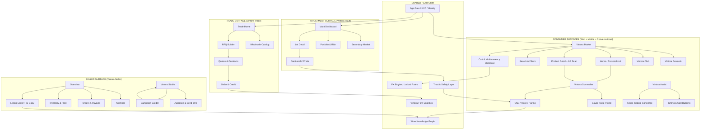
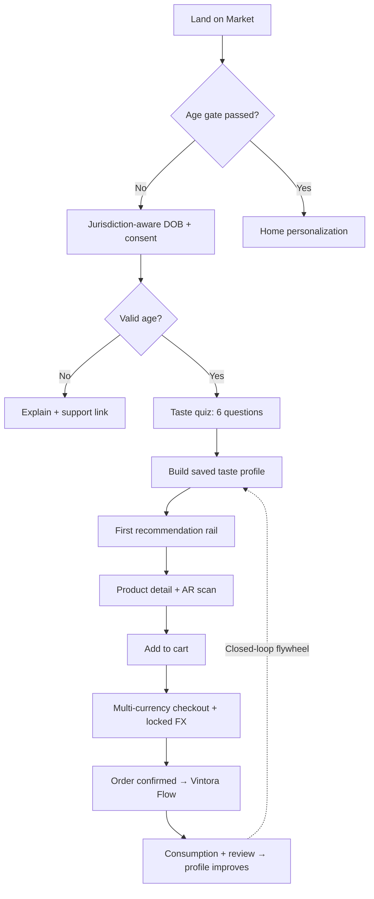
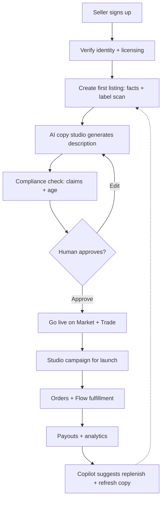
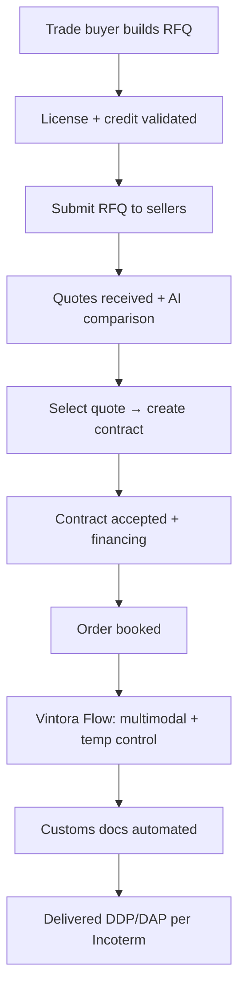
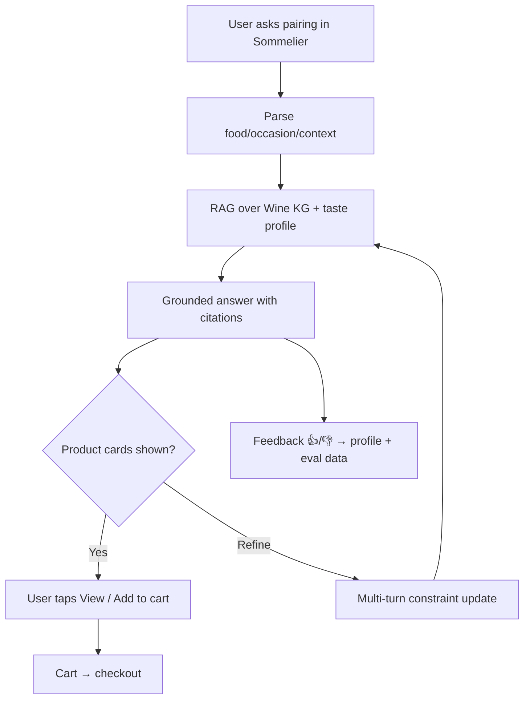

# VINTORA — UI/UX Wireframes & Design System

**Document:** `05-ui-ux-wireframes.md` · **Owner:** Product Design (CDO office) · **Status:** v1.0 · **Companion:** `06-ai-features.md`

> **Purpose.** This is the single interaction-design reference for Vintora — the design system, information architecture, screen wireframes, flows, and research/design-ops practice that turn the canon into something a person can actually use. It is written for product managers, engineers, and designers working across the three client surfaces (web, mobile, conversational). Every screen here is a *specification of intent*: layout hierarchy, states, and the exact point where AI enters. Pixel values live in the token table; behavior lives in `06-ai-features.md`.

---

## Canon snapshot (binding)

| Fact | Value used in this doc |
|---|---|
| Umbrella brand / tagline | **Vintora** — *The World's Cellar, Intelligent.* |
| Mission | Democratize discovery, trade, and enjoyment of fine wine and spirits through applied AI — protecting provenance, safety, responsible consumption. |
| Founded / HQ | 2026 · Dual HQ **Singapore + New York City**; hubs London, Paris, Amsterdam, Dubai, Tokyo, Sydney, São Paulo, Cape Town. |
| Modules (exact names) | Vintora **Market**, **Trade**, **Sommelier**, **Assist**, **Studio**, **Seller**, **Flow**, **Club**, **Vault**, **Rewards** |
| Web / mobile stack | Next.js 15 App Router, TypeScript, RSC, Turborepo · React Native (Expo), shared design system, iOS + Android |
| Conversational surfaces | Web/mobile chat, WhatsApp, Messenger, voice (Alexa/Google Assistant), in-app AR label scan |
| Localization | **24 launch languages → 60+ by 2030**; **135+ currencies**; RTL (Arabic, Hebrew) |
| Club tiers | **$29 / $59 / $119 / $199** per month — Good / Better / Best / Icon |
| Seller tiers | **Free → $99 → $399 → $999** per month + 0.5–2% processing |
| Studio tiers | **$199 / $599 / $2,999** per month — Creator / Brand / Enterprise + usage credits |
| Vault fees | **1.5% buy / 2% sell**, **0.5% p.a. custody**, **5–15% performance fee above high-water mark**, fractional minimum **$25** |
| Scale | 10M SKU target · 250k producers · 200+ countries · 40+ licensed warehouses · 4.5B embeddings · 300M graph edges |
| Compliance | Age verification (global), KYC/AML, licensing per jurisdiction, GDPR/CCPA/LGPD/PIPL, responsible-drinking guardrails |

**Do not contradict the canon.** Where a screen shows a price, tier, fee, or module name, use the values above. Detailed AI behavior is specified in `06-ai-features.md`; commercial context in `01-business-plan.md`; investor framing in `10-investor-pitch-deck.md`.

---

## 1. Design philosophy

Vintora is a **premium marketplace that happens to be intelligent**, not an AI demo with a shopping cart. The interface must feel like a well-run wine shop with a brilliant sommelier behind the counter — calm, literate, unhurried — while the machine does enormous work silently. Five principles govern every surface:

1. **Warmth before wow.** Burgundy and cream, generous whitespace, serif display type. The emotional register is a cellar door in Bordeaux, not a fintech dashboard.
2. **Knowledge made approachable.** A first-time buyer and a Master Sommelier share the same product; the interface adapts depth, never condescends. Explanations are available, never forced.
3. **Trust is visible.** Provenance, age-gate, locked FX rate, custody, and responsible-drinking cues are shown *in context* at the moment of decision, not buried in a legal footer.
4. **AI is a collaborator with a name.** Vintora Sommelier and Vintora Assist appear as identifiable agents with provenance citations and an "why this?" affordance — never as an anonymous magic box.
5. **Compliance is a design material.** Age assurance, licensing, and responsible-drinking nudges are composed into flows as first-class UI states (see §4, screen 1; `06-ai-features.md` §12).

The product serves five distinct user postures: **consumer buyer**, **seller/merchant**, **trade buyer (HoReCa)**, **vault investor**, and **sommelier/enthusiast**. The design system is shared; the information architecture branches by posture.

---

## 2. Design system foundations

### 2.1 Brand personality

| Trait | How it shows up | Anti-pattern to avoid |
|---|---|---|
| **Premium** | Restrained palette, serif display, high whitespace ratio (≥ 40% on hero surfaces), no loud badges | Discount-site red, countdown timers, clutter |
| **Warm** | Cream canvas, burgundy accents, rounded-but-tailored corners, human copy |Cold grays, corporate blue, robotic tone |
| **Knowledgeable** | Tasting vocabulary, producer stories, provenance chain, citations in AI answers | Fake expertise, unexplained jargon, generic "You may also like" |
| **Trustworthy** | Locked-rate disclosure, visible custody chain, age/KYC states, source links | Hidden fees, ambiguous pricing, unattributed claims |

Copy voice: declarative, specific, quietly confident. "Single vineyard, 2019. Black cherry, cedar, fine tannin." Not "This amazing wine is super delicious!"

### 2.2 Color tokens

| Token | Hex | Role | Light-mode use | Dark-mode use |
|---|---|---|---|---|
| `color/burgundy/900` | **#5B1A2B** | Primary brand | Primary buttons, active nav, headers | Raised surfaces, primary buttons (light text) |
| `color/cream/50` | **#F7F1E6** | Canvas | Page background, card fill | Text on burgundy, subtle accents |
| `color/gold/500` | **#C9A227** | Accent / reward | Rewards, tier marks, highlights, focus ring accents | Tier marks, AI sparkle, CTA accents |
| `color/charcoal/900` | **#1C1917** | Text / ink | Primary text, dark surfaces | Page background (not pure black) |
| `color/sage/600` | **#6B7A5E** | Support / success-adjacent | Eco/sustainability cues, "in stock", positive deltas | Secondary accents, positive deltas |

Derived scales (illustrative): burgundy 100–900, cream 50–700, gold 100–700, charcoal 100–900, sage 100–700, plus semantic `success` (sage-based), `warning` (amber), `danger` (brick), `info` (slate). All semantic pairs are checked for **WCAG 2.2 AA** contrast (≥ 4.5:1 body, ≥ 3:1 large text/UI components). Gold is reserved for accents and never used as body text on cream (insufficient contrast) — gold text sits on charcoal/burgundy only.

### 2.3 Typography

- **Display:** a licensed editorial serif — internally *Vintora Display* (fallback stack: `Georgia, "Playfair Display", serif`). Used for page titles, wine names, tier names, prices in hero positions. Tight leading (1.05–1.15), negative tracking on large sizes.
- **UI / body:** a humanist sans — *Vintora Sans* (fallback: `Inter, "Helvetica Neue", Arial, sans-serif`). Used for navigation, controls, data, chat, tables.
- **Numeric:** tabular figures for prices, quantities, portfolio values, RFQ counts.
- **Scale (rem):** 0.75 / 0.875 / 1 / 1.125 / 1.375 / 1.75 / 2.25 / 3 / 4 / 5.25. Display weights 400/500; UI weights 400/500/600/700.
- **Reading measure:** 60–75 characters for editorial and AI answers; 45–60 for chat bubbles.

### 2.4 Spacing, radius, elevation

- **Spacing scale (px):** 0, 2, 4, 8, 12, 16, 24, 32, 48, 64, 96, 128. 8px baseline grid; 4px half-steps for optical alignment.
- **Radius:** 2 (tags), 6 (inputs, buttons), 12 (cards), 20 (modals/sheets), 9999 (pills, avatars). Premium surfaces favor restrained 12px corners — not bubbly 24px.
- **Elevation:** `e0` flat (border only), `e1` subtle card lift, `e2` dropdown/popover, `e3` modal, `e4` overlays. Shadows use low-opacity charcoal with a slight warm tint, never black. Elevation communicates hierarchy, never decoration.

### 2.5 Iconography

Custom 24px grid, 1.5px stroke, rounded caps, optical alignment to the baseline. Outline is default; filled variant marks active/selected states. Domain-specific glyphs (grape cluster, decanter, barrel, thermometer, custody seal, RFQ document, cork, glass) are drawn once in the shared icon package and reused across web/mobile/chat. No emoji in UI chrome; emoji allowed only in user-generated content and optional chat reactions. Every icon has an accessible name.

### 2.6 Motion

| Token | Duration | Use |
|---|---|---|
| `motion/instant` | 120ms | Hover, focus, toggle |
| `motion/standard` | 200ms | Micro-transitions, tab changes |
| `motion/deliberate` | 320ms | Sheet/drawer, card expand |
| `motion/ambient` | 480ms | Hero reveal, onboarding progression |

Easing: `cubic-bezier(0.2,0,0,1)` for entrances, `cubic-bezier(0.4,0,0.2,1)` for standard. AI "thinking" uses a restrained three-dot pulse and a shimmer on skeleton cards — no fake typewriter effect. `prefers-reduced-motion` disables transforms and parallax, keeping opacity fades ≤ 120ms.

### 2.7 Accessibility (WCAG 2.2 AA)

- Contrast: 4.5:1 text, 3:1 UI components/graphics; gold never on cream for text.
- **Target size (2.5.8):** ≥ 24×24 CSS px for all interactive targets (44×44 on touch).
- **Focus not obscured (2.4.11):** visible 2px gold/charcoal focus ring, scroll-margin reserved.
- **Dragging movements (2.5.7):** sliders, comparison handles, and map routes have keyboard/button alternatives.
- **Consistent help (3.2.6)** and **redundant entry (3.3.7):** persistent help affordance; never re-ask age/address data already captured.
- Semantic landmarks, labeled form fields with persistent labels (no placeholder-only), live regions for cart totals and chat responses, error summaries with anchors.
- Screen-reader labels for wine label images include vintage, producer, and appellation from the knowledge graph — not "image 12".
- Color is never the sole carrier of meaning (tier, stock, risk use icon + text).

### 2.8 Dark mode

A token inversion, not a stylesheet fork. Canvas becomes charcoal `#1C1917` (softened to `#211E1B` for elevation) with cream text; burgundy shifts to a lighter `#7A2A3E` for interactive fills so it stays legible on dark; gold remains the accent. Imagery gets a subtle luminance reduction. User preference follows OS with a manual override persisted per account. All contrast pairs re-audited for dark mode.

### 2.9 RTL & localization readiness

All layouts use CSS logical properties (`inline-start`, `margin-inline`, `padding-inline`) so Arabic and Hebrew mirror automatically: nav rails flip, chevrons reverse, stepper advances right-to-left, charts re-order. Numbers use Latin digits by default with locale-aware separators; Hijri dates optional in Arabic locales. The AR label-scan reticle and wine-label component handle mixed Latin/Arabic script without truncation. Currency amounts always show the ISO code alongside the symbol to avoid ambiguity across the 135+ supported currencies.

---

## 3. Information architecture



The IA deliberately makes **Vintora Sommelier** and **Vintora Assist** reachable from discovery, PDP, cart, and support rather than as a siloed "AI tab" — conversational entry is a posture, not a destination. **Vintora Flow** and the trust layer sit underneath all four commercial surfaces.

---

## 4. Screen wireframes

Each wireframe is annotated with numbered callouts, explicit states, and the AI touchpoint. Wireframes use desktop composition unless noted; mobile parity is addressed in §7.

### Screen 1 — Onboarding / age gate

```
┌──────────────────────────────────────────────────────────────────┐
│  VINTORA  ·  The World's Cellar, Intelligent.      [EN ▾] [$$$ ▾] │ ①
├──────────────────────────────────────────────────────────────────┤
│                                                                  │
│              ┌────────────────────────────────────┐             │
│              │        V I N T O R A               │             │
│              │   Welcome to the world's cellar.   │             │
│              │                                    │             │
│              │  You must be of legal drinking age │             │
│              │  in your jurisdiction to enter.    │             │ ②
│              │                                    │             │
│              │  Country/Region: [Singapore    ▾]  │             │ ③
│              │  Date of birth:  [DD] [MM] [YYYY]  │             │ ④
│              │                                    │             │
│              │  ☐ I agree to Terms & Privacy      │             │
│              │  ☐ Remember this device            │             │
│              │                                    │             │
│              │      [ Enter Vintora  → ]           │             │ ⑤
│              │   Verification takes ~20 seconds.  │             │
│              └────────────────────────────────────┘             │
│     🔒 Age verification · KYC/AML · Responsible drinking         │ ⑥
└──────────────────────────────────────────────────────────────────┘
```

**Callouts.** ① Language/currency switchers available pre-gate (localization is a right, not a post-entry perk). ② The gate states *why*, in plain language; legal copy expands on demand. ③ Jurisdiction selection drives the legal age and licensing rules — the DOB validator is jurisdiction-aware (e.g., 18/19/21). ④ DOB uses three labeled selects, not a free-text date, to prevent ambiguous formats across locales. ⑤ Primary CTA is enabled only when a valid age + consent are present; progressive disclosure avoids a wall of forms. ⑥ Trust strip names age verification, KYC/AML, and responsible drinking at the threshold — the compliance posture is part of the brand.

**States.** *Empty* — pristine form. *Loading* — inline spinner in CTA with "Verifying…" and a retained DOB. *Error* — field-level message ("You must be 21+ in the United States") plus a link to support; no shaming. *Success* — a one-frame confirmation then transition to taste quiz (screen 2) or home for returning users.

**AI touchpoint.** Trust & safety age-assurance models assess the DOB/jurisdiction signal and device signals for anomaly (see `06-ai-features.md` §12); no AI decisions are shown to the user — the outcome is a normal state transition.

### Screen 2 — Home personalization

```
┌──────────────────────────────────────────────────────────────────┐
│ VINTORA | Market  Trade  Club  Vault | 🔍 Search | Sommelier ✦ |👤 │ ①
├──────────────────────────────────────────────────────────────────┤
│  Good evening, Amelia.                    [Taste profile: 82% ▸] │ ②
│  ┌────────────────────────────────────────────────────────────┐  │
│  │  YOUR CELLAR, CURATED TODAY        "Why these?" ✦          │  │ ③
│  │  ┌────────┐ ┌────────┐ ┌────────┐ ┌────────┐ ┌────────┐   │  │
│  │  │ 🍷 Img │ │ 🍷 Img │ │ 🍷 Img │ │ 🍷 Img │ │ 🍷 Img │   │  │ ④
│  │  │ Barolo │ │ Chablis│ │ Rioja  │ │ Riesling│ │ Malbec │   │  │
│  │  │ $58    │ │ $42    │ │ $36    │ │ $29    │ │ $24    │   │  │
│  │  │ ★4.8   │ │ ★4.7   │ │ ★4.6   │ │ ★4.9   │ │ ★4.5   │   │  │
│  │  └────────┘ └────────┘ └────────┘ └────────┘ └────────┘   │  │
│  │  [See all 24 picks →]                                       │  │
│  └────────────────────────────────────────────────────────────┘  │
│  ┌───────────────────────────┐ ┌───────────────────────────────┐ │
│  │ Ask Vintora Sommelier ✦   │ │ Tonight's pairing             │ │ ⑤
│  │ "What goes with lamb?"    │ │ Herb-crusted lamb · Barolo   │ │
│  │ [ type… ]           [➤]  │ │ [Pair this meal →]            │ │
│  └───────────────────────────┘ └───────────────────────────────┘ │
│  Vintora Club: your Better box ships Sep 12  [Manage ▸]         │ ⑥
└──────────────────────────────────────────────────────────────────┘
```

**Callouts.** ① Global nav exposes the four postures (Market/Trade/Club/Vault) plus a persistent Sommelier entry. ② Greeting + "Taste profile 82%" is a *confidence* indicator that invites refinement, never a grade. ③ "Why these?" is the explainability affordance — opens a plain-language rationale with citations to the knowledge graph. ④ Product cards lead with image, appellation, price, rating; a small ✦ badge marks AI-selected picks. ⑤ Two conversational entry points: an inline chat composer and a context card that pre-fills a pairing question. ⑥ Subscription status is surfaced on home to reduce support queries and drive retention.

**States.** *Empty* (new user) — taste quiz card replaces the recommendation rail. *Loading* — skeleton cards with shimmer in the same grid. *Error* — "We couldn't refresh your picks" with retry; last successful list is retained. *Success* — populated rails with a subtle entrance fade.

**AI touchpoint.** The taste-profile recommender (two-tower + transformers) and Vintora Sommelier ranking produce the rail; every pick carries a grounded rationale. See `06-ai-features.md` §§3–4.

### Screen 3 — Sommelier chat

```
┌──────────────────────────────────────────────────────────────────┐
│ ← Back   Vintora Sommelier ✦        [Voice ●] [Clear] [⋯]        │ ①
├──────────────────────────────────────────────────────────────────┤
│                                                                  │
│  🍷  You: What should I serve with herb-crusted lamb in autumn?  │
│                                                                  │
│  ✦  Sommelier: For herb-crusted lamb, a medium-bodied Nebbiolo   │
│     is ideal — the rose and tar notes echo the herbs, while      │
│     firm tannin cuts the fat. Two options in your range:          │
│     • Barolo 2019, Serralunga — $58  [View]                       │ ②
│     • Barbera d'Asti 2021 — $28  [View]                          │
│     Sources: Wine KG · 3 critic notes · your taste profile       │ ③
│     [👍] [👎] [Copy] [Add both to cart]            "Why?" ▸       │ ④
│                                                                  │
│  🍷  You: Make it a vegan, under-$40 bottle.                      │
│  ✦  Sommelier: Updating… I'll exclude animal-finings methods.    │ ⑤
│                                                                  │
├──────────────────────────────────────────────────────────────────┤
│  Ask about pairing, taste, regions, or occasions…      [🎙] [➤]  │ ⑥
│  Suggestions: [Under $40] [Vegan] [Gift for a chef] [Whisky 101]  │
└──────────────────────────────────────────────────────────────────┘
```

**Callouts.** ① Voice toggle and Clear are always available; the agent has a consistent identity. ② Answers end in tappable product cards, so conversation converts without leaving the thread. ③ Every answer carries a source strip (knowledge graph, critic corpus, taste profile) — citations are a trust feature, not debug output. ④ Feedback controls feed the closed-loop data flywheel; "Add both to cart" is the conversational-commerce handoff. ⑤ Multi-turn context is visible ("Updating…") and the agent restates constraints, proving it remembered. ⑥ Composer supports text and voice; chips seed common intents for fast first-time use.

**States.** *Empty* — greeting with four suggestion chips. *Loading* — three-dot pulse + "Consulting the cellar…". *Error* — "I lost that thread — what were we pairing?" with retry, preserving last user message. *Success* — formatted answer with citations and product actions.

**AI touchpoint.** Full RAG over the Wine Knowledge Graph with multi-turn memory, food/occasion/weather context, multilingual output, and voice ASR/TTS. Detailed pipeline in `06-ai-features.md` §§3, 17.

### Screen 4 — Product detail with AR label scan

```
┌──────────────────────────────────────────────────────────────────┐
│ ← Market / Italy / Piedmont      [Share] [♡ Save] [⚖ Compare]     │ ①
├──────────────────────────────┬───────────────────────────────────┤
│  ┌────────────────────────┐  │ Barolo DOCG 2019                  │ ②
│  │                        │  │ Fontanafredda · Serralunga d'Alba │
│  │      [ WINE LABEL ]    │  │ ★★★★★ 4.8 (1,204) · 94 pts        │
│  │      IMG / AR TARGET   │  │ $58.00  USD  [Locked rate ▸]      │ ③
│  │                        │  │ ───────────────────────────────── │
│  │  [ 📷 Scan label ] ✦   │  │ 🍒 Black cherry · cedar · tannin  │ ④
│  └────────────────────────┘  │ Producer → Vineyard → Vintage →   │
│  [◀] [1/6] [▶]   [🔍 Zoom]   │ Bottle → Custody  [Verify chain▸] │ ⑤
│                              │ ───────────────────────────────── │
│                              │ Qty [− 1 +]  [ Add to cart ]     │ ⑥
│                              │ 🚚 Arrives Sep 18–20 · Flow       │
│                              │ ⚠ Please enjoy responsibly · 21+ │ ⑦
└──────────────────────────────┴───────────────────────────────────┘
        ┌──────────────── AR SCAN OVERLAY ────────────────┐
        │  ▌ ▌      ⌖  ALIGN LABEL IN FRAME    ▌ ▌         │ ⑧
        │       [ shutter ]   Reading front label…        │
        │  Detected: Barolo · 2019 · Fontanafredda  ✓     │ ⑨
        │  [Match to listing] [Translate] [Check provenance]│
        └──────────────────────────────────────────────────┘
```

**Callouts.** ① Breadcrumb, save, and compare support non-linear evaluation. ② Serif display for the wine name; rating and critic score are separate signals. ③ Price shows ISO currency plus locked-rate disclosure before the user reaches checkout. ④ Tasting notes are structured tags from the knowledge graph, not unstructured prose only. ⑤ The provenance chain is a visible, expandable component — a core differentiator made tangible. ⑥ Quantity + persistent add-to-cart. ⑦ Responsible-drinking and age cue on the transactional surface. ⑧ AR scan is a first-class mode over the label image, with a reticle and progress. ⑨ Vision result is shown as *detected* (with confidence), then offered as actions: match, translate, verify.

**States.** *Empty* — no scan, standard PDP. *Loading* — AR overlay with scanning progress. *Error* — "Couldn't read the label — try more light or fill the frame" with manual entry fallback. *Success* — detected fields with a confidence badge and match actions.

**AI touchpoint.** Label OCR/translation, provenance verification, and counterfeit/condition grading via computer vision; the matched result links back to the knowledge graph. See `06-ai-features.md` §6.

### Screen 5 — Search / filter results

```
┌──────────────────────────────────────────────────────────────────┐
│ 🔍 "barolo under $60"             [🎙 Voice] [✦ Ask Sommelier]    │ ①
├──────────────┬───────────────────────────────────────────────────┤
│ FILTERS      │ 1,284 results · Sorted: Relevance ▾   [Grid|List] │ ②
│ Region ▾     │ ┌───────────────────────────────────────────────┐ │
│  ☑ Piedmont  │ │ ✦ BEST MATCH  Barolo 2019 · $58 · ★4.8        │ │ ③
│  ☐ Tuscany   │ │    Serralunga · full-bodied · [Why? ▸]        │ │
│ Vintage ▾    │ ├───────────────────────────────────────────────┤ │
│ Price  [──●] │ │ Barolo 2020 · $52 · ★4.6  [♡]  [⚖ Compare]    │ │ ④
│ $0 – $60     │ ├───────────────────────────────────────────────┤ │
│ Body  ▾      │ │ Barbaresco 2019 · $49 · ★4.7                  │ │
│ Grapes ▾     │ └───────────────────────────────────────────────┘ │
│ ☐ Vegan      │ [Load more]  or  [Refine with Sommelier ✦]        │ ⑤
│ [Clear all]  │                                                   │
└──────────────┴───────────────────────────────────────────────────┘
```

**Callouts.** ① Search accepts natural language ("barolo under $60") and voice; "Ask Sommelier" hands the query to conversation rather than fighting it. ② Result count + sort + view toggle are above the fold. ③ The top result is explicitly labeled "Best match" with an explainable "Why?" — ranking is transparent. ④ Compare and save are available per row; filters are faceted and cumulative. ⑤ "Refine with Sommelier" converts a sterile filter session into a guided one.

**States.** *Empty* — "No bottles match all filters" with the least-restrictive filter highlighted for relaxation. *Loading* — skeleton rows. *Error* — "Search is unavailable — try again" with last results cached. *Success* — ranked results with facets applied.

**AI touchpoint.** Semantic search over OpenSearch + embeddings, with the recommender supplying "Best match"; Vintora Assist can interpret the natural-language query into filters. See `06-ai-features.md` §§4–5, 16.

### Screen 6 — Cart & multi-currency checkout

```
┌──────────────────────────────────────────────────────────────────┐
│ ← Cart                                        [Secure 🔒]         │
├────────────────────────────────────┬─────────────────────────────┤
│ YOUR BASKET (3)                    │ ORDER SUMMARY               │ ①
│ 🍷 Barolo 2019        $58.00  [×]  │ Subtotal        $139.00     │
│ 🍷 Chablis 2022       $42.00  [×]  │ Shipping (Flow)  $18.00     │
│ 🍷 Rioja Reserva      $39.00  [×]  │ Duties & taxes  $12.40   ⓘ  │ ②
│                                    │─────────────────────────────│
│ ✦ Assist: Add a $25 Rioja to       │ TOTAL           $169.40 USD │
│   reach free shipping? [Add] [No]  │ 🔒 Rate locked: 1 USD =      │ ③
│                                    │    1.35 SGD · valid 14:32   │
│ GIFT OPTIONS  [Add gift message ▸] │ [ SGD v ] [Change currency] │ ④
│ DELIVERY  [Standard | Express]     │                             │
│                                    │ [ Continue to payment → ]   │ ⑤
│ Age at delivery: 21+ · ID required │ Visa · Alipay · Pix · UPI … │ ⑥
└────────────────────────────────────┴─────────────────────────────┘
```

**Callouts.** ① Basket and summary are two columns on desktop, stacked on mobile. ② Duties/taxes are itemized with an info popover — landed cost is never a surprise (critical for 200+ countries). ③ The FX engine shows a **locked rate with expiry** and the ISO pair; this is the multi-currency trust moment. ④ Currency switcher recalculates the whole summary; local payment methods are listed. ⑤ Single primary CTA. ⑥ Age-at-delivery and accepted local methods are explicit.

**States.** *Empty* — "Your basket is empty" + personalized starter rail. *Loading* — rate recalculation shimmer on the summary. *Error* — "Rate expired — refresh to continue" with a one-tap refresh; or "Item no longer available" with remove/replace. *Success* — payment sheet with order confirmation.

**AI touchpoint.** Vintora Assist suggests a cross-sell to reach a shipping threshold; dynamic promotion logic may apply a personalized offer within brand guardrails. See `06-ai-features.md` §§5, 7.

### Screen 7 — Vintora Club subscription picker

```
┌──────────────────────────────────────────────────────────────────┐
│  VINTORA CLUB — your cellar, on a schedule                       │ ①
│  Curated monthly boxes. Skip or cancel anytime.                  │
│  ┌──────────┬──────────┬──────────┬──────────┐                   │
│  │ GOOD     │ BETTER ✓ │ BEST     │ ICON     │                   │ ②
│  │ $29/mo   │ $59/mo   │ $119/mo  │ $199/mo  │                   │
│  │ 2 bottles│ 3 bottles│ 4 bottles│ 6 bottles│                   │
│  │ + notes  │ + notes  │ + premium│ + rare   │                   │
│  │          │          │ + live   │ + concierge│                 │ ③
│  │ [Choose] │ [Current]│ [Choose] │ [Choose] │                   │
│  └──────────┴──────────┴──────────┴──────────┘                   │
│  Taste preferences: [Bold reds] [Minerally whites] [+ Edit ✦]    │ ④
│  Next box: Sep 12 · [Skip this month] [Pause] [Change tier]      │ ⑤
│  ✦ Sommelier: "Based on your profile, Better is your best value."│ ⑥
└──────────────────────────────────────────────────────────────────┘
```

**Callouts.** ① Club is framed as curation + ritual, not a discount subscription. ② Four canon tiers with exact prices and bottle counts. ③ Features escalate by tier; the current tier is marked. ④ Taste preferences auto-populated from the saved profile, editable with a Sommelier assist. ⑤ Retention controls (skip/pause/change) are prominent to reduce churn and support contacts. ⑥ A grounded recommendation explains tier value.

**States.** *Empty* — first-time picker with quiz prompt. *Loading* — plan cards shimmer during plan-data fetch. *Error* — "Couldn't load your next box" with retry. *Success* — confirmation with ship date and a "What's inside" preview.

**AI touchpoint.** Recommender selects tier and box contents from taste profile; Sommelier explains value. See `06-ai-features.md` §§3–4.

### Screen 8 — Vintora Vault dashboard & lot detail

```
┌──────────────────────────────────────────────────────────────────┐
│ VINTORA VAULT · Portfolio               [USDC settle] [Explore]   │ ①
├────────────────────────────────────┬─────────────────────────────┤
│ PORTFOLIO VALUE        $48,250     │ LOT: 2010 Château X (12btl) │ ⑤
│ ▲ 6.4% YTD   [Chart: 12mo]         │ ┌─────────────────────────┐ │
│  ┌──────────────────────────────┐  │ │  Custody: Geneva ✓      │ │ ⑥
│  │        ╱╲    ╱╲___           │  │ │  Condition: 94/100      │ │
│  │   ___╱   ╲__╱                 │  │ │  Provenance: 5/5 links ✓│ │
│  └──────────────────────────────┘  │ └─────────────────────────┘ │
│ HOLDINGS                           │ Last trade $4,050 · +8.2%   │ ⑦
│ 2010 Château X   $18,900  ▸       │ Liquidity score: 82/100     │ ⑧
│ 2015 Barolo Y    $12,100  ▸       │ [ Buy fraction $25+ ]       │ ⑨
│ 2018 Champagne Z $9,300   ▸       │ [ Sell ] [Add to watchlist] │
│ [Discover lots ✦]                  │ Fees: 1.5% buy · 2% sell ·   │ ⑩
│                                    │ 0.5% p.a. · 5–15% perf      │
└────────────────────────────────────┴─────────────────────────────┘
```

**Callouts.** ① Vault is visually distinct (darker, data-forward) but still on-system; USDC settlement is explicit. ② Portfolio value and chart lead; performance uses tabular figures. ③ Holdings list with drill-in. ④ "Discover lots" is the AI discovery entry. ⑤ Lot detail pairs financial and physical attributes. ⑥ Custody, condition, and provenance are the trust triad for fine-wine investment. ⑦ Comparable last-trade data. ⑧ **Liquidity score** is an AI-generated signal with an explainable tooltip. ⑨ Fractional minimum **$25** is shown exactly. ⑩ Fee schedule is stated on the lot — 1.5% buy / 2% sell / 0.5% custody / 5–15% performance above high-water mark.

**States.** *Empty* — "Start with a $25 fraction" + curated lots. *Loading* — chart skeleton, holdings shimmer. *Error* — "Price feed delayed — showing last close" with timestamp. *Success* — live portfolio with validated custody data.

**AI touchpoint.** Price prediction, comparables, liquidity scoring, portfolio risk, and wash-trade/fraud detection. See `06-ai-features.md` §11.

### Screen 9 — Vintora Seller overview

```
┌──────────────────────────────────────────────────────────────────┐
│ VINTORA SELLER   Maison Rivière        [Store ▾] [+ New listing] │ ①
├──────────────────────────────────────────────────────────────────┤
│ TODAY   Orders 42 ▲  GMV $6,840 ▲  Conversion 3.8% ▼            │ ②
│ ┌───────────────────────┬───────────────────────────────────────┐│
│ │ SALES (14d) [chart]   │ ✦ COPILOT: 3 listings need fresh      ││ ③
│ │      ╱╲   ╱╲          │   copy. 2 prices below market.        ││
│ │  ___╱  ╲_╱  ╲__       │   [Review suggestions →]              ││
│ └───────────────────────┴───────────────────────────────────────┘│
│ ACTIONS NEEDED                    │ QUICK LINKS                  │
│ ⚠ 6 SKUs low stock  [Replenish]   │ [Listings] [Inventory]       │ ④
│ ⚠ 2 orders awaiting ship [Flow]   │ [Orders] [Payouts] [Studio]  │
│ ✓ Payout $4,200 arriving Fri      │ [Analytics] [Trade RFQs]     │
└──────────────────────────────────────────────────────────────────┘
```

**Callouts.** ① Workspace switcher and a persistent "New listing" CTA. ② Daily KPIs with direction. ③ Seller-ops copilot surfaces *actions*, not dashboards — "3 listings need fresh copy" ties directly to Studio. ④ Action-needed queue integrates Flow for fulfillment. Plan tier (Free/$99/$399/$999) is reflected in a subtle badge, with upgrade prompts only where a feature is gated.

**States.** *Empty* — onboarding checklist for a new seller. *Loading* — metric skeletons. *Error* — "Analytics delayed — showing yesterday" with timestamp. *Success* — live KPIs and action queue.

**AI touchpoint.** Seller-ops copilot, demand signals, and pricing suggestions (within brand guardrails). See `06-ai-features.md` §§7–8, 14.

### Screen 10 — Vintora Seller listing editor with AI copy

```
┌──────────────────────────────────────────────────────────────────┐
│ ← Listings / Edit: "Rioja Reserva 2018"      [Preview] [Save draft]│ ①
├────────────────────────────────────┬─────────────────────────────┤
│ PRODUCT FACTS                      │ AI COPY STUDIO ✦            │ ②
│ Name: Rioja Reserva 2018           │ Tone: [Warm ▾] Len: [Short▾] │
│ Producer: Bodega Rivière           │ Language: [English ▾]       │
│ Region: Rioja · Appellation: DOCa  │ ─────────────────────────── │
│ Vintage: 2018 · Grapes: Tempranillo│ "A Reserva of quiet power — │ ③
│ ABV: 14% · Volume: 750 ml          │  dark cherry, leather, and  │
│ Price: $36 USD · Stock: 120        │  a long, spiced finish."    │
│ [ Upload label ] [Scan label ✦]    │ [Regenerate] [Tone] [Translate]│
│                                    │ Sources: fact sheet · KG ·   │ ④
│                                    │  prior reviews ✓  [Why? ▸]  │
│                                    │ ⚠ Claims checked: no health  │
│                                    │   claims · age-appropriate   │ ⑤
├────────────────────────────────────┴─────────────────────────────┤
│ [ Save & continue ]                                  [ Go live → ]│ ⑥
└──────────────────────────────────────────────────────────────────┘
```

**Callouts.** ① Two-path exit: save draft or publish. ② AI copy is a *side-by-side studio*, not an overwrite — the seller retains control (human-in-the-loop). ③ Generated description cites tone and length controls. ④ Source strip and "Why?" show grounding in the fact sheet, knowledge graph, and prior reviews. ⑤ Compliance checker blocks health claims and flags age-inappropriate language. ⑥ "Go live" is gated on required facts + compliance pass.

**States.** *Empty* — blank facts with "Scan label to autofill ✦". *Loading* — generation shimmer with "Writing…". *Error* — "Couldn't verify a claim — edit or remove it" with inline highlight. *Success* — copy accepted, preview updates, publish enabled.

**AI touchpoint.** Studio generative copy with brand-voice controls, vision autofill from label scan, and compliance checks. See `06-ai-features.md` §§6, 10.

### Screen 11 — Vintora Trade RFQ screen

```
┌──────────────────────────────────────────────────────────────────┐
│ VINTORA TRADE   RFQ-20481        [Draft] [Save] [Submit →]        │ ①
├────────────────────────────────────┬─────────────────────────────┤
│ BUYER: Le Petit_TABLE, Paris       │ LINE ITEMS                  │ ⑤
│ License: FR-HOReCa-8821 ✓         │ 1. Chablis 2022   120 btl    │
│ Credit: Approved $80k             │ 2. Rioja Reserva   60 btl    │
│ Incoterm: DDP Paris                │ 3. Barolo 2019     24 btl    │
│ Delivery: Oct 12 (window ±3d)      │ + Add line [Search catalog] │
│ ─────────────────────────────────  │ ─────────────────────────── │
│ NOTES                              │ EST. TOTAL  $11,940         │ ⑥
│ "Need temperature-controlled       │ ✦ Suggested alternative for │
│  delivery; invoice in EUR."        │  item 3 saves $420 [View]   │ ⑦
│ ─────────────────────────────────  │ ─────────────────────────── │
│ ✦ TRADE COPILOT                    │ QUOTES RECEIVED: 3 / 5      │ ⑧
│ "Your window is tight for DDP;     │ [Compare quotes ⚖]          │
│  consider Incoterm DAP." [Apply]   │ [Create contract →]         │ ⑨
└────────────────────────────────────┴─────────────────────────────┘
```

**Callouts.** ① RFQs carry a status lifecycle (Draft → Submitted → Quoted → Contract → Order). ② Buyer license, KYC, and credit are validated inline — compliance is visible to the trade user. ③ Incoterm and delivery window are structured fields feeding Vintora Flow. ④ Free-text notes capture constraints. ⑤ Line items with catalog search and quantities. ⑥ Estimated total with currency. ⑦ Copilot suggests a cost-saving alternative within the buyer's taste/quality constraints. ⑧ Quote comparison is a first-class step. ⑨ Contract and order creation continue the B2B flow.

**States.** *Empty* — new RFQ with template prompts. *Loading* — quote aggregation shimmer. *Error* — "No sellers can meet the delivery window" with relaxation options. *Success* — quotes received, contract ready.

**AI touchpoint.** Trade copilot for Incoterm/delivery risk, quote aggregation, and alternatives; Flow estimates logistics. See `06-ai-features.md` §§5, 9, 14.

### Screen 12 — Vintora Rewards / tier screen

```
┌──────────────────────────────────────────────────────────────────┐
│ VINTORA REWARDS             [Points: 12,480] [Tier: Gold] [⋮]    │ ①
│┌──────────┬──────────┬──────────┬──────────┬────────────────────┐│
││ Bronze   │ Silver   │ Gold  ★  │ Platinum │ 12,480 / 20,000    ││ ②
││          │          │          │          │ ▓▓▓▓▓▓▓░░░ 7,520 to ││
│└──────────┴──────────┴──────────┴──────────┴── Platinum         ││
│ YOUR BENEFITS                        │ EARN MORE               │ ③
│ ✓ 2× points on Club boxes            │ [Book a tasting ✦]      │ ④
│ ✓ Early access to Vault lots         │ [Refer a friend]        │
│ ✓ Free standard delivery             │ [Complete a review +50] │
│ ✓ Birthday bottle                    │ [Partner offers]        │
│ EXPERIENCES                          │ HISTORY: 3,240 this mo   │ ⑤
│ [Harvest dinner · Bordeaux] [Winery trip · Rioja]               │
└──────────────────────────────────────────────────────────────────┘
```

**Callouts.** ① Points and tier are always visible. ② Progress bar with exact threshold to next tier; gold accent is reserved for tier marks (legible on dark/charcoal). ③ Benefits are concrete and checkmarked. ④ Personalized "earn more" actions, including a Sommelier-booked experience. ⑤ Experiences redeem points for memorable moments, not just discounts — reinforcing premium positioning.

**States.** *Empty* — new member with first-earn prompt. *Loading* — balance shimmer. *Error* — "Balance temporarily unavailable" with last known value. *Success* — redemption confirmation with experience details.

**AI touchpoint.** Personalized earn/redeem suggestions and partner matching; no sensitive inference is shown without user control. See `06-ai-features.md` §5.

### Screen 13 — Mobile tab bar + one mobile screen

```
┌─────────────────────────┐
│ VINTORA      🔍   ✦ SOM │ ①
├─────────────────────────┤
│ Good evening, Amelia    │
│ ┌─────────────────────┐ │
│ │ FOR YOU   [Why? ✦]  │ │ ②
│ │ ┌─────┐ ┌─────┐     │ │
│ │ │ 🍷  │ │ 🍷  │     │ │
│ │ │$58  │ │$42  │     │ │
│ │ └─────┘ └─────┘     │ │
│ │ [See all →]         │ │
│ └─────────────────────┘ │
│ ┌─────────────────────┐ │
│ │ ✦ Ask Sommelier     │ │ ③
│ │ "Pair dinner…" [➤] │ │
│ └─────────────────────┘ │
├─────────────────────────┤
│  ⌂      ⚖      ✦      ▣      👤  │ ④
│ Home  Search Sommelier Cellar  You │
└─────────────────────────┘
```

**Callouts.** ① Compact header; Sommelier icon is always in reach. ② Two-card "For You" rail optimized for a 390pt viewport; swipeable. ③ Persistent chat composer. ④ Five-tab bar: Home, Search, Sommelier, Cellar (saved/wishlist + Club + Vault shortcuts), You (account, Rewards, seller switch). 44×44 touch targets; safe-area aware; RTL mirrors the bar.

**States.** *Empty* — quiz card. *Loading* — skeleton cards. *Error* — cached picks + retry. *Success* — personalized rail.

**AI touchpoint.** Same recommender and Sommelier as web; parity is enforced by the shared design system (React Native + web share tokens and component contracts).

### Screen 14 — Vintora Studio campaign builder

```
┌──────────────────────────────────────────────────────────────────┐
│ VINTORA STUDIO   Campaign: "Autumn Reds"       [Save] [Schedule →]│ ①
├──────────────────────────────────┬───────────────────────────────┤
│ STEP 2 of 4 — CREATIVE           │ PREVIEW                       │ ②
│ ● Audience ● Creative ○ Send ○   │ ┌───────────────────────────┐ │
│ ────────────────────────────────  │ │  🍂 AUTUMN REDS           │ │
│ Channel: [Email ▾] [Push] [WhatsApp]│ │  Barolo · Rioja · Malbec  │ │ ③
│ Brand voice: [Warm ▾]             │ │  [ Shop the collection ]  │ │
│ ✦ Generate: [Copy] [Image] [Video]│ └───────────────────────────┘ │
│ ────────────────────────────────  │ ✦ Brand-voice score: 92/100  │ ④
│ SUBJECT LINES (AI)                │ ⚠ Compliance: age gate ✓      │
│ 1. "The cellar turns a page"  [✓] │   no health claims ✓         │
│ 2. "Cool nights, bold reds"  [ ]  │   region age-rules ✓         │ ⑤
│ [Regenerate] [Edit tone]          │                               │
│ AUDIENCE: "Bold-red lovers, 28–45"│ SEND-TIME ✦ Tue 18:40 local   │ ⑥
└──────────────────────────────────┴───────────────────────────────┘
```

**Callouts.** ① Campaign steps are explicit; Studio tiers (Creator $199 / Brand $599 / Enterprise $2,999) gate advanced features subtly. ② Stepper with progress. ③ Live multichannel preview. ④ Brand-voice score quantifies on-brand tone. ⑤ Compliance checker validates age gating, health-claim avoidance, and regional ad rules before scheduling — critical for alcohol marketing. ⑥ Send-time optimization is presented as a recommendation the user can override.

**States.** *Empty* — blank creative with generate prompts. *Loading* — generation progress with partial previews. *Error* — "Compliance check failed: phrase flagged" with inline highlight. *Success* — scheduled campaign with confirmation.

**AI touchpoint.** Studio generative copy/image/video, audience segmentation, brand-voice scoring, send-time optimization, and compliance checks. See `06-ai-features.md` §10.

---

## 5. Core user flows









---

## 6. Interaction patterns

- **Conversational commerce.** Chat is a first-class buying surface: answers terminate in product cards, cart actions, and "why?" explanations. Vintora Assist can build a cart from constraints ("a dinner for six, under $200, mostly French") and hand off to checkout. Conversation state is portable across web, mobile, WhatsApp, Messenger, and voice.
- **Voice.** Always opt-in and clearly indicated. Voice output for Sommelier and Assist, voice input for search and RFQ notes. Voice sessions surface a transcript for review; no purchase action is finalized by voice alone without confirmation.
- **AR label scan.** Point the camera at a bottle in a shop or cellar; OCR reads the label, translation renders it in the user's language, and provenance verification checks the chain. Results are *presented with confidence*, never asserted as fact. Manual entry is always available.
- **Comparison.** The ⚖ Compare tray holds up to four wines across price, body, region, rating, and provenance; keyboard-accessible, with tabular figures and a RTL-safe layout.
- **Saved taste profile.** A visible, editable model of preferences with a confidence score. Users can inspect, correct, export, or delete it. Every recommendation can be traced to a profile attribute via "Why?".
- **Gifting.** Gift message, delivery date, and recipient age assurance are built into cart; the giver never sees the recipient's DOB. Studio powers gift campaign creatives.
- **Social / shared cellars.** Users can curate shared lists and cellars with permissioned visibility; a shared cellar shows collective ratings and "cellar of the month." Privacy defaults to private.
- **Accessibility.** Every pattern above has a keyboard/screen-reader path: comparison via buttons, AR via manual entry and label alt-text, voice via typed equivalent, chat via live regions, drag interactions via alternatives (WCAG 2.5.7).

---

## 7. Localization & currency UX

| Concern | UX treatment |
|---|---|
| **Language switcher** | Available pre- and post-gate in the header; 24 launch languages → 60+ by 2030. Switching preserves cart, conversation history, and taste profile; content re-renders with localized tasting vocabulary from the knowledge graph. |
| **Currency switcher** | ISO code + symbol; 135+ currencies. Shows the locked rate pair (e.g., `1 USD = 1.35 SGD`) and an expiry countdown. Rate lock is refreshed on cart change; a expiry shows a one-tap refresh, never a silent repricing. |
| **Unit conversion** | Volume toggles ml / oz / cl with exact conversion; ABV and serving suggestions remain consistent. Case quantities (6×75cl) display in both formats. |
| **Date & number formats** | Locale-aware (`DD/MM/YYYY`, `MM/DD/YYYY`, etc.), tabular numerals, locale separators; vintage years are always four digits and never localized. Hijri calendar option in Arabic locales. |
| **Duties at checkout** | Landed cost itemized: subtotal, Flow shipping, duties & taxes, with an info popover explaining the jurisdiction's rules. No "surprise" charges at delivery across 200+ countries. |
| **RTL** | Logical properties mirror all layouts; Sommelier avatars and bubbles flip; charts and steppers reverse; mixed-script wine labels remain readable. |

---

## 8. Responsive breakpoints & device matrix

| Breakpoint | Width | Layout intent |
|---|---|---|
| `xs` | 360–479 | Mobile phone; single column, 5-tab bar, stacked checkout |
| `sm` | 480–767 | Large phone / small tablet portrait; 2-card rails |
| `md` | 768–1023 | Tablet; 2-column PDP, collapsible filter drawer |
| `lg` | 1024–1439 | Desktop; full multi-column IA, persistent compare tray |
| `xl` | 1440–1919 | Wide desktop; max content 1440px, generous margins |
| `xxl` | 1920+ | Large display; capped measure, centered canvas |

**Device matrix.** Web (Chrome/Safari/Firefox/Edge, last 2 versions), iOS (React Native Expo, iPhone + iPad, 15+), Android (Expo, API 28+), conversational (WhatsApp, Messenger, Alexa, Google Assistant), in-app AR (iOS ARKit / Android ARCore). Touch targets ≥ 44pt; safe-area insets respected; offline-tolerant states for cached cart and last recommendations.

**Web ↔ mobile parity table.**

| Capability | Web | Mobile | Notes |
|---|---|---|---|
| Age gate / KYC | Full | Full | Device remember on mobile |
| Home personalization | Full | Full | Shared component contract |
| Sommelier chat + voice | Full | Full | Voice native on mobile |
| AR label scan | Webcam / upload | Native AR | Mobile is primary |
| Search & facets | Full sidebar | Drawer | Same facet model |
| Cart & FX checkout | Full | Full | Apple/Google Pay on mobile |
| Club / Rewards | Full | Full | — |
| Vault portfolio | Full | Read-first + trade | Charts simplified on mobile |
| Seller / Studio | Full | Read + approve | Authoring optimized for web |
| Trade RFQ | Full | Review + approve | Contract creation web-first |

---

## 9. Design tokens & component inventory

### 9.1 Token table (excerpt)

| Token | Value | Token | Value |
|---|---|---|---|
| `color.brand.primary` | `#5B1A2B` | `space.4` | 4px |
| `color.canvas` | `#F7F1E6` | `space.8` | 8px |
| `color.accent` | `#C9A227` | `space.16` | 16px |
| `color.ink` | `#1C1917` | `space.24` | 24px |
| `color.support` | `#6B7A5E` | `radius.card` | 12px |
| `font.display` | Vintora Display / Georgia | `radius.pill` | 9999px |
| `font.ui` | Vintora Sans / Inter | `elevation.card` | e1 |
| `motion.standard` | 200ms | `target.min` | 24px (44px touch) |
| `shadow.warm` | 0 4px 16px rgba(28,25,23,.08) | `focus.ring` | 2px gold |

Tokens are authored once in a platform-agnostic JSON, compiled to CSS variables (web) and StyleSheet tokens (React Native), and published as an npm package consumed by both clients. Single source of truth, no drift.

### 9.2 Component inventory

| Component | Variants | Key states | A11y / notes |
|---|---|---|---|
| **Button** | primary, secondary, ghost, icon | default, hover, focus, disabled, loading | ≥44pt touch, labels not icons alone |
| **Card** | product, article, lot, KPI | default, selected, skeleton | Link semantics, elevation e1 |
| **Wine label component** | front, AR-detected, translated | loading, low-confidence, error | Alt text with producer/vintage/appellation from KG |
| **Rating** | stars + numeric + critic | static, interactive | Text alternative "4.8 of 5, 1,204 reviews" |
| **Price** | retail, struck, landed, per-fraction | base, locked-rate, sale | Tabular figures, ISO code, rate expiry |
| **Badge** | AI pick, tier, provenance, compliance | neutral, positive, warning | Icon + text, never color alone |
| **Chat bubble** | user, sommelier, assistant, system | sending, thinking, delivered, error | Live region, citation strip, feedback controls |
| **Chart** | line, bar, sparkline, candlestick | loading, stale, error | Text summary + data table alternative |
| **Stepper** | numeric, workflow, tier | active, complete, disabled | Keyboard, RTL mirroring, drag alternative |

Every component ships with usage docs, Figma variant set, unit tests, and an accessibility contract. New components require design-system review.

---

## 10. Research, metrics, and design ops

### 10.1 Usability testing plan

- **Cadence:** discovery interviews (quarterly, 12–15 participants across buyer/seller/trade/investor postures); moderated usability rounds at each phase gate; unmoderated tests weekly via the design ops platform.
- **Panel:** first-time buyers (age 21–35), enthusiast collectors, trade buyers, sellers (small and enterprise), and accessibility participants (screen reader, low vision, motor, cognitive). Recruit across launch markets — US, UK, Singapore, then EU/APAC — to catch localization issues early.
- **Method:** task-based scenarios mapped to the flows in §5 (age-gate→first bottle, seller→go-live, RFQ→order, pairing→cart). Think-aloud, then retrospective interview. Test in English and at least two RTL/localized variants per phase.
- **Special sessions:** AR scan in real retail lighting; locked-rate comprehension under a simulated FX change; responsible-drinking nudge tone; AI explanation trust ("Why these?").
- **Output:** severity-ranked findings, design-system changes, and a signed-off readiness gate before each phase (Phase 1 MVP through Phase 5 scale, per canon).

### 10.2 Metrics

| Metric | Definition | Target / use |
|---|---|---|
| **Task success** | % of unassisted completions per scenario | ≥ 90% for checkout and age gate |
| **Time-to-first-bottle** | Median seconds from gate pass to first add-to-cart | Reduce round over round; baseline in Phase 1 |
| **Checkout conversion** | Cart → paid order | Primary commercial KPI; segment by acquisition and AI-touch |
| **Sommelier→cart rate** | Chats ending in a product action | Measures conversational commerce efficacy |
| **Explanation trust** | Self-reported + behavioral after "Why?" | Guardrail for AI transparency |
| **Accessibility defect rate** | AA violations per release | Zero critical; trend to zero |
| **Rate-lock comprehension** | % correctly stating locked total | ≥ 95% (localization/trust guardrail) |
| **Support deflection** | Self-serve completion vs. contact | Ties to AI support and clear states |

All AI-specific success metrics (groundedness, factuality, KPI lift) are specified in `06-ai-features.md` §18 and are instrumented through the same event taxonomy.

### 10.3 Design ops & Figma → code workflow

1. **Author** in a single Figma library with variables mapped 1:1 to design tokens; components follow the inventory in §9.2.
2. **Review** via a weekly design critique and a design-system council; changes to tokens are semver-versioned.
3. **Handoff** through Figma Dev Mode plus a generated token package; engineers consume tokens, not copied hex values.
4. **Build** with shared React (web, Next.js 15 RSC) and React Native (Expo) component implementations in the Turborepo monorepo; Storybook-based visual regression in CI.
5. **Verify** with automated accessibility (axe), contrast checks, and snapshot tests; manual AA audit before each phase gate.
6. **Measure** with product analytics events defined in the design spec; research findings loop back into the Figma library as versioned updates.

The design system is a product, not a document: it has an owner, a roadmap, a changelog, and an SLA. This ensures that from the Phase 1 US/UK/Singapore MVP to the 60+ language, 100M-user scale of Phase 5, Vintora feels like *one* intelligent cellar — warm, premium, knowledgeable, and trustworthy on every surface.

---

**Cross-references:** `06-ai-features.md` (AI behavior behind every touchpoint), `_canon.md` (binding facts), `01-business-plan.md` (commercial context), `10-investor-pitch-deck.md` (investor framing), `README.md` (document index).
