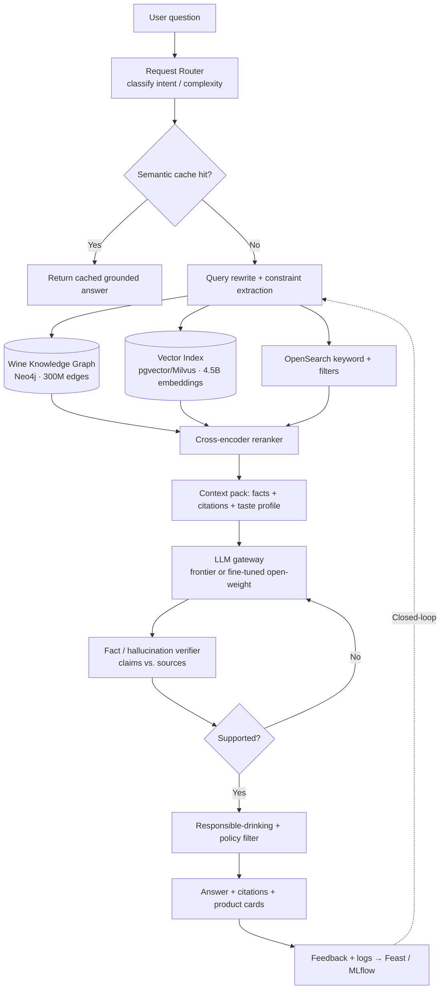
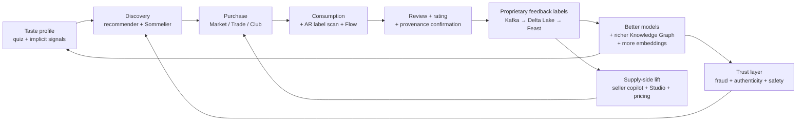

# VINTORA — AI Features & Architecture

**Document:** `06-ai-features.md` · **Owner:** Chief AI Officer · **Status:** v1.0 · **Companion:** `05-ui-ux-wireframes.md`

> **Purpose.** This document specifies what Vintora's AI actually does, how it is built, how it is evaluated, and how it is governed. It is the engineering and product contract for the intelligence layer behind every screen in `05-ui-ux-wireframes.md` and every differentiator in `_canon.md`. Where a feature has a user-facing moment, the wireframe section is named; where it has a number, the canon value is used verbatim.

---

## Canon snapshot (binding)

| Fact | Value used in this doc |
|---|---|
| Brand / tagline | **Vintora** — *The World's Cellar, Intelligent.* |
| Mission | Democratize discovery, trade, and enjoyment of fine wine and spirits through applied AI — protecting provenance, safety, and responsible consumption. |
| AI-native differentiator | Closed-loop AI: taste profile → discovery → purchase → consumption → review → better profile. |
| Modules (exact names) | **Vintora Market**, **Vintora Trade**, **Vintora Sommelier**, **Vintora Assist**, **Vintora Studio**, **Vintora Seller**, **Vintora Flow**, **Vintora Club**, **Vintora Vault**, **Vintora Rewards** |
| AI/ML stack (canonical) | Multi-model LLM gateway (frontier + self-hosted fine-tuned open-weight), RAG over Wine Knowledge Graph, pgvector/Milvus, two-tower + transformer recommenders, XGBoost/LightGBM forecasting, CV (label OCR, authenticity, condition), ASR/TTS, RL for pricing/inventory, anomaly detection |
| MLOps (canonical) | **MLflow**, **Feast** feature store, **Ray**, **Triton** inference |
| Data assets | **4.5B embeddings** in vector index; **300M edges** in wine knowledge graph; 10M SKU target; 250k producers |
| Data infra | PostgreSQL+Citus, TimescaleDB, Redis, OpenSearch, ClickHouse, Neo4j, S3+CloudFront, dbt+Snowflake, Delta Lake, Kafka |
| Payments / FX | Stripe+Adyen, local methods, USDC settlement for Vault, FX engine with locked rates |
| Scale / SLO | 50k req/s edge, p95 < 200ms API, 99.99% availability; 1.2M orders/day peak |
| Compliance | Age verification, KYC/AML, licensing per jurisdiction, GDPR/CCPA/LGPD/PIPL, responsible-drinking guardrails, SOC 2 Type II, ISO 27001 |
| Roadmap | Phase 0 Q4 2026 → Phase 5 2030–2034 (see §20) |

**Do not contradict the canon.** AI behavior must remain consistent with the interactions and states specified in `05-ui-ux-wireframes.md`; commercial framing lives in `01-business-plan.md`; investor narrative in `10-investor-pitch-deck.md`.

---

## 1. AI philosophy

Vintora's intelligence is organized around three roles:

1. **AI as sommelier.** A knowledgeable, warm companion that lowers the barrier to fine wine — answering "what goes with lamb?", explaining appellations, and remembering what you liked. This is Vintora **Sommelier**: the human face of the system.
2. **AI as operator copilot.** An invisible productivity layer for sellers, trade buyers, support agents, and engineers — drafting listing copy, forecasting demand, routing shipments, triaging tickets, and writing code. This is the operational leverage behind Vintora **Seller**, **Trade**, **Flow**, and **Studio**.
3. **AI as trust layer.** A set of models that verify what is true — provenance chains, authenticity, age assurance, KYC/AML anomalies, review fraud, hallucination detection, and responsible-drinking nudges. Trust is not a feature; it is a precondition for the other two.

**Human-in-the-loop is a design decision, not a compromise.** Sellers approve AI copy before it goes live (wireframe §4, screen 10); trade buyers accept AI-suggested quote alternatives; support agents confirm AI-drafted resolutions; patient (user) controls govern taste-profile inference. The system proposes; a human with context disposes. The exception is low-stakes automation (ranking, forecasting, chat answers grounded in citations), which runs autonomously within guardrails and is monitored continuously.

**Responsible drinking is embedded, not appended.** Every conversational surface carries safety policy: no encouragement of excessive consumption, no claims of health benefits, no targeting of minors, jurisdiction-aware age gating, and contextual nudges ("Please enjoy responsibly"; see wireframe §4, screens 1, 4, 6). The alcohol-specific safety policy in §19 is binding across all models and surfaces.

---

## 2. AI capability map

| # | Feature | Module | User | Model type | Data inputs | Output | KPI |
|---|---|---|---|---|---|---|---|
| 1 | Conversational Sommelier | Vintora Sommelier | Consumer | RAG LLM + KG, multi-turn, voice | Question, taste profile, KG, critic corpus, context (food/occasion/weather) | Grounded answer + product cards | Sommelier→cart rate, groundedness |
| 2 | Taste profile & recommender | Market, Club, Rewards | Consumer | Two-tower + transformers, bandits | Quiz, clicks, purchases, reviews, dwell | Ranked picks, tier/box curation | Time-to-first-bottle, CTR, conversion |
| 3 | Shopping concierge | Vintora Assist | Consumer | Tool-calling LLM, planner | Cart, intent, inventory, catalog | Built cart, gifts, support actions | Cart completion, support deflection |
| 4 | Computer vision | Market, Seller, Flow | Consumer, seller | OCR, translation, authenticity, condition CNN | Label/cellar images | Detected fields, provenance, grade | Scan accuracy, false-match rate |
| 5 | Dynamic pricing & promos | Market, Seller, Studio | Seller, consumer | Elasticity models + RL | Demand, inventory, competitor, context | Price/offer suggestions | GMV lift, margin, dilution guardrail |
| 6 | Demand forecasting & replenishment | Seller, Flow, Trade | Seller, trade | Hierarchical time series, XGBoost/LightGBM | Sales, seasonality, weather, events | Forecasts, reorder points | Forecast MAPE, stockout rate |
| 7 | Vintora Flow optimization | Flow | All | Multimodal routing + risk models + NLP doc AI | Route, temperature, customs, carrier data | Route plan, risk flags, customs docs | On-time %, temperature excursions |
| 8 | Studio generative marketing | Vintora Studio | Seller, brand | LLMs, diffusion, video, segmentation, bandits | Product facts, brand voice, audience | Copy, imagery, video, send-time | Campaign CTR, brand-voice score |
| 9 | Wine investment analytics | Vintora Vault | Investor | Price models, comparables, liquidity, risk, anomaly | Trades, custody, provenance, market | Predictions, liquidity score, risk | Prediction MAE, fraud catch rate |
| 10 | Trust & safety | Cross-module | All | Age assurance, KYC/AML anomaly, NLP, hallucination guard | Identity, behavior, text, model outputs | Decisions, nudges, blocks | False-accept, incident rate |
| 11 | AI customer support | Assist, cross-module | Consumer, seller | Ticket triage, RAG resolution, sentiment, escalation | Tickets, chat, order data | Draft replies, routing, escalation | CSAT, resolution time, deflection |
| 12 | Internal co-pilots | Seller, Trade, Support, Eng | Staff, sellers | Task-specific LLM agents + tools | Ops data, tickets, repos | Drafts, analyses, code | Task time saved, accuracy |

---

## 3. Conversational AI Sommelier

**Problem.** Fine wine is intimidating. The average buyer does not know Nebbiolo from Nero d'Avola, and search boxes fail on questions like "something cozy for a rainy Tuesday with mushroom risotto under $40." The canon's core differentiator — closed-loop taste learning — needs a conversational front door.

**Data.** The **Wine Knowledge Graph** (Neo4j, **300M edges**) encodes producer → vineyard → vintage → bottle → custody, plus grapes, appellations, tasting notes, food pairings, and critic scores. A curated tasting-note corpus and critic reviews are embedded in the vector index (**4.5B embeddings**) alongside the user's saved taste profile and session context (food, occasion, weather, budget, dietary constraints).

**Model / pipeline.** A query is classified (pairing / education / discovery / account action), then rewritten into a retrieval plan. A hybrid retriever combines graph traversal (Cypher over Neo4j), dense vector search (pgvector/Milvus), and OpenSearch keyword filters; a cross-encoder reranks candidates. The frontier LLM generates a grounded answer with citations; a fine-tuned open-weight model handles high-volume intents for cost. Multi-turn memory is a compressed summary plus key constraints in the session store, with long-term facts promoted to the taste profile. Voice uses ASR → text pipeline → TTS output. Multilingual generation is grounded so tasting terms stay accurate across the 24 launch languages (→ 60+ by 2030).

**UX.** Wireframe §4 screens 2, 3, 5: a persistent Sommelier entry, a chat thread ending in product cards, a source strip, "Why?" and feedback controls. Answers are scannable, not essays.

**Evaluation metric.** Groundedness (share of claims supported by retrieved sources), factual accuracy on a sommelier-curated gold set, multi-turn constraint adherence, and Sommelier→cart rate.

**Guardrails.** Cite-or-abstain: no uncited varietal or vintage claims. Alcohol safety policy enforced (no consumption encouragement, no health claims). Dietary constraints (e.g., vegan finings) treated as hard filters. Hallucination checker verifies numeric claims against the KG.

**Rollout.** Phase 1 (US/UK/Singapore) with text; voice and multilingual expansion in Phases 2–3; context-aware (weather/occasion) enrichment in Phase 3; full 60+ language voice by Phase 5.

---

## 4. Taste profile learning & recommender

**Problem.** The closed-loop flywheel requires a persistent, accurate, *user-controllable* model of taste — from cold start to an evolving preference graph — that drives home rails, search ranking, Club boxes, and Rewards offers.

**Data.** An onboarding quiz (6 questions, wireframe §5 flow) seeds explicit preferences: body, sweetness, oak, regions, budget, occasion. Implicit signals — clicks, dwell, skips, cart adds, purchases, reviews, rating distribution — stream through Kafka into the feature store (Feast). Negative feedback ("not for me") is as valuable as positive.

**Model / pipeline.** A **two-tower** model (user tower from profile + behavior, item tower from SKU attributes + embeddings) handles candidate generation at 10M SKU target scale; a **transformer** ranker reorders using sequential behavior and context. Contextual bandits manage exploration/exploitation: 80% exploitation of known preference, 20% calibrated exploration for serendipity. Cold start is addressed by quiz priors, region/population priors, and editorially curated starter sets. Diversity constraints prevent a monoculture of one grape; a serendipity slot deliberately introduces one "stretch" pick with an explanation. All features are served from Feast; training uses Ray; inference via Triton.

**UX.** Wireframe §4 screens 2 and 13: a "Taste profile 82%" confidence indicator, "Why these?" explanations, and editable profile controls. Users can inspect, correct, export, or delete the profile.

**Evaluation metric.** Offline NDCG@10 and recall on held-out purchases; online CTR, add-to-cart, and time-to-first-bottle; diversity and serendipity indices as guardrails.

**Guardrails.** No sensitive-attribute inference (health, identity beyond age assurance). Price sensitivity used for relevance, never for discriminatory pricing. Opt-out produces a non-personalized, editorially curated experience with no degradation in service.

**Rollout.** Phase 1 quiz + basic ranking; Phase 2 implicit signals; Phase 3 bandits and diversity; Phases 4–5 full transformer ranker and closed-loop review ingestion at scale.

---

## 5. AI Shopping Assistant / concierge

**Problem.** Users think in outcomes ("build me a dinner-party cart", "gift something for a chef", "get me under $200") rather than SKUs. Vintora Assist must turn intent into action across modules — search, cart, gifting, support, and trade.

**Data.** Cart state, catalog and inventory (real-time from PostgreSQL/Citus + Redis), user taste profile, order history, gift recipients (age-assured), shipping constraints, and policy documents for support answers.

**Model / pipeline.** A tool-calling LLM plans a sequence of function calls (`search_catalog`, `filter_by_constraints`, `apply_promotion`, `add_to_cart`, `create_gift`, `check_inventory`, `open_support_ticket`) against the NestJS BFF's GraphQL/REST APIs. A constraint solver validates budget, quantity, age, and jurisdiction before actions commit. For support intents, the assistant retrieves policy docs via RAG and drafts a resolution; high-value actions require confirmation. Proactive support triggers on signals (delayed shipment, expiring rate lock, low stock in a saved list).

**UX.** Wireframe §4 screens 5, 6, 9, 12: inline "Ask Sommelier" handoffs, a cart cross-sell suggestion, an RFQ copilot, and personalized Rewards actions. Every action is previewable and reversible.

**Evaluation metric.** Task-completion rate for assistant-initiated flows, cart completion, support deflection rate, and tool-call accuracy (valid calls / total calls).

**Guardrails.** Whitelisted tools with parameter schemas; no autonomous purchase above a threshold without explicit confirmation; gift recipient age assurance mandatory; rate-lock and landed-cost disclosure before any currency action.

**Rollout.** Phase 1 basic search/cart tools; Phase 2 gifting and proactive support; Phase 3 cross-module (Trade, Vault, Club); Phases 4–5 fully conversational commerce across WhatsApp/Messenger/voice.

---

## 6. Computer vision: label OCR, provenance, counterfeit & condition, shelf scanning

**Problem.** Bottles carry their truth on the label, but labels are hard to read, in foreign languages, and easy to fake. Sellers need fast, accurate cataloging; buyers need confidence in what they are buying.

**Data.** A proprietary corpus of millions of front/back label images across vintages, producers, and scripts, linked to the knowledge graph; condition-graded lot photos from Vault; shelf images from sellers; provenance and custody records.

**Model / pipeline.** Detection localizes the label region; OCR (with a wine-specific lexicon) reads producer, appellation, vintage, and alcohol content; a translation model renders text into the user's language; an embedding-based matcher resolves the detected fields to a canonical SKU in the 10M+ catalog. A authenticity classifier examines typography, holograms, and packaging against known-good references; a condition-grading CNN scores label/foil/fill level for Vault lots (the "94/100" in wireframe §4 screen 8). Seller shelf scanning extracts multiple labels from one photo to create listings in bulk (screen 10 autofill). All results carry confidence scores; low-confidence cases route to human review.

**UX.** Wireframe §4 screens 4 and 10: AR reticle, "Detected: … ✓" with confidence, and actions (Match / Translate / Check provenance). Detected values are *suggestions* the user confirms.

**Evaluation metric.** Field-level OCR accuracy, SKU match precision/recall, authenticity AUC, condition-grade agreement with expert graders, and false-match rate (critical guardrail).

**Guardrails.** Never assert authenticity as certain; present as "consistent with" plus a provenance check. Manual entry always available. Human adjudication for high-value Vault lots. No counterfeit accusation without evidence chain.

**Rollout.** Phase 1 label OCR + translation; Phase 2 SKU matching and seller shelf scan; Phase 3 condition grading for Vault (Phase 4 launch); Phase 5 authenticity at global scale.

---

## 7. Dynamic pricing & promotion optimization

**Problem.** Pricing a 10M-SKU catalog across 135+ currencies and 200+ countries with perishable inventory and brand-sensitive luxury goods is beyond manual rules. Yet naive optimization dilutes premium brands.

**Data.** Transaction history, inventory levels and aging, competitor prices, demand signals from search and Sommelier, seasonality, weather/events, and seller constraints.

**Model / pipeline.** Elasticity models estimate demand curves per SKU/segment; a reinforcement-learning policy (offline-trained, then shadow-mode) sets price and promotional offers within seller-defined floors and ceilings. The RL reward balances GMV, margin, inventory turnover, and a **brand-dilution penalty** that caps discount frequency and depth for premium/luxury categories (canon: premium take rate 8–12%, B2C commission 12–20%). Promotions are personalized through the recommender but constrained by fairness and published terms. FX locked rates are handled by the payments layer, not the pricing model.

**UX.** Wireframe §4 screens 6 and 9: a cart cross-sell offer, seller "2 prices below market" copilot suggestions. Sellers approve pricing changes; consumers see a clear price with any promotion labeled.

**Evaluation metric.** GMV and margin lift versus holdout, inventory turnover, and the brand-dilution guardrail (discount depth/frequency within allowed bands).

**Guardrails.** Hard price floors/ceilings per seller; no personalized price discrimination on protected attributes; all offers have disclosed terms; luxury SKUs are excluded from aggressive discounting.

**Rollout.** Phase 1 rule-based suggestions; Phase 2 elasticity models; Phase 3 shadow-mode RL with seller opt-in; Phase 4 controlled rollout; Phase 5 at scale with continuous monitoring.

---

## 8. Demand forecasting & inventory replenishment

**Problem.** Wine inventory is capital-intensive and perishable in the sense that holding costs and vintage windows matter. Stockouts lose sales; overstock traps cash. Sellers and trade buyers need reliable forecasts.

**Data.** TimescaleDB telemetry of sales and inventory, dbt/Snowflake historical aggregates, seasonality, holidays, weather, local events, marketing calendar from Studio, and external demand signals.

**Model / pipeline.** A hierarchical time-series model reconciles forecasts across SKU → appellation → region → category → market. XGBoost/LightGBM models incorporate exogenous features (weather, events, promotions). Probabilistic outputs yield reorder points and safety stock with service-level targets. Forecasts feed Vintora Flow for capacity planning and the seller copilot for "6 SKUs low stock — Replenish" (wireframe §4 screen 9). Online learning updates weekly; drift detection triggers retraining.

**UX.** Wireframe §4 screens 9 and 11: seller action queue and RFQ delivery-window feasibility. Forecasts are shown as ranges with confidence, never false precision.

**Evaluation metric.** Weighted MAPE / WAPE and pinball loss at the SKU-market level; downstream stockout rate and inventory turns.

**Guardrails.** Human approval for large purchase orders; scenario planning for supply shocks; no automated commitments beyond seller-set credit limits.

**Rollout.** Phase 2 basic forecasts for Seller/Trade; Phase 3 exogenous signals and Flow integration; Phase 4 probabilistic; Phase 5 hierarchical at global scale.

---

## 9. Vintora Flow route & temperature optimization

**Problem.** Fine wine is temperature-sensitive, customs-heavy, and multi-modal. A delayed or overheated shipment destroys value and trust across 40+ licensed warehouses and 200+ countries.

**Data.** Carrier routes, temperature telemetry (TimescaleDB), warehouse capacity, customs rules by jurisdiction, historical delay/excursion labels, weather, and order attributes (Incoterm, value, insurance).

**Model / pipeline.** A multimodal routing optimizer evaluates air/sea/road/rail combinations under cost, time, and temperature-risk constraints; a risk-prediction model flags delay and excursion probability per leg. An NLP document-automation model generates and validates customs paperwork from order and SKU data, with jurisdiction-specific rules. The system recommends routes, monitors live telemetry, and triggers alerts or rerouting on excursions. Insurance pricing (0.3–1.2% of insured value per canon) uses the same risk score.

**UX.** Wireframe §4 screens 6, 9, 11: delivery estimates at checkout, seller "awaiting ship → Flow" actions, RFQ Incoterm and delivery-window risk ("consider DAP").

**Evaluation metric.** On-time delivery %, temperature-excursion rate, customs rework rate, and cost per shipment.

**Guardrails.** Human customs review for high-value lots; temperature excursions always alert a human; no route that violates licensing or sanctioned-party rules.

**Rollout.** Phase 2 launch with Flow; Phase 3 risk prediction; Phase 4 customs automation; Phase 5 global multimodal optimization.

---

## 10. Vintora Studio generative marketing

**Problem.** Sellers and brands must produce compliant, on-brand, localized campaigns at speed across email, push, WhatsApp, and ads — without legal mistakes in a regulated category.

**Data.** Product facts from listings and the knowledge graph, brand-voice guidelines, historical campaign performance, audience segments from Rewards and taste profiles, and a compliance ruleset (age gating, health-claim bans, regional ad rules).

**Model / pipeline.** LLMs generate subject lines and copy with tone/length controls; diffusion models produce imagery; video models assemble short creatives. A brand-voice classifier scores output (the "92/100" in wireframe §4 screen 14). Audience segmentation uses clustering and propensity models; contextual bandits optimize send time. A compliance checker scans for age-gate requirements, prohibited health claims, and jurisdiction-specific ad restrictions before scheduling. Human approval is required to publish.

**UX.** Wireframe §4 screen 14: step-by-step builder, live multichannel preview, brand-voice score, compliance flags, and an overridable send-time suggestion. Studio tiers ($199 / $599 / $2,999 per month — Creator / Brand / Enterprise) gate advanced generation and volume.

**Evaluation metric.** Campaign CTR and conversion lift, brand-voice score, compliance pass rate, and time-to-campaign.

**Guardrails.** No health or intoxication claims; age-gate enforced per region; minors never targeted; all generated imagery reviewed for category appropriateness; ad spend capped at the canon's ≤ 8% of revenue by design.

**Rollout.** Phase 3 Studio v1 (copy + email); Phase 4 image/video and segmentation; Phase 5 send-time optimization and full localization.

---

## 11. Wine investment analytics

**Problem.** Fine wine is an alternative asset with opaque pricing, thin liquidity, custody risk, and fraud (including wash trading). Vintora Vault must make it investable and trustworthy.

**Data.** Historical trade prints, listing and bid/ask data, comparables from the knowledge graph, custody and condition records from 40+ warehouses, provenance chain completeness, and macro/lot-specific signals.

**Model / pipeline.** Gradient-boosted price models and comparables selection estimate fair value; a liquidity score (the "82/100" in wireframe §4 screen 8) models time-to-sell and bid-depth; portfolio risk models compute exposure, correlation, and drawdown; an anomaly-detection layer flags wash trades, spoofing, and KYC/AML anomalies. USDC settlement and the fee schedule (1.5% buy / 2% sell / 0.5% p.a. custody / 5–15% performance above high-water mark, fractional minimum $25) are applied by the transaction layer, not the models.

**UX.** Wireframe §4 screen 8: portfolio value and chart, lot detail with custody/condition/provenance, liquidity score with explanation, and clear fee disclosure. Predictions are ranges with confidence, never guarantees.

**Evaluation metric.** Price-prediction MAE, liquidity-score calibration, portfolio risk backtests, and fraud/anomaly precision-recall.

**Guardrails.** No investment advice language; no guaranteed-return claims; anomaly flags go to human compliance review; KYC/AML clearance required before trading; all projections carry disclaimers.

**Rollout.** Phase 4 Vault launch with core analytics; Phase 5 secondary-market liquidity scoring and advanced fraud detection.

---

## 12. Trust & safety

**Problem.** Alcohol commerce attracts regulatory and abuse risk: minors, identity fraud, fake reviews, money laundering, and AI hallucination. Trust must be systemic.

**Data.** Age-assurance signals (DOB/jurisdiction/device), KYC documents, transaction graphs, review text and metadata, model outputs, and user feedback.

**Model / pipeline.** Age assurance combines jurisdiction-aware DOB validation with anomaly detection on device/identity signals (wireframe §4 screen 1). KYC/AML anomaly detection runs graph-based and rules-based checks over transactions. Review-fraud models detect coordinated inauthentic behavior. A responsible-drinking NLP classifier monitors assistant/sommelier output and user messages for harmful patterns and inserts contextual nudges. A hallucination guardrail cross-checks numeric and factual claims against retrieved sources before display; unsupported claims are suppressed or rewritten.

**UX.** Wireframe §4 screens 1, 4, 6: trust strip at gate, provenance and compliance badges on PDP, locked-rate disclosure and responsible-drinking cue at checkout. Enforcement outcomes are explained without exposing detection logic.

**Evaluation metric.** False-accept rate for age/KYC, fraud catch rate, review-removal precision, harmful-output rate, and hallucination escape rate.

**Guardrails.** No automated adverse decision without human appeal path; privacy-preserving feature use under GDPR/CCPA/LGPD/PIPL; decision logs retained for audit; alignment with SOC 2 Type II / ISO 27001 controls.

**Rollout.** Phase 0 foundation; Phase 1 age/hallucination guardrails; Phase 2 KYC/AML; Phases 3–5 full trust layer including EU AI Act alignment.

---

## 13. AI customer support

**Problem.** Support volume scales with GMV (from $120M in Y1 to $15B by Y8), and wine-specific questions need domain knowledge plus order context.

**Data.** Tickets from chat/email/WhatsApp, conversation history, order and Flow shipment data, policy documents, and product knowledge from the graph.

**Model / pipeline.** A classifier triages intent, urgency, and sentiment; RAG retrieves policy and order facts to draft a resolution; the assistant proposes a reply for human agents in high-stakes cases and auto-resolves low-risk, high-confidence cases (order status, rate lock, returns policy). Escalation routing uses predicted resolution complexity. Continuous feedback from CSAT and reopens retrains the models.

**UX.** Wireframe §4 screen 9: seller action queue and support entry; Assist handles consumer support inline in chat. Users always see a "talk to a person" path.

**Evaluation metric.** CSAT, first-contact resolution, median resolution time, and support deflection rate.

**Guardrails.** No account-changing action without authentication; no refund above threshold without human approval; empathetic tone constraints; no sensitive-data exposure in chat logs.

**Rollout.** Phase 1 triage + drafts; Phase 2 auto-resolution for top intents; Phase 3 multilingual; Phase 5 proactive support at scale.

---

## 14. Internal co-pilots

**Problem.** Operators across seller, buyer, support, and engineering functions need leverage, not another dashboard.

**Data.** Role-scoped access to operational systems (Seller analytics, Trade RFQs, support tickets, order data, code repositories, documentation).

**Model / pipeline.** Task-specific agents with tool access: a **seller-ops copilot** (refresh copy, replenish stock, price suggestions — screens 9–10), a **buyer/trade copilot** (RFQ comparison, Incoterm advice — screen 11), a **support copilot** (draft replies, summarize cases), and an **engineering copilot** (code review, incident triage, SQL generation). All are RAG-grounded in internal docs and governed by least-privilege tool permissions.

**UX.** Copilots appear as suggestion cards, not chat windows that demand attention; every suggestion is actionable and attributable (screen 9 "Review suggestions →").

**Evaluation metric.** Task time saved, suggestion acceptance rate, and error/rework rate.

**Guardrails.** Role-based access control; no autonomous writes to financial or identity systems; audit logging of all tool calls; alignment with zero-trust and mTLS architecture.

**Rollout.** Phase 2 seller copilot; Phase 3 trade and support; Phase 4 engineering; Phase 5 company-wide.

---

## 15. Model stack & routing

**Canonical layers.**

| Layer | Technology | Role |
|---|---|---|
| LLM gateway | Frontier models + self-hosted fine-tuned open-weight | Reasoning, generation, tool calling |
| Embeddings / retrieval | pgvector + Milvus, **4.5B embeddings** | Semantic search, RAG candidates |
| Knowledge graph | Neo4j, **300M edges** | Structured wine facts and provenance |
| Recommenders | Two-tower + transformers | Candidate generation and ranking |
| Forecasting | XGBoost / LightGBM, hierarchical TS | Demand, pricing elasticity |
| Computer vision | OCR, CNN classifiers, condition graders | Labels, authenticity, condition |
| Speech | ASR / TTS | Voice sommelier and search |
| Optimization | RL, contextual bandits | Pricing, inventory, send-time |
| Anomaly detection | Graph + statistical models | Fraud, AML, wash trading |
| MLOps | MLflow, Feast, Ray, Triton | Tracking, features, training, serving |

**Cost/latency routing.** A router classifies each request by complexity, sensitivity, and latency budget. High-volume, well-defined intents (simple pairings, OCR post-processing, triage) go to fine-tuned open-weight models served via Triton; complex reasoning, multilingual nuance, and low-confidence cases escalate to frontier models through the gateway. Embedding lookups and graph queries run as cheap pre-steps to reduce token spend. A semantic cache (Redis) absorbs repeated queries. Fallback chain: primary model → secondary model → canned, grounded response → human handoff, with a hard SLO of p95 < 200ms at the API edge for non-generative paths and explicit streaming for generative ones.

---

## 16. Data & knowledge assets

The moat is data, not models. Four proprietary assets compound:

1. **Wine Knowledge Graph** — **300M edges** linking producer → vineyard → vintage → bottle → custody chain, plus varietals, appellations, pairings, and critic scores. It is the substrate for RAG, provenance verification, investment comparables, and Studio fact-checking.
2. **4.5B embeddings** — a vector index over labels, tasting notes, reviews, images, and product attributes, serving semantic search and RAG at 10M SKU target scale.
3. **Tasting-note corpus** — critic reviews, producer notes, and user reviews in 24+ languages, aligned to the graph and used for grounded generation and multilingual tasting vocabulary.
4. **Proprietary closed-loop feedback** — the canon's differentiator: taste profile → discovery → purchase → consumption → review → better profile. Every interaction is an instrumented training label, streamed via Kafka, stored in Delta Lake and Snowflake, and served through Feast.

Data governance: lineage via dbt, catalog and access controls, PII minimization, consent-aware feature use, and retention policies under GDPR/CCPA/LGPD/PIPL.

---

## 17. RAG architecture & worked example

**Example prompt (Sommelier, multi-turn).**

> **System:** You are Vintora Sommelier. Answer only from retrieved sources. Cite source IDs. Never encourage excessive consumption or make health claims. If a dietary constraint is present, treat it as a hard filter. Be warm, specific, concise.
> **Context:** taste profile = {body: medium-full, regions: [Piedmont, Rioja], budget: $40, dietary: vegan}; retrieved sources = [KG:neo-8821 (Nebbiolo/Barolo pairings), NOTE:rev-339 (critic note, 2021), KG:neo-104 (food pairing: lamb + herbs)].
> **User:** "What should I serve with herb-crusted lamb in autumn? Keep it vegan and under $40."

**Example response.**

> For herb-crusted lamb, a medium-bodied Nebbiolo works beautifully: its rose-and-tar notes echo the herbs, and firm tannin cuts the richness. Within your $40 vegan filter, I'd pick **Barbera d'Asti 2021 ($28)** — bright acidity, no animal finings confirmed in the producer's fact sheet. If you want to stretch to $58, **Barolo 2019 (Serralunga)** is the celebratory version. *Please enjoy responsibly.*
> **Sources:** [KG:neo-104] food pairing · [NOTE:rev-339] tasting note · [KG:neo-8821] varietal profile · producer fact sheet (vegan status).
> **Actions:** [View Barbera] [Add both to cart] [Why this?]

Note the grounded claims, citations, hard-constraint handling, responsible-drinking close, and product actions — exactly the pattern specified in wireframe §4 screen 3.

---

## 18. Evaluation framework

**Offline metrics.**

| System | Metrics |
|---|---|
| Sommelier / RAG | NDCG@10, recall@k, groundedness, factuality, citation precision, ROUGE-L (secondary) |
| Recommender | NDCG@10, recall, MAP, calibration, diversity, serendipity |
| Forecasting | WAPE, pinball loss, bias |
| Vision | OCR field accuracy, SKU-match F1, authenticity AUC, grade agreement |
| Pricing / RL | Off-policy evaluation, reward vs. holdout, guardrail violation rate |
| Trust & safety | Precision/recall, false-accept rate, harmful-output rate |

**Online A/B.** Every user-facing model change runs through an experimentation platform with guardrail metrics (conversion, CSAT, complaint rate, responsible-drinking incidents) and pre-registered stopping rules. Frontier-model swaps are canaried at 1% → 5% → 25% → 100%.

**Red teaming.** Quarterly adversarial campaigns target prompt injection, alcohol-safety bypass, price manipulation, fake-review generation, and cross-locale failures. A dedicated red-team corpus is versioned and added to regression suites.

**LLM-as-judge + human panels.** An LLM judge scores groundedness, tone, and policy compliance at scale, calibrated against a sommelier/subject-matter-expert human panel; disagreements trigger review. Human panels also evaluate blind comparisons for brand voice and explanation quality.

**Drift monitoring.** Input-distribution drift, embedding drift, and output-quality drift are monitored on live traffic with Prometheus/Grafana and Datadog; thresholds page via PagerDuty. Automatic fallback to a prior model version or curated content occurs on breach.

---

## 19. Responsible AI

- **Bias & fairness.** Audit recommendation, pricing, and fraud models across protected groups and markets; fairness constraints in ranking and offer eligibility; no sensitive-attribute inference.
- **Transparency & explainability.** "Why?" affordances, source citations, confidence ranges, and plain-language explanations on every consequential AI output (wireframe §4 screens 2, 3, 10, 14).
- **Provenance citations.** Structured source IDs travel with generated answers and are logged for audit.
- **User control & opt-out.** Editable taste profile, explanation access, feedback controls, and a fully non-personalized mode; export/delete rights upheld.
- **EU AI Act alignment.** Risk classification of systems, documentation, human oversight for high-impact decisions, transparency obligations for AI interactions, and conformity workstreams ahead of Phase 2 EU expansion; alignment with SOC 2 Type II / ISO 27001 controls.
- **Alcohol-specific safety policy.** No health claims, no encouragement of excessive consumption, no minor targeting, jurisdiction-aware age assurance, responsible-drinking nudges in chat and checkout, and compliance with regional advertising rules.
- **Addiction & minor protection.** Pattern detection for concerning consumption behavior triggers supportive resources, never punitive profiling; stronger gating on high-alcohol products; age reassurance on gifting and shared cellars.
- **Privacy.** Data minimization, consent-aware features, differential privacy for aggregate insights, and adherence to GDPR/CCPA/LGPD/PIPL.

---

## 20. AI roadmap by phase & build vs. buy

| Phase | Period | AI focus |
|---|---|---|
| **0** | Q4 2026 | Foundation: data platform, KG seed, age/KYC, model gateway, evaluation harness, team hire |
| **1** | Q1–Q2 2027 | Sommelier (text) + Assist (search/cart) + recommender quiz; guardrails live in US/UK/SG |
| **2** | Q3–Q4 2027 | Trade copilot, forecasting, Flow optimization, Rewards personalization, KYC/AML, EU compliance |
| **3** | 2028 | Voice Sommelier, multilingual, Studio v1, seller copilot, CV shelf scan, 12 languages |
| **4** | 2029 | Vault analytics, RL pricing, condition grading, AI API licensing, anomaly/fraud, 24 languages |
| **5** | 2030–2034 | 60+ languages, full closed-loop flywheel, autonomous optimization, company-wide co-pilots |

**Build vs. buy.** **Build** the differentiated core: wine knowledge graph, closed-loop recommender, taste profile, RAG pipeline, provenance/authenticity CV, RL pricing, investment analytics, and the evaluation harness. **Buy/partner** commodity capabilities: base frontier LLM access via the gateway, ASR/TTS where quality/cost warrants, object storage/CDN, general OCR primitives, vector DB managed service, and monitoring. **Hybrid**: fine-tune open-weight models on proprietary data for cost and control, while routing hard cases to frontier models. The rule: *own the data and the loop; rent the generic intelligence.*

---

## 21. Team & MLOps

**Roles.** Chief AI Officer (this document's owner); Head of Applied ML (recommenders, ranking); NLP/LLM engineering (Sommelier, Assist, copilots); Computer Vision (labels, authenticity, condition); Forecasting & Optimization (pricing, inventory, Flow); Data engineering (KG, embeddings, feature pipelines); ML Platform/MLOps (MLflow, Feast, Ray, Triton, gateway); Responsible AI & Eval (red teaming, fairness, policy); Sommelier-in-residence and domain experts (ground truth, human panel); Product Managers per module; Design partnership via `05-ui-ux-wireframes.md`.

**MLOps practice.** Experiment tracking and model registry in **MLflow**; features materialized in **Feast** for consistent training/serving; distributed training and batch inference on **Ray**; low-latency GPU/CPU serving via **Triton**; the multi-model gateway handles routing, retries, and cost controls. CI/CD for models includes data validation, unit tests, offline eval gates, canary deployment, and automatic rollback. Every model has a versioned model card, datasheet, owner, and SLO.

**Incident response for model regressions.** Severity levels mirror platform SLOs; a regression (e.g., groundedness drop or biased ranking) triggers: detect via drift/eval monitors → page owner via PagerDuty → freeze rollout → roll back to prior model or curated fallback → publish incident review with root cause and corrective action within 48 hours. Audit logs and decision traces support compliance investigations.

---

## 22. Moat: the data flywheel

**Defensibility argument.** Competitors can copy features; they cannot copy the loop. Each purchase and review produces proprietary labels that improve recommendations, which improve conversion, which attract more sellers and producers, which deepen the **300M-edge knowledge graph** and **4.5B-embedding index**, which improves authenticity and provenance verification, which increases trust, which drives more purchases. The supply-side OS (Seller + Studio + Flow) generates operational data no pure marketplace owns, while the capital layer (Vault) adds price and liquidity signals no content site owns. Compliance-by-design — age assurance, KYC/AML, responsible drinking — becomes an asset as regulation tightens: Vintora can operate where others cannot. By Phase 5, the compounding loop, not any single model, is the moat — consistent with the canon's "closed-loop AI" and "provenance graph" differentiators and reflected in the Y5 and Y8 financial trajectory.

---

**Cross-references:** `05-ui-ux-wireframes.md` (every AI touchpoint's UI and states), `_canon.md` (binding facts and stack), `01-business-plan.md` (commercial context), `10-investor-pitch-deck.md` (investor framing), `README.md` (document index).
