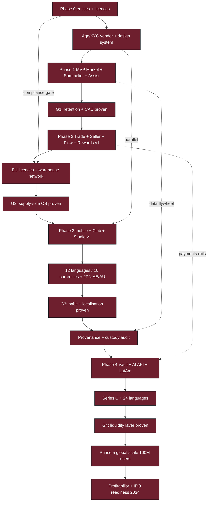

# VINTORA — Launch Roadmap & Operating Plan (Q4 2026–2034)

**Document:** `08-launch-roadmap.md` · **Owner:** COO (with CEO / CTO / CCO) · **Version:** 1.0, Q4 2026
**Siblings:** `01-business-plan.md`, `02-revenue-model.md`, `03-technical-architecture.md`, `04-database-design.md`, `05-ui-ux-wireframes.md`, `06-ai-features.md`, `07-marketing-strategy.md`, `09-growth-strategy.md`, `10-investor-pitch-deck.md`, `README.md`.

---

## CANON SNAPSHOT (binding)

| Canon fact | Value used here |
|---|---|
| Brand / tagline | **Vintora** — *The World's Cellar, Intelligent.* |
| Mission | Democratize discovery, trade and enjoyment of fine wine and spirits through applied AI — protecting provenance, safety and responsible consumption. |
| Founded / HQ | Incorporated Q4 2026. Dual HQ **Singapore (APAC/ops) + New York City (Americas/commercial)**; hubs London, Paris, Amsterdam, Dubai, Tokyo, Sydney, São Paulo, Cape Town. |
| 10 modules (exact) | **Vintora Market, Vintora Trade, Vintora Sommelier, Vintora Assist, Vintora Studio, Vintora Seller, Vintora Flow, Vintora Club, Vintora Vault, Vintora Rewards**. |
| Platform | Web Next.js 15 (App Router), TypeScript, React Server Components, Turborepo; mobile React Native (Expo), one codebase iOS + Android; WhatsApp/Messenger/voice/AR scan; 24 launch languages → 60+ by 2030, 135+ currencies, RTL. |
| Stack | Kubernetes (EKS + GKE multi-region active-active), NestJS BFF, Go microservices, gRPC + Kafka + Istio; GraphQL Federation / REST / gRPC; PostgreSQL+Citus, TimescaleDB, Redis, OpenSearch, ClickHouse, Neo4j, S3+CloudFront, dbt+Snowflake, Delta Lake; multi-model LLM gateway + RAG, pgvector/Milvus, MLflow/Feast/Ray/Triton; Stripe+Adyen + local methods + USDC for Vault; OpenTelemetry/Grafana/Prometheus/Datadog/PagerDuty; SOC 2 Type II, ISO 27001, PCI DSS L1. |
| Phases | **0 — Q4 2026** foundation/licensing/age-KYC/founders/seed/suppliers · **1 — Q1–Q2 2027** MVP Market+Sommelier+Assist, US/UK/SG, closed beta→launch · **2 — Q3–Q4 2027** Trade/Seller/Flow/Rewards v1 + EU · **3 — 2028** apps/Club/Studio v1/12 languages/10 currencies + JP/UAE/AU · **4 — 2029** Vault/AI API/24 languages/LatAm/Series C · **5 — 2030–2034** scale/60+ languages/100M users/profitability/IPO readiness. |
| Financial trajectory | 2027 2M / $120M / $18M / 15.0% · 2028 8M / $520M / $72M / 13.8% · 2029 20M / $1.2B / $180M / 15.0% · 2031 50M / $5B / $750M / 15.0% · 2034 100M / $15B / $2.5B / 16.7%. |
| Scale | 100M users / 60M MAU / 200+ countries / 250k producers / 40+ licensed warehouses / 1.2M orders/day / 50k rps edge / p95 <200ms / 99.99% availability / 4.5B embeddings / 300M graph edges. |
| Differentiators | Closed-loop AI · provenance graph · supply-side OS · liquidity layer · compliance-by-design. |

All dates, headcounts, valuations and budgets below are **operating targets**; valuations are explicitly illustrative. Canon values are never overridden.

---

## 1. Vision and Phased Strategy

**Vision:** by 2034, Vintora is the default intelligent layer for wine and spirits — the place where a palate becomes data, a bottle becomes verified provenance, a producer gets an operating system, and a cellar becomes a tradable asset. Everything before that is sequenced proof.

| Phase | Dates | Strategic intent | Modules live | Geography |
|---|---|---|---|---|
| **0 — Foundation** | 1 Oct–31 Dec 2026 | Legal entities, licences, founders, seed capital, supplier MOUs, architecture, age/KYC, design system | none public | SG + NYC incorporated; licence applications |
| **1 — Proven PMF** | 4 Jan–30 Jun 2027 | Closed beta → public launch of the consumer loop | Market, Sommelier, Assist | US, UK, Singapore |
| **2 — Supply-side OS** | 1 Jul–31 Dec 2027 | Add B2B, merchant and logistics rails; first expansion | + Trade, Seller, Flow, Rewards v1 | + FR, DE, IT, ES, NL |
| **3 — Habit & Localisation** | 1 Jan–31 Dec 2028 | Mobile, subscription, seller marketing, local depth | + Club, Studio v1 | + JP, UAE, AU |
| **4 — Capital Layer** | 1 Jan–31 Dec 2029 | Investment liquidity, developer surface, global coverage | + Vault, AI API | + LatAm (Brazil lead) |
| **5 — Global Scale** | 1 Jan 2030–31 Dec 2034 | 100M users, profitability, IPO readiness, category standard | all 10, continuous | 200+ countries, 60+ languages |

Sequencing rule: **each phase earns the next**. No B2B build before consumer retention is proven; no Vault before custody, KYC/AML and provenance completeness are audited; no new market before the licence gate is green.

---

## 2. Gantt-Style Workstream Matrix

Owner column is the accountable executive; "exit" is the phase-gate criterion (quantified in §13).

| Workstream | Phase 0 | Phase 1 | Phase 2 | Phase 3 | Phase 4 | Phase 5 | Owner | Exit |
|---|---|---|---|---|---|---|---|---|
| **Product** | PRD + design system, prototype | MVP Market/Sommelier/Assist; beta→GA | Trade/Seller/Flow/Rewards v1 | Apps, Club, Studio v1 | Vault, AI API | Continuous 10-module roadmap | CPO | G1–G5 |
| **AI** | LLM gateway choice, graph schema, eval harness | RAG Sommelier, taste profile, recommender v1, Assist | Provenance extraction, OCR authenticity v1, forecasting | Voice + AR scan, localised models, Club curation | Vault pricing/condition models, public API | 4.5B embeddings, 300M edges | CTO | G1, G3, G4, G5 |
| **Supply** | 150 supplier MOUs, warehouse partners | 1,500 live SKU partners, curation rules | Seller onboarding, 6k sellers, wholesale contracts | 25k sellers, producer associations | 60k sellers, LatAm supply | 250k producers | CCO / VP Supply | G0, G1, G2 |
| **Compliance** | Entity + licence map, age/KYC vendor, policies | Age gate, KYC at checkout, market rules | EU rules, trade/commercial compliance | JP/UAE/AU regimes, local counsel | LatAm, Vault securities/AML | 200+ jurisdictions | CCO | G0–G4 |
| **Payments** | Stripe + Adyen integration design, FX model | Cards + Apple/Google Pay + iDEAL; locked FX | SEPA, Klarna; B2B invoices/credit | Alipay/WeChat, Pix, UPI, local methods | USDC Vault settlement, custody ledger | 135+ currencies | CFO | G1, G3, G4 |
| **Marketing** | Brand system, research, creator seed | Know Your Palate; 600k users | Trade OS + EU launch; 2M users | Cellar in Your Pocket; 8M users | Liquid Assets; 20M users | Always-on global | CMO | G1–G5 |
| **Hiring** | 8 founders → 27 total | 116 by Jun 2027 | 260 by Dec 2027 | 560 by Dec 2028 | 980 by Dec 2029 | ~3,300 by 2034 | COO / CPO People | Quarterly plan |
| **Infra / Data** | Turborepo, EKS+GKE, CI/CD, observability | Multi-region active-active, Snowflake/dbt, SLOs | Kafka/Istio scale, ClickHouse, warehouse network | 12-locale edge, mobile BFF, DR drills | 24-locale, API gateway, USDC rails | 50k rps, 99.99% | CTO | G1, G3, G5 |

### Phase exit criteria (summary)

| Gate | Date | Non-negotiable exits |
|---|---|---|
| G0 | 31 Dec 2026 | SG + NY entities live; licence map and counsel retained; seed closed; ≥150 supplier MOUs; age/KYC vendor selected; architecture frozen; design system shipped; 27 staff. |
| G1 | 30 Jun 2027 | 600k users, 180k MAU, 108k first buyers, quiz completion ≥62%, checkout age-verification failure <0.5%, p95 <350ms, 99.95% availability, CAC ≤$21.90. |
| G2 | 31 Dec 2027 | 2M users, 600k MAU, $120M GMV, $18M net revenue, 15.0% take, 6k sellers, 15k trade accounts; 5 EU markets licensed and live. |
| G3 | 31 Dec 2028 | 8M users, 2.4M MAU, $520M GMV, $72M revenue, 13.8% take; 12 languages/10 currencies; 25k sellers; JP/UAE/AU live. |
| G4 | 31 Dec 2029 | 20M users, 6.5M MAU, $1.2B GMV, $180M revenue, 15.0%; 24 languages, LatAm live; Vault audited; Series C closed. |
| G5 | 2031 / 2034 | 50M users / $5B GMV / $750M revenue in 2031; 100M users, 60M MAU, $15B GMV, $2.5B revenue, 250k producers, 40+ warehouses, profitability and IPO readiness by 2034. |

---

## 3. Phase 0 — Q4 2026 in Depth

**Dates:** 1 Oct–31 Dec 2026 · **Budget:** $2.4M marketing + $4.5M corporate/legal/capital formation · **Team:** 27 at exit.

**Entity setup.** Incorporate **Vintora Pte. Ltd.** (Singapore, APAC/ops) and **Vintora Inc.** (Delaware with NYC commercial office, Americas) by 20 Oct 2026. Establish London and Amsterdam service entities by 10 Dec for EU licensing and producer contracting. Founder agreements, IP assignment, cap table, board (3 + 1 observer), banking, and employer-of-record for early hires complete by 15 Nov. Regional hub entities (Paris, Dubai, Tokyo, Sydney, São Paulo, Cape Town) are registered on licence trigger, not before.

**Licensing map.** Deliver a jurisdiction-by-jurisdiction register by 30 Nov: regulator, licence type, DTC shipping rules, age-verification standard, tax/excise, advertising limits, data-transfer rules, and owner. Rank by the market sequence in `07-marketing-strategy.md` §3. File US state applications for the first 12 shipping states by 15 Dec, UK notification by 30 Nov, SG liquor licence by 15 Nov (target grant 20 Dec), EU pre-filings for FR/DE/IT/ES/NL by 31 Dec.

**Founder hiring.** Eight founders by 31 Oct: CEO, CTO, CPO, COO, CFO, Chief Compliance Officer, VP Supply, CMO. Hiring bar: each has operated at the relevant scale in commerce, alcohol, AI or regulated finance. By 31 Dec add 8 engineers, 4 product/design, 3 compliance/legal, 2 finance, 2 supply, 2 marketing, 1 support = 27 (see §10).

**Seed raise.** Target **$18M at a $90M pre-money valuation (illustrative target)**, close by 15 Dec 2026. Allocate: 38% engineering/AI, 20% licensing and compliance, 18% supply deposits, 14% GTM, 10% contingency. Milestone for Series A (Q3 2027): G1 green and ≥25% of G2 users booked.

**Supplier MOUs.** Sign ≥150 non-binding MOUs by 31 Dec 2026, weighted to the three launch markets; each MOU records appellation, vintage, allocated case volume, verified custody documents, and data-sharing consent. Target 40+ licensed warehouse partners in negotiation by year end (canon scale target is 40+ by 2034).

**Architecture decisions — freeze by 20 Nov 2026.** Next.js 15 App Router + TypeScript + RSC in a Turborepo monorepo; React Native/Expo mobile with one shared design system; NestJS BFF; Go microservices over gRPC/Kafka/Istio on EKS + GKE active-active; GraphQL Federation to clients, REST partner API; PostgreSQL+Citus, Redis, OpenSearch, Neo4j knowledge graph, ClickHouse analytics, Snowflake/dbt, Delta Lake; multi-model LLM gateway with RAG and pgvector/Milvus; OpenTelemetry/Grafana/PagerDuty with SLOs; zero-trust, mTLS, SOC 2 Type II and ISO 27001 programmes opened on day one; Stripe + Adyen primary PSPs. Decisions are recorded as ADRs; deviations require CTO + COO sign-off.

**Age/KYC vendor selection.** Shortlist candidates across age estimation, document verification, AML screening and address checks (e.g., Persona, Jumio, Onfido, Veratad/AgeChecker-class providers — candidates only, no contract claim). Score by: coverage in US/UK/SG (30%), GDPR/CCPA posture (20%), API p95 <300ms (15%), verified-cost per check <$0.85 (20%), fallback and sandbox quality (15%). Select primary + fallback by 15 Nov, integrate in sandbox by 10 Dec, run 1,000 synthetic checks by 31 Dec.

**Design system.** Ship v1 by 15 Dec: Cellar Grid, Provenance Thread, palette/type tokens, age-gate component, quiz component, bottle card, cart, assist chat, and alcohol-policy banner. Same tokens drive web and Expo mobile. Deliverables and owners are tracked in `01-business-plan.md` §9 (Team & governance) and §13 (Milestones & KPIs).

---

## 4. Phase 1 — Q1–Q2 2027 in Depth

**MVP scope (locked):** **Vintora Market** (curated storefront, age gate, cart, checkout, provenance thread, 10k curated SKUs at launch), **Vintora Sommelier** (four-question taste quiz, conversational pairing, reasoning display, education), **Vintora Assist** (search, cart, gifting, support across web/chat/WhatsApp). Explicitly out of scope: Trade, Seller, Flow, Club, Vault, Studio, public API.

| Date | Milestone |
|---|---|
| 4 Jan | Internal dogfood: employees + 50 sommelier advisors; architecture in production |
| 1 Feb | Closed beta: 2,000 invited users across US/UK/SG; age verification live; 500 SKUs |
| 15 Mar | Beta 20k users; quiz completion ≥55%; first 1,000 verified orders |
| 1 Apr | Pre-launch: 50k waitlist, creator embargo content, press briefings |
| 5 Apr | **Public launch: US, UK, Singapore** — all three on the same build |
| 15 May | 300k users; Vintora Assist on WhatsApp in SG/UK; first paid creator programme |
| 30 Jun | G1 gate: 600k users, 180k MAU, 108k first buyers |

**Success metrics:** quiz start ≥70% / completion ≥62%; registered→first purchase ≥18%; second purchase within 90 days ≥28% (first cohort reads in Q3); CAC ≤$21.90; NPS ≥45; checkout age-verification failure <0.5%; provenance-complete orders ≥92%; API p95 <350ms; availability ≥99.95%; zero critical compliance incidents.

**Kill criteria ( escalate to board within 48h):** quiz completion <35% for two consecutive weeks; registered→first purchase <8%; CAC >1.5× plan for four weeks with no lift-study explanation; age-verification failure >2%; >3 provenance-critical order defects per 10,000; p95 >700ms or availability <99.5% for 72 hours; any licence suspension. Response: pause paid acquisition, freeze scope, 10-day remediation sprint, then continue/pivot decision per §13.

**Launch checklist (Phase 1):**
- [ ] Three-market licences and tax registrations active; shipping matrix published
- [ ] Age gate + KYC primary/fallback in production; minor-targeting audit passed
- [ ] 10k SKUs live with provenance records; 150 MOUs converted to live listings
- [ ] Sommelier eval set (1,000 pairs) scored ≥90% by expert panel; unsafe-query refusal 100%
- [ ] SLO dashboards, PagerDuty rotation, rollback runbook and DR drill complete
- [ ] Crisis/comms plan, support macros (EN + local), refund and chargeback flows ready
- [ ] Campaign assets cleared by brand + policy + counsel; creator disclosures in place
- [ ] G1 dashboard instrumented in Snowflake/dbt with finance reconciliation

---

## 5. Phase 2 — Q3–Q4 2027

**Build:** **Vintora Trade** (wholesale catalogue, RFQs, contracts, credit terms), **Vintora Seller** (listings, inventory, orders, analytics, payouts; Free→$99→$399→$999/mo), **Vintora Flow** (multimodal freight, temperature control, customs, last-mile, insurance at 0.3–1.2% of insured value), **Vintora Rewards v1** (points, tiers, partner redemption). B2B commission 3–8% GMV + $199–$1,499/mo SaaS.

| Date | Milestone |
|---|---|
| 1 Jul | Trade/Seller/Flow alpha with 20 design-partner restaurants and 50 sellers |
| 1 Aug | **EU soft launch: Netherlands** — iDEAL, SEPA, German-adjacent logistics |
| 15 Sep | Prowein/Vinexpo-style exhibition push; ≥300 producer meetings |
| 1 Oct | FR, DE, IT, ES live; Évin-compliant editorial motion in France |
| 1 Nov | Rewards v1 to all users; Flow temperature telemetry on 100% of eligible orders |
| 1 Dec | Seller 5k → 6k; Trade 15k accounts; first B2B financing pilot |
| 31 Dec | G2 gate: 2M users, $120M GMV, $18M revenue, 15.0% take |

**Exits:** 6k sellers, 15k trade accounts, 25% RFQ-to-order, 12% SaaS attach, ≥70% of sellers live within 30 days, on-time delivery ≥95%, five EU markets licensed and trading, zero licence or ad-policy suspensions. Marketing execution is in `07-marketing-strategy.md` §6.2.

---

## 6. Phase 3 — 2028

**Build:** iOS and Android apps (React Native/Expo, one codebase, AR label scan, voice via Alexa/Google Assistant), **Vintora Club** ($29/$59/$119/$199 Good/Better/Best/Icon), **Vintora Studio v1** ($199/$599/$2,999 Creator/Brand/Enterprise + usage credits), 12 languages and 10 currencies, Vintora Vault positioned (not yet launched).

| Date | Milestone |
|---|---|
| 15 Jan | App store submission (iOS + Android); closed TestFlight/Play tracks |
| 1 Feb | Public mobile launch; "Cellar in Your Pocket" campaign begins |
| 1 Mar | Vintora Club launch with four tiers; first monthly box fulfilment via Flow |
| 1 Apr | Vintora Studio v1 GA to sellers; 1,000 producer accounts in 30 days |
| 1 Jun | **Japan + Australia live**; localised pairing and gifting content |
| 1 Jul | **UAE live**; RTL layout validated; Arabic/English experience |
| 1 Sep | 12 languages / 10 currencies complete; voice + AR scan in top 5 locales |
| 31 Dec | G3: 8M users, 2.4M MAU, $520M GMV, $72M revenue, 13.8% take, 25k sellers |

**Exits:** M1→M6 Club retention ≥62%; app share of orders ≥35%; ≥30% of Studio accounts publish monthly; localisation QA pass rate ≥98%; JP/UAE/AU licence gates green; 560 staff.

---

## 7. Phase 4 — 2029

**Build:** **Vintora Vault** (fractional/whole-lot investing from $25, custody, secondary market; 1.5% buy / 2% sell / 0.5% p.a. custody / 5–15% performance above high-water mark, USDC settlement), public **AI API** licensing (REST, metered), 24 languages, LatAm entry (Brazil lead, then MX/AR/CL/CO), **Series C**.

| Date | Milestone |
|---|---|
| 1 Jan | Vault closed beta with 500 qualified collectors; custody audit begins |
| 15 Feb | AI API private preview with 20 design partners; usage billing live |
| 1 Apr | **Vault public launch**; "Liquid Assets" campaign; risk disclosures adjacent to every claim |
| 1 May | **Brazil live** (Pix); seller onboarding from São Paulo hub |
| 1 Jun | AI API GA; 24 languages live; RTL + 135-currency roadmap validated |
| 1 Jul | **Series C close target: $220M at a $2.2B pre-money valuation (illustrative)** |
| 1 Sep | MX/AR/CL/CO soft launch on licence clearance; 60k sellers |
| 31 Dec | G4: 20M users, 6.5M MAU, $1.2B GMV, $180M revenue, 15.0% take |

**Exits:** Vault custody and AML audit passed with zero material findings; sell-side turnover ≥8% of funded AUM annually; API ≥99.9% availability; 60k sellers; LatAm licences cleared per country; 980 staff. Y5 revenue mix must be tracking to canon (B2C 34%, Trade 18%, Club 12%, Seller+Studio 14%, Vault 10%, Logistics 6%, Rewards 3%, Ads/data/API 3%).

---

## 8. Phase 5 — 2030–2034

**Objective:** global scale with defensible unit economics and IPO readiness.

| Year | Users | GMV | Net revenue | Take | Operating focus |
|---|---|---|---|---|---|
| 2030 | ~32M | ~$2.7B | ~$400M | ~14.8% | 60+ languages programme; warehouse network to 30+ |
| 2031 | 50M | $5.0B | $750M | 15.0% | Profitability inflection; Series D; 40 warehouses |
| 2032 | ~65M | ~$8B | ~$1.2B | ~15.0% | 200+ countries; ads/data/API to 3% of revenue |
| 2033 | ~82M | ~$11.5B | ~$1.8B | ~15.7% | Pre-IPO round; SOX-ready controls; board refresh |
| 2034 | 100M | $15B | $2.5B | 16.7% | 60M MAU, 250k producers, IPO readiness |

**Exits:** 99.99% availability at 50k rps edge and 1.2M orders/day; p95 <200ms; 4.5B embeddings and 300M graph edges; GAAP-path profitability demonstrated for four quarters; audit committee, internal controls and investor-relations function operational. `10-investor-pitch-deck.md` carries the external narrative; `02-revenue-model.md` holds the model.

---

## 9. Dependency Map (Critical Path)

**Critical path:** entity/licence clearance → age/KYC → MVP → G1 retention proof → supply-side OS → EU → G2 → mobile/localisation → G3 → provenance/custody audit → Vault/API → G4 → scale. The three dashed links are the concurrency risks: compliance work started in Phase 0 must stay 6–9 months ahead of each wave, payment rails must be ready before Vault, and the data flywheel from Phase 1 must be intact before custody is audited.

---

## 10. Hiring Plan (headcount at phase end)

| Function | P0 Dec 2026 | P1 Jun 2027 | P2 Dec 2027 | P3 Dec 2028 | P4 Dec 2029 | P5 by 2034 |
|---|---|---|---|---|---|---|
| Product & Design | 4 | 8 | 16 | 35 | 60 | 200 |
| Engineering, Data & AI | 8 | 32 | 70 | 150 | 260 | 900 |
| Supply & Commercial | 4 | 14 | 40 | 90 | 160 | 520 |
| Compliance, Legal & Trust | 3 | 10 | 22 | 45 | 75 | 240 |
| Payments, Finance & Risk | 2 | 6 | 14 | 30 | 50 | 180 |
| **Marketing & Growth** | **4** | **22** | **38** | **70** | **115** | **260** |
| Customer Ops & Support | 1 | 12 | 30 | 70 | 130 | 500 |
| Logistics & Operations | 1 | 6 | 18 | 45 | 85 | 320 |
| People / G&A | 0 | 6 | 12 | 25 | 45 | 180 |
| **Total** | **27** | **116** | **260** | **560** | **980** | **~3,300** |

Marketing numbers match `07-marketing-strategy.md` §9.2. Hiring gates: no function exceeds 120% of plan without COO approval; compliance and support hire one quarter ahead of each market launch; every people manager completes compliance training before managing a team.

---

## 11. Capital Plan (all valuations illustrative targets)

| Round | Target close | Amount | Pre-money (illustrative) | New dilution | Milestone |
|---|---|---|---|---|---|
| Seed | 15 Dec 2026 | $18M | $90M | ~16.7% | G0 exits |
| Series A | 15 Sep 2027 | $65M | $450M | ~12.6% | G1 green, G2 on plan |
| Series B | 30 Jun 2028 | $130M | $1.1B | ~10.6% | G2 green, mobile in flight |
| **Series C** | 1 Jul 2029 | **$220M** | **$2.2B** | ~9.1% | G3 green, Vault beta passed |
| Series D | Q3 2031 | $450M | $5.5B | ~7.6% | Profitability inflection |
| Pre-IPO | Q1 2033 | $700M | $9.0B | ~7.2% | 200+ countries, controls ready |

Cumulative dilution across listed rounds ≈50%; founder/management ownership target 35–45% at IPO readiness via option refresh. No valuation in this table is a fact or a promise — all are fundraising targets to be tested against market conditions.

**Use of funds:**

| Category | Seed + A (2026–27) | B + C (2028–29) | D + Pre-IPO (2031–33) |
|---|---|---|---|
| Engineering, AI, data, infra | 38% | 33% | 25% |
| Supply deposits, logistics, warehouses | 18% | 22% | 18% |
| Compliance, licensing, legal, security | 20% | 12% | 8% |
| Marketing and growth | 14% | 18% | 20% |
| Hiring, People, G&A | 6% | 10% | 20% |
| Liquidity / custody buffer / contingency | 4% | 5% | 9% |

Marketing spend reconciliation: $2.4M (P0) + $14M (P1) + $18M (P2) + $58M (P3) + $95M (P4) + $620M cumulative (P5) — see `07-marketing-strategy.md` §9.

---

## 12. Regulatory / Licensing Workstream by Jurisdiction

| Jurisdiction | Regime / authority class | Key requirements | Target clearance | Owner |
|---|---|---|---|---|
| United States | TTB + state ABC; three-tier and DTC rules | Producer/shipper permits, state-by-state shipping, 21+ verification, sales tax | 12 states by Jan 2027; 25 by Jun 2027; 45 by Dec 2028 | CCO + US Counsel |
| United Kingdom | HMRC / licensing authorities; distance-selling rules | Premises/online sale permissions, age verification, excise, advertising | 30 Nov 2026 | CCO |
| Singapore | Liquor licensing + payment/FX oversight | On/off-trade licence, 18+ verification, AML for payments | Licence 20 Dec 2026 | COO + SG Counsel |
| EU — Netherlands | National alcohol rules + EU e-commerce/VAT | Age gate, VAT OSS, packaging, distance selling | 1 Aug 2027 | EU Counsel |
| EU — France | National rules + Évin-style ad restrictions | Editorial-led marketing, producer content, no youth appeal | 1 Oct 2027 | CMO + EU Counsel |
| EU — DE / IT / ES | National licensing, excise, packaging rules | Local entity filings, deposit/packaging rules, tax | 1 Oct 2027 | EU Counsel |
| Japan | Liquor Tax Act, labelling, import | Label review, import permits, local disclosures | 1 Jun 2028 | JP Counsel |
| UAE | Federal + emirate licensing; tourism-linked sales | Emirate permits, tourist-status checks, 21+ policy | 1 Jul 2028 | Dubai Hub Lead |
| Australia | State/territory liquor licensing | Per-state permits, 18+ verification, shipping rules | 1 Jun 2028 | AU Counsel |
| Brazil | Federal + state regimes; Pix payments | Tax registrations, state permits, import duties | 1 May 2029 | São Paulo Hub Lead |
| MX / AR / CL / CO | National alcohol and customs rules | Local permits, labelling, tax, FX controls | Q3 2029, staggered | LatAm Counsel |

Rule: **no market receives marketing budget until the licence is granted and the compliance checklist in §12 of this document is signed by the CCO, with the risk register in `01-business-plan.md` §10.** Regulatory filings begin at entity formation in Phase 0 and continue on a rolling 6–9-month horizon per wave; a 3-month clearance buffer before each launch is mandatory.

---

## 13. Risk Register

| # | Risk | Prob. | Impact | Owner | Mitigation | Trigger |
|---|---|---|---|---|---|---|
| 1 | State-by-state US licensing delays | High | High | CCO | 12-state first batch, parallel filings, external counsel | <8 states licensed by 15 Dec 2026 |
| 2 | Age/KYC vendor fails coverage or latency | Med | High | CTO | Primary + fallback, 1,000 synthetic checks, <300ms SLO | p95 >500ms or >2% false rejects |
| 3 | Supplier MOUs do not convert to live listings | Med | High | VP Supply | Activation SLA 70% in 30 days, rescue playbook | <50% live by day 30 |
| 4 | Quiz/recommendation fails to predict taste | Med | High | CPO | 1,000-pair expert eval, weekly retraining | Completion <35% or acceptance <20% |
| 5 | Provenance record gaps undermine trust claims | Med | Critical | CCO | Provenance-complete ≥92%, audit sampling | >3 defects per 10k orders |
| 6 | Alcohol ad-policy suspension (Meta/Google/TikTok) | Med | High | CMO | Certification, quarterly policy re-check, organic fallback | Any account restriction >48h |
| 7 | Seed/Series A shortfall | Med | Critical | CFO | 6-month runway floor, bridge options, milestone-based raise | <5 months runway at any gate |
| 8 | Cross-border logistics damage / customs delay | High | Med | VP Flow | Temperature telemetry, 40+ warehouse plan, insurance | On-time <95% or claims >0.8% |
| 9 | Payment fraud / chargebacks | Med | High | CFO | Stripe+Adyen radar, 3DS, anomaly detection | Chargeback >1.2% of orders |
| 10 | Vault regulatory classification (securities/AML) | Med | Critical | CCO | Pre-clearance opinion, custody partner audit, KYC | Any regulator inquiry or adverse opinion |
| 11 | Platform reliability at launch | Med | High | CTO | Active-active EKS+GKE, DR drill, PagerDuty | p95 >700ms or availability <99.5% for 72h |
| 12 | Localisation quality erodes brand | Med | Med | CPO | Certified reviewer, RTL test, canon glossary | QA pass <98% in any locale |
| 13 | Talent gaps in compliance/AI | High | Med | People Lead | Hire one quarter ahead, comp bands, advisor pool | Any critical role open >60 days |
| 14 | Competitive price war in B2C | High | Med | CMO | Differentiate on provenance/AI, protect category mix, no blanket discounting | Blended take rate <13% for 2 quarters |
| 15 | Data privacy incident | Low | Critical | CCO | Zero-trust, mTLS, PCI DSS L1, SOC 2 Type II | Any confirmed unauthorised access |

---

## 14. Go-Live Checklists

**Technical**
- [ ] Multi-region active-active health check and failover drill passed
- [ ] p95 <350ms (2027 target), error budget ≥99.95%, dashboards + PagerDuty live
- [ ] GraphQL Federation, REST partner API and gRPC internal smoke tests green
- [ ] LLM gateway eval suite ≥90%; refusal paths for unsafe alcohol queries 100%
- [ ] Provenance graph writes atomic with order events; rollback runbook tested
- [ ] Payment sandbox → production cutover with locked FX; USDC rails (Phase 4) audited

**Compliance**
- [ ] Licence granted in market; tax/excise registration active; shipping matrix published
- [ ] Age gate + third-party verification live; no minor-targeting in ad accounts
- [ ] Responsible-drinking copy and jurisdiction disclosures on all surfaces
- [ ] Privacy consent, GDPR/CCPA/LGPD/PIPL flows and suppression list tested
- [ ] CCO sign-off recorded; regulatory buffer ≥3 months before launch

**Support**
- [ ] 24/7 rotation staffed for first 14 days; local-language macros ready
- [ ] Refund, chargeback, damaged-in-transit and age-verification-failure playbooks
- [ ] Escalation tree to CTO/CCO/CMO with 15-minute P1 response
- [ ] Help centre published; in-app Vintora Assist deflection tested

**Marketing**
- [ ] All assets through brand → policy → counsel; creator disclosures in place
- [ ] Campaign KPI dashboard wired to finance-reconciled revenue
- [ ] Geo holdouts configured; MMP/postbacks live from 2028
- [ ] Launch-day press kit, waitlist sequence and referral mechanics ready

**Supply**
- [ ] ≥1,500 live SKUs (Phase 1) with complete provenance records; MOUs converted
- [ ] Warehouse capacity, temperature logging and insurance certificates verified
- [ ] Seller payout cycle tested; RFQ flow staffed (Phase 2 onward)
- [ ] Recall/counterfeit response protocol with producer contacts on file

---

## 15. KPI Gates and Decision Framework

| Gate | Continue | Accelerate | Pivot / stop |
|---|---|---|---|
| G0 | All Phase 0 exits green | MOUs >200 and seed oversubscribed | Licence map incomplete or seed <$12M → delay launch one quarter |
| G1 | Metrics in §4 | Quiz >70% and CAC <$18 per registered user → add one market test | Conversion <8% or CAC >1.5× plan → pause acquisition, 10-day sprint |
| G2 | $120M GMV, $18M revenue, 6k sellers | EU CAC 20% below plan → pull JP forward | Take rate <12% or on-time <90% → fix economics before EU expansion |
| G3 | 8M users, $520M GMV, 25k sellers | Club retention >70% → add two locales early | App share <15% or Studio publish <15% → rework mobile/content value |
| G4 | $1.2B GMV, Vault audit clean | Vault funded >2% of eligible → pull LatAm scale forward | Vault AML finding or turnover <4% → delay public API |
| G5 | 50M/2031, 100M/2034, profitability path | Availability >99.99% at target load → IPO timetable pull forward | Four-quarter profitability missed → defer IPO 12 months |

**Decision cadence:** gate review within 10 business days of quarter end; COO presents data, CFO validates economics, CCO has veto on compliance gates, CEO decides. A "pivot" is a 30-day written re-plan with revised scope and budget, not an open-ended pause. Any "accelerate" requires headcount and capital plan sign-off in the same meeting.

---

## 16. Post-Launch Operating Cadence

- **Daily (15 min):** SLO/incident stand-up; orders, age-verification failures, payment success, on-time delivery, P1 tickets.
- **Weekly (60 min):** growth and funnel review against §15 metrics; AI eval scores; supply activation; experiment readout; risk register changes.
- **Bi-weekly (90 min):** product/AI roadmap and model-performance review; provenance audit sampling; creator and content pipeline.
- **Monthly (half day):** P&L and CAC/LTV by market and segment; licensing horizon scan; hiring vs plan; board pack inputs.
- **Quarterly (2 days):** phase-gate review, MMM and incrementality readout, capital plan refresh, DR drill, compliance audit, risk register re-score.
- **Annual:** strategy reset, budget re-baseline, audit cycle, compensation and option refresh, five-year model update.
- **Always on:** 15-minute P1 response, 1-hour regulatory escalation, 24-hour self-exclusion propagation, 72-hour postmortem for critical incidents.

---

**Cross-references:** marketing execution and channel economics in `07-marketing-strategy.md`; product surfaces in `05-ui-ux-wireframes.md`; AI capability in `06-ai-features.md`; supply chain in `01-business-plan.md` §7; compliance and risk in `01-business-plan.md` §10; financial model in `02-revenue-model.md`; organisation in `01-business-plan.md` §9; investor narrative in `10-investor-pitch-deck.md`; index in `README.md`. All non-canon figures are targets and are re-baselined at each gate.
