# VINTORA — Growth Strategy

**Owner lens:** Growth Lead / Chief Growth Officer · **Audience:** Board, executive team, growth squads
**Status:** Planning document. All figures are **modeled projections, targets, or illustrative decompositions** — not reported results. No actual users, suppliers, licenses, or partnerships are claimed.

---

> ## CANON SNAPSHOT (binding)
>
> - **Brand:** VINTORA ("Vintora" in prose) · *The World's Cellar, Intelligent.* · Founded 2026 (incorporated Q4 2026) · **Dual HQ:** Singapore + New York City; hubs: London, Paris, Amsterdam, Dubai, Tokyo, Sydney, São Paulo, Cape Town.
> - **Mission:** Democratize discovery, trade, and enjoyment of fine wine and spirits worldwide through applied AI — protecting provenance, safety, and responsible consumption.
> - **Ten modules (exact names):** Vintora Market · Vintora Trade · Vintora Sommelier · Vintora Assist · Vintora Studio · Vintora Seller · Vintora Flow · Vintora Club · Vintora Vault · Vintora Rewards.
> - **Trajectory (USD):** 2027 — 2M users / $120M GMV / $18M revenue / 15.0% take; 2028 — 8M / $520M / $72M / 13.8%; 2029 — 20M / $1.2B / $180M / 15.0%; 2031 — 50M / $5.0B / $750M / 15.0%; 2034 — 100M / $15B / $2.5B / 16.7%.
> - **Y5 revenue mix:** B2C 34% · Trade 18% · Club 12% · Seller+Studio 14% · Vault 10% · Logistics 6% · Rewards 3% · Ads/data/API 3% (ads ≤8% of revenue by design).
> - **Scale targets:** 100M registered / 60M MAU · 10M SKU target · 250k producers · 200+ countries · 40+ licensed warehouses · 1.2M orders/day peak · 50k req/sec edge · p95 <200ms · 99.99% availability · 4.5B embeddings · 300M graph edges.
> - **Pricing:** Market 12–20% (luxury 8–12%); Trade 3–8% + $199–$1,499/mo; Club $29/$59/$119/$199 (Good/Better/Best/Icon); Seller Free→$99→$399→$999/mo + 0.5–2% processing; Studio $199/$599/$2,999/mo + credits; Vault 1.5% buy / 2% sell / 0.5% p.a. custody / 5–15% performance / $25 minimum; Flow cost-plus + 0.3–1.2% insurance.
> - **Sequencing:** Phase 0 Q4 2026 foundation → Phase 1 Q1–Q2 2027 US/UK/SG → Phase 2 Q3–Q4 2027 EU + Trade/Seller/Flow/Rewards v1 → Phase 3 2028 apps/Club/Studio + JP/AE/AU → Phase 4 2029 Vault/API/LatAm/Series C → Phase 5 2030–34 global scale, 60+ languages, profitability, IPO readiness.
> - **Differentiators:** closed-loop AI · provenance graph · supply-side OS · liquidity layer · compliance-by-design.
>
> **Siblings:** [`_canon.md`](./_canon.md) · business plan `01-business-plan.md` · revenue model `02-revenue-model.md` · architecture `03-technical-architecture.md` · AI features `06-ai-features.md` · marketing `07-marketing-strategy.md` · roadmap `08-launch-roadmap.md` · pitch deck `10-investor-pitch-deck.md`.

---

## 1. Growth Thesis & North Star

**Thesis.** Vintora is not a wine shop with a chatbot. It is the operating system for a category: discovery (Vintora Sommelier), transaction (Vintora Market), supply (Vintora Seller and Vintora Trade), movement (Vintora Flow), ritual (Vintora Club and Vintora Rewards), and capital (Vintora Vault), all fed by one closed-loop taste graph. Every consumer interaction sharpens the profile and improves conversion; every seller onboarded deepens catalog and liquidity. The objective is not traffic — it is **durable repeat behavior with rising take rate**.

**North Star: Repeat Purchase Rate (RPR)** — share of age-verified buyers with ≥2 completed orders in a trailing 12 months. **Co-primary scale metric: Net GMV** (net of cancellations, returns, fraud). GMV can be bought with discounts; RPR cannot. Board rule: **GMV without rising RPR is a red flag, not a win.**

| Guardrail | Target | Owner |
|---|---|---|
| Contribution margin / order | ≥60% of net revenue | CFO + Growth |
| Age-verification pass rate | ≥99.5%; 100% gate coverage | Compliance |
| Provenance coverage, >$500 lots | ≥98% by 2031 | Supply + Data |
| Responsible-drinking incidents | <0.05%; zero minors | Trust & Safety |
| Ad share of revenue | ≤8% by design | CFO |
| p95 API / availability | <200ms / 99.99% | Engineering |

### 1.1 Input metrics tree

> **Net GMV = Users × Conversion × Frequency × AOV**
> Users = age-verified registered accounts · Conversion = registered → first purchase · Frequency = orders per activated buyer per year · AOV = average order value.

```mermaid
flowchart TD
    GMV["NET GMV — modeled to $15B by 2034"] --> U["USERS — 100M target"]
    GMV --> C["CONVERSION — 18–30% target"]
    GMV --> F["FREQUENCY — 2.5 → 4.5 orders/yr"]
    GMV --> A["AOV — $80 → $185"]
    U --> U1["SEO & content / paid media"]
    U --> U2["Referral + gifting loops"]
    U --> U3["Partner & affiliate distribution"]
    U --> U4["Geo launches / seller invites"]
    C --> C1["Vintora Sommelier taste quiz → first basket"]
    C --> C2["Vintora Assist search → cart → checkout"]
    C --> C3["Provenance trust + age-gate friction"]
    C --> C4["Local payments + Vintora Flow promise"]
    C --> C5["Vintora Rewards first-order credit"]
    F --> F1["Vintora Club ritual"]
    F --> F2["Vintora Rewards tiers & points"]
    F --> F3["Replenishment + tasting events"]
    F --> F4["Community, shared cellars, win-back"]
    A --> A1["Curated bundles & gifting"]
    A --> A2["Premium allocation via Vintora Market"]
    A --> A3["Vintora Vault upsell / Trade bulk"]
    A --> A4["Cross-sell spirits, accessories, experiences"]
    style GMV fill:#4c1d95,color:#fff
    style U fill:#7c3aed,color:#fff
    style C fill:#7c3aed,color:#fff
    style F fill:#7c3aed,color:#fff
    style A fill:#7c3aed,color:#fff
```

### 1.2 Modeled decomposition of the canonical trajectory

| Year | Users | Buyer conv. | Activated buyers | Orders/buyer/yr | AOV | Implied GMV | Canon GMV |
|---|---:|---:|---:|---:|---:|---:|---:|
| 2027 | 2M | 30% | 0.6M | 2.5 | $80 | $120M | **$120M** |
| 2028 | 8M | 22.5% | 1.8M | 3.2 | $90 | $518M | **$520M** |
| 2029 | 20M | 20% | 4.0M | 3.5 | $86 | $1.204B | **$1.2B** |
| 2031 | 50M | 20% | 10.0M | 4.0 | $125 | $5.0B | **$5.0B** |
| 2034 | 100M | 18% | 18.0M | 4.5 | $185 | $14.99B | **$15B** |

Conversion dilutes as the funnel widens into new geographies; **frequency and AOV carry the growth**. That is why retention (§4) and expansion (§5) are the real growth program.

| Metric | Primary lever | Owning module(s) |
|---|---|---|
| Users | Referral, gifting, content, geo launch | Vintora Market, Vintora Rewards |
| Conversion | Taste quiz → first basket, trust, checkout | Vintora Sommelier, Vintora Assist |
| Frequency | Subscription ritual, points, replenishment | Vintora Club, Vintora Rewards |
| AOV | Curation, premium, gifting, investing | Vintora Market, Vintora Vault, Vintora Trade |
| Supply depth | Seller activation, inventory freshness | Vintora Seller, Vintora Trade |
| Take rate | Mix shift to SaaS, Vault, Trade, Club | Vintora Studio, Vintora Vault, Vintora Trade |

---

## 2. Stage-Gated Growth Model

Each stage has **one binding constraint**; capital is released only when prior-stage KPI gates clear. This is the board's allocation rhythm — see `08-launch-roadmap.md` and `02-revenue-model.md`.

### Stage 1 — 0 → 2M users (Q4 2026 – Q4 2027)
- **Constraint:** Trust and licensing at first purchase.
- **Strategy:** Three beachheads (US, UK, Singapore) with a narrow high-trust promise — Market + Sommelier + Assist. Closed beta first; obsess over the first 100k taste profiles.
- **Channels:** Founder-led supplier signing; sommelier/educator creators; pairing-vintage SEO; invitation beta; compliance-capped paid social; Rewards first-order credit.
- **Product bets:** Taste quiz → personalized first basket; assistive concierge for search/cart/gifting/support; <2s age gate; provenance badge; AR label scan.
- **Org:** 25–40 people — founders, 8–12 engineers, 4–6 AI/data, 4–6 commercial, 3–5 compliance/ops, 3–5 growth/content; one growth squad, one supply squad.
- **Capital:** Seed + Series A for licensing, inventory-light working capital, inference budget. No fixed warehouse footprint; bonded partners only.
- **KPI gates:** 2M verified users; $120M annualized GMV; first-order conversion ≥25%; M12 RPR ≥12%; premium provenance ≥95%; zero age-gate failures; p95 <200ms.

### Stage 2 — 2M → 8M users (2028)
- **Constraint:** Supply-side operating depth — demand outruns catalog, delivery, and seller sophistication.
- **Strategy:** Become two-sided. Launch Trade, Seller, Flow, Rewards v1; add FR/DE/IT/ES/NL then JP/AE/AU. Apps, Club, Studio v1 land here.
- **Channels:** Seller BD; trade RFQs and restaurant associations; Studio free tools as wedge; web-to-app migration; local creators and local payments.
- **Product bets:** Merchant OS (Seller); wholesale RFQ/contracts (Trade); cold chain, customs, last-mile (Flow); unified points (Rewards); iOS/Android via React Native; Club tiers; Studio v1.
- **Org:** 90–140 people; four squads — Consumer Growth, Supply/Seller, International, AI/Data; country GMs and hub leads.
- **Capital:** Series A extension / Series B for 24-language localization, 10 currencies, bonded partners, SLA logistics.
- **KPI gates:** 8M users; $520M GMV; take rate >14%; ≥25% sellers paid; OTIF ≥97%; ≥12 languages; app share of orders ≥35%.

### Stage 3 — 8M → 20M users (2029)
- **Constraint:** Monetization diversity and category credibility — one commission line is fragile.
- **Strategy:** Launch Vault and AI API licensing; enter LatAm; 24 languages. Shift narrative from marketplace to infrastructure.
- **Channels:** Collector waitlist and HNW partnerships; prosumer cross-sell from Club Icon; developer outreach; São Paulo partner launch; affiliate scale; brand takeovers under the 8% cap.
- **Product bets:** Fractional/whole-lot investing, custody, secondary market (Vault); public REST API and SDKs; Studio Brand/Enterprise; Trade credit.
- **Org:** 250–350 people; six squads — Acquisition, Activation, Retention, Monetization, Capital (Vault), International/Platform; dedicated quant research.
- **Capital:** Series C (canonical) for custody, KYC/AML, USDC rails, regional licensing.
- **KPI gates:** 20M users; $1.2B GMV; ≥15% take; Vault AUM and repeat-trade thresholds; ≥4 revenue lines >$10M; LatAm live; SOC 2 Type II and ISO 27001.

### Stage 4 — 20M → 50M users (2030–2031)
- **Constraint:** Liquidity and network density — thin markets fragment search, delivery economics, and order books.
- **Strategy:** Density before breadth. Build 40+ licensed warehouses, deepen 200-country coverage, make Vintora the default supply OS; grow B2B/SaaS.
- **Channels:** Seller referral pull-through; Trade enterprise; white-label/embedded commerce; Rewards interchange and co-branded cards; global tasting programs.
- **Product bets:** Warehouse network + Flow orchestration; white-label Seller/Studio; Vault market-making; contributor graph; personalization at 4.5B-embedding scale; Cape Town hub.
- **Org:** 600–900; seven–nine squads plus regional P&Ls, Growth Council, M&A integration team.
- **Capital:** Growth equity; warehouse bonds, Trade credit facilities, tuck-in M&A (§7).
- **KPI gates:** 50M users; $5B GMV; $750M revenue; 40+ warehouses; 250k producers; ≥150M graph edges; contribution margin ≥60%; M12 RPR ≥27%; no line >40% of revenue.

### Stage 5 — 50M → 100M users (2032–2034)
- **Constraint:** Institutional durability — profitability, governance, auditability.
- **Strategy:** Harvest the compounding loop; push take rate to 16.7% via SaaS/Vault/Rewards mix; reach 60+ languages, 1.2M orders/day peak.
- **Channels:** Embedded distribution through Shopify/WooCommerce/POS/ERP; affiliate and developer ecosystem; global brand partnerships.
- **Product bets:** "Cellar OS" positioning; 300M-edge graph; multi-region active-active platform; compliance automation; privacy-safe data products.
- **Org:** 1,200–1,800 with public-company functions — internal audit, SOX-ready controls, investor relations.
- **Capital:** Late-stage/pre-IPO; self-funding operations.
- **IPO-readiness gates:** 100M users / 60M MAU; $15B GMV; $2.5B revenue; 16.7% take; sustained profitability; 99.99% at 50k req/sec; zero material compliance events.

---

## 3. Viral & Network Effects

Six compounding loops, each instrumented for viral coefficient (K) and cycle time.

1. **Shared cellars (Market + Rewards).** Permissioned lists of owned/loved bottles; every share carries discovery and wishlist actions plus contextual Sommelier pairings. Loop: collect → curate → share → recipient profile enriches → better recommendations. Target K ≈ 0.15–0.25, 14-day cycle.
2. **Gifting (Market + Assist + Rewards).** Occasion-led, high-intent acquisition. Assist finds recipient preferences, sets delivery, and gives the recipient a credit plus a taste quiz. Target: 20% of gift recipients activate in 30 days.
3. **Sommelier share cards.** Every pairing exports as a branded card — bottle, rationale, tasting notes, provenance snapshot — into WhatsApp, Messenger, and social. Trust-bearing distribution at zero media cost; instrument view → click → quiz-start.
4. **Two-sided referral (Rewards).** Consumer: $20 credit to inviter and invitee on first order; unlocks at 3 / 10 / 25 successes (early access, Icon box, Vault allocation priority). Seller: three months of Seller upgrade credit plus waived onboarding; Studio referrals earn usage credits. Credits release post-purchase only, with anomaly detection, tax treatment, and quantity caps per jurisdiction.
5. **Seller and Trade effects.** More buyers → more orders → better demand signals in Seller → better pricing/margin → more sellers → deeper catalog. Each restaurant RFQ pulls distributors; each distributor adds HoReCa accounts; contracts and credit raise switching costs.
6. **Vault liquidity and contributor flywheel.** More collectors tighten bid-ask and improve price discovery → more consignors → more lots → more collectors; custody plus provenance is the trust precondition. Sommeliers, producers, and enthusiasts contribute vintages, notes, and label images; contributions improve Vintora Sommelier, which attracts more contributors toward the 300M-edge graph. Currency: badges, Rewards points, attribution.

**Board priority:** Vault liquidity and Seller density are defensible effects; referral and share cards are accelerants. Fund accordingly.

---

## 4. Retention Engine

Retention is the growth strategy; acquisition fills the bucket, the closed loop seals it.

**Cohort framework.** Assign every user to acquisition cohort (week/month × geo × channel × first module). Track activation, first purchase, second purchase (RPR), Club attach, Rewards enrollment, Club churn, Vault first trade, revenue. Report by cohort age in months, sliced by channel so paid and organic quality never blend.

**Habit loops.** (1) *Discovery:* occasion → Sommelier pairing → cellar save → revisit. (2) *Ritual:* Club box → tasting content → points → refined next box. (3) *Cellar:* purchase → cellar entry → drinking-window reminder → replenish or Vault upgrade. (4) *Status:* points → tier → experience → visible status. (5) *Social:* shared cellar/card → comments → reciprocal visits → contribution.

| Lever | Mechanism | Module | Target effect |
|---|---|---|---|
| Personalization | Two-tower + transformer recommenders over taste profile and 4.5B embeddings | Sommelier, Assist | +15–25% click-to-cart |
| Replenishment | Drinking-window and velocity reminders | Market, Assist | +0.3–0.5 orders/buyer/yr |
| Club × Rewards | Club spend earns accelerated points; Icon unlocks allocations | Club, Rewards | Club M6 +8–12 pts |
| Tasting events | Sommelier-led, age-verified, in-person and virtual | Club, Sommelier | Attendees 1.6× frequency |
| Community | Reviews, cellar shares, contributor reputation | Market, Rewards | +20% RPR |
| Win-back | 30/60/90-day lapsed triggers, preference-aware | Assist, Rewards | 8–12% reactivation |
| Service recovery | Flow exceptions handled by Assist | Flow, Assist | ≥30% churn reduction |

**Target cohort retention** — share active (≥1 order in trailing 90 days) at month M1/M3/M6/M12. Targets, not observations.

| Cohort | M1 | M3 | M6 | M12 | Driver |
|---|---:|---:|---:|---:|---|
| 2027 US/UK/SG beta | 42% | 28% | 19% | 12% | Sommelier-first activation |
| 2028 EU + apps + Club | 48% | 34% | 24% | 16% | Ritual, app push, Rewards v1 |
| 2029 Vault + 24 languages | 53% | 39% | 29% | 21% | Multi-module attach |
| 2031 density + warehouses | 58% | 45% | 35% | 27% | Delivery reliability, status |
| 2034 Cellar OS | 63% | 51% | 41% | 33% | Full expansion ladder |

M12 retention roughly triples to 33%; applied to 100M users, that is what makes $15B GMV achievable without heroic CAC.

---

## 5. Monetization Expansion — Land and Expand

**Consumer journey:** `First bottle → repeat buyer → Club → Rewards → Vault → prosumer/Trade`.

| Step | Trigger | Module | Canonical economics |
|---|---|---|---|
| First bottle | Quiz → recommendation | Market / Sommelier | 12–20% commission (luxury 8–12%) |
| Repeat buyer | Replenishment / occasion | Market / Assist | Commission on 2.5+ orders/yr |
| Club | Curated monthly box | Club | $29/$59/$119/$199 per month |
| Rewards | Points, tiers, experiences | Rewards | Interchange, co-branded cards |
| Vault | Fractional / whole lot | Vault | 1.5% buy, 2% sell, 0.5% p.a., 5–15% performance |
| Prosumer / Trade | Bulk, restaurant needs | Trade | 3–8% GMV + $199–$1,499/mo SaaS |

Illustrative annual net revenue per user at each maturity (not an average): first bottle ≈ $12 → repeat ≈ $30 → Club ≈ $95 → Rewards-engaged Club ≈ $130 → Vault-active ≈ $210 → Trade prosumer ≈ $420. Blended across 100M users, canonical $2.5B revenue is only ~$25 per registered user.

**Seller journey:** `Free Seller → $99 → $399 → $999/mo → Studio → Trade → white-label`. Order volume triggers upgrades; Studio and Trade are gated at higher tiers; white-label/API is the enterprise endpoint.

**Expansion math (illustrative, Y5).** SaaS = 14% × $750M = **$105M**; at ~$1,000/month blended per paying account, that is ≈8,750 accounts — ~3.5% of 250k producers. One producer at $399 Seller + $599 Studio ≈ $12,000/yr SaaS, plus $500,000 Trade GMV at 5% ≈ $25,000, plus logistics margin → **~$40k+ annual account**. Take rate moves 15.0% (Y3) → 15.0% (Y5) → 16.7% (Y8) through mix, not higher B2C commission. Waterfall detail in `02-revenue-model.md`.

---

## 6. Market Expansion Playbook

**Template (per country):** (1) score the market, gate ≥4.0/5; (2) licensing map with counsel sign-off before spend; (3) supply wedge — 20–50 anchors, ≥2,000 SKUs, Seller onboarding in-language; (4) Flow design — bonded warehouse, cold chain, last-mile SLA, customs; (5) localization — language, currency, local payments (Alipay, WeChat Pay, iDEAL, Klarna, Pix, UPI, SEPA, Apple/Google Pay), RTL where needed; (6) Sommelier cold start with local pairing taxonomy and sommelier contributors; (7) closed beta → creator seeding → capped paid → Club/Vault attach after 90 days; (8) day-90/180 gate on conversion, RPR, SLA, margin, incidents.

| Factor | Weight |
|---|---:|
| Market size & spend | 20% |
| Wealth / premium demand | 15% |
| Licensing ease | 15% |
| Supply density | 15% |
| Logistics readiness | 10% |
| Digital & payments | 10% |
| Partner access | 10% |
| Competitive whitespace | 5% |

Each factor scored 1–5, weighted sum; **launch threshold ≥4.0**.

**Canonical sequencing:** Phase 0 Q4 2026 foundation (Singapore + NYC) → Phase 1 US/UK/SG → Phase 2 FR/DE/IT/ES/NL → Phase 3 JP/AE/AU → Phase 4 LatAm (São Paulo) → Phase 5 global including Cape Town. Languages: 12 (2028) → 24 (2029) → 60+ (2030–34); 135+ currencies. Channel budgets in `07-marketing-strategy.md`; checklists in `08-launch-roadmap.md`.

---

## 7. Platform, Ecosystem & M&A

**API.** Public REST API alongside internal GraphQL (Apollo Federation) and gRPC. Partners get catalog, availability, pricing, provenance, order, and fulfillment endpoints; webhooks; TypeScript/Python/Go SDKs; sandbox; scoped rate limits. Monetized via usage tiers and licenses inside the 3% ads/data/API bucket; privacy-safe anonymized insights only.

**Integrations, in priority order:** Shopify, WooCommerce, Shopify POS (merchant volume) → restaurant POS connectors via REST/middleware (Trade reorder frequency) → ERP connectors for NetSuite/SAP/Xero-class workflows (enterprise lock-in) → marketplace plugins and feed managers (catalog parity) → affiliate network with post-purchase validation (scalable CAC) → developer ecosystem — docs, SDKs, sandbox, partner directory, certification (durable platform effect).

**M&A categories:** *Data* (wine datasets, label/OCR archives — adds graph edges), *logistics* (bonded warehouses, cold chain, last mile — licensed capacity), *licensing* (importers, wholesalers, regtech — jurisdiction access), *content* (sommelier education, tasting media, clubs — engaged audience), *tech* (search/recs, computer vision, FX/payments — shortens build). Criteria: mission-critical to a stage constraint; proprietary data/license/capacity not rebuildable in <12 months; payback <24 months; zero-trust and age-gated compliance fit; clean rights. **Integration playbook:** 0–30 days stabilize and map licenses/data/people; 31–60 unify identity, catalog, Seller flows, and warehouse analytics; 61–90 cut over to shared API, realize synergies, publish joint KPI. Named DRI and board synergy tracker per deal; no deal may weaken compliance.

**Strategic partners:** producers and negociants; importers/distributors; restaurants and hotels; retail chains; payment networks and FX; logistics and bonded warehousing; cloud and AI infrastructure; creator/sommelier networks; loyalty and co-branded issuers; regulators and industry bodies in advisory roles.

---

## 8. Data-Driven Growth Organization

| Squad | Mission | Core metric |
|---|---|---|
| Acquisition | Verified users at efficient CAC | Users, CAC, channel K |
| Activation | First-purchase conversion | Quiz completion, time-to-first-order |
| Retention | RPR and cohorts | RPR, Club M6, win-back |
| Supply & Seller | Catalog depth, seller activation | Paid attach, SKU freshness |
| Monetization | Take rate, expansion | Revenue/user, SaaS ARR |
| Capital | Vault liquidity and AUM | AUM, trade frequency, spread |
| International | Launches, localization | Markets live, local RPR |
| Experimentation & Data | Velocity, measurement quality | Tests shipped, decision quality |

Each squad has a DRI, designer, engineer allocation, analyst, and quarterly objective tied to a stage gate.

**Experiment velocity:** two-week sprints; ≥2 decision-grade tests per squad per month; ≥20 concurrent company-wide; ≥60% of shipped features instrumented. Funnel: hypothesis → power analysis → preregistered metric and guardrails → build → run → decide (ship/iterate/kill) → registry write-up. A test that cannot reach significance in four weeks is redesigned, not left running.

**Measurement:** power analysis before launch (α 0.05, power ≥0.8); sequential testing with always-valid p-values for early stopping; guardrail breaches stop tests; cluster-randomized and geo holdouts for market/pricing changes; holdout lift is ground truth, last-click is diagnostic; single dbt/Snowflake metric registry prevents "two versions of GMV" (`03-technical-architecture.md`, `04-database-design.md`).

**Decision rights:** test ship/kill → squad DRI; pricing/take rate → CFO + Monetization DRI (board if >1 pt impact); market launch/exit → International DRI + Compliance; compliance gating → Compliance lead with unilateral veto, never overruled for growth; squad capital → CEO + CFO + Growth Lead; M&A → board approval.

**Weekly growth review (60 min):** 5 min North Star and guardrails; 10 min input tree deltas; 15 min experiment decisions; 10 min worst cohorts with owners; 10 min supply/Vault liquidity and SLA; 10 min decisions log. No meeting ends without a decision.

---

## 9. Growth Metrics Dashboard & Targets

| Metric | 2027 | 2028 | 2029 | 2031 | 2034 |
|---|---:|---:|---:|---:|---:|
| Registered users | 2M | 8M | 20M | 50M | 100M |
| MAU | ~0.8M | ~3.2M | ~8M | ~25M | 60M |
| Net GMV | $120M | $520M | $1.2B | $5.0B | $15B |
| Net revenue | $18M | $72M | $180M | $750M | $2.5B |
| Take rate | 15.0% | 13.8% | 15.0% | 15.0% | 16.7% |
| Buyer conversion | 30% | 22.5% | 20% | 20% | 18% |
| Orders/buyer/yr | 2.5 | 3.2 | 3.5 | 4.0 | 4.5 |
| AOV | $80 | $90 | $86 | $125 | $185 |
| M12 RPR | 12% | 16% | 21% | 27% | 33% |
| Club attach of buyers | — | 6% | 10% | 14% | 18% |
| Paid-seller attach | — | 25% | 32% | 38% | 45% |
| Ad share of revenue | ≤8% | ≤8% | ≤8% | ≤8% | ≤8% |
| Contribution margin | 58% | 60% | 62% | 65% | 68% |
| Countries / languages | 3 / 3 | 12 / 12 | 20 / 24 | 120 / 40+ | 200+ / 60+ |

**Benchmarks:** take rate 13.8–16.7% sits inside the 10–20% marketplace norm; the endpoint is earned by mixing SaaS 14%, Vault 10%, Trade 18% — not by raising B2C commission. M12 RPR of 33% would be strong-end consumer subscription retention, justified only by Club/Rewards/Vault coupling. Frequency 2.5→4.5 roughly doubles GMV at constant users. AOV $185 reflects premium/gifting/Vault mix, not price hikes. 60% MAU/user is unusually high for commerce and requires conversational surfaces plus Club ritual; it is a target, not a base assumption. Margin gains come from mix and Flow efficiency, never from cutting trust or compliance.

---

## 10. Defensive Moat & Competitive Response

Five differentiators, five defensibility claims: **closed-loop AI** improves with usage; **provenance graph** (producer → vineyard → vintage → bottle → custody) reaches 300M audit-ready edges; **supply-side OS** creates seller switching costs; **liquidity layer** turns cellars into a tradable asset class; **compliance-by-design** is a fixed cost that deters light entrants.

| Competitor set (canonical) | Structural gap | Response |
|---|---|---|
| Vivino | No supply OS or capital layer | Win on personalization + provenance + checkout |
| Wine.com | US-centric | Win internationally and on AI; avoid US price war |
| Wine-Searcher / Pro | Information, not transaction | Bottle-level custody graph embedded in commerce |
| Vinous, Master of Malt, The Whisky Exchange | Specialist, not multi-module | Content via Studio and contributors |
| WineBid, Cult Wine / CultX | Auction, thin daily use | Vault + Club + Market: liquidity with frequency |
| Amazon, eBay, Alibaba/JD | No provenance or curation | Compete on trust; Flow for delivery parity |
| Drizly-style quick commerce | No cellar, low AOV | Occasion-led curation, not speed parity |
| Liquor control boards | Weak digital UX | Partnership posture, never adversarial |
| Gallo, Diageo, Pernod Ricard direct | Single-brand | Studio/Trade as infrastructure, not adversary |
| Sommelier SaaS startups | Point solutions, no demand side | API/white-label partnerships or acquisition |

**Price wars:** never fight a general marketplace on price. Defend with provenance guarantees, curation that lowers search cost, Rewards/Club effective value, Studio co-marketing, and allocation SKUs that cannot be price-compared. Ads stay ≤8%; any defensive pricing needs CFO sign-off and a contribution-margin floor.

**Regulatory shocks:** maintain a jurisdiction licensing matrix, diversified hub footprint, 40+ licensed warehouses, and SOC 2 Type II / ISO 27001 / PCI DSS L1 / GDPR, CCPA, LGPD, PIPL / KYC-AML / global age verification. Playbook: freeze affected marketing in 24 hours, legal review in 72, alternative supply in 30 days, public responsible-drinking statement. Compliance is a growth asset — the reason brands, boards, and regulators can trust a 100M-user platform.

---

## 11. Long-Term Vision

By 2034 Vintora is the **Cellar OS** — the system of record for what a person or business owns, wants, trades, and drinks. Three layers compound: **consumer** (Market, Sommelier, Assist, Club, Rewards), **supply** (Seller, Trade, Studio, Flow, 40+ warehouses), **capital** (Vault, custody, provenance graph, secondary liquidity).

The IPO narrative is four sentences: 100M users and 60M MAU across 200+ countries; $15B GMV and $2.5B revenue at 16.7% take; eight revenue lines with none above 40%; a 300M-edge provenance graph no competitor can replicate. Add governance — age verification, KYC/AML, responsible drinking, SOC 2/ISO/PCI — and Vintora presents as regulated, recurring, durable. Three pillars: **engage** (closed-loop AI, 60% MAU/user), **operate** (supply OS in 250k producers and HoReCa), **capitalize** (Vault liquidity and custody). Take-rate expansion from 15.0% to 16.7% is mix-driven; advertising is capped at 8% — growth that does not buy revenue with attention.

**The board's single question:** *Is RPR rising while contribution margin holds?* If yes, fund the binding constraint of the current stage. If no, stop buying users and fix the loop. Everything here elaborates that test.

---

## 12. Sensitivity & Downside Triggers

The canonical trajectory is a base case, not a promise. Three levers dominate outcomes because GMV is a multiplicative identity: a 10% miss in frequency costs roughly the same as a 10% miss in users, but frequency improvements are cheaper to buy than paid acquisition once the product works. The board should therefore run sensitivities on **frequency first, conversion second, AOV third, users last**.

| Lever | Base 2034 input | Downside case | Upside case | Lever owner |
|---|---:|---:|---:|---|
| Users | 100M | 70M | 120M | Acquisition |
| Buyer conversion | 18% | 15% | 21% | Activation |
| Orders/buyer/yr | 4.5 | 3.5 | 5.2 | Retention |
| AOV | $185 | $155 | $215 | Monetization |
| Take rate | 16.7% | 15.0% | 18.0% | Finance + mix |

Illustrative combined effect: users 70M × 15% × 3.5 × $155 ≈ **$5.7B GMV**, versus 120M × 21% × 5.2 × $215 ≈ **$28.1B GMV** in the upside — a roughly 5× spread from the same platform. This is why stage gates exist: capital follows observed input metrics, not the base-case spreadsheet.

**Automatic downside triggers (board review within 10 business days):**
1. **RPR decline:** two consecutive cohorts with M3 retention down >3 points versus the prior cohort — freeze incremental acquisition spend for that channel and move budget to retention squad.
2. **CAC payback breach:** blended payback >15 months for two months — pause paid scaling in the affected geographies; audit channel incrementality with holdouts.
3. **Contribution margin breach:** <55% for two consecutive months — stop promotional funding and reprice the Flow subsidy; no exception for growth.
4. **Delivery reliability:** OTIF <95% in any market for 30 days — halt new-customer marketing there until Vintora Flow recovers.
5. **Compliance event:** any age-gate failure involving a minor, or unlicensed shipment — immediate market freeze, unilateral Compliance veto, CEO and board notification within 24 hours.
6. **Liquidity failure:** Vault bid-ask widening beyond board threshold for 30 days — suspend new lot onboarding and restore market-making before re-opening.

Each trigger names an owner and a predefined action so that a downturn produces decisions, not committees. Recovery plans are reviewed at the next weekly growth review and reported to the board at the following stage gate. The purpose is not to avoid risk; it is to keep risk local, measurable, and reversible.

---

## Cross-References

Canonical: [`_canon.md`](./_canon.md) · market/ops/risk/funding: `01-business-plan.md` · pricing/unit economics: `02-revenue-model.md` · architecture/API: `03-technical-architecture.md` · graph/embeddings: `04-database-design.md` · UX: `05-ui-ux-wireframes.md` · AI/responsible AI: `06-ai-features.md` · positioning/channels: `07-marketing-strategy.md` · execution/hiring: `08-launch-roadmap.md` · board narrative: `10-investor-pitch-deck.md`.

*All figures are modeled projections, targets, and illustrative estimates for planning and narrative purposes — not reported results.*
