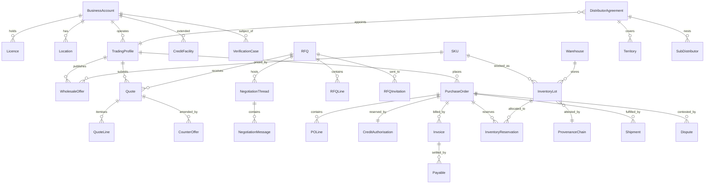
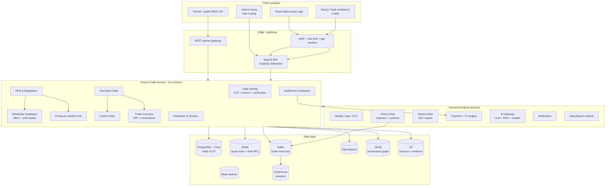
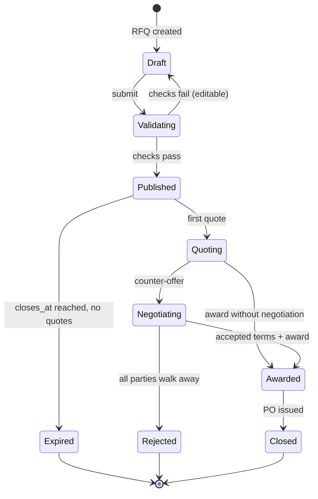
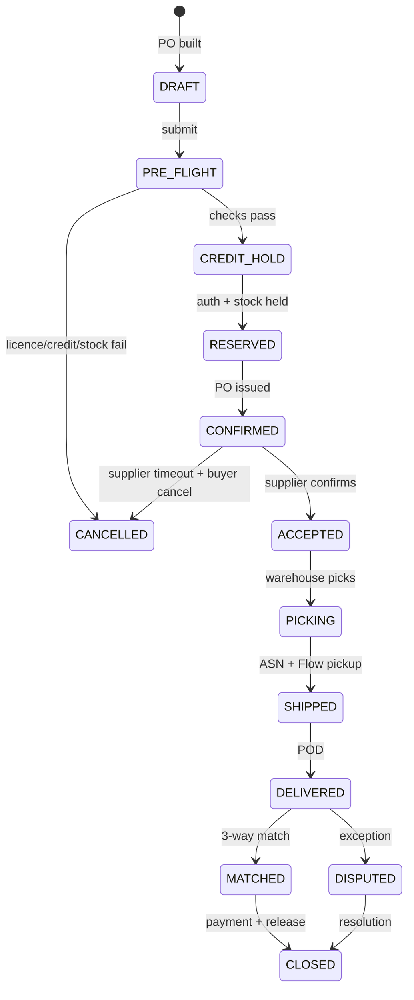
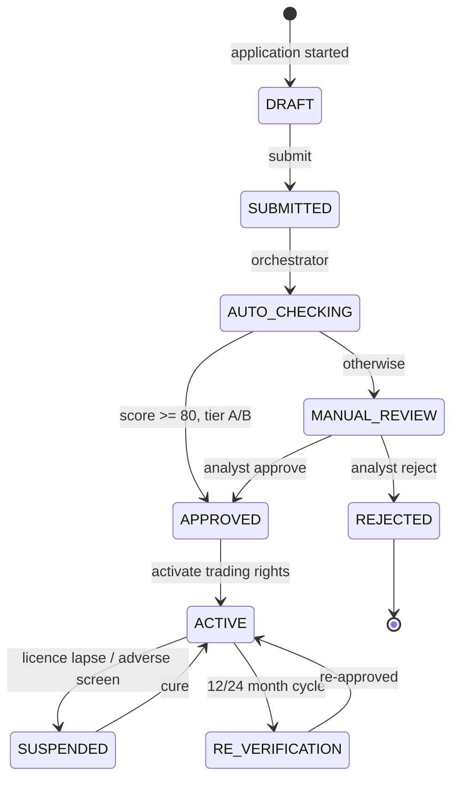
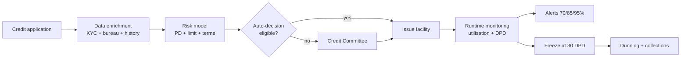

# VINTORA — Global B2B Wholesale Module (Vintora Trade)

> **Companion documents:** `_canon.md`, `03-technical-architecture.md`, `04-database-design.md`, `05-ui-ux-wireframes.md`, `06-ai-features.md`, `02-revenue-model.md`, `08-launch-roadmap.md`, `BUILDING.md`.
> This document is the **domain-level design authority for Vintora Trade**. It defines participants, architecture, data, state machines and end-to-end workflows for the global B2B marketplace. System-wide infrastructure is defined in `03-technical-architecture.md`; table-level OLTP detail is in `04-database-design.md`.

---

## Canon snapshot (binding)

| Dimension | Canonical fact |
|---|---|
| Brand | VINTORA (prose: "Vintora"); *The World's Cellar, Intelligent.* |
| All modules | Vintora Market, Vintora Trade, Vintora Sommelier, Vintora Assist, Vintora Studio, Vintora Seller, Vintora Flow, Vintora Club, Vintora Vault, Vintora Rewards. |
| Module in scope | **Vintora Trade** — B2B wholesale procurement, contracts, RFQs, credit and distribution. |
| Mission fit | Democratize discovery, trade and enjoyment of fine wine and spirits worldwide through applied AI — protecting provenance, safety and responsible consumption. |
| Participants | Wineries, distilleries, distributors, bars, restaurants, hotels (HoReCa), retailers. |
| Revenue | 3–8% GMV + SaaS ($199–$1,499/mo) + financing/credit; 18% of net revenue at Y5 (2031). |
| Roadmap | Phase 2 (Q3–Q4 2027): Trade launches with Seller, Flow, Rewards v1 in US/UK/SG + EU (FR/DE/IT/ES/NL). Phase 3–5 expand globally. |
| Scale context | 10M SKU target, 250k producers, 200+ countries, 40+ licensed warehouses; 1.2M orders/day peak; p95 < 200ms; 99.99% availability. |
| Stack | TypeScript BFF (NestJS/GraphQL), Go domain services, Python AI services, Kafka, PostgreSQL + Citus, Redis, OpenSearch, ClickHouse, Neo4j, S3, Istio, OpenTelemetry. |
| Compliance | KYC/AML, per-jurisdiction alcohol licensing, age assurance, responsible-drinking guardrails, SOC 2 / ISO 27001 / PCI DSS L1, GDPR/CCPA/LGPD/PIPL. |
| Prototype | `apps/prototype/index.html` → Vintora Trade workbench (5 tabs); API contract in `services/api/src/trade.ts` + `app.ts`. All figures are illustrative demo data. |

**Non-claims:** all volumes, limits, take rates and timelines are targets/plans. No real licences, supplier contracts, credit facilities or trade traction are asserted.

---

## 1. Scope and design goals

### 1.1 What Vintora Trade is

A **global, multi-tenant B2B marketplace and operating layer** for the beverage-alcohol supply chain. It connects supply (wineries, distilleries, importers, distributors) with demand (bars, restaurants, hotels, retailers, institutional buyers) in one compliant, auditable, AI-assisted environment.

It is deliberately **not** a generic procurement suite. Every design decision is constrained by three domain realities:

1. **Alcohol is regulated per jurisdiction, per channel, per SKU.** A bottle that can be shipped to a restaurant in one state cannot be shipped direct to a consumer in another. Licensing, tax, age and Incoterm checks are synchronous dependencies of the order state machine.
2. **The product is a vintage, not a commodity.** Each SKU carries producer, appellation, vintage, lot, custody chain and condition. Substitutability is fuzzy; provenance is a hard requirement for trade and investment.
3. **Trade runs on credit and relationships.** Buyers expect terms (Net 30/45/60), volume rebates and negotiated prices. Suppliers expect verified buyers, predictable demand and protected territories.

### 1.2 Design goals (in priority order)

| # | Goal | Measurable outcome |
|---|---|---|
| G1 | Compliance-by-design | Zero orders accepted without valid buyer licence, seller licence and destination rule check. 100% of decisions emit an audit event. |
| G2 | Trust | Every supplier and distributor has a verification state and trust score; every quote is attributable and immutable after award. |
| G3 | Liquid, comparable quotes | Landed-cost normalisation across Incoterms, currencies and duty regimes; quote comparison in one view. |
| G4 | Credit without friction | Pre-approved facilities shown at RFQ time; 80% of routine POs require no manual credit review. |
| G5 | AI that assists, not decides | Copilots draft RFQs, benchmark prices and flag risk; a named human approves every award, price concession and credit change. |
| G6 | Global, multi-currency, multi-tenant | 135+ currencies with locked FX; tenant isolation enforced in the data layer; 200+ markets with jurisdiction rules. |
| G7 | Operability | Every workflow has a state machine, an SLO, an owner and a replayable event trail. |

### 1.3 Out of scope for this module

- Consumer storefront and taste profiling → **Vintora Market / Vintora Sommelier**.
- Seller-facing D2C listing, payouts and analytics → **Vintora Seller** (Trade consumes its catalogue).
- Freight execution, cold chain, customs brokerage → **Vintora Flow** (Trade emits shipment requests).
- Fractional investment and custody → **Vintora Vault** (Trade can source lots into Vault; no commingling).
- Marketing content generation → **Vintora Studio** (Trade supplies price/stock facts).

---

## 2. Marketplace participants

### 2.1 Participant catalogue

| Participant | Also called | Primary need | What they contribute | Verification level | Revenue to Vintora |
|---|---|---|---|---|---|
| **Producer** | Winery, distillery, domaine, estate | Reach trade buyers globally without building a distributor network | SKU master, vintage lots, allocated stock, provenance attestation | `VERIFIED_PRODUCER` (Tier 2) | 3–8% GMV + optional Seller/Studio SaaS |
| **Importer / Wholesaler** | Shipping merchant, négociant | Bulk availability, cross-border arbitrage, inventory financing | Depth of stock, market coverage, bonded inventory | `VERIFIED_SUPPLIER` (Tier 2) | 3–8% GMV |
| **Distributor** | Wholesale distributor, B2B reseller | Protected territory, price book, sub-distributor network | Last-mile trade coverage, local licensing, relationships | `VERIFIED_DISTRIBUTOR` (Tier 2+) | 3–8% GMV + SaaS; rebate sharing |
| **Bar / Restaurant** | On-premise, HoReCa | By-the-glass and by-bottle cost control, fast replenishment | Consumption signal, repeat volume | `VERIFIED_TRADE_BUYER` (Tier 1) | Take rate on GMV; SaaS for premium tools |
| **Hotel** | Hospitality group, resort | Multi-property consistency, banquet volume, wine list curation | Large, predictable volume | `VERIFIED_TRADE_BUYER` (Tier 1) | Take rate + enterprise SaaS |
| **Retailer** | Off-premise, wine shop, supermarket chain | Shelf-stable supply, margin protection, allocation access | Scale, forecast data | `VERIFIED_TRADE_BUYER` (Tier 1) | Take rate + SaaS |
| **Institutional buyer** | Airlines, cruise, corporate, government | Tender/RFQ at scale, contractual compliance | Tender volume | `VERIFIED_TRADE_BUYER` (Tier 2) | Take rate + enterprise SaaS |
| **Bonded warehouse** | 3PL, customs warehouse | Storage, custody, lot integrity | Stock availability, temperature telemetry | `VERIFIED_WAREHOUSE` (Tier 2) | Flow warehousing revenue |
| **Carrier / broker** | Freight forwarder, customs broker | Compliance-ready movement | Tracking, DDP capability | `VERIFIED_CARRIER` (Tier 2) | Flow cost-plus freight |
| **Vintora operator** | Platform, marketplace operator | Market integrity, dispute resolution, compliance | Trust infrastructure, AI, capital | Internal | Take rate, SaaS, financing margin |

### 2.2 Account hierarchy

```text
BusinessAccount (tenant root)
├── Organisation (legal entity, jurisdiction, tax id)
│   ├── Licence[] (per premises / per channel / per jurisdiction)
│   ├── Location[] (warehouse, restaurant, hotel property, store)
│   ├── User[] (buyer, approver, finance, warehouse manager, auditor)
│   ├── RoleBinding[] (RBAC + spend authority)
│   └── TradingProfile (one or more of:)
│       ├── ProducerProfile
│       ├── SupplierProfile
│       ├── DistributorProfile
│       └── TradeBuyerProfile
├── CreditFacility (one per currency / legal entity)
└── VerificationCase (current + history)
```

A single legal entity may hold several trading profiles (e.g. a négociant that both buys and resells). **Tenant isolation** is enforced by `tenant_id` on every row; a user's effective identity is `(user_id, tenant_id, trading_profile_id)`.

### 2.3 Permission matrix (abridged)

| Action | Producer | Distributor | Buyer (Bar/Rest) | Buyer (Hotel/Retail) | Vintora Ops |
|---|---|---|---|---|---|
| Publish wholesale price list | ✓ own SKUs | ✓ appointed SKUs | — | — | ✓ audit |
| Respond to RFQ | ✓ | ✓ | — | — | — |
| Create RFQ | ✓ (sourcing) | ✓ | ✓ | ✓ | ✓ (demo) |
| Negotiate price / counter | ✓ | ✓ | ✓ within authority | ✓ within authority | — |
| Award quote / issue PO | — | ✓ (resale) | ✓ | ✓ | ✓ (override, logged) |
| View own credit facility | ✓ | ✓ | ✓ | ✓ | ✓ |
| Approve credit increase | — | — | — | — | ✓ only |
| Manage inventory / ATP | ✓ | ✓ | — | — | ✓ audit |
| Appoint sub-distributor | ✓ (brand owner) | ✓ within territory | — | — | ✓ audit |
| View landed-cost comparison | ✓ | ✓ | ✓ | ✓ | ✓ |
| Raise dispute | ✓ | ✓ | ✓ | ✓ | ✓ |
| Close dispute | — | — | — | — | ✓ only |

**Spend authority bands** are configured per user: `0–$5k` auto, `$5k–$50k` manager, `$50k–$250k` finance director, `>$250k` two-person rule + ops review.

---

## 3. Domain model

### 3.1 Core entities and relationships



### 3.2 Entity definitions (key fields)

| Entity | Grain | Key fields | Notes |
|---|---|---|---|
| `BusinessAccount` | one legal entity | `tenant_id`, `legal_name`, `country`, `tax_id`, `registration_number`, `kyc_tier`, `status`, `risk_score` | Root of all trade identity. |
| `Licence` | one permit per premises/channel | `licence_id`, `tenant_id`, `jurisdiction`, `licence_type` (on/off-premise, wholesale, import, export, bonded), `valid_from`, `valid_to`, `issuer`, `document_uri`, `verification_state` | Hard gate on every order. |
| `Location` | one physical site | `location_id`, `tenant_id`, `type` (warehouse/store/restaurant/hotel), `address`, `jurisdiction`, `warehouse_id?` | Destination rule resolution. |
| `TradingProfile` | one role per account | `profile_id`, `tenant_id`, `kind` (PRODUCER/SUPPLIER/DISTRIBUTOR/BUYER), `categories`, `territories`, `status` | A buyer can also be a reseller. |
| `VerificationCase` | one onboarding/re-verification | `case_id`, `tenant_id`, `stage`, `score`, `checks[]`, `decision`, `decided_by`, `decided_at`, `expires_at` | Re-verification every 12–24 months by risk tier. |
| `SKU` | one saleable bottle/pack | `sku_id`, `producer_id`, `appellation`, `vintage`, `pack_format`, `abv`, `liquid_color`, `provenance_score` | Shared with Market via `Vintora Seller`. |
| `InventoryLot` | one physical lot at a warehouse | `lot_id`, `sku_id`, `warehouse_id`, `quantity_cases`, `available_cases`, `bonded`, `condition`, `temperature_range`, `received_at`, `expiry_or_peak_at` | FEFO allocation; lot-level provenance. |
| `WholesaleOffer` | one price book line | `offer_id`, `profile_id`, `sku_id`, `currency`, `price_per_case`, `tier_breaks[]`, `moq_cases`, `incoterm`, `valid_from/to`, `status` | Tier breaks: `min_cases → price`. |
| `RFQ` | one sourcing event | `rfq_id`, `buyer_tenant_id`, `market`, `incoterm`, `delivery_window`, `status`, `closes_at`, `target_price_usd`, `visibility` | One RFQ per target market + window. |
| `RFQLine` | one requested item | `line_id`, `rfq_id`, `sku_id?`, `description`, `cases`, `target_price`, `substitution_allowed`, `vintage_preference` | Free-text lines supported for rare bottles. |
| `RFQInvitation` | one recipient | `rfq_id`, `supplier_profile_id`, `state` (INVITED/VIEWED/QUOTED/DECLINED), `confidential` | Anonymous mode hides buyer identity until award. |
| `Quote` | one supplier response | `quote_id`, `rfq_id`, `supplier_profile_id`, `status`, `valid_until`, `total_usd`, `landed_cost_usd`, `rank` | Immutable once `AWARDED`. |
| `QuoteLine` | one priced line | `quote_line_id`, `rfql_line_id`, `sku_id`, `price_per_case`, `cases`, `incoterm`, `lead_days`, `moq_cases`, `allocation_limit` | Drives landed-cost normalisation. |
| `CounterOffer` | one negotiation round | `counter_id`, `quote_id`, `round`, `proposer_side`, `price_per_case`, `terms_json`, `status`, `expires_at`, `accepted_by` | Max rounds configurable; all logged. |
| `PurchaseOrder` | one binding order | `po_id`, `rfq_id?`, `buyer_tenant_id`, `supplier_tenant_id`, `currency`,`total`, `status`, `incoterm`, `payment_terms`, `credit_auth_id` | The settlement unit. |
| `CreditFacility` | one facility per legal entity/currency | `facility_id`, `tenant_id`, `currency`, `limit`, `used`, `available`, `terms`, `status`, `expires_at` | Utilisation checked at PO. |
| `CreditAuthorisation` | one hold per PO | `auth_id`, `facility_id`, `po_id`, `amount`, `status`, `expires_at` | 30-day hold released on settlement. |
| `Invoice` / `Payable` | billing and ageing | `invoice_id`, `po_id`, `amount`, `due_at`, `status`, `bucket` | 3-way match with PO and ASN. |
| `DistributorAgreement` | one appointment | `agreement_id`, `brand_tenant_id`, `distributor_tenant_id`, `territories[]`, `categories[]`, `rebate_schedule`, `exclusivity`, `valid_from/to`, `status` | Governs territory and sub-distribution. |
| `Dispute` | one contested event | `dispute_id`, `po_id`, `reason`, `evidence[]`, `status`, `owner`, `sla_due_at` | Holds payment until resolution. |

### 3.3 Immutability and audit rules

- `Quote` and `CounterOffer` are **append-only**. A revised quote is a new row with a `supersedes_id`.
- Every state transition writes an `AuditEvent` with `(actor_id, tenant_id, entity_type, entity_id, from_state, to_state, reason, trace_id, occurred_at)` to Kafka topic `trade.audit.v1` and an append-only Postgres table.
- Financial values store both `amount_minor` and `currency`; FX rate + `fx_locked_at` + `fx_source` are mandatory on any non-USD record.
- JsonB `terms_json` is validated against a versioned schema registry; unknown keys are rejected.

---

## 4. Architecture

### 4.1 Service map



### 4.2 Service responsibilities

| Service | Language | Owns | Hard rules |
|---|---|---|---|
| **Trade Identity** | Go | Business accounts, licences, verification cases, trust score | No PO/RFQ without `status = VERIFIED` and valid licence for destination. |
| **Wholesale Catalogue** | Go | Price books, tier breaks, allocations, offer lifecycle | Prices are tenant-scoped; no cross-tenant read without agreement. |
| **RFQ & Negotiation** | Go | RFQ, invitations, quotes, counter-offers, ranking | Quotes immutable after award; one award per RFQ line. |
| **Pricing & Landed Cost** | Go | Incoterm normalisation, duty/tax estimate, FX lock simulation | Must disclose every additive component; no silent spread. |
| **Purchase Order** | Go | PO lifecycle, ASN, partial shipments, amendments | PO state machine is the only writer of `po.status`. |
| **Credit & Risk** | Go/Python | Facilities, scoring, authorisations, ageing, dunning | PO above available credit is rejected, never queued. |
| **Trade Inventory** | Go | Lots, ATP, reservations, FEFO, cycle counts | Oversell prevented by atomic decrement under row lock. |
| **Distributor & Territory** | Go | Agreements, territories, sub-distributors, rebates | Territory conflicts resolved before quote publication. |
| **Settlement & Disputes** | Go | Invoices, 3-way match, payables, disputes, chargebacks | Dispute auto-holds related payable. |
| **Trade Copilot** | Python | RFQ drafting, price benchmarking, risk flags, negotiation guidance | Suggestions are advisory; never auto-approve. |

### 4.3 Event contract (Kafka topics)

| Topic | Producer | Key consumers | Payload essence |
|---|---|---|---|
| `trade.verification.completed.v1` | Trade Identity | RFQ, Catalogue, Analytics | `tenant_id, decision, score, kyc_tier, valid_until` |
| `trade.licence.expiring.v1` | Trade Identity | Notification, PO, Ops | `licence_id, days_remaining` |
| `trade.rfq.published.v1` | RFQ | Catalogue, Notification, Analytics | `rfq_id, lines[], invitations[], closes_at` |
| `trade.quote.received.v1` | RFQ | Notification, Analytics | `quote_id, rfq_id, supplier_id, total_usd` |
| `trade.negotiation.countered.v1` | RFQ | Notification, Trade Copilot | `counter_id, round, proposer_side, delta_pct` |
| `trade.rfq.awarded.v1` | RFQ | PO, Inventory, Credit, Analytics | `rfq_id, quote_id, buyer_id, supplier_id` |
| `trade.po.created.v1` | PO | Credit, Inventory, Flow, Settlement, Analytics | `po_id, lines[], total, incoterm, pay_terms` |
| `trade.po.confirmed.v1` | PO | Inventory, Flow, Notification | `po_id, warehouse_id, ship_window` |
| `trade.inventory.reserved.v1` | Trade Inventory | PO, Analytics | `po_id, lot_ids[], cases, warehouse_id` |
| `trade.shipment.requested.v1` | PO | Vintora Flow | `po_id, origin, destination, incoterm, temp_range` |
| `trade.shipment.milestone.v1` | Vintora Flow | PO, Notification, Analytics | `po_id, milestone, temp, location, occurred_at` |
| `trade.invoice.matched.v1` | Settlement | Credit, Analytics | `invoice_id, po_id, amount, due_at` |
| `trade.dispute.opened.v1` | Settlement | Notification, Ops, Credit | `dispute_id, po_id, reason, amount_held` |
| `trade.credit.utilisation.v1` | Credit | Notification, Analytics | `facility_id, used, available, pct` |
| `trade.audit.v1` | all | audit sink, SIEM | `actor, entity, from, to, reason, trace_id` |

All topics are **at-least-once** with idempotent consumers keyed by `(event_id, consumer_name)`. Dead-letter topics are monitored with a 15-minute alert.

### 4.4 Synchronous vs asynchronous boundaries

| Boundary | Mode | Why |
|---|---|---|
| BFF → Trade services | gRPC (Istio, mTLS) | Low latency, typed contracts. |
| PO → Credit authorisation | Synchronous | Must fail fast before stock reservation. |
| PO → Inventory reservation | Synchronous (row lock) | Oversell prevention requires atomicity. |
| PO → Flow shipment | Asynchronous event | Carrier assignment is slow and retryable. |
| Quote → Notification | Asynchronous | Email/in-app is not in the critical path. |
| Any transition → audit | Asynchronous + transactional outbox | Audit cannot block the buyer, but cannot be lost. |

---

## 5. Workflows

Each workflow below follows the same contract: **trigger → actors → preconditions → steps → state transition → postconditions → failure paths → SLA**.

### 5.1 Supplier verification and onboarding

**Trigger:** a producer, importer or distributor submits a verification application.
**Actors:** applicant (`BUSINESS_ADMIN`), Trade Identity automated checks, KYC vendor, Ops reviewer (`COMPLIANCE_ANALYST`).
**Preconditions:** account exists; beneficial owners declared; jurisdiction supported.

| # | Step | System action | Human action |
|---|---|---|---|
| 1 | Submit application | Capture legal entity, registrations, owners, premises, licences, bank account, categories, target markets | Upload documents |
| 2 | Automated KYC/KYB | Registry match, sanctions/PEP screen, tax-id validation, bank account ownership, UBO control graph | — |
| 3 | Licence validation | Parse licence document, verify issuer/validity/channel against jurisdiction rule table | — |
| 4 | Product authenticity spot-check | Cross-reference SKU/brand against producer registry; request label scan for top 5 SKUs | Upload label scans if requested |
| 5 | Risk scoring | Produce `verification_score` 0–100 and `risk_tier` A–D | — |
| 6a | Auto-approve (tier A/B, score ≥ 80) | Set `VERIFIED`, enable price lists and RFQ response | — |
| 6b | Manual review (tier C/D or score < 80) | Create review task with evidence bundle | Analyst approves / rejects / requests evidence |
| 7 | Activation | Issue trust badge, set listing/quote quotas, credit eligibility, publish to search index | — |
| 8 | Continuous monitoring | Re-screen daily; re-verify at 12 (high risk) / 24 (low risk) months; licence-expiry alerts at 60/30/7 days | — |

**States:** `DRAFT → SUBMITTED → AUTO_CHECKING → MANUAL_REVIEW → APPROVED | REJECTED | SUSPENDED → RE_VERIFICATION`.

**Failure paths:** sanctions hit → immediate `REJECTED` + SAR workflow; licence mismatch → request correction, no quote rights; bank ownership mismatch → hold payouts; document expiry → `SUSPENDED` with 7-day cure window.

**SLA:** automated checks ≤ 90 seconds p95; manual review ≤ 2 business days; suspension propagation to all services ≤ 5 seconds via event.

**Verification score components (illustrative weights):**

| Component | Weight | Evidence |
|---|---:|---|
| Legal entity & registration | 15 | Registry API, document OCR |
| UBO / sanctions / PEP | 20 | KYC vendor |
| Licence completeness & validity | 25 | Licence registry / issuer |
| Trade history & references | 15 | Bank/trade references, platform history |
| Product authenticity | 15 | Producer registry, label scan, provenance graph |
| Financial signals | 10 | Bank verification, credit bureau where available |

### 5.2 Distributor management and territory appointment

**Trigger:** a brand owner wants market coverage via a distributor, or a distributor applies for a brand.
**Actors:** brand owner (`BRAND_MANAGER`), distributor (`DISTRIBUTOR_ADMIN`), Vintora Ops (conflict arbiter).

| # | Step | Detail |
|---|---|---|
| 1 | Candidate discovery | Search verified distributors by market, channel, category, warehouse footprint and performance tier |
| 2 | Territory proposal | Brand proposes `territories[]` (country/state/postcode), `categories[]`, exclusivity, minimum annual volume, rebate schedule |
| 3 | Conflict check | Service compares overlapping active agreements; hard-block on exclusivity collision, warn on non-exclusive overlap |
| 4 | Due diligence | Brand reviews licences, financials, sub-distributor list; platform supplies trust score and dispute history |
| 5 | Agreement execution | E-signature on structured template; versioned terms stored in S3 with hash on-chain-equivalent audit row |
| 6 | Activation | Price book published to distributor; territory added to quote eligibility; sub-distributors inherited |
| 7 | Performance monitoring | Quarterly scorecard: sell-through, on-time payment, forecast accuracy, chargeback rate, brand compliance |
| 8 | Rebate settlement | Rebates accrue per case sold; settled quarterly against verified sell-out data |
| 9 | Renewal / termination | 60-day notice; termination freezes new quotes, allows run-off of accepted POs |

**States:** `PROPOSED → CONFLICT_CHECK → DUE_DILIGENCE → EXECUTED → ACTIVE → UNDER_REVIEW → RENEWED | TERMINATED`.

**Sub-distributor rule:** a distributor may appoint sub-distributors only if the parent agreement sets `sub_distribution_allowed = true`. Every sub-distributor is independently verified; the parent remains liable for compliance.

**SLA:** conflict check ≤ 2 seconds; activation ≤ 15 minutes after signature.

### 5.3 RFQ lifecycle

**Trigger:** a trade buyer wants to source a defined set of bottles for a market and delivery window.
**Actors:** buyer (`BUYER`, `BUYER_MANAGER`), invited suppliers, Trade Copilot, Vintora Ops (only for disputes).

| # | Step | System action | Human action |
|---|---|---|---|
| 1 | Draft | Copilot pre-fills lines from past POs, current price books and demand forecast | Buyer edits SKU/vintage/cases/target/market/window/Incoterm |
| 2 | Pre-flight validation | Check buyer licence for destination, credit headroom, target-price realism against benchmark, stock feasibility | — |
| 3 | Invitation | Select all verified suppliers, a shortlist, or anonymous broadcast; apply territory rules | Buyer confirms recipient list |
| 4 | Publish | Freeze RFQ version, set `closes_at`, emit event, notify suppliers | — |
| 5 | Quoting | Suppliers submit one quote per RFQ; partial-line quotes allowed; confidentiality enforced until award | Supplier prices, sets MOQ/lead/Incoterm |
| 6 | Clarification | Buyer and supplier exchange structured questions attached to a line | — |
| 7 | Ranking | Normalise every quote to landed cost per case in buyer currency; rank; show target delta | Buyer reviews comparison |
| 8 | Negotiation | Counter-offers on price, MOQ, lead time, terms; each round time-boxed | Both sides approve within authority |
| 9 | Award | Buyer awards per line or whole RFQ; generates PO atomically | Buyer clicks **Award** |
| 10 | Close | Unsuccessful suppliers notified; quote set frozen; RFQ marked `AWARDED` | — |

**States:** `DRAFT → VALIDATING → PUBLISHED → QUOTING → NEGOTIATING → AWARDED → CLOSED`, with branches `CANCELLED`, `EXPIRED`, `NO_BIDS`.

**Failure paths:**

- No quotes by `closes_at` → `EXPIRED`; buyer is offered auto-invite to next-best suppliers.
- Credit headroom disappears mid-RFQ → warning at publish and hard block at award.
- Supplier licence expires mid-RFQ → quote automatically withdrawn and flagged.
- Target price unrealistic (> 35% below benchmark median) → Copilot warns; buyer may proceed with logged acknowledgement.

**SLA:** publish pre-flight ≤ 1.5 s p95; comparison recompute on quote arrival ≤ 2 s; award → PO ≤ 500 ms.

**Landed-cost normalisation (per case):**

```text
landed_cost = unit_price
            + freight_per_case(incoterm, route, temperature_band)
            + duty_and_excise(if incoterm = DAP and destination requires it)
            + insurance(0.3%–1.2% × insured value)
            + FX_adjustment(buyer_currency, locked_rate)
            - rebate_earned(volume tier, contract)
```

Every component is displayed. DDP quotes include duty; DAP quotes show an explicit duty estimate. The API reference implementation exposes this as `landedCostPerBottleUsd` in `services/api/src/trade.ts`.

### 5.4 Price negotiation workflow

**Trigger:** a counter-offer is submitted on a quote or a buyer requests a volume break.
**Actors:** buyer or supplier negotiator, Trade Copilot, approvers per spend authority.

| # | Step | Detail |
|---|---|---|
| 1 | Intent | Proposer selects fields to change: `unit_price`, `cases`, `moq`, `lead_days`, `incoterm`, `payment_terms`, `rebate`, `delivery_window` |
| 2 | Guardrail check | Reject terms outside configuration (e.g. payment terms > Net 90, negative price); check authority band |
| 3 | Copilot guidance | Show benchmark median/p25/p75 for comparable SKU+vintage+market+window, historical acceptance rate, and estimated landed-cost impact |
| 4 | Submit | Counter-offer written as new immutable row with `round`, `expires_at` (default 24 h) |
| 5 | Counterparty response | Accept / reject / counter; max 6 rounds then escalation to human-to-human |
| 6 | Approval chain | If concession exceeds authority, route to manager/finance; two-person rule above $250k |
| 7 | Lock | Accepted terms produce a `PriceLock` with 15-minute FX lock and 24-hour quote hold |
| 8 | Award | Accepted counter becomes the quoted price for PO generation |

**States:** `OPEN → COUNTERED ↔ COUNTERED → ACCEPTED | REJECTED | EXPIRED | ESCALATED`.

**Negotiation guardrails:**
- No hidden side payments; all concessions in `terms_json`.
- Discount above 12% from list requires regional manager approval; above 20% requires ops review.
- Alcohol-policy copy and responsible-drinking obligations cannot be negotiated away.

### 5.5 Bulk ordering workflow

**Trigger:** RFQ award, contract price-list selection, spot buy, framework call-off or recurring replenishment.
**Actors:** buyer, supplier, Trade Inventory, Credit, Flow, Settlement.

| # | Step | Detail |
|---|---|---|
| 1 | Build order | Lines from awarded quote / price book; case packs and mixed pallets validated |
| 2 | Pre-flight | Buyer licence, seller licence, destination rule, import allowance, credit headroom, ATP — all synchronous |
| 3 | Credit authorisation | Hold `total + 10%` (freight/duty buffer) for 30 days; release on invoice settlement |
| 4 | Stock reservation | Atomic FEFO allocation across warehouses; lot IDs captured; provenance chain attached |
| 5 | PO issue | `PO` created in `CONFIRMED`; buyer and supplier see the same immutable document |
| 6 | Supplier acceptance | Supplier confirms within SLA (default 4 business hours); auto-reminder at 2 h |
| 7 | Pick & pack | Warehouse picks lots; temperature log starts; ASN generated |
| 8 | Shipment | `trade.shipment.requested.v1` → Vintora Flow books carrier, customs and insurance |
| 9 | Milestones | Picked → In transit → Customs → Out for delivery → Delivered; telemetry to TimescaleDB |
| 10 | Receipt & 3-way match | Buyer confirms receipt (or ASN auto-confirm after 48 h); PO + ASN + Invoice matched |
| 11 | Invoice & payable | Invoice generated per agreed terms; payable ages; FX locked at PO unless contract states otherwise |
| 12 | Close | PO `CLOSED`; credit hold released; loyalty/Rewards accrual emitted; analytics updated |

**States:** `DRAFT → PRE_FLIGHT → CREDIT_HOLD → RESERVED → CONFIRMED → ACCEPTED → PICking → SHIPPED → DELIVERED → MATCHED → CLOSED`, branches `CANCELLED`, `PARTIALLY_SHIPPED`, `EXCEPTION`, `DISPUTED`.

**Bulk-specific rules:**
- Volume tiers apply at **PO level** across all lines in the same currency and delivery window.
- Mixed pallets are allowed only when all lots share temperature band and origin warehouse.
- Partial shipment requires buyer opt-in (`allow_partial = true`) and generates one PO sub-shipment per release.
- Allocated/limited wines enforce per-account quota from the producer agreement.

**SLA:** pre-flight ≤ 1 s p95; reservation ≤ 300 ms p95; supplier acceptance reminder at 2 h; shipment request emitted within 60 s of confirm.

### 5.6 Credit limits and financing

**Trigger:** a buyer requests terms, or an existing facility reaches a review date / utilisation threshold.
**Actors:** buyer (`FINANCE_CONTACT`), Credit & Risk service, credit bureau, Vintora Credit Committee.

| # | Step | Detail |
|---|---|---|
| 1 | Application | Requested limit, currency, desired terms, bank/trade references, audited statements (SME) or corporate guarantee (enterprise) |
| 2 | Data enrichment | KYC/KYB status, platform payment history, bureau data where available, bank account behaviour, ownership, jurisdiction risk |
| 3 | Scoring | Model outputs `limit_recommendation`, `terms_recommendation`, `pd` (probability of default), `risk_tier` |
| 4a | Auto-decision (≤ $50k and tier A/B) | Approve instantly |
| 4b | Committee review (>$50k or tier C/D) | Credit Committee approves / reduces / declines with reason |
| 5 | Facility activation | `CreditFacility` created with limit, used = 0, available, terms, 12-month expiry |
| 6 | Runtime control | Each PO consumes an authorisation; utilisation alerts at 70% / 85% / 95% |
| 7 | Monitoring | Weekly behavioural review; DPD (days past due) tracking; automatic freeze at 30 DPD |
| 8 | Dunning | T-3 reminder, due-date notice, 7/14/30-day escalations, collections handoff at 45 DPD |
| 9 | Review | Quarterly or on trigger; limit increase requires updated financials |

**Illustrative scoring inputs (weights are targets, not claims):**

| Input | Weight | Direction |
|---|---:|---|
| Platform payment history (on-time %) | 30 | Higher is better |
| Trade/bank references | 20 | Higher is better |
| Financial capacity (turnover, leverage) | 20 | Higher is better |
| Verification & licence standing | 15 | Higher is better |
| Jurisdiction & category risk | 10 | Lower is better |
| Relationship tenure & repeat volume | 5 | Higher is better |

**Controls:** exposure capped at `min(requested, recommended, collateral_support)`; no single buyer > 5% of total credit book at launch; credit insurance on balances above $100k where available; FX mismatch requires 10% buffer.

**Failure paths:** bureau unavailable → manual review with no auto-approval; adverse UBO change → freeze facility and require re-verification; licence suspension → immediate freeze.

### 5.7 Inventory management

**Trigger:** stock received, PO reservation, shipment milestone, cycle count, replenishment signal.
**Actors:** warehouse manager, Trade Inventory service, Vintora Flow, demand-forecast model.

| # | Step | Detail |
|---|---|---|
| 1 | Receipt | Goods-in records lot, cases, condition, temperature, bonded/duty-paid status, provenance attestation |
| 2 | Availability | `available_cases = quantity_cases - reserved_cases - quarantined_cases` |
| 3 | Allocation | FEFO by default; vintage lot preference from RFQ; single-warehouse preference to minimise split shipments |
| 4 | Reservation | Atomic row lock; reservation TTL 30 minutes pending PO confirm, then firm |
| 5 | In-transit visibility | Reserved stock shown as `in_transit` after ASN; excluded from ATP for other buyers |
| 6 | Condition monitoring | Temperature excursion → quarantine lot → block further reservations → dispute workflow |
| 7 | Cycle count | Weekly ABC counts; variance > 0.5% triggers investigation and audit event |
| 8 | Replenishment | Forecast model predicts 8-week demand by SKU/warehouse; suggests purchase or transfer |
| 9 | Peak/expiry management | For age-sensitive inventory, FEFO + peak-window warnings; no automatic write-off |

**States:** `RECEIVED → AVAILABLE → RESERVED → PICKED → IN_TRANSIT → DELIVERED`, branches `QUARANTINED`, `ADJUSTED`, `RETURNED`.

**Warehouse modes:** owned/dedicated, 3PL, **bonded** (duty suspended until release) and **duty-paid**. A PO may span both; the invoice must disclose each line's tax treatment.

### 5.8 Settlement and dispute handling

**Trigger:** invoice generated, buyer rejects goods, temperature excursion, quantity mismatch.
**Actors:** buyer, supplier, Settlement service, Vintora Ops.

| # | Step | Detail |
|---|---|---|
| 1 | Invoice | Generated on delivery/ASN per terms; references PO and lot IDs; FX locked |
| 2 | 3-way match | PO qty/price × ASN qty × invoice qty/price; tolerance 1% by value |
| 3 | Approval | Auto-approve within tolerance; otherwise hold and route to buyer finance |
| 4 | Payment | At due date via agreed rail (SEPA, ACH, wire, local methods, USDC for eligible accounts) |
| 5 | Dispute open | Reason: quality, quantity, condition, documentation, late delivery; evidence upload; related payable auto-held |
| 6 | Adjudication | Ops reviews evidence with carrier/warehouse telemetry and provenance chain |
| 7 | Resolution | Refund, credit note, replacement shipment or rejection; audit event; trust-score impact |
| 8 | Close | Payable released or written off; dispute SLA tracked (target ≤ 5 business days) |

**States:** `INVOICED → MATCHED → APPROVED → PAID → CLOSED`, branches `ON_HOLD`, `DISPUTED`, `CREDIT_NOTE`, `CHARGEBACK`.

---

## 6. State machines (consolidated)







---

## 7. Pricing, landed cost and negotiation engine

### 7.1 Price stack

```text
List price (supplier, currency)
  − volume tier discount (cases in PO)
  − contract rebate (agreement)
  − negotiated concession (counter-offer)
  + freight (Incoterm, route, temp band)
  + duty / excise / taxes (destination, DAP only)
  + insurance (0.3–1.2% of insured value)
  + payment-term cost (Net 60 vs Net 30)
  + FX conversion at locked rate
  = landed cost per case (buyer currency)
```

### 7.2 Benchmarking data

| Signal | Source | Use |
|---|---|---|
| Comparable transactions | Internal ClickHouse (SKU, vintage, market, window) | Price fairness band |
| Published price books | Wholesale Catalogue | List-price reference |
| Auction results | Vintora Vault + partner feeds | Rare-bottle reference |
| External indices | Licensed market data where available | Macro trend context |
| Demand forecast | Feature store (Feast) | Expected price drift |

The Copilot shows p25/median/p75 and a confidence band. It never states a "correct" price — it discloses comparables and lets the human decide.

### 7.3 Constraint solver

Negotiation proposals are validated against:

- **Hard constraints:** price > 0; case pack integer; MOQ respected; licence valid; no conflicting territory; credit headroom; FX rate available.
- **Soft constraints:** target price, desired lead time, preferred Incoterm, rebate target.
- **Approval policy:** concession thresholds by role and value.
- **Expiry:** every counter-offer has `expires_at`; expired offers cannot be accepted.

---

## 8. Credit and risk architecture



**Key controls:** facility is per legal entity + currency; PO authorisation holds `total × 1.10`; authorisation TTL 30 days; utilisation recomputed on every PO, invoice and payment event; all changes are append-only and require named approver.

---

## 9. AI capabilities (Vintora Trade Copilot)

| Capability | Model / technique | Input | Output | Guardrail |
|---|---|---|---|---|
| RFQ drafting | LLM + retrieval over past POs and price books | Buyer history, seasonality, menu/wine list | Draft RFQ lines and target prices | Buyer must confirm every line |
| Price benchmarking | Gradient boosting + comparable index | SKU, vintage, market, window, condition | Fair-value band and confidence | Explained with comparables |
| Negotiation guidance | Rule engine + bandit on historical acceptance | Round, counterparty, concession history | Suggested next offer and walk-away | Human sends all offers |
| Credit risk | XGBoost/LightGBM PD model | KYC, payment history, bureau, financials | Limit, terms, risk tier | Auto-approval capped at $50k |
| Demand forecasting | LightGBM / temporal model | Sell-out, seasonality, events, weather | 8-week demand by SKU/warehouse | Planner approves transfers |
| Fraud / collusion detection | Graph analytics + anomaly detection | Quote patterns, bidder relationships, timing | Flag suspicious RFQs | Ops investigates; no auto-rejection |
| Document intelligence | OCR + LLM extraction | Licences, invoices, certificates | Structured fields + confidence | Low confidence → manual review |
| Dispute triage | Classifier + retrieval of telemetry | Evidence, photos, temperature logs | Recommended resolution | Ops decides |

All Copilot calls go through the canonical **AI Gateway** (`06-ai-features.md`) with prompt versioning, evaluation sets, PII redaction and cost attribution to `tenant_id`.

---

## 10. Compliance framework

### 10.1 Licensing gate by jurisdiction model

| Jurisdiction model | Examples | Trade rule |
|---|---|---|
| Three-tier (US states) | CA, NY, IL | Producer → licensed distributor → licensed retailer/on-premise. Direct producer-to-retail allowed only where statute permits; platform encodes state-by-state rules. |
| Wholesale licence regime | UK, EU members | Wholesale authorisation required for B2B resale; excise and duty suspended in bond until release. |
| State monopoly / control board | CA (Canada), some Nordic markets | Trade may only transact with the control board or licensed agent; no direct supplier bids. |
| Import-licence regime | JP, AE, SG, CN | Importer-of-record must be verified and hold import permit; DDP quotes require broker. |
| Dry / restricted jurisdictions | Various | Hard block on all trade for the destination, regardless of buyer verification. |

Rules live in a versioned `jurisdiction_rule` table evaluated at RFQ pre-flight, PO pre-flight and shipment request. A rule change is a data migration with effective dating — never a code hotfix.

### 10.2 Compliance checklist per order

- [ ] Buyer licence valid for channel (on-premise / off-premise / wholesale) and destination
- [ ] Seller licence valid for sale and origin
- [ ] Destination import/export allowance and duty regime resolved
- [ ] Age assurance recorded for business principals and delivery contact
- [ ] Product classification (wine/spirit/fortified) matched to licence scope
- [ ] Incoterm assigned and disclosed; DDP broker identified
- [ ] Excise/duty treatment disclosed per line (bonded vs duty-paid)
- [ ] Responsible-drinking and no-health-claims language present in all copy
- [ ] KYC/AML screening current for both parties
- [ ] Audit event emitted with `trace_id`

### 10.3 Tax, Incoterms and records

- **Tax:** VAT/GST, excise and customs duty computed by destination rule engine; tax-inclusive and tax-exclusive prices both displayed; VAT IDs validated where supported.
- **Incoterms:** DAP and DDP supported at launch; FOB/CIF available for container lots in Phase 3. Incoterm determines duty responsibility and insurance requirement.
- **Records:** licence documents, agreements, invoices, ASN, temperature logs and audit events retained for 7 years (configurable by jurisdiction), encrypted at rest in S3 with object lock.

---

## 11. API contracts

### 11.1 REST (partner/public) — illustrative

| Method | Path | Purpose |
|---|---|---|
| `POST` | `/v1/trade/accounts` | Create business account |
| `POST` | `/v1/trade/verification-cases` | Start verification |
| `GET` | `/v1/trade/verification-cases/:id` | Verification status + checks |
| `GET` | `/v1/trade/licences` | List licences for account |
| `POST` | `/v1/trade/licences` | Submit licence |
| `GET` | `/v1/trade/suppliers?category=&market=` | Verified supplier directory |
| `GET` | `/v1/trade/offers?sku_id=&market=` | Wholesale price books |
| `POST` | `/v1/trade/rfqs` | Create RFQ |
| `GET` | `/v1/trade/rfqs` | RFQ pipeline |
| `GET` | `/v1/trade/rfqs/:id` | RFQ detail |
| `POST` | `/v1/trade/rfqs/:id/publish` | Publish and invite suppliers |
| `GET` | `/v1/trade/rfqs/:id/quotes` | Ranked quotes (landed cost) |
| `POST` | `/v1/trade/rfqs/:id/quotes` | Submit quote (supplier) |
| `POST` | `/v1/trade/quotes/:id/counters` | Counter-offer |
| `POST` | `/v1/trade/rfqs/:id/award` | Award quote → PO |
| `GET` | `/v1/trade/purchase-orders` | PO list |
| `POST` | `/v1/trade/purchase-orders/:id/confirm` | Supplier confirmation |
| `GET` | `/v1/trade/inventory/lots?sku_id=&warehouse_id=` | Lot availability |
| `POST` | `/v1/trade/inventory/reservations` | Reserve stock |
| `GET` | `/v1/trade/credit` | Credit facility |
| `POST` | `/v1/trade/credit/applications` | Apply for terms |
| `GET` | `/v1/trade/credit/utilisation` | Current exposure |
| `GET` | `/v1/trade/distributors` | Distributor directory |
| `POST` | `/v1/trade/distributor-agreements` | Appoint distributor |
| `GET` | `/v1/trade/distributor-agreements/:id/territories` | Territory map |
| `GET` | `/v1/trade/invoices` / `POST /v1/trade/disputes` | Settlement |

**Superseded design note:** an earlier draft proposed client headers (`x-tenant-id`, `x-verified-country`, `x-verified-dob`, `x-trade-profile-id`, `x-business-verified`). The runnable API deliberately does **not** accept verification or credit claims from headers. Tenant, role, jurisdiction, licence, contract, authorised buyer and credit are derived from the authenticated session and server records; missing or invalid state returns `401`/`403`. See [`IDENTITY_ACCESS_BOUNDARIES.md`](./IDENTITY_ACCESS_BOUNDARIES.md).

**Example — ranked quotes:**

```json
GET /v1/trade/rfqs/RFQ-2041/quotes
{
  "rfq": { "id": "RFQ-2041", "market": "London, UK", "incoterm": "DAP", "status": "QUOTING" },
  "rankedBy": "landed_cost_per_bottle",
  "items": [
    {
      "quoteId": "Q-8814",
      "supplier": "Etna Export Group",
      "rating": 4.6,
      "pricePerBottleUsd": 139,
      "landedCostPerBottleUsd": 149.26,
      "savingVsTargetUsd": 13,
      "incoterm": "DAP London",
      "leadDays": 16,
      "moqCases": 8,
      "validUntil": "29 Nov"
    }
  ]
}
```

**Example — award:**

```json
POST /v1/trade/rfqs/RFQ-2041/award
{ "quoteId": "Q-8813", "acceptTerms": true }
→ 201
{
  "purchaseOrder": {
    "id": "PO-7831",
    "rfqId": "RFQ-2041",
    "quoteId": "Q-8813",
    "totalUsd": 42547.20,
    "status": "CONFIRMED",
    "incoterm": "DDP London",
    "paymentTerms": "Net 30"
  }
}
```

### 11.2 GraphQL types (client BFF, abridged)

```graphql
type BusinessAccount { id: ID!, legalName: String!, jurisdiction: String!, kycTier: KycTier!, verification: VerificationCase }
type TradeProfile { id: ID!, kind: ProfileKind!, categories: [String!]!, territories: [Territory!]! }
type Rfq { id: ID!, status: RfqStatus!, lines: [RfqLine!]!, quotes: [Quote!]!, closesAt: DateTime!, buyer: BusinessAccount }
type Quote { id: ID!, supplier: TradeProfile!, lines: [QuoteLine!]!, landedCostPerCase: Money!, rank: Int, status: QuoteStatus! }
type CounterOffer { id: ID!, round: Int!, proposerSide: Side!, pricePerCase: Money!, status: CounterStatus!, expiresAt: DateTime! }
type PurchaseOrder { id: ID!, status: PoStatus!, lines: [PoLine!]!, creditAuthorisation: CreditAuthorisation!, shipments: [Shipment!]! }
type CreditFacility { id: ID!, limit: Money!, used: Money!, available: Money!, terms: [String!]!, utilisationPct: Float! }
type InventoryLot { id: ID!, skuId: ID!, warehouseId: ID!, availableCases: Int!, bonded: Boolean!, temperatureRange: String! }
type DistributorAgreement { id: ID!, brand: BusinessAccount!, distributor: BusinessAccount!, territories: [Territory!]!, rebateSchedule: Json!, status: AgreementStatus! }

type Query {
  myRfqs(status: RfqStatus): [Rfq!]!
  rankedQuotes(rfqId: ID!): [Quote!]!
  myCredit(currency: CurrencyCode): CreditFacility
  availableLots(skuId: ID!, market: String!): [InventoryLot!]!
  verifiedSuppliers(category: String, market: String): [TradeProfile!]!
}

type Mutation {
  createRfq(input: RfqInput!): Rfq!
  publishRfq(id: ID!, supplierIds: [ID!]): Rfq!
  submitQuote(rfqId: ID!, input: QuoteInput!): Quote!
  counterOffer(quoteId: ID!, input: CounterInput!): CounterOffer!
  awardQuote(rfqId: ID!, quoteId: ID!): PurchaseOrder!
  confirmPo(id: ID!): PurchaseOrder!
}
```

### 11.3 Webhooks (partner-facing)

| Event | Delivery | Retry |
|---|---|---|
| `trade.rfq.published` | POST to partner endpoint | 5 attempts, exponential backoff |
| `trade.quote.received` | POST | as above |
| `trade.rfq.awarded` | POST | as above |
| `trade.po.confirmed` | POST | as above |
| `trade.shipment.milestone` | POST | as above |
| `trade.invoice.matched` | POST | as above |

Signatures use HMAC-SHA256 with a rotating secret; replay protection via `event_id` deduplication.

---

## 12. Security, privacy and tenancy

- **Zero-trust:** mTLS between services via Istio; no implicit trust by network location.
- **Tenant isolation:** `tenant_id` is a mandatory partition key in Citus, a prefix in S3, a namespace in Redis/OpenSearch and a label in telemetry. Row-level security enforces it in Postgres.
- **Least privilege:** RBAC + attribute-based checks (territory, category, spend authority); all privileged actions require MFA and produce an audit event.
- **PII:** business contact PII encrypted with envelope encryption; KYC documents in S3 with object lock; redaction before AI Gateway calls; data-residency rules per jurisdiction.
- **Financial controls:** dual authorisation above $250k; segregation of duties between PO approval, supplier confirmation and payment release; immutable audit trail.
- **Fraud:** graph-based detection of bid rigging (shared UBOs, synchronized bid timing, circular distributor agreements), velocity limits, device fingerprinting on partner API.

---

## 13. Observability and SLOs

| SLO | Target | Alert |
|---|---|---|
| Trade API availability | 99.99% monthly | Error-budget burn > 2% in 1 h |
| RFQ pre-flight latency | p95 < 1.5 s | p95 > 2 s for 5 min |
| PO creation latency | p95 < 500 ms | p95 > 800 ms for 5 min |
| Quote comparison latency | p95 < 2 s | p95 > 3 s for 5 min |
| Credit authorisation success | 99.95% | 5xx > 0.1% for 5 min |
| Stock reservation accuracy | 99.99% | Any oversell → page immediately |
| Event delivery | 99.9% within 10 s | DLQ depth > 100 |
| Audit completeness | 100% | Missing audit event → page |

**Dashboards:** RFQ funnel (draft → published → quoted → awarded), quote spread distribution, credit utilisation heatmap, inventory days-of-cover, dispute ageing, supplier verification queue, territory conflict count. Every trace carries `tenant_id`, `rfq_id`, `po_id` and `trace_id`.

---

## 14. Analytics and KPIs

| KPI | Definition | Target/note |
|---|---|---|
| Trade GMV | Sum of settled PO value | Feeds canonical GMV and 18% Y5 revenue mix |
| Take rate | Net revenue / Trade GMV | 3–8% band |
| RFQ → order rate | Awarded RFQs / published RFQs | 25% in prototype demo; improve via Copilot |
| Quote turnaround | Median publish → first quote | < 4 h target |
| Credit utilisation | Used / limit | Alert at 70/85/95% |
| On-time delivery | POs delivered by committed window | 95% SLA (Flow) |
| Sell-through | Sold cases / purchased cases by distributor | Agreement KPI |
| Dispute rate | Disputed POs / total POs | Track by supplier and category |
| Supplier verification time | Submit → decision | ≤ 2 business days manual |
| Forecast accuracy | 1 − MAPE on 8-week demand | Planner scorecard |

Events land in ClickHouse via Kafka; dbt models published to Snowflake for finance and investor reporting. Privacy-safe aggregates may feed Rewards and Studio with `tenant_id` removed.

---

## 15. Implementation plan

### 15.1 Canonical roadmap alignment

| Phase | Window | Trade deliverables | Exit criteria |
|---|---|---|---|
| **Phase 1** | Q1–Q2 2027 | Prototype workbench + API contracts (delivered in `apps/prototype`, `services/api`) | Offline selftests green, 34 API checks |
| **Phase 2** | Q3–Q4 2027 | Production Trade Identity, RFQ/Negotiation, Catalogue, PO, Credit, Inventory; launch US/UK/SG + EU | 50 verified suppliers, 200 trade buyers, 3 pilot distributor agreements; all SLOs green |
| **Phase 3** | 2028 | Distributor sub-networks, rebates, FOB/CIF, mobile buyer app, AI Copilot v1 | 20 markets, credit book live, dispute SLA ≤ 5 days |
| **Phase 4** | 2029 | Vault sourcing integration, AI API licensing, advanced fraud graph | 24 languages, 60+ markets |
| **Phase 5** | 2030–2034 | Full global scale, self-serve credit market, IPO-ready controls | 100M users, $15B GMV (canonical) |

### 15.2 Build sequence within Phase 2

1. **Foundations:** `trade` schema migration, tenant/RLS, jurisdiction rule table, event topics, audit sink.
2. **Identity & verification:** KYC/KYB integration, licence parsing, verification scoring, Ops console.
3. **Catalogue & pricing:** price books, tier breaks, landed-cost engine, FX lock integration.
4. **RFQ & quotes:** state machine, invitations, ranking, immutability, notifications.
5. **Credit:** scoring model, facility lifecycle, authorisations, monitoring, dunning.
6. **PO & inventory:** atomic reservation, PO state machine, ASN, Flow integration.
7. **Distributor & settlement:** agreements, territories, rebates, 3-way match, disputes.
8. **Copilot:** drafting, benchmarking, negotiation guidance, fraud flags — behind flags, human approval.
9. **Hardening:** load tests at 10× pilot volume, chaos drills, SOC 2 evidence, launch.

### 15.3 Prototype-to-production mapping

| Prototype element | Production destination |
|---|---|
| 5 Trade tabs (`apps/prototype/app.js`) | BFF GraphQL queries/mutations → domain services |
| `data.js` `trade` fixture | Seed data in `packages/db/seed/001_seed.sql` + test fixtures |
| `services/api/src/trade.ts` landed-cost logic | Pricing & Landed Cost service (Go), same formula |
| Award → PO demo | `trade.rfq.awarded.v1` → PO service |
| Credit facility panel | Credit & Risk service + dunning worker |
| Supplier directory filter | Wholesale Catalogue + OpenSearch index |

---

## 16. Risks and mitigations

| Risk | Impact | Mitigation |
|---|---|---|
| Licensing complexity across jurisdictions | Orders blocked, legal exposure | Versioned rule engine, effective dating, ops review for new markets, hard blocks where unclear |
| Credit defaults | Bad debt, cash-flow strain | Tiered auto-approval cap, collateral, credit insurance, exposure limits, early DPD intervention |
| Oversell on allocated vintages | Supplier relationship damage | Atomic lot reservation, quotas from agreements, single-warehouse preference |
| Quote collusion / bid rigging | Buyer overpaying | Graph anomaly detection, anonymous RFQ mode, audit trail, ops investigation |
| Temperature excursion in transit | Product loss, disputes | Flow telemetry, quarantine on breach, insurance, rapid dispute workflow |
| FX volatility on long terms | Margin erosion | 30-minute locks, 10% buffer on mismatch, contract-level FX clauses |
| Supplier verification fraud | Counterfeit goods, licence breach | Document verification, UBO checks, label/authenticity spot-checks, continuous monitoring |
| AI overreach in negotiation | Non-compliant or unfair terms | Advisory-only Copilot, hard guardrails, human approval, prompt evals |

---

## 17. Dependencies on other modules

| Module | Direction | Contract |
|---|---|---|
| Vintora Seller | Trade ← Seller | SKU master, producer identity, availability hints |
| Vintora Flow | Trade → Flow | `trade.shipment.requested.v1`, returns milestones + telemetry |
| Vintora Market | Trade ↔ Market | Shared catalogue; wholesale and consumer stock are segregated at lot level |
| Vintora Vault | Trade → Vault | Sourced lots with provenance for investment eligibility |
| Vintora Studio | Trade → Studio | Price/stock facts for compliant trade copy |
| Vintora Assist | Assist → Trade | `assistReply()` routes wholesale/credit/RFQ intents into Trade views |
| Vintora Rewards | Trade → Rewards | Trade volume accrues partner benefits where permitted |
| Identity / KYC | Trade → Identity | Verification, licence and age assertions |
| Payment / FX | Trade → Payment | Settlement rails, locked rates, multi-currency |

---

## 18. Open decisions for Phase 2 kickoff

1. **Credit vehicle:** balance-sheet facility vs partner financing vs embedded credit line — affects capital plan in `01-business-plan.md`.
2. **Anonymous RFQ default:** on by default for spot buys, off for contract accounts?
3. **Commission basis:** GMV at PO confirmation vs at settlement — affects revenue recognition.
4. **Distributor rebate timing:** quarterly against verified sell-out vs per-case at PO.
5. **Direct-shipping matrix:** which US states and EU markets allow producer-direct B2B at launch.
6. **Insurance:** platform-provided cargo insurance vs supplier-provided — affects landed-cost display.

---

## 19. Summary

Vintora Trade is designed as a **compliance-first, credit-aware, AI-assisted B2B marketplace** with seven first-class workflows — supplier verification, distributor management, RFQ, price negotiation, bulk ordering, credit limits and inventory management — bound together by an append-only event trail and explicit state machines. The architecture reuses the canonical platform (Kafka, Citus, Redis, AI Gateway, Flow) rather than creating a parallel stack, and the prototype/API already in the repository provide executable contracts for the domain model.

**Verification status:** offline selftests and 34 API checks pass in this snapshot (requires supported Node 24.x/26.x LTS to run). All figures are targets and demo data, not claims of live traction.
