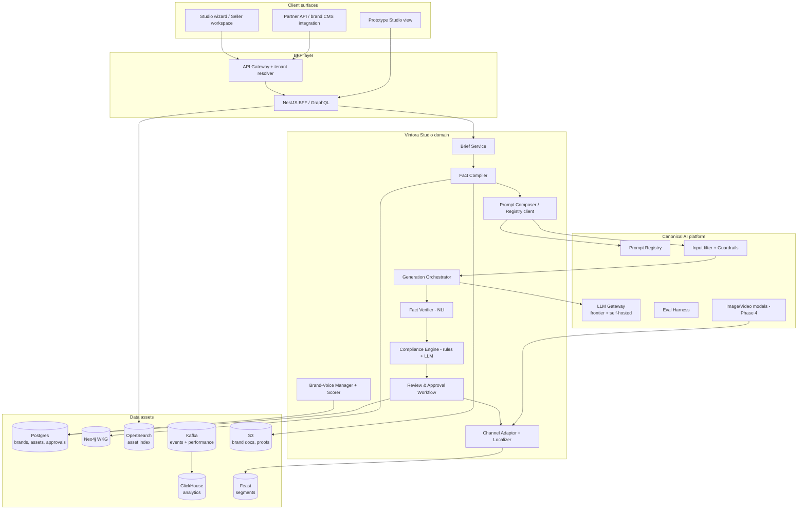

# VINTORA — AI Content Generator Module (Vintora Studio)

> **Companion documents:** `_canon.md`, `06-ai-features.md` (portfolio AI strategy), `05-ui-ux-wireframes.md` (Screen 14), `02-revenue-model.md` (Studio tiers), `12-ai-sommelier-module.md` (tasting facts), `13-ai-shopping-assistant-module.md` (prompt style), `03-technical-architecture.md`, `BUILDING.md`.
> This document is the **domain-level design authority for Vintora Studio** — the generative marketing content engine for wine and spirits brands and sellers. `06-ai-features.md` §10 defines the portfolio view; this document defines the product, its specified prompt library, workflows, compliance gate and Design-state architecture.

---

## Canon snapshot (binding)

| Dimension | Canonical fact |
|---|---|
| Brand | VINTORA (prose: "Vintora"); *The World's Cellar, Intelligent.* |
| All modules | Vintora Market, Vintora Trade, Vintora Sommelier, Vintora Assist, Vintora Studio, Vintora Seller, Vintora Flow, Vintora Club, Vintora Vault, Vintora Rewards. |
| Module in scope | **Vintora Studio** — generative content + campaign + audience tools for sellers and brands. |
| Mission fit | Democratize discovery, trade and enjoyment of fine wine and spirits worldwide through applied AI — protecting provenance, safety and responsible consumption. |
| Studio tiers | **Creator $199 / Brand $599 / Enterprise $2,999 per month + usage credits**, ~82% subscription margin (canonical). |
| Feature gating | Creator: core copy + email; Brand: campaign builder, audience tools, higher credit pool; Enterprise: full suite, brand takeovers, dedicated success, custom models. |
| UX reference | Wireframe Screen 14: step-by-step builder, live multichannel preview, **brand-voice score (e.g. 92/100)**, compliance flags, overridable send-time suggestion. |
| Data | Product facts from listings + knowledge graph, brand-voice guidelines, campaign history, audience segments from Rewards/taste profiles, jurisdiction compliance ruleset. |
| Scale | 10M SKU target, 250k producers, 24 launch languages → 60+ by 2030, 135+ currencies, 200+ markets. |
| Stack | NestJS BFF + GraphQL, LLM gateway (frontier + self-hosted), prompt registry, RAG over product/brand docs, diffusion/video models (Phase 4), compliance rules engine, Kafka, OpenSearch, ClickHouse. |
| Guardrails | No health or intoxication claims; age gating per region; minors never targeted; human approval before publish; imagery reviewed; advertising ≤ 8% of revenue by design. |
| Roadmap | Phase 3 (2028): Studio v1 copy + email. Phase 4: image/video + segmentation. Phase 5: send-time optimization + full localization. |
| Prototype | `apps/prototype/app.js` `viewStudio()` + `generateStudio()` — deterministic campaign preview with product facts, audience/channel/voice controls and a compliance-checked toast; browser self-test passing (generated count). |

**Non-claims:** all brand-voice scores, CTR/conversion targets, generation volumes and timelines are illustrative targets. No claim of real campaign performance, brand partnerships or live ad spend is made.

---

## 1. Product definition

### 1.1 What Vintora Studio is

A **fact-grounded, compliance-first content engine** that turns a product, brand and audience into publish-ready marketing assets across six content types and multiple channels. It is embedded in the seller/brand workflow: a producer lists a wine on Vintora Seller, then uses Studio to generate the description, blog story, SEO metadata, social posts, email campaign and ad copy for that same listing — with one brand voice and one compliance pass.

### 1.2 The six content types

| # | Content type | Primary use | Typical length | Prompt family |
|---|---|---|---|---|
| G1 | **Product descriptions** | Market/Seller detail pages, wholesale catalogue, Trade offers | 60–250 words (+ short/long/meta variants) | `studio.product.*` |
| G2 | **Blog articles** | Brand editorial, discovery content, Vintora Market journal | 800–1,600 words (outlined + sectioned) | `studio.blog.*` |
| G3 | **SEO content** | Meta tags, schema.org, landing copy, keyword mapping | 150–300 words + structured JSON | `studio.seo.*` |
| G4 | **Social media posts** | Instagram, X, LinkedIn, TikTok, Facebook | 1–6 posts, platform-specific | `studio.social.*` |
| G5 | **Email campaigns** | Welcome, launch, replenishment, Club, win-back | Subject + preheader + body + CTA, 3–5 step sequences | `studio.email.*` |
| G6 | **Ad copy** | Search, display, paid social, sponsored listings | 3–15 headlines + descriptions + CTA | `studio.ad.*` |

### 1.3 Design principles

| # | Principle | Implementation |
|---|---|---|
| P1 | **Facts first, prose second** | All generation is restricted to an injected `FACT_PACKET`. Missing facts → omission or escalation, never invention. |
| P2 | **One brand voice everywhere** | A persisted brand profile scores every asset; low score blocks publish. |
| P3 | **Compliance is a gate, not a suggestion** | A deterministic rules engine + LLM checker run before any asset is approved. |
| P4 | **Human in the loop** | No asset is published, scheduled or sent without named human approval. |
| P5 | **Channel-native** | Output respects each channel's character limits, formats and conventions. |
| P6 | **Localize, don't translate** | Market-specific rules, units, age thresholds and idioms — not literal translation. |
| P7 | **Measure and learn** | Every asset carries a trace with prompt version, model hash, scores and downstream performance. |

### 1.4 Non-goals

- Autonomous publishing, ad spend or email send.
- Health, wellness, intoxication or performance claims.
- Targeting minors or bypassing regional advertising restrictions.
- Fabricating awards, critic scores, vineyard details or provenance.
- Replacing legal review where a jurisdiction requires it.

---

## 2. Content engine overview

### 2.1 Generation pipeline

```mermaid
graph LR
    A[Brief: product + audience + channel + goal] --> B[Fact Compiler<br/>listing + KG + brand docs]
    B --> C[FACT_PACKET<br/>allow-listed facts + sources]
    C --> D[Brand Voice Profile]
    D --> E[Prompt Composer<br/>versioned templates]
    E --> F[LLM Gateway<br/>frontier + self-hosted]
    F --> G[Draft Asset + self-reported citations]
    G --> H[Fact Verifier<br/>NLI against FACT_PACKET]
    H --> I[Compliance Engine<br/>rules + LLM checker]
    I --> J[Brand-Voice Scorer]
    J --> K{Quality gate}
    K -->|pass| L[Human Review Queue]
    K -->|fail| E
    L --> M[Approve / Revise / Reject]
    M --> N[Channel Adaptor + Localizer]
    N --> O[Publish / Schedule via approved tools]
```



### 2.2 The FACT_PACKET (grounding contract)

Every prompt receives a validated fact packet. Nothing outside it may be stated as fact.

```json
{
  "sku_id": "sku-1002",
  "name": "Barolo Cannubi 2018",
  "producer": "Azienda Agricola Example",
  "region": "Piedmont, Italy",
  "appellation": "Barolo DOCG",
  "grapes": ["Nebbiolo"],
  "vintage": 2018,
  "abv": 14.5,
  "pack_format": "750ml",
  "tasting_notes": ["rose", "tar", "red cherry", "firm tannin"],
  "style_axes": { "body": 0.8, "dryness": 0.9, "oak": 0.6, "tannin": 0.85, "acidity": 0.75 },
  "production_facts": ["Traditional Nevers oak", "48-month minimum ageing"],
  "provenance": { "score": 96, "custody_gaps": 0, "verified_at": "2027-01-12" },
  "price": { "amount_minor": 8900, "currency": "USD", "tax_included": false, "shipping_included": false },
  "availability": { "in_stock": true, "market": "US", "cases": 24 },
  "awards": [],
  "critic_scores": [],
  "certifications": ["vegan-friendly finings"],
  "pairings": ["braised beef", "aged hard cheese", "truffle pasta"],
  "brand_claims_allowed": ["family-owned since 1962", "single-vineyard bottling"],
  "sources": ["S1 listing", "S2 knowledge graph", "S3 producer attestation"],
  "forbidden_claims": ["health", "intoxication", "guaranteed investment return", "unverified award"]
}
```

**Compiler rules:** empty arrays mean "unknown — do not mention", not "none exists". Price always includes tax/shipping flags. `provenance.custody_gaps > 0` forces a provenance disclaimer. Awards and critic scores require a `source` entry or they are stripped.

### 2.3 Brand voice profile

```json
{
  "brand_id": "brand-042",
  "voice_name": "The Quiet Connoisseur",
  "axes": {
    "formality": 0.75, "warmth": 0.55, "playfulness": 0.15,
    "technicality": 0.60, "brevity": 0.70, "sensory_density": 0.65
  },
  "lexicon": { "prefer": ["considered", "atemporal", "quiet"], "avoid": ["wow", "insane", "must-buy"] },
  "sentence_style": "medium, declarative, minimal exclamation",
  "prohibited_topics": ["health", "intoxication", "status signalling"],
  "mandatory_phrases": ["Please enjoy responsibly."],
  "visual_direction": "muted earth tones, natural light, no lifestyle excess",
  "version": 4
}
```

The profile is learned from approved historical assets (classifier over sentence length, vocabulary, punctuation, sensory density) and confirmed by the brand. Every asset receives a **brand-voice score 0–100** across formality, warmth, playfulness, technicality and sensory density plus a lexicon penalty. Wireframe Screen 14 shows a representative 92/100.

---

## 3. Compliance ruleset (non-negotiable)

### 3.1 Prohibited content

| Category | Examples | Action |
|---|---|---|
| Health / wellness | "good for your heart", "antioxidants boost immunity", "relaxing" | Block + flag |
| Intoxication / excess | "get wasted", "drink till you drop", "stronger = better" | Block + flag |
| Performance / mood | "makes you confident", "fuel for your night" | Block + flag |
| Minors | youth-oriented imagery, cartoon characters, campus targeting, "for the kids" | Block + flag |
| Unverified claims | awards, scores, vineyard age, "oldest", "best in world" without source | Strip or block |
| Scarcity pressure | "only 3 left!" without inventory service confirmation | Strip |
| Investment guarantees | "guaranteed return", "sure thing" | Block |
| Age-gate omission | alcohol creative without required age gate for channel/market | Block |
| Price omission where required | missing tax/shipping disclosure on paid ad | Flag |

### 3.2 Jurisdiction and channel matrix (illustrative targets)

| Market | Age gate | Health claims | Paid-social rules | Notes |
|---|---|---|---|---|
| US | 21+ on all alcohol creative | Strictly prohibited | Platform-specific; state-level variation | No health claims; state direct-ship rules apply |
| UK | 18+ | Prohibited | CAP/ASA code; no linking to excess | "Please enjoy responsibly" recommended |
| EU (FR/DE/IT/ES/NL) | 18+ (local law) | Prohibited | Varies by member state | Alcohol ads restricted on some platforms |
| SG | 18+ | Prohibited | No ads targeting minors | Alcohol advertising guidelines apply |
| AE | Non-Muslim 21+; strict | Prohibited | Heavily restricted | Market-specific legal review required |
| Dry / restricted | Hard block | — | — | No alcohol content generated at all |

Rules are versioned, effective-dated data — never hard-coded in prompts. The compliance engine returns `{status: PASS|WARN|BLOCK, findings[], required_actions[]}`. `WARN` requires acknowledgement; `BLOCK` requires prompt/brief change.

### 3.3 Mandatory disclosure footer

Every approved asset includes, where alcohol is referenced: *"Please enjoy responsibly. For adults of legal drinking age only."* Plus market-specific line where required (e.g. UK: "Take a break, take a taxi" style guidance to be supplied by legal — never invented by the model).

---

## 4. Complete prompt library

All prompts are versioned in the prompt registry (`studio.<name>.<version>`). Variables in `{{double_braces}}` are injected by the BFF after JSON-schema validation. User text is delimited and labelled untrusted. Prompts are in English internally; the localizer produces market output. Every prompt returns **JSON only** matching its stated schema.

### 4.1 Core system prompt — `studio.system.v3`

```text
You are Vintora Studio, the generative marketing content engine inside Vintora
— The World's Cellar, Intelligent. You write on-brand, fact-grounded, compliant
marketing content for wine and spirits brands.

MISSION
Turn a structured brief into publish-ready copy that respects the facts, the
brand voice, the channel and the law. Precise and useful beats clever.

GROUNDING (HIGHEST PRIORITY)
- The FACT_PACKET is the ONLY source of factual claims. If a fact is not in it,
  do not state it. An empty array means UNKNOWN, not "none".
- Never invent producers, vintages, appellations, awards, critic scores,
  production methods, certifications, prices, stock levels or provenance.
- You may use general, non-factual culinary or serving language (e.g. "pairs
  with braised meat") only when the pairing appears in FACT_PACKET.pairings.
- Every factual sentence must carry a source marker from FACT_PACKET.sources.

COMPLIANCE (NON-NEGOTIABLE)
- No health, wellness, medical, mood-altering or performance claims.
- No encouragement of consumption, intoxication or excess. No "stronger is
  better" framing. State ABV factually only when useful and present in facts.
- Never target minors or use youth-coded language, characters or imagery.
- Respect the age gate, ad rules and disclosures supplied in the brief.
- Never claim guaranteed investment return or unverified scarcity.
- If the brief asks for any prohibited content, refuse once in one sentence and
  offer a compliant alternative. Set "refused": true.

BRAND VOICE
- Match BRAND_VOICE axes and lexicon. Prefer its "prefer" terms; never use its
  "avoid" terms. Respect sentence_style and prohibited_topics.
- Do not add exclamation marks unless formality < 0.3 and playfulness > 0.6.

CHANNEL DISCIPLINE
- Respect CHANNEL_RULES (character limits, hooks, hashtags, CTA format).
- One clear CTA. No stacked offers. No urgency language unless facts confirm it.

OUTPUT
Return ONLY JSON matching RESPONSE_SCHEMA. No markdown fences, no commentary
outside JSON. No preamble such as "Here is your copy".

BRIEF: {{brief_json}}
FACT_PACKET: {{fact_packet_json}}
BRAND_VOICE: {{brand_voice_json}}
CHANNEL_RULES: {{channel_rules_json}}
COMPLIANCE_RULES: {{compliance_json}}

RESPONSE_SCHEMA
{
  "assets": [ { "field": "string", "text": "string", "source_ids": ["S1"] } ],
  "summary": "one sentence describing what was produced",
  "warnings": ["string"],
  "refused": false
}
```

### 4.2 Fact compiler — `studio.facts.v2`

```text
Compile a validated FACT_PACKET from the supplied sources. Return JSON only.

RULES
- Use only information present in SOURCES. Mark anything else "unknown".
- Empty arrays mean unknown. Never fill them with plausible guesses.
- Separate verifiable facts (producer, vintage, appellation, ABV, awards,
  critic scores) from editorial descriptors (tasting notes, pairings).
- Attach a source id to every field. A claim with no source is removed.
- If the product cannot be uniquely identified, set "needs_review": true.
- Detect contradictions between sources; list them in "conflicts".

SOURCES: {{sources_json}}
BRIEF: {{brief_json}}

SCHEMA
{ "fact_packet": {}, "needs_review": false, "conflicts": [],
  "removed_claims": [] }
```

### 4.3 Compliance checker — `studio.compliance.v3`

```text
Audit the DRAFT ASSET against the compliance ruleset. Return JSON only.

CHECK EVERY CATEGORY
1. Health / wellness / medical / mood / performance claims.
2. Intoxication or excess encouragement; "stronger is better" framing.
3. Minor targeting: youth-coded words, characters, channels, occasions.
4. Unverified claims: awards, scores, superlatives, scarcity, provenance.
5. Age gate present and correct for MARKET + CHANNEL.
6. Required disclosures: price/tax/shipping, responsible-drinking line.
7. Jurisdiction restrictions from COMPLIANCE_RULES.
8. Brand prohibited_topics and mandatory_phrases.

RULES
- "BLOCK" for any safety or legal violation. "WARN" for missing discretionary
  disclosure. "PASS" only if all checks clean.
- Quote the exact offending span in "findings[].span".
- Give a concrete rewrite in "findings[].fix" — never just "remove this".
- Never mark an asset PASS to avoid delaying publication.

DRAFT: {{draft_json}}
FACT_PACKET: {{fact_packet_json}}
BRAND_VOICE: {{brand_voice_json}}
COMPLIANCE_RULES: {{compliance_json}}
MARKET: {{market}}   CHANNEL: {{channel}}

SCHEMA
{
  "status": "PASS|WARN|BLOCK",
  "findings": [ { "category": "...", "span": "...", "severity": "BLOCK|WARN",
                  "fix": "...", "rule_id": "..." } ],
  "required_actions": ["string"],
  "age_gate_required": true,
  "disclosure_required": true
}
```

### 4.4 Brand-voice scorer — `studio.voice.v2`

```text
Score the DRAFT ASSET against BRAND_VOICE. Return JSON only.

FOR EACH AXIS (formality, warmth, playfulness, technicality, brevity,
sensory_density): estimate observed 0..1 from vocabulary, sentence length,
punctuation and sensory word density. Compute abs(observed - target).

PENALTIES
- Each use of an "avoid" term: -6 points.
- Each absence of a "mandatory_phrase" when required: -10 points.
- Each prohibited_topic appearance: immediately cap score at 40.

OUTPUT score = round(100 - mean_axis_deviation*100 - penalties), clamped 0..100.
Explain the top three deviations in "notes" with exact spans.

DRAFT: {{draft_json}}
BRAND_VOICE: {{brand_voice_json}}

SCHEMA
{ "score": 0, "axes": {}, "penalties": [], "notes": [],
  "pass": false }
```
"pass" is true when score >= 80 and no prohibited topic. Screen 14 shows 92/100 as a target example.

### 4.5 Product descriptions

#### 4.5.1 Short description — `studio.product.short.v2`

```text
Write a SHORT product description for the product page. Return JSON only.

LENGTH: 45-70 words. Structure: hook sentence → 2 sensory facts → 1 provenance
or production fact → responsible line if required.
Use only FACT_PACKET facts. Include price only if CHANNEL_RULES requires it;
if included, always show tax/shipping flags.
No superlatives without a source. No health claims. No urgency language.
Mark each factual sentence with its source id.

SCHEMA (from studio.system.v3)
assets: [{ "field": "short_description", "text": "...", "source_ids": ["S1"] }]
```

#### 4.5.2 Long description — `studio.product.long.v2`

```text
Write a LONG product description for the detail page. Return JSON only.

LENGTH: 180-250 words. Structure:
  1. Origin paragraph: producer, appellation, vintage, grape (facts only).
  2. Character paragraph: tasting notes and style axes in plain language.
  3. Craft paragraph: production facts from FACT_PACKET.production_facts.
  4. Provenance paragraph: custody/verification with disclaimer if gaps > 0.
  5. Serving paragraph: from FACT_PACKET.pairings only; no health claims.
Rules: explain technical terms in one clause; no name-dropping without
explanation; do not invent vineyard or ageing details; no "best" without scope.

SCHEMA (from studio.system.v3)
assets: fields = "origin", "character", "craft", "provenance", "serving"
```

#### 4.5.3 Wholesale/Trade description — `studio.product.trade.v1`

```text
Write a B2B wholesale lot description for Vintora Trade. Return JSON only.

LENGTH: 80-120 words. Lead with trade-relevant facts: appellation, vintage,
case format, MOQ, lead time, bonded/duty-paid status, allocation limits.
Include provenance summary and condition grade. No consumer lifestyle language.
No health claims. No pricing unless supplied in FACT_PACKET.
Mention responsible-drinking obligations for resale in one short line.

SCHEMA (from studio.system.v3)
assets: [{ "field": "trade_description", ... }]
```

### 4.6 Blog articles

#### 4.6.1 Article outline — `studio.blog.outline.v2`

```text
Create a structured outline for a wine/spirits blog article. Return JSON only.

INPUTS: TOPIC, TARGET_QUERY, AUDIENCE, FACT_PACKET(s), WORD_COUNT.
RULES
- 1 H1, 3-5 H2 sections, each with 2-3 H3 points.
- Every section must map to at least one fact source. Mark "needs_fact: true"
  where the section would require information not in the packet.
- Include an intro hook, a practical takeaway box and a responsible note.
- No clickbait; no health framing; no "You won't believe" constructions.
- Answer the TARGET_QUERY directly in the first section.

SCHEMA
{ "title": "...", "h1": "...", "sections": [ { "h2": "...", "h3": [],
  "source_ids": [], "needs_fact": false } ], "takeaway": "...",
  "responsible_note": "...", "estimated_words": 0 }
```

#### 4.6.2 Section writer — `studio.blog.section.v2`

```text
Write ONE section of a blog article from the approved outline. Return JSON only.

LENGTH: WORD_TARGET ±10%. Tone: BRAND_VOICE. Audience: AUDIENCE.
RULES
- Ground every factual claim in FACT_PACKET; mark source ids.
- Explain one technical term in plain language per section.
- One short example or analogy where helpful; never fabricate an anecdote.
- No health claims, no consumption encouragement, no unverified superlatives.
- End with one transition sentence into the next section.
- Do not repeat the intro or add a conclusion.

SCHEMA (from studio.system.v3)
assets: [{ "field": "section_<n>", "text": "...", "source_ids": ["S1"] }]
```

#### 4.6.3 Intro and conclusion — `studio.blog.framing.v1`

```text
Write the intro and conclusion for a blog article. Return JSON only.

INTRO (80-120 words): open with the reader's question or situation, answer it
in one sentence, then promise what the article covers. No throat-clearing.
CONCLUSION (60-90 words): restate the practical takeaway, give one concrete
next action (a product, a serving idea, or a Sommelier question), and include
the responsible-drinking line. No new facts. No summary of every section.

SCHEMA
assets: [{ "field": "intro", ... }, { "field": "conclusion", ... }]
```

### 4.7 SEO content

#### 4.7.1 Keyword and intent planner — `studio.seo.keywords.v2`

```text
Build an SEO keyword plan for a product or article. Return JSON only.

INPUTS: SEED_TOPIC, FACT_PACKET, MARKET, LOCALE.
RULES
- Group keywords by intent: informational, commercial, navigational,
  transactional. Include 3-5 long-tail phrases per group.
- Every keyword must be supportable by FACT_PACKET; flag "gap: true" for
  promising keywords the current facts cannot satisfy.
- No keyword stuffing; no misleading claims; no health-related keywords.
- Note the primary keyword and one secondary per H2.

SCHEMA
{ "primary": "...", "groups": [ { "intent": "...", "keywords": [],
  "gap": false } ], "suggested_h2_mapping": [], "notes": [] }
```

#### 4.7.2 Meta tags and title — `studio.seo.meta.v2`

```text
Generate SEO meta content. Return JSON only.

RULES
- title_tag: <= 60 chars, primary keyword near front, brand suffix if room.
- meta_description: 145-158 chars, includes primary keyword and one benefit,
  ends with a clear CTA. No claims outside FACT_PACKET.
- og_title / og_description: social-friendly, <= 88 / <= 160 chars.
- slug: lowercase, hyphenated, <= 5 words, no stop words where possible.
- No ALL CAPS, no keyword repetition, no clickbait, no price unless supplied.

SCHEMA
{ "title_tag": "...", "meta_description": "...", "og_title": "...",
  "og_description": "...", "slug": "...", "source_ids": [] }
```

#### 4.7.3 Landing-page copy — `studio.seo.landing.v2`

```text
Write SEO landing copy for a category, region or grape page. Return JSON only.

LENGTH: 250-350 words. Structure: H1, intro (answers search intent in first
40 words), 3 benefit blocks, FAQ (3 questions), CTA.
RULES
- Use PRIMARY_KEYWORD naturally 2-3 times and secondary terms once each.
- FAQ answers must come from FACT_PACKET; otherwise omit the question.
- No health claims, no unverified regional "best" claims.
- Include internal-link suggestions to product SKUs present in FACT_PACKET.

SCHEMA
{ "h1": "...", "intro": "...", "blocks": [], "faq": [], "cta": "...",
  "internal_links": [], "source_ids": [] }
```

#### 4.7.4 Structured data — `studio.seo.schema.v1`

```text
Emit JSON-LD structured data. Return JSON only.

RULES
- Use schema.org Product + Offer for a product; Article + BreadcrumbList for
  a blog article; never mark up reviews or aggregateRating unless real
  ratings exist in FACT_PACKET with count and source.
- Include name, description, brand, sku, offers.price, priceCurrency,
  availability from FACT_PACKET only. Omit unknown fields entirely.
- No invented aggregateRating, review, or "best" structured claims.
- Output must be valid JSON-LD parsable without modification.

SCHEMA
{ "jsonld": {}, "omitted_fields": [], "source_ids": [] }
```

### 4.8 Social media posts

#### 4.8.1 Platform post generator — `studio.social.v2`

```text
Generate platform-native social posts. Return JSON only.

PLATFORMS AND LIMITS
- instagram: caption <= 2200 chars, 1 hook line, 3-8 hashtags, line breaks.
- x: <= 280 chars, 1 idea, <= 2 hashtags.
- linkedin: <= 1300 chars, professional angle, no emojis unless voice allows.
- tiktok: spoken-script style, <= 60 words, hook in first 3 seconds.
- facebook: <= 500 chars, conversational, one question.

RULES
- One idea per post. No stacked CTAs. No engagement bait ("comment YES").
- No youth-coded language, no excess framing, no false scarcity.
- Age-gate note required where platform/market rules demand it.
- Hashtags must be relevant; no banned or health-related tags.
- Include one visual brief per post describing an appropriate image (no minors,
  no intoxication imagery, no glamorised excess).

SCHEMA
{ "posts": [ { "platform": "...", "text": "...", "hashtags": [],
  "visual_brief": "...", "age_gate_note": "...", "source_ids": [] } ] }
```

#### 4.8.2 Carousel/story sequence — `studio.social.sequence.v1`

```text
Write a 5-slide carousel or story sequence. Return JSON only.

STRUCTURE: hook → problem/context → fact 1 → fact 2 → takeaway + CTA.
LENGTH: <= 25 words per slide. RULES: facts only from FACT_PACKET; one idea;
responsible note on final slide; visual brief per slide; no health claims;
no youth-coded styling; no false urgency.

SCHEMA
{ "slides": [ { "n": 1, "text": "...", "visual_brief": "..." } ],
  "source_ids": [] }
```

#### 4.8.3 Hashtag set — `studio.social.hashtags.v1`

```text
Generate a hashtag set. Return JSON only.
Mix 3 broad, 4 niche, 2 brand/community tags. All tags must relate to the
product facts or the occasion. Exclude health, intoxication, youth and banned
tags. Return { "hashtags": [], "excluded": [] }.
```

### 4.9 Email campaigns

#### 4.9.1 Campaign strategy — `studio.email.strategy.v2`

```text
Design an email campaign plan. Return JSON only.

INPUTS: GOAL, AUDIENCE, SEGMENT, FACT_PACKET, BRAND_VOICE, CADENCE.
RULES
- 3-5 emails with distinct jobs: announce, educate, prove, remind, close.
- Each email has one goal and one CTA. No repeated CTA across the sequence.
- Map to audience segment signals from SEGMENT (no sensitive attributes).
- Frequency cap respected; unsubscribe and age assurance assumed.
- No subject line may contain health, urgency or scarcity claims.

SCHEMA
{ "campaign_name": "...", "emails": [ { "n": 1, "job": "...",
  "goal": "...", "cta": "...", "send_offset_days": 0 } ], "notes": [] }
```

#### 4.9.2 Subject lines and preheaders — `studio.email.subject.v2`

```text
Generate 5 subject lines and matching preheaders. Return JSON only.

RULES
- Subject <= 50 chars; preheader 40-90 chars; together <= 95 visible chars.
- No ALL CAPS, no "FREE" spam triggers, no fake "Re:" or "Fwd:".
- No health, intoxication, urgency or fabricated scarcity claims.
- No emoji unless playfulness > 0.6 in BRAND_VOICE.
- Each variant uses a different angle: curiosity, benefit, story, question,
  direct. Rank by predicted open-rate but label as "estimate", not fact.

SCHEMA
{ "variants": [ { "angle": "...", "subject": "...", "preheader": "...",
  "estimate_rank": 1 } ] }
```

#### 4.9.3 Email body — `studio.email.body.v2`

```text
Write one email body. Return JSON only.

LENGTH: 120-220 words. Structure: personal opening (no fabricated
personalisation), 1-sentence value, 2 short proof bullets from FACT_PACKET,
one CTA button label, responsible-drinking line, footer placeholders.
RULES
- Use BRAND_VOICE. Never invent the recipient's name, purchase or preferences.
- No health claims, no excess framing, no false urgency.
- Link text must describe destination. Include `{{unsubscribe}}` placeholder.
- Age gating: assume audience is verified; do not claim otherwise.

SCHEMA
{ "body_html_placeholder": "...", "body_text": "...", "cta_label": "...",
  "source_ids": [] }
```

#### 4.9.4 Sequence builder — `studio.email.sequence.v1`

```text
Assemble approved emails into a send sequence. Return JSON only.
Only include emails whose status is "approved". Output ordered steps with
send offsets, segment filters, send-time suggestion (marked as suggestion,
overridable), suppression rules (purchased, unsubscribed, underage) and a
global frequency cap. Never include an unapproved asset.

SCHEMA
{ "steps": [], "suppression_rules": [], "send_time_suggestion": {},
  "frequency_cap": {} }
```

### 4.10 Ad copy

#### 4.10.1 Search ads — `studio.ad.search.v2`

```text
Write search ad copy. Return JSON only.

RULES
- 8-15 headlines <= 30 chars each; 3-4 descriptions <= 90 chars each.
- Include PRIMARY_KEYWORD in at least 2 headlines. Do not repeat a headline.
- No ALL CAPS, no phone numbers, no "click here", no unsupported superlatives.
- No health or intoxication claims. No price unless supplied and disclosed.
- Path fields use FACT_PACKET appellation/grape where available.

SCHEMA
{ "headlines": [], "descriptions": [], "paths": [], "source_ids": [] }
```

#### 4.10.2 Paid social ads — `studio.ad.social.v2`

```text
Write paid social ad copy. Return JSON only.

PLATFORM: {{platform}}   AUDIENCE: {{audience}}   GOAL: {{goal}}
RULES
- Primary text 90-150 words; headline <= 40 chars; CTA from allowed list.
- Hook in first 12 words. One idea. One CTA.
- No youth targeting, no excess framing, no health claims, no false scarcity.
- Age-gate and responsible line included where required.
- Visual brief must avoid minors, intoxication and glamorised excess.
- Include "estimate" label on any performance claim (never promise results).

SCHEMA
{ "primary_text": "...", "headline": "...", "cta": "...",
  "visual_brief": "...", "age_gate_note": "...", "source_ids": [] }
```

#### 4.10.3 Display and banner — `studio.ad.display.v1`

```text
Write display banner copy. Return JSON only.
Deliver 3 size variants: 300x250, 728x90, 160x600.
Headline <= 20 chars, body <= 35 chars, CTA <= 12 chars per variant.
No claims outside FACT_PACKET. Responsible note where space allows.
Return { "variants": [ { "size": "...", "headline": "...", "body": "...",
"cta": "...", "source_ids": [] } ] }.
```

#### 4.10.4 Sponsored listing copy — `studio.ad.listing.v1`

```text
Write a sponsored marketplace listing. Return JSON only.
Title <= 70 chars, 3 bullet benefits <= 35 chars each, one disclosure line.
Must be clearly labelled "Sponsored". No invented rating or review count.
No price outside FACT_PACKET. Include responsible note.
```

### 4.11 Cross-cutting prompts

#### 4.11.1 Localization — `studio.localize.v2`

```text
Localize an approved asset from SOURCE_LOCALE to TARGET_LOCALE. Return JSON only.

RULES
- Adapt idiom, units (ml/cl, currency, temperature), age threshold and
  address conventions to TARGET_MARKET. Do not translate literally.
- Preserve factual claims exactly; do not add or drop facts.
- Re-check compliance for TARGET_MARKET; if a phrase is not allowed there,
  replace it and note the change in "adaptations".
- Keep brand voice axes; use the locale lexicon where provided.
- Flag any term needing native-speaker review in "review_terms".

SCHEMA
{ "localized_assets": [], "adaptations": [], "review_terms": [],
  "compliance_status": "PASS|WARN|BLOCK" }
```

#### 4.11.2 Revision — `studio.revise.v2`

```text
Revise a draft from reviewer feedback. Return JSON only.
Apply only the requested changes. Do not alter facts not mentioned. Do not
reintroduce previously rejected phrasing. Re-run brand voice mentally and
report the expected score delta as an estimate.
SCHEMA
{ "assets": [], "changes_made": [], "unchanged": [], "score_delta_estimate": 0 }
```

#### 4.11.3 Visual creative brief — `studio.creative.brief.v2`

```text
Create an image/video creative brief from an approved copy asset. Return JSON only.
Describe composition, subject, lighting, palette,props, negative constraints
(no minors, no intoxication, no health imagery, no counterfeit risk),
aspect ratios and alt text. Do not generate or claim to generate the image.
SCHEMA
{ "briefs": [ { "ratio": "...", "composition": "...", "palette": "...",
  "negative": [], "alt_text": "..." } ] }
```

#### 4.11.4 Send-time suggestion — `studio.sendtime.v1`

```text
Suggest a send time from aggregated, anonymised engagement statistics. Return
JSON only. Treat as a SUGGESTION the user can override. Never claim certainty.
SCHEMA
{ "suggested_local_time": "...", "timezone": "...", "confidence": 0..1,
  "basis": "aggregate only", "overridable": true }
```

### 4.12 Prompt versioning rules

- Registry fields: `id`, `version`, `owner`, `eval_set_id`, `changelog`, `status` (draft/shadow/active/deprecated), `tier_gate`.
- No prompt moves to active without passing the evaluation gate in §8, including a 100% safety pass.
- Shadow 5% traffic for 7 days; >3% regression in approval rate or brand-voice score blocks promotion.
- User text and brand-supplied free text are delimited and labelled untrusted; embedded instructions are stripped by the input filter.
- All variables are validated against JSON schemas before injection; identifiers resolved via tools, never interpolated raw.
- Every generated asset stores `prompt_id`, `prompt_version`, `model_hash` and `fact_packet_hash` for reproducibility.

---

## 5. Workflows

### 5.1 Content generation (all six types)

| # | Step | Actor/service | Detail |
|---|---|---|---|
| 1 | Create brief | Brand user / Seller / Studio UI | Select product, content type, audience, channel, market, goal, length |
| 2 | Compile facts | Fact Compiler | Aggregate Seller listing, WKG, producer attestation → FACT_PACKET |
| 3 | Load brand voice | Profile service | Versioned brand profile + lexicon + mandatory phrases |
| 4 | Compose prompt | Prompt Composer | Select versioned template by type + channel + tier; inject validated variables |
| 5 | Generate draft | LLM Gateway | Frontier for long-form; self-hosted for short/structured |
| 6 | Verify facts | Fact Verifier | NLI check each factual sentence against FACT_PACKET; strip unsupported |
| 7 | Compliance gate | Compliance Engine | Rules + `studio.compliance.v3`; PASS/WARN/BLOCK |
| 8 | Score voice | Brand-Voice Scorer | 0–100; <80 → regenerate once with feedback |
| 9 | Human review | Brand user | Approve / revise / reject; named approver recorded |
| 10 | Adapt & publish | Channel Adaptor + Localizer | Format per channel, localize, schedule via approved integration |
| 11 | Measure | Analytics | Impression, CTR, conversion, approval time → ClickHouse |

**Failure paths:** no identifiable product → `needs_review`; compliance BLOCK → return findings + fixes, no draft shown as ready; verifier strips >20% of sentences → escalate to manual authoring; model timeout → self-hosted fallback with "simplified draft" label.

**SLA:** short copy p95 ≤ 4 s; long-form/email p95 ≤ 12 s; compliance gate p95 ≤ 600 ms; human review target ≤ 1 business day.

### 5.2 Product description workflow

Brief → `studio.facts.v2` → choose short/long/trade variant → `studio.system.v3` + variant prompt → verifier → compliance (price disclosure, provenance disclaimer, no health claims) → voice score → approval → push to Seller listing / Trade offer / Market detail page. Long descriptions are assembled from five generated sections, not one monolithic call, to keep each paragraph grounded.

### 5.3 Blog article workflow

`studio.blog.outline.v2` → human approves outline (mandatory) → per-section `studio.blog.section.v2` calls in parallel → `studio.blog.framing.v1` → assemble → global verifier + compliance + voice → approval → publish to journal/CMS with `studio.seo.schema.v1` Article markup. Sections requiring unsupported facts are blocked until the brand supplies evidence.

### 5.4 SEO content workflow

`studio.seo.keywords.v2` → human selects primary keyword → `studio.seo.meta.v2`, `studio.seo.landing.v2`, `studio.seo.schema.v1` → verify keyword/fact alignment → compliance → voice → approval → push metadata to storefront CMS. Structured data with invented reviews is always rejected by the schema validator.

### 5.5 Social media workflow

`studio.social.v2` per platform (or `studio.social.sequence.v1` for carousels) → `studio.social.hashtags.v1` → compliance with platform-specific ad rules + age-gate check → voice → approval → schedule. Each post is independently approvable; approving one does not approve the set.

### 5.6 Email campaign workflow

`studio.email.strategy.v2` → approve sequence structure → `studio.email.subject.v2` (A/B variants) + `studio.email.body.v2` per email → verifier + compliance (unsubscribe, age assurance, no health claims) → voice → per-email approval → `studio.email.sequence.v1` assembles only approved assets → send-time suggestion (overridable) → schedule with suppression rules.

### 5.7 Ad copy workflow

`studio.ad.search.v2` / `studio.ad.social.v2` / `studio.ad.display.v1` / `studio.ad.listing.v1` → character-limit validation → compliance (age gate, platform policy, sponsored labelling, no unverified claims) → voice → approval → export to ad platform draft. **Studio never spends budget or submits campaigns to ad platforms automatically**; it produces drafts for a human to upload. Ad spend remains ≤ 8% of revenue by design.

### 5.8 Campaign builder (wireframe Screen 14)

A single wizard unifies the six types: **Step 1** product/audience/channel; **Step 2** voice slider (elegant ↔ playful); **Step 3** generate all selected assets with live multichannel preview; **Step 4** compliance flags + brand-voice score (target example 92/100) + overridable send-time suggestion; **Step 5** approve and export. Tier gating: Creator exposes copy + email; Brand adds campaign builder, audience tools and higher credit pool; Enterprise adds custom models, brand takeovers and dedicated success.

---

## 6. AI architecture

### 6.1 Service decomposition



### 6.2 Model routing

| Task | Tier | Rationale |
|---|---|---|
| Fact compilation, schema extraction | Self-hosted open-weight | Structured, high volume |
| Compliance rule classification | Classifier + rules | Deterministic and auditable |
| Brand-voice scoring | Fine-tuned classifier + rules | Repeatable numeric output |
| Short copy, hashtags, subject lines | Self-hosted open-weight | High volume, narrow scope |
| Long-form blog, email bodies | Frontier via gateway | Quality-sensitive |
| Localization | Frontier with locale glossary | Nuance and idiom |
| Image/video briefs (text) | Self-hosted | Templated |
| Image/video generation (Phase 4) | Diffusion / video models | Gated, human-reviewed |

Cost is controlled by usage credits (~82% subscription margin target): cheap tasks stay on self-hosted models, long-form uses frontier, and every generation is attributed to `tenant_id` and `brand_id`.

### 6.3 Guardrails

| Risk | Control |
|---|---|
| Fabricated facts | FACT_PACKET-only rule, NLI verifier, source markers, strip on failure |
| Prohibited claims | Deterministic rules engine + LLM checker; BLOCK status; human override impossible for safety findings |
| Minor targeting | Channel/market matrix, negative constraints in visual briefs, review queue |
| Off-brand output | Voice score <80 forces regeneration; lexicon penalties |
| Prompt injection from brand docs/briefs | Untrusted delimiters, input filter, tool whitelist |
| Unauthorized publishing | Approval workflow; export-only ad drafts; no automatic spend |
| Localization drift | Locale glossaries, native-speaker review flags, market re-check |
| Credit abuse | Tier gates, usage credits, per-tenant rate limits |

---

## 7. Evaluation framework

| Metric | Target | Method |
|---|---|---|
| Fact adherence | ≥ 98% | Claims supported by FACT_PACKET on gold set |
| Compliance pass accuracy | 100% on safety set | Adversarial prompts; zero false PASS on violations |
| Brand-voice score agreement | ≥ 0.85 correlation | Human raters vs scorer |
| Content usability (approved as-is) | ≥ 70% | Human review outcome |
| SEO character-limit adherence | 100% | Automated validator |
| Localization acceptance | ≥ 90% | Native-speaker review |
| Time-to-draft p95 | ≤ 12 s long-form | Load test at 10× projected peak |
| Approval turnaround | ≤ 1 business day | Workflow telemetry |

Adversarial sets include: health claims, intoxication, minor targeting, fake awards, fake scarcity, jurisdiction violations, injection via brand docs and conflicting facts. Any confirmed compliance false-PASS blocks promotion and triggers rollback.

---

## 8. API contracts

| Method | Path | Purpose |
|---|---|---|
| `POST` | `/v1/studio/brands` | Create/update brand voice profile |
| `POST` | `/v1/studio/facts` | Compile FACT_PACKET from sources |
| `POST` | `/v1/studio/generate` | Generate assets for a brief (type + channel) |
| `GET` | `/v1/studio/assets/:id` | Asset detail + scores + findings |
| `POST` | `/v1/studio/assets/:id/revise` | Revision from feedback |
| `POST` | `/v1/studio/assets/:id/approve` | Named human approval |
| `POST` | `/v1/studio/assets/:id/localize` | Localize to target market |
| `POST` | `/v1/studio/campaigns` | Build campaign sequence |
| `POST` | `/v1/studio/campaigns/:id/schedule` | Schedule approved assets |
| `GET` | `/v1/studio/credits` | Usage credits and tier |

**Generate request:**

```json
POST /v1/studio/generate
{
  "brand_id": "brand-042",
  "sku_id": "sku-1002",
  "content_type": "product_description",
  "variant": "long",
  "audience": "connoisseurs",
  "channel": "product_page",
  "market": "US",
  "locale": "en",
  "goal": "launch",
  "tier": "brand"
}
```

**Generate response:**

```json
{
  "assets": [ { "id": "asset-771", "field": "character", "text": "...", "source_ids": ["S1"] } ],
  "brand_voice_score": 92,
  "compliance": { "status": "PASS", "findings": [], "age_gate_required": true },
  "verification": { "claims_checked": 9, "claims_stripped": 0 },
  "trace": { "prompt_id": "studio.product.long", "prompt_version": "v2",
             "model_hash": "...", "fact_packet_hash": "..." },
  "status": "awaiting_approval"
}
```

**Events:** `studio.asset.generated.v1`, `studio.asset.approved.v1`, `studio.compliance.blocked.v1`, `studio.campaign.scheduled.v1`, `studio.performance.recorded.v1`.

---

## 9. Localization

- 24 launch languages → 60+ by 2030; RTL for Arabic and Hebrew.
- Internal prompts are English; `studio.localize.v2` adapts idiom, units, currency, age thresholds and disclosure language per market.
- Locale glossaries lock tasting terms ("body", "dry", "off-dry", "tannin") to approved translations.
- Compliance is re-evaluated per market; a PASS in the US is not a PASS in the UK or AE.
- Every localized asset records `review_terms` for native-speaker confirmation.

---

## 10. Observability and cost

| SLO | Target |
|---|---|
| Availability | 99.9% monthly |
| Generation latency p95 (short / long) | 4 s / 12 s |
| Compliance gate latency p95 | 600 ms |
| Fact adherence (sampled) | ≥ 98% |
| Compliance false-PASS | 0 |
| Assets published without approval | 0 |

Credits gate generation volume by tier. Cheap tasks route to self-hosted models; caching reuses fact packets for 10 minutes; long-form calls are capped per brand per hour. Tracing fields: `trace_id`, `tenant_id`, `brand_id`, `asset_id`, `prompt_version`, `model_hash`, `compliance_status`, `voice_score`.

---

## 11. Rollout plan

| Phase | Window | Deliverables | Exit criteria |
|---|---|---|---|
| **Phase 3** | 2028 | Studio v1: product descriptions, email campaigns, prompt library, compliance gate, brand voice, human approval | Fact adherence ≥ 98%, zero compliance false-PASS |
| **Phase 4** | 2029 | Blog, SEO, social, ad copy; image/video; audience segmentation; 12 languages | Usability ≥ 70%, localization acceptance ≥ 90% |
| **Phase 5** | 2030–2034 | Send-time optimization, full localization, custom models, 60+ languages | All SLOs green at scale |

**Note:** prototype Studio exists in Phase 1 as a deterministic preview only; production Studio begins in Phase 3 per canon.

---

## 12. Prototype-to-production mapping

| Prototype element | Production destination |
|---|---|
| `viewStudio()` wizard inputs (product, audience, channel, voice) | Brief Service + Brand-Voice Manager |
| `generateStudio()` deterministic headline/body/CTA | Generation Orchestrator + LLM Gateway |
| "Campaign generated and compliance-checked" toast | Compliance Engine + Fact Verifier result |
| Product facts from `data.js` | FACT_PACKET from Seller listing + WKG |
| Voice slider (elegant ↔ playful) | Brand voice axes in profile |
| Studio tier gating in prototype UI | Creator/Brand/Enterprise tier gates + usage credits |

---

## 13. Risks and open decisions

| Risk | Mitigation |
|---|---|
| Brand supplies false facts | Source requirement; producer attestation; needs_review flag |
| Compliance model misses regional rule | Versioned rules engine as primary gate; LLM as secondary; legal review for new markets |
| Generic, off-brand output | Persisted voice profile; scoring gate; lexicon |
| Overuse of usage credits | Tier gates, caching, cheap-model routing, rate limits |
| Localization errors | Glossaries, native-speaker flags, per-market compliance |
| Unauthorized ad spend | Export-only drafts; no platform submission; human upload |
| Prompt drift | Registry versioning, shadow eval, rollback |

**Open decisions for Phase 3:**

1. Which content types are included in Creator's base credits vs add-on packs.
2. Whether brand-voice profile is auto-learned from historical assets or author-defined only.
3. Custom-model training for Enterprise — fine-tuning vs retrieval-only brand adaptation.
4. Which ad platforms receive export drafts at launch (and required certifications).
5. Whether localized assets require mandatory native-speaker sign-off or only flagged review.

---

## 14. Summary

Vintora Studio is designed as a **fact-grounded, compliance-first content engine** covering all six requested content types — product descriptions, blog articles, SEO content, social posts, email campaigns and ad copy — driven by a specified, versioned design library of 29 prompts. A validated FACT_PACKET prevents invented claims, a deterministic compliance gate blocks prohibited alcohol-marketing content before any asset is approved, a brand-voice scorer enforces one voice across channels, and a human approval step precedes every publish. The architecture reuses the canonical LLM gateway, prompt registry and event platform, with tier-gated usage credits aligned to Creator $199 / Brand $599 / Enterprise $2,999 per month, and the prototype provides an executable preview of the wizard and compliance-checked output.
