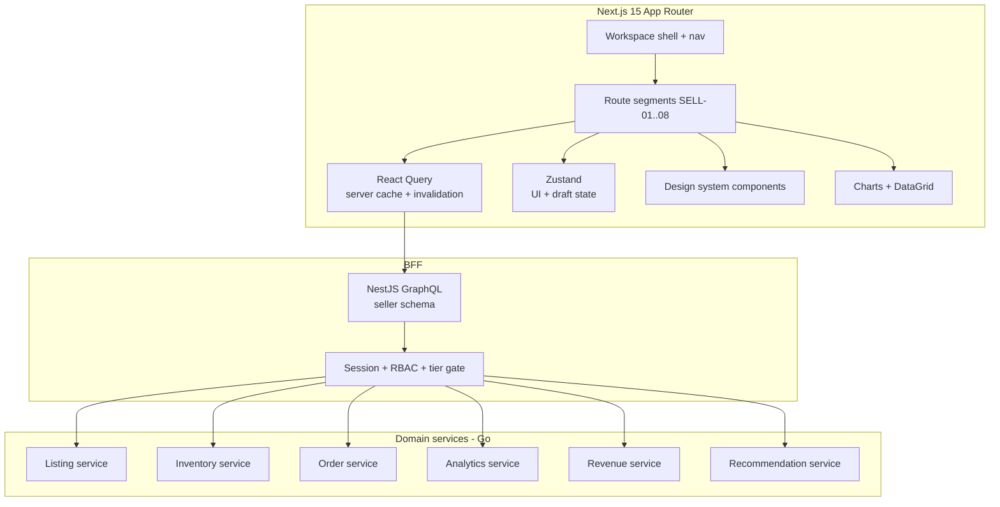
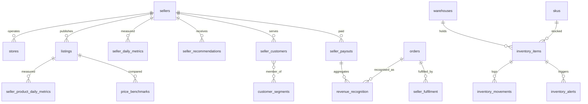
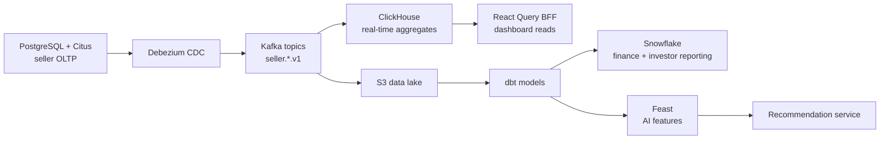

# VINTORA — Seller Dashboard Module (Vintora Seller)

> **Companion documents:** `_canon.md`, `05-ui-ux-wireframes.md` (Screens 9–10), `04-database-design.md` (baseline schema), `02-revenue-model.md` (Seller tiers), `03-technical-architecture.md`, `06-ai-features.md` (copilots), `14-ai-content-generator-module.md` (Studio), `11-b2b-wholesale-module.md` (Trade), `BUILDING.md`.
> This document is the **domain-level design authority for Vintora Seller** — the merchant operating system. It defines the UI architecture and the database architecture for seven capabilities: product management, inventory tracking, sales analytics, order management, customer insights, revenue reports and AI business recommendations. `04-database-design.md` owns the canonical baseline tables; this document extends them for dashboard read/write workloads.

---

## Canon snapshot (binding)

| Dimension | Canonical fact |
|---|---|
| Brand | VINTORA (prose: "Vintora"); *The World's Cellar, Intelligent.* |
| All modules | Vintora Market, Vintora Trade, Vintora Sommelier, Vintora Assist, Vintora Studio, Vintora Seller, Vintora Flow, Vintora Club, Vintora Vault, Vintora Rewards. |
| Module in scope | **Vintora Seller** — merchant OSS: listings, inventory, orders, analytics, payouts. |
| Mission fit | Democratize discovery, trade and enjoyment of fine wine and spirits worldwide through applied AI — protecting provenance, safety and responsible consumption. |
| Seller tiers | **Free / $99 Growth / $399 Pro / $999 Enterprise per month + 0.5–2% payment processing** (canonical). |
| Tier entitlements | Free: basic listing, limited SKUs, standard payouts. Growth: expanded listings, basic analytics, email support. Pro: inventory sync, advanced analytics, Studio entry. Enterprise: API access, multi-entity, priority support, custom reporting. |
| UI reference | Wireframe Screen 9 (Seller overview), Screen 10 (listing editor with AI copy); design tokens burgundy `#5B1A2B`, cream `#F7F1E6`, gold `#C9A227`, charcoal `#1C1917`, sage `#6B7A5E`. |
| Baseline schema | `sellers`, `stores`, `warehouses`, `listings`, `inventory_items`, `orders`, `order_items`, `payments` — all `tenant_id`-partitioned in PostgreSQL + Citus. |
| Stack | Next.js 15 web, React Query + Zustand, NestJS BFF/GraphQL, Go domain services, PostgreSQL + Citus, Redis, Kafka, ClickHouse, Snowflake/dbt, OpenTelemetry. |
| Scale | 250k producers, 10M SKU target, 1.2M orders/day peak, 200+ markets, p95 < 200 ms API, 99.99% availability. |
| Guardrails | KYC/licence before payouts; provenance and lot integrity; age-gated listings; human approval for all AI actions; no autonomous price/order changes. |
| Roadmap | Phase 2 (Q3–Q4 2027): Seller v1 with listings, inventory, orders, payouts, basic analytics. Phase 3: Studio entry, advanced analytics. Phase 4: API, multi-entity, custom reporting. |
| Prototype | `apps/prototype/app.js` `viewSeller()` — KPI grid, AI listing assistant, demand signals and inventory table; browser self-test passing (generated count). |

**Non-claims:** all metrics, lift figures and timelines are targets. Prototype GMV, listing counts and payouts are illustrative demo data, not real seller results.

---

## 1. Product definition

### 1.1 Users and postures

| Persona | Need | Primary screens | Tier (typical) |
|---|---|---|---|
| Small producer / estate | Get first listings live, manage a few hundred cases | SELL-01, 02, 03, 04 | Free / Growth |
| Merchant / négociant | Multi-warehouse inventory, pricing, margin | SELL-03, 05, 07 | Pro |
| Retail chain / hotel group | Multi-store, multi-entity, custom reports | SELL-01, 05, 06, 07 | Enterprise |
| Brand / marketing lead | Content and campaign performance | SELL-02, 05, 06, 08 | Pro + Studio |
| Ops / fulfilment clerk | Pick, pack, ship, exceptions | SELL-03, 04 | Growth / Pro |

### 1.2 Capability surface

| # | Feature | Core questions answered | UI area | Data domain |
|---|---|---|---|---|
| F1 | **Product management** | Is my catalogue complete, compliant and live? | SELL-02 | `listings`, `skus`, `product_media` |
| F2 | **Inventory tracking** | What do I have, where, in which lot, and what is reserved? | SELL-03 | `inventory_items`, `inventory_movements` |
| F3 | **Sales analytics** | What sold, through which channel, at what conversion? | SELL-05 | `seller_product_daily_metrics` |
| F4 | **Order management** | What needs picking, shipping or exception handling? | SELL-04 | `orders`, `seller_fulfilment` |
| F5 | **Customer insights** | Who buys, what do they return for, who is churning? | SELL-06 | `seller_customers`, `customer_segments` |
| F6 | **Revenue reports** | What did I earn after fees, and when is the payout? | SELL-07 | `revenue_recognition`, `seller_payouts` |
| F7 | **AI business recommendations** | What should I do next, and why? | SELL-08 + overview copilot | `seller_recommendations` |

### 1.3 Non-goals

- Consumer storefront (Vintora Market) and B2B RFQ execution (Vintora Trade).
- Freight booking and telemetry (Vintora Flow consumes the shipment request).
- Generative content authoring (Vintora Studio renders inside SELL-02 via side-by-side panel).
- Investment/custody reporting (Vintora Vault).

---

## 2. UI architecture

### 2.1 Information architecture

```text
Vintora Seller (desktop-first workspace)
├── Global shell
│   ├── Workspace switcher (seller → store → channel)
│   ├── Global search (SKU, order, customer)
│   ├── "+ New listing" primary CTA
│   ├── Tier badge (Free / Growth / Pro / Enterprise)
│   └── Notification bell + AI action inbox
├── SELL-01 Overview            KPIs, sales chart, copilot actions, action queue
├── SELL-02 Products            Catalogue table, listing editor, AI copy studio, compliance
├── SELL-03 Inventory           Stock by SKU/warehouse/lot, movements, alerts, counts
├── SELL-04 Orders              Order queue, fulfilment, exceptions, returns
├── SELL-05 Analytics           Sales, channels, conversion, cohorts, benchmarks
├── SELL-06 Customers           Segments, lifetime value, repeat rate, churn
├── SELL-07 Revenue             Gross→net waterfall, fees, payouts, tax documents
└── SELL-08 AI Recommendations  Action inbox with rationale, impact and approve/reject
```

**Navigation rules:** left rail is persistent on desktop; the AI inbox is reachable from the bell and from SELL-01. Every metric is click-through to its source table (e.g. "42 orders" → SELL-04 filtered to today). Every AI action deep-links to the relevant editor with context preserved.

### 2.2 Screen catalogue

| ID | Screen | Primary widgets | Tier gate | Source of truth |
|---|---|---|---|---|
| SELL-01 | Overview | 4 KPI cards, 14-day sales chart, copilot panel, action queue, quick links | All | `seller_daily_metrics`, `seller_recommendations` |
| SELL-02 | Product catalogue + editor | Filterable table, bulk edit, fact sheet, AI copy panel, compliance strip, publish gate | All (AI copy Pro+ / Studio) | `listings`, `skus`, `product_media` |
| SELL-03 | Inventory & lots | Stock table by warehouse, movement timeline, low-stock alerts, cycle-count form | All (sync Pro+) | `inventory_items`, `inventory_movements` |
| SELL-04 | Orders & fulfilment | Status tabs, order table, detail drawer, ship action, exception queue | All | `orders`, `seller_fulfilment` |
| SELL-05 | Sales analytics | GMV/units chart, channel split, conversion funnel, price benchmark, top SKUs | Basic Growth+, Advanced Pro+ | `seller_product_daily_metrics` |
| SELL-06 | Customer insights | Segment tiles, LTV distribution, repeat-rate cohort, top customers, consent flags | Growth+ | `seller_customers` |
| SELL-07 | Revenue & payouts | Waterfall chart, fee breakdown, payout schedule, invoice list, tax documents | All (custom Enterprise) | `revenue_recognition`, `seller_payouts` |
| SELL-08 | AI recommendations | Action cards with rationale/impact/confidence, approve/reject/snooze, history | Growth+ (full Pro+) | `seller_recommendations` |

### 2.3 Wireframes

#### SELL-01 — Overview (aligns with wireframe Screen 9)

```text
┌──────────────────────────────────────────────────────────────────┐
│ VINTORA SELLER   Maison Rivière   [Store ▾] [+ New listing]  [🔔3]│
├──────────────────────────────────────────────────────────────────┤
│ TODAY  Orders 42 ▲   GMV $6,840 ▲   Conversion 3.8% ▼  Payout $4.2k│
│ ┌─────────────────────────┬────────────────────────────────────┐ │
│ │ SALES · 14d      [chart]│ ✦ COPILOT — 3 actions             │ │
│ │   ╱╲    ╱╲             │  • 3 listings need fresh copy      │ │
│ │ _╱  ╲__╱  ╲__          │  • 2 prices below market           │ │
│ │                        │  • 6 SKUs low stock                │ │
│ │ [7d][14d][30d][90d]    │  [Review all →]                    │ │
│ └─────────────────────────┴────────────────────────────────────┘ │
│ ACTIONS NEEDED                  │ QUICK LINKS                    │
│ ⚠ 6 SKUs low stock [Replenish]  │ [Listings] [Inventory]         │
│ ⚠ 2 orders awaiting ship [Flow] │ [Orders] [Payouts] [Analytcs]  │
│ ✓ Payout $4,200 arriving Fri    │ [Studio] [Trade RFQs]          │
└──────────────────────────────────────────────────────────────────┘
```

#### SELL-02 — Product catalogue & listing editor (aligns with Screen 10)

```text
┌──────────────────────────────────────────────────────────────────┐
│ ← Products / Edit "Rioja Reserva 2018"   [Preview] [Save draft]   │
├────────────────────────────────┬─────────────────────────────────┤
│ PRODUCT FACTS                  │ AI COPY STUDIO ✦                │
│ Name · Producer · Region       │ Tone [Warm ▾] Length [Short ▾]  │
│ Appellation · Vintage · Grapes │ Language [English ▾]            │
│ ABV · Volume · Price · Stock   │ ─────────────────────────────── │
│ [Upload label] [Scan label ✦]  │ "A Reserva of quiet power —     │
│ Compliance: licence ✓          │  dark cherry, leather, long     │
│ Provenance: 96/100 · 0 gaps    │  spiced finish."                │
│                                │ Sources: facts · KG · reviews ✓ │
│                                │ ⚠ Claims: no health · age OK    │
│                                │ [Regenerate] [Tone] [Translate] │
├────────────────────────────────┴─────────────────────────────────┤
│ [Save & continue]                                  [Go live →]   │
└──────────────────────────────────────────────────────────────────┘
```

**Publish gate:** required facts present + licence valid + provenance disclosed + compliance PASS + named user approval. AI copy is side-by-side, never an overwrite.

#### SELL-03 — Inventory & lots

```text
┌──────────────────────────────────────────────────────────────────┐
│ INVENTORY          [Warehouse ▾] [SKU ▾] [+ Receive] [+ Count]    │
│ Available 18,420 cases · Reserved 2,140 · Bonded 6,800           │
│ ⚠ 6 low stock · 2 quarantined · 1 temp excursion                 │
├──────────────────────────────────────────────────────────────────┤
│ SKU / Lot        │ Warehouse │ On hand │ Reserved │ Avail │ Status│
│ Barolo Cannubi '18│ London-B │ 120     │ 24       │ 96    │ OK    │
│ Chablis GC '20   │ London-B │ 18      │ 16       │ 2     │ LOW   │
│ Etna Rosso '21   │ NY-Bonded│ 240     │ 0        │ 240   │ OK    │
│ Port 2017        │ London-B │ 980     │ 0        │ 980   │ OVER  │
├──────────────────────────────────────────────────────────────────┤
│ MOVEMENT TIMELINE  [Filter: All / Receive / Reserve / Adjust]    │
│ 09:12 Receive +48 cases · lot L-2291 · user M.Dupont             │
│ 08:40 Reserve −24 cases · order ORD-7831                          │
└──────────────────────────────────────────────────────────────────┘
```

#### SELL-04 — Orders & fulfilment

```text
┌──────────────────────────────────────────────────────────────────┐
│ ORDERS  [All] [To pick 12] [To ship 8] [Exceptions 2] [Done]     │
├────────────┬─────────────────────────────────────────────────────┤
│ ORD-7831   │ Buyer: Harrods Wine · DDP London · Net 30           │
│ 3 lines    │ 2× Barolo, 1× Chablis · $426 · age gate ✓            │
│ To pick ⏱  │ [Pick] [Create shipment → Flow] [Hold]               │
│ ────────── │ ─────────────────────────────────────────────────── │
│ ORD-7828   │ ⚠ Temp excursion 14.2°C · [Raise dispute] [Replace]  │
└────────────┴─────────────────────────────────────────────────────┘
```

#### SELL-05 — Sales analytics

```text
┌──────────────────────────────────────────────────────────────────┐
│ ANALYTICS  [Market ▾] [Channel ▾] [30d ▾] [Compare prior ▾]      │
│ GMV $184,200 ▲12.4% │ Units 2,418 │ AOV $76.10 │ Conv 3.8%        │
│ ┌──────────────────────────┬──────────────────────────────────┐  │
│ │ GMV trend [line chart]   │ Channel split Market 62% /      │  │
│ │                          │ Trade 28% / Club 10% [donut]    │  │
│ ├──────────────────────────┼──────────────────────────────────┤  │
│ │ Conversion funnel        │ Top SKUs by GMV                  │  │
│ │ Views 12.4k → Cart 1.9k  │ 1 Barolo Cannubi  $28,400       │  │
│ │ → Orders 471             │ 2 Chablis GC      $21,100       │  │
│ └──────────────────────────┴──────────────────────────────────┘  │
└──────────────────────────────────────────────────────────────────┘
```

#### SELL-06 — Customer insights

```text
┌──────────────────────────────────────────────────────────────────┐
│ CUSTOMERS  [All] [Trade] [Club] [At risk]                        │
│ Segments: Loyal 18% · Growing 34% · Occasional 41% · At risk 7%  │
│ ┌──────────────────────────┬──────────────────────────────────┐  │
│ │ LTV distribution [hist]  │ Repeat-rate cohorts [heatmap]    │  │
│ ├──────────────────────────┼──────────────────────────────────┤  │
│ │ Top customers            │ Consent: marketing ✓ · age ✓     │  │
│ │ 1 Harrods Wine $84k LTV  │ [Create segment] [Export]        │  │
│ └──────────────────────────┴──────────────────────────────────┘  │
└──────────────────────────────────────────────────────────────────┘
```

#### SELL-07 — Revenue & payouts

```text
┌──────────────────────────────────────────────────────────────────┐
│ REVENUE  [Currency ▾] [Period ▾]                                 │
│ Gross $184,200 → Fees $21,140 → Refunds $2,460 → Net $160,600    │
│ [waterfall chart]  Commission 8% · Processing 1.4% · Flow 2.1%   │
│ ┌──────────────────────────────────────────────────────────────┐ │
│ │ PAYOUTS   Next $4,200 Fri 12 Nov · [View statement]          │ │
│ │ 05 Nov $3,180 paid · 29 Oct $2,940 paid · [Download CSV]     │ │
│ └──────────────────────────────────────────────────────────────┘ │
└──────────────────────────────────────────────────────────────────┘
```

#### SELL-08 — AI recommendations inbox

```text
┌──────────────────────────────────────────────────────────────────┐
│ ✦ AI RECOMMENDATIONS   [Open 4] [Approved 12] [Rejected 3]       │
│ ┌──────────────────────────────────────────────────────────────┐ │
│ │ Replenish Chablis GC 2020 — 2 available, 8-week demand 34    │ │
│ │ Why: velocity +28%, London warehouse, 3 open orders          │ │
│ │ Expected: avoid 9 lost orders/mo · Confidence 0.86           │ │
│ │ [Approve & draft PO → Trade] [Snooze 7d] [Dismiss]           │ │
│ ├──────────────────────────────────────────────────────────────┤ │
│ │ Refresh copy on 3 listings · Studio · Confidence 0.91        │ │
│ │ [Open Studio] [Dismiss]                                      │ │
│ └──────────────────────────────────────────────────────────────┘ │
└──────────────────────────────────────────────────────────────────┘
```

### 2.4 Component inventory

| Component | Used on | Behaviour |
|---|---|---|
| `WorkspaceSwitcher` | all | Seller → store → channel context; persists in URL + store |
| `KpiCard` | 01, 05 | Value, delta, sparkline, click-through to filtered source |
| `TimeRangeControl` | 01, 05, 06, 07 | 7/14/30/90d + compare toggle; canonical currency formatting |
| `DataGrid` | 02, 03, 04, 06 | Virtualised, sortable, column chooser, saved views, bulk actions |
| `DetailDrawer` | 02, 03, 04 | Non-navigating side panel with facts/line items/actions |
| `AiActionCard` | 01, 08 | Rationale, expected impact, confidence, approve/reject/snooze |
| `ComplianceStrip` | 02 | Claims checked, age gate, licence and provenance status |
| `WaterfallChart` | 07 | Gross → fees → refunds → net payout |
| `CohortHeatmap` | 05, 06 | Repeat purchase by first-order month |
| `TierGate` | all | Subtle upgrade affordance when a control is gated |
| `EmptyState` / `ErrorState` | all | Onboarding checklist / delayed analytics with timestamp |

### 2.5 State matrix

| Screen | Empty | Loading | Error | Success |
|---|---|---|---|---|
| 01 Overview | Onboarding checklist (verify identity, add first listing) | Metric skeletons | "Analytics delayed — showing yesterday" + timestamp | Live KPIs + action queue |
| 02 Products | "Scan a label to autofill" | Generation shimmer | "Couldn't verify a claim — edit or remove" | Publish enabled |
| 03 Inventory | "Receive your first lot" | Table skeleton | "Stock sync unavailable — cached 14:32" | Live ATP + alerts |
| 04 Orders | "No orders yet" | Row shimmer | "Fulfilment delayed — retry" | Status tabs with counts |
| 05 Analytics | "Need 7 days of data" | Chart skeleton | "Metrics delayed — cached" | Full charts |
| 06 Customers | "No customer history" | Tile skeleton | "Segments unavailable" | Segments + cohorts |
| 07 Revenue | "No payouts yet" | Waterfall skeleton | "Ledger delayed — last closed period shown" | Waterfall + payout list |
| 08 AI | "You're all caught up" | Card shimmer | "Recommendations unavailable" | Action cards |

### 2.6 Responsive and accessibility

- Desktop-first at ≥1280px; tablet collapses the left rail to icons; mobile (390pt) exposes a compact "You (seller switch)" tab with Overview, Orders, Inventory and AI actions only.
- Touch targets ≥44×44 px; tables become cards at <768px; charts have a tabular data alternative.
- WCAG 2.2 AA: keyboard-only flows for all approve/reject/publish actions, visible focus rings, `aria-live` for KPI refresh, colour never sole status indicator, RTL mirrors the shell and tables.
- All currency/date formatting follows locale; tax-inclusive/exclusive labels are explicit.

### 2.7 Frontend architecture



**Data fetching rules:** list views use cursor pagination + server-side filters; KPI cards use a single batched query per screen; mutations invalidate named query keys; optimistic updates only for non-financial fields; financial figures always re-fetch from the ledger. Error boundaries degrade per widget, never the whole page.

---

## 3. Database architecture

### 3.1 Design principles

| # | Principle | Implementation |
|---|---|---|
| D1 | Tenant-first partitioning | `tenant_id` on every table; Citus distribution column; Postgres RLS as defence in depth |
| D2 | OLTP/OLAP separation | Writes land in Citus; CDC to ClickHouse for dashboard aggregates; dbt to Snowflake for finance |
| D3 | Append-only financials | `revenue_recognition` and `inventory_movements` are immutable; corrections are compensating rows |
| D4 | Idempotent projections | Daily metrics keyed by `(tenant, seller, entity, date, currency)`; re-runs overwrite deterministically |
| D5 | Money discipline | `numeric(19,4)` + `currency_code` + FX provenance on every monetary row |
| D6 | Soft delete | `deleted_at` on catalogue rows; hard delete restricted to compliance-approved purge |
| D7 | Effective dating | Price/list changes and segments are versioned, never in-place overwritten |
| D8 | Least privilege | RLS policies per `tenant_id`; service accounts scoped by table and operation |

### 3.2 Baseline vs new tables

| Domain | Baseline (`04-database-design.md`) | Added by this module |
|---|---|---|
| Identity | `sellers`, `stores`, `users`, `kyc_records` | — |
| Catalogue | `skus`, `product_media`, `listings` | `price_benchmarks` |
| Inventory | `warehouses`, `inventory_items` | `inventory_movements`, `inventory_alerts` |
| Orders | `orders`, `order_items`, `payments` | `seller_fulfilment` |
| Analytics | — | `seller_daily_metrics`, `seller_product_daily_metrics` |
| Customers | `user_profiles`, `taste_profiles` | `seller_customers`, `customer_segments` |
| Revenue | `payments`, `refunds` | `revenue_recognition`, `seller_payouts` |
| AI | — | `seller_recommendations` |

### 3.3 ER diagram



### 3.4 DDL (PostgreSQL 16 + Citus)

The authoritative executable migration is `packages/db/migrations/0003_seller_dashboard.sql`. Key tables:

```sql
-- Daily seller KPIs (dashboard Overview / Analytics)
CREATE TABLE seller_daily_metrics (
  tenant_id        uuid NOT NULL,
  seller_id        uuid NOT NULL REFERENCES sellers(id),
  store_id         uuid REFERENCES stores(id), -- NULL = seller-level rollup
  metric_date      date NOT NULL,
  currency_code    char(3) NOT NULL REFERENCES currencies(code),
  gmv_minor        bigint NOT NULL DEFAULT 0,
  orders_count     integer NOT NULL DEFAULT 0,
  units_sold       integer NOT NULL DEFAULT 0,
  visitors         integer NOT NULL DEFAULT 0,
  conversion_bps   integer NOT NULL DEFAULT 0,
  refunds_minor    bigint NOT NULL DEFAULT 0,
  aov_minor        bigint NOT NULL DEFAULT 0,
  computed_at      timestamptz NOT NULL DEFAULT now()
);
-- NULL store_id is not allowed in a PK, so uniqueness uses an expression index.
CREATE UNIQUE INDEX seller_daily_metrics_key ON seller_daily_metrics
  (tenant_id, seller_id, metric_date, currency_code,
   COALESCE(store_id, '00000000-0000-0000-0000-000000000000'::uuid));
-- Citus distribution column: tenant_id

-- Product-level performance (top SKUs, conversion, stockouts)
CREATE TABLE seller_product_daily_metrics (
  tenant_id        uuid NOT NULL,
  seller_id        uuid NOT NULL REFERENCES sellers(id),
  listing_id       uuid NOT NULL REFERENCES listings(id),
  sku_id           uuid NOT NULL REFERENCES skus(id),
  metric_date      date NOT NULL,
  currency_code    char(3) NOT NULL REFERENCES currencies(code),
  views            integer NOT NULL DEFAULT 0,
  clicks           integer NOT NULL DEFAULT 0,
  add_to_carts     integer NOT NULL DEFAULT 0,
  units_sold       integer NOT NULL DEFAULT 0,
  gmv_minor        bigint NOT NULL DEFAULT 0,
  refunds_minor    bigint NOT NULL DEFAULT 0,
  conversion_bps   integer NOT NULL DEFAULT 0,
  stockout_minutes integer NOT NULL DEFAULT 0,
  price_minor      bigint,
  computed_at      timestamptz NOT NULL DEFAULT now(),
  PRIMARY KEY (tenant_id, seller_id, listing_id, metric_date, currency_code)
);
-- Citus distribution column: tenant_id

-- Append-only inventory ledger
CREATE TYPE inventory_movement_type AS ENUM
  ('receive','reserve','release','pick','adjust','quarantine','return','transfer','cycle_count');

CREATE TABLE inventory_movements (
  id               uuid PRIMARY KEY DEFAULT gen_random_uuid(),
  tenant_id        uuid NOT NULL,
  sku_id           uuid NOT NULL REFERENCES skus(id),
  warehouse_id     uuid NOT NULL REFERENCES warehouses(id),
  movement_type    inventory_movement_type NOT NULL,
  quantity_delta   integer NOT NULL,
  quantity_before  integer NOT NULL,
  quantity_after   integer NOT NULL,
  lot_code         text,
  reason           text,
  reference_type   text,
  reference_id     uuid,
  actor_id         uuid REFERENCES users(id),
  occurred_at      timestamptz NOT NULL DEFAULT now()
);
-- Citus distribution column: tenant_id

-- Low-stock / condition alerts
CREATE TABLE inventory_alerts (
  id               uuid PRIMARY KEY DEFAULT gen_random_uuid(),
  tenant_id        uuid NOT NULL,
  seller_id        uuid NOT NULL REFERENCES sellers(id),
  sku_id           uuid NOT NULL REFERENCES skus(id),
  warehouse_id     uuid REFERENCES warehouses(id),
  alert_type       text NOT NULL CHECK (alert_type IN
                     ('low_stock','overstock','quarantine','temperature','expiry','count_variance')),
  severity         text NOT NULL CHECK (severity IN ('info','warn','critical')),
  threshold_value  numeric(14,2),
  observed_value   numeric(14,2),
  status           text NOT NULL DEFAULT 'open',
  created_at       timestamptz NOT NULL DEFAULT now(),
  resolved_at      timestamptz,
  resolved_by      uuid REFERENCES users(id)
);

-- Fulfilment projection for order management
CREATE TABLE seller_fulfilment (
  id               uuid PRIMARY KEY DEFAULT gen_random_uuid(),
  tenant_id        uuid NOT NULL,
  seller_id        uuid NOT NULL REFERENCES sellers(id),
  order_id         uuid NOT NULL REFERENCES orders(id),
  status           text NOT NULL DEFAULT 'to_pick',
  warehouse_id     uuid REFERENCES warehouses(id),
  ship_by          timestamptz,
  picked_at        timestamptz,
  shipped_at       timestamptz,
  delivered_at     timestamptz,
  carrier          text,
  tracking_code    text,
  exception_reason text,
  UNIQUE (tenant_id, seller_id, order_id)
);

-- Customer rollups (privacy-safe, aggregate only)
CREATE TABLE seller_customers (
  tenant_id          uuid NOT NULL,
  seller_id          uuid NOT NULL REFERENCES sellers(id),
  customer_key       uuid NOT NULL,          -- pseudonymous, not raw PII
  first_order_at     timestamptz,
  last_order_at      timestamptz,
  orders_count       integer NOT NULL DEFAULT 0,
  lifetime_value_minor bigint NOT NULL DEFAULT 0,
  currency_code      char(3) NOT NULL REFERENCES currencies(code),
  avg_order_value_minor bigint NOT NULL DEFAULT 0,
  preferred_categories text[] NOT NULL DEFAULT '{}',
  return_rate_bps    integer NOT NULL DEFAULT 0,
  churn_risk         numeric(5,4),
  marketing_consent  boolean NOT NULL DEFAULT false,
  age_verified       boolean NOT NULL DEFAULT false,
  computed_at        timestamptz NOT NULL DEFAULT now(),
  PRIMARY KEY (tenant_id, seller_id, customer_key)
);

CREATE TABLE customer_segments (
  id               uuid PRIMARY KEY DEFAULT gen_random_uuid(),
  tenant_id        uuid NOT NULL,
  seller_id        uuid NOT NULL REFERENCES sellers(id),
  name             text NOT NULL,
  rule_json        jsonb NOT NULL,
  member_count     integer NOT NULL DEFAULT 0,
  status           text NOT NULL DEFAULT 'active',
  created_by       uuid REFERENCES users(id),
  updated_at       timestamptz NOT NULL DEFAULT now(),
  UNIQUE (tenant_id, seller_id, name)
);

-- Immutable revenue recognition and payouts
CREATE TABLE revenue_recognition (
  id               uuid PRIMARY KEY DEFAULT gen_random_uuid(),
  tenant_id        uuid NOT NULL,
  seller_id        uuid NOT NULL REFERENCES sellers(id),
  order_id         uuid NOT NULL REFERENCES orders(id),
  period           date NOT NULL,
  currency_code    char(3) NOT NULL REFERENCES currencies(code),
  gross_minor      bigint NOT NULL,
  refunds_minor    bigint NOT NULL DEFAULT 0,
  commission_minor bigint NOT NULL DEFAULT 0,
  processing_minor bigint NOT NULL DEFAULT 0,
  shipping_minor   bigint NOT NULL DEFAULT 0,
  tax_minor        bigint NOT NULL DEFAULT 0,
  net_minor        bigint NOT NULL,
  fx_rate          numeric(18,8),
  fx_locked_at     timestamptz,
  status           text NOT NULL DEFAULT 'recognized',
  recognized_at    timestamptz NOT NULL DEFAULT now(),
  UNIQUE (tenant_id, order_id, period)
);
COMMENT ON TABLE revenue_recognition IS 'Append-only. Corrections are compensating rows, never UPDATE.';

CREATE TABLE seller_payouts (
  id               uuid PRIMARY KEY DEFAULT gen_random_uuid(),
  tenant_id        uuid NOT NULL,
  seller_id        uuid NOT NULL REFERENCES sellers(id),
  period_start     date NOT NULL,
  period_end       date NOT NULL,
  currency_code    char(3) NOT NULL REFERENCES currencies(code),
  gross_minor      bigint NOT NULL,
  fees_minor       bigint NOT NULL,
  net_minor        bigint NOT NULL,
  rail             text NOT NULL,
  status           text NOT NULL DEFAULT 'scheduled',
  due_at           timestamptz NOT NULL,
  paid_at          timestamptz,
  reference        text,
  created_at       timestamptz NOT NULL DEFAULT now()
);

-- Market price benchmarks for AI pricing suggestions
CREATE TABLE price_benchmarks (
  tenant_id        uuid NOT NULL,
  sku_id           uuid NOT NULL REFERENCES skus(id),
  market           text NOT NULL,
  currency_code    char(3) NOT NULL REFERENCES currencies(code),
  p25_minor        bigint,
  median_minor     bigint,
  p75_minor        bigint,
  sample_size      integer NOT NULL DEFAULT 0,
  as_of            date NOT NULL,
  PRIMARY KEY (tenant_id, sku_id, market, currency_code, as_of)
);

-- AI action inbox
CREATE TABLE seller_recommendations (
  id               uuid PRIMARY KEY DEFAULT gen_random_uuid(),
  tenant_id        uuid NOT NULL,
  seller_id        uuid NOT NULL REFERENCES sellers(id),
  rec_type         text NOT NULL CHECK (rec_type IN
                     ('replenish','price_change','copy_refresh','bundle','discount',
                      'customer_winback','overstock','fulfilment','compliance')),
  target_type      text,
  target_id        uuid,
  title            text NOT NULL,
  rationale_json   jsonb NOT NULL DEFAULT '{}'::jsonb,
  expected_impact_json jsonb NOT NULL DEFAULT '{}'::jsonb,
  confidence       numeric(5,4) NOT NULL,
  status           text NOT NULL DEFAULT 'open',
  created_at       timestamptz NOT NULL DEFAULT now(),
  expires_at       timestamptz,
  acted_at         timestamptz,
  acted_by         uuid REFERENCES users(id),
  prompt_version   text,
  model_hash       text
);
-- Citus distribution column: tenant_id
```

### 3.5 Indexing and query patterns

| Query | Index | Notes |
|---|---|---|
| Overview KPIs by date range | `(tenant_id, seller_id, metric_date DESC)` btree | Single batch query per screen |
| Top SKUs by GMV | `(tenant_id, seller_id, metric_date, gmv_minor DESC)` | Covering index |
| Orders to pick/ship | `(tenant_id, seller_id, status, ship_by)` partial where `status <> 'delivered'` | Drives SELL-04 tabs |
| Inventory by warehouse | `(tenant_id, sku_id, warehouse_id)` existing unique | Low-stock filtered partial index on `quantity_available` |
| Movement timeline | `(tenant_id, sku_id, occurred_at DESC)` | Virtualised table |
| Customer segments | GIN on `rule_json`, btree on `(tenant_id, seller_id, lifetime_value_minor DESC)` | |
| Open recommendations | `(tenant_id, seller_id, status, created_at DESC)` partial where `status='open'` | AI inbox |
| Payout schedule | `(tenant_id, seller_id, due_at)` partial where `status <> 'paid'` | |

Citus: distribute all large tables on `tenant_id`; keep `currencies`, `countries`, `price_benchmarks` (small/shared) as reference tables where appropriate. RLS policy template: `USING (tenant_id = current_setting('app.tenant_id')::uuid)` on every table, with a separate policy for Vintora ops using a scoped role.

### 3.6 Analytics pipeline



- Real-time widgets (KPIs, orders, inventory) read ClickHouse with a 5-second freshness target.
- Financial reports read `revenue_recognition` directly from Postgres for correctness, then reconcile with Snowflake daily.
- Daily metric jobs are idempotent: recompute a day by deleting/reinserting that `(tenant, seller, date)` partition.
- Retention: OLTP 24 months hot, cold archive in S3 with 7-year object lock for financial records; raw events 13 months in ClickHouse.

---

## 4. Feature-to-architecture mapping

| Feature | UI | Read model | Write path | Events |
|---|---|---|---|---|
| Product management | SELL-02 | `listings`, `product_media` + OpenSearch | Listing service → Kafka `seller.listing.*` | `seller.listing.published.v1` |
| Inventory tracking | SELL-03 | `inventory_items`, `inventory_movements` | Inventory service, atomic decrement | `seller.inventory.movement.v1`, `seller.inventory.alert.v1` |
| Sales analytics | SELL-05 | ClickHouse from `seller_product_daily_metrics` | CDC + dbt | `seller.metrics.ready.v1` |
| Order management | SELL-04 | `orders` + `seller_fulfilment` | Order service → Flow | `seller.order.ship_requested.v1` |
| Customer insights | SELL-06 | `seller_customers`, `customer_segments` | Feast + segment jobs | `seller.segment.updated.v1` |
| Revenue reports | SELL-07 | `revenue_recognition`, `seller_payouts` | Settlement + payout jobs | `seller.payout.paid.v1` |
| AI recommendations | SELL-08 + 01 | `seller_recommendations`, Feast | Recommendation service | `seller.recommendation.acted.v1` |

---

## 5. AI business recommendations

### 5.1 Recommendation catalogue

| Type | Signal | Action | Guardrail |
|---|---|---|---|
| `replenish` | Velocity +28%, days-of-cover < lead time | Draft PO in Trade | Seller approves; never auto-order |
| `price_change` | Price below market p25 with healthy stock | Suggest new band | Within brand guardrails; compliance checked; no direct edit |
| `copy_refresh` | Listing older than 90 days, low conversion | Open Studio with product facts | Human approves copy |
| `bundle` | Frequent co-purchase baskets | Suggest mixed case | No auto-discount without approval |
| `discount` | Slow mover approaching peak window | Suggest discount ceiling | Margin floor enforced; capped duration |
| `customer_winback` | At-risk segment, last order > 90 days | Draft email via Assist/Studio | Consent + age verification required |
| `overstock` | Days-of-cover > threshold | Suggest Trade wholesale listing | Seller approves; no inventory write |
| `fulfilment` | Ship-by breach risk | Prioritise pick list | Ops approves; never auto-cancel |
| `compliance` | Licence expiring, claim flag | Remediation checklist | Hard block until resolved |

### 5.2 Architecture

Signals from ClickHouse/Feast → feature server → rule filters (tier, consent, margin floor, licence) → ranker (expected impact × confidence) → recommendation row with `rationale_json` and `expected_impact_json` → human approve/reject/snooze → `seller.recommendation.acted.v1` → downstream action (PO draft, Studio session, segment) → outcome measured and fed back. Every row stores `prompt_version` and `model_hash`. Explanations cite the concrete signal (e.g. "velocity +28%, 3 open orders"), never a generic claim.

### 5.3 Guardrails

No autonomous orders, price changes, discounts, emissions or cancellations. No sensitive-attribute inference. No health/intoxication language in any suggested copy. Recommendations expire (`expires_at`) and are re-scored. Rejections suppress the same recommendation type/target for 30 days.

---

## 6. Workflows

| Workflow | Trigger | Steps | SLA |
|---|---|---|---|
| Publish listing | Seller completes facts | Validate → Studio copy → compliance → provenance → licence check → approval → publish event | ≤ 2 business days review |
| Receive stock | Warehouse receipt | Create lot → movement +qty → alert re-eval → ATP update | ≤ 60 s |
| Pick & ship | Order confirmed | Allocate FEFO → movement −qty → fulfilment status → Flow shipment | ≤ 4 business hours |
| Low-stock alert | Available < threshold | Evaluate alert → notify → create `replenish` recommendation | ≤ 5 min |
| Payout | Period close | Aggregate `revenue_recognition` → fees → payout row → approval → rail → paid event | Weekly cycle |
| Analytics refresh | CDC event / hourly | Ingest → aggregate → `metrics.ready` → invalidate React Query keys | ≤ 5 s freshness |

---

## 7. API contracts (BFF GraphQL, abridged)

```graphql
type SellerOverview { period: String!, gmv: Money!, orders: Int!, conversionBps: Int!, payout: Money }
type Listing { id: ID!, sku: SKU!, status: ListingStatus!, price: Money!, stock: Int!, compliance: ComplianceResult }
type InventoryLot { id: ID!, skuId: ID!, warehouseId: ID!, onHand: Int!, reserved: Int!, available: Int!, lotCode: String }
type Fulfilment { id: ID!, orderId: ID!, status: FulfilmentStatus!, shipBy: DateTime, exception: String }
type SalesMetrics { date: Date!, gmv: Money!, units: Int!, views: Int!, conversionBps: Int! }
type CustomerInsight { segment: String!, customers: Int!, lifetimeValue: Money!, churnRisk: Float }
type RevenueReport { gross: Money!, fees: Money!, refunds: Money!, net: Money!, payouts: [Payout!]! }
type Recommendation { id: ID!, type: RecType!, title: String!, rationale: Json!, confidence: Float!, status: RecStatus! }

type Query {
  sellerOverview(period: String!, storeId: ID): SellerOverview!
  listings(filter: ListingFilter, cursor: String): ListingConnection!
  inventory(filter: InventoryFilter, cursor: String): InventoryConnection!
  orders(status: FulfilmentStatus, cursor: String): FulfilmentConnection!
  salesAnalytics(range: DateRange!, channel: String): [SalesMetrics!]!
  customerInsights(segment: String): [CustomerInsight!]!
  revenueReport(period: String!, currency: CurrencyCode): RevenueReport!
  recommendations(status: RecStatus): [Recommendation!]!
}

type Mutation {
  upsertListing(input: ListingInput!): Listing!
  publishListing(id: ID!): Listing!
  recordInventoryMovement(input: MovementInput!): InventoryLot!
  setFulfilmentStatus(id: ID!, status: FulfilmentStatus!): Fulfilment!
  createSegment(input: SegmentInput!): CustomerSegment!
  actOnRecommendation(id: ID!, action: RecAction!): Recommendation!
}
```

REST parity endpoints are exposed under `/v1/seller/*` for Enterprise API access and partner integrations. All routes require `x-tenant-id`, a verified seller profile, and tier checks; financial routes require an additional finance role and MFA.

---

## 8. Security, tenancy and privacy

- RLS on every table keyed by `tenant_id`; Citus co-location ensures a seller's data stays on one shard group.
- `seller_customers.customer_key` is pseudonymous; raw PII stays in the identity domain and is never exposed to seller analytics. Marketing use requires `marketing_consent = true` and age verification.
- Financial mutations require finance role + MFA + dual approval above a configured threshold; all changes append audit events.
- Listing publish requires valid licence for destination market and completed provenance disclosure.
- Enterprise API keys are scoped per operation with rate limits and rotation.

---

## 9. Observability

| SLO | Target |
|---|---|
| Dashboard API p95 | < 200 ms (canonical) |
| Analytics freshness | ≤ 5 s |
| Inventory movement accuracy | 100% (no negative available) |
| Payout reconciliation | 100% daily |
| Recommendation action latency | ≤ 800 ms |

Dashboards: listing publish funnel, stockout minutes, order-to-ship time, payout exception count, recommendation acceptance rate, RLS denial count. Every query trace carries `tenant_id`, `seller_id`, `screen_id`.

---

## 10. Rollout plan

| Phase | Window | Deliverables | Exit criteria |
|---|---|---|---|
| Phase 2 | Q3–Q4 2027 | Seller v1: SELL-01/02/03/04/07, Free–Pro tiers, payouts | Listings publish with compliance pass; payouts reconcile |
| Phase 3 | 2028 | SELL-05/06 advanced analytics, Studio entry, recommendations v1 | Analytics freshness ≤ 5 s; acceptance rate tracked |
| Phase 4 | 2029 | Enterprise API, multi-entity, custom reports, full AI inbox | 100% tenant isolation in test; API SLO green |
| Phase 5 | 2030–2034 | Global scale, 60+ locales, custom models | All SLOs green at 250k sellers scale |

---

## 11. Prototype-to-production mapping

| Prototype element (`viewSeller()`) | Production destination |
|---|---|
| KPI grid (GMV, listings, conversion, payout) | `seller_daily_metrics` → `sellerOverview` query |
| AI listing assistant + demand signals | Studio panel + Recommendation service |
| Inventory table with low-stock pill | `inventory_items` + `inventory_alerts` |
| Pro tier badge | Tier entitlements (Free/$99/$399/$999) |
| "Replenish — 6 SKUs low" | `replenish` recommendation card |

---

## 12. Risks and open decisions

| Risk | Mitigation |
|---|---|
| Stale analytics misleading decisions | Freshness timestamp, cached-state banner, CDC monitoring |
| Oversell from inventory races | Atomic row lock + append-only movement ledger |
| Payout errors | Immutable recognition rows + daily reconciliation + dual approval |
| Customer privacy leakage | Pseudonymous keys, consent gates, RLS |
| AI suggestions overstepping | Human approval, margin/licence guardrails, expiry |
| Tier gating confusion | Subtle `TierGate` affordances with clear entitlement copy |

**Open decisions for Phase 2:**

1. Whether payout cadence is weekly by default with daily option for Enterprise.
2. Attribution model for multi-seller orders (pro-rata by line value vs commission rule).
3. Whether Growth tier includes the AI inbox or only Pro+.
4. Customer segment rules: visual builder vs SQL-like editor.
5. Retention window for hot OLTP data (12 vs 24 months) before S3 archive.

---

## 13. Summary

Vintora Seller is designed as a **desktop-first merchant operating system with eight screens and a tenant-partitioned analytics architecture**. The UI provides a persistent workspace shell, filterable data grids, detail drawers, a compliance-stripped listing editor, a revenue waterfall and an AI action inbox. The database extends the canonical `04-database-design.md` baseline with eleven new tables covering daily metrics, product performance, an append-only inventory ledger, fulfilment, pseudonymous customer rollups, immutable revenue recognition, payouts, price benchmarks and AI recommendations — all `tenant_id`-distributed in Citus with RLS, CDC into ClickHouse for sub-5-second dashboards and dbt/Snowflake for finance. AI recommendations are advisory only: every action carries a rationale, confidence and expected impact, and requires named human approval before it changes a listing, price, order or payout.
