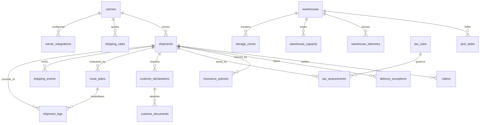

# VINTORA — Logistics & Delivery Module (Vintora Flow)

> **Companion documents:** `_canon.md`, `06-ai-features.md` (§9 route & temperature optimization), `03-technical-architecture.md`, `04-database-design.md` (logistics baseline + TimescaleDB), `11-b2b-wholesale-module.md` (Incoterm/PO handoff), `15-seller-dashboard-module.md` (fulfilment screens), `02-revenue-model.md`, `BUILDING.md`.
> This document is the **domain-level design authority for Vintora Flow** — the global logistics and delivery platform. `04-database-design.md` owns the canonical `carriers`, `shipments`, `shipping_events` and `warehouse_telemetry` baseline; this document defines the workflows, backend services, integrations and extensions that make them operational.

---

## Canon snapshot (binding)

| Dimension | Canonical fact |
|---|---|
| Brand | VINTORA (prose: "Vintora"); *The World's Cellar, Intelligent.* |
| All modules | Vintora Market, Vintora Trade, Vintora Sommelier, Vintora Assist, Vintora Studio, Vintora Seller, Vintora Flow, Vintora Club, Vintora Vault, Vintora Rewards. |
| Module in scope | **Vintora Flow** — multimodal freight, temperature control, customs, last-mile. |
| Mission fit | Democratize discovery, trade and enjoyment of fine wine and spirits worldwide through applied AI — protecting provenance, safety and responsible consumption. |
| Scale | 200+ countries served, **40+ licensed warehouses**, 1.2M orders/day peak, 10M SKU target; telemetry ingest > 50k/s. |
| Revenue | Cost-plus freight (20–35% spread), last-mile, insurance **0.3–1.2% of insured value** (60–70% margin), bonded warehousing; Logistics = 6% of Y5 revenue. |
| Baseline data | `carriers` (reference table), `shipments`, `shipping_events` (Citus by `tenant_id`), `warehouse_telemetry` + `device_telemetry` (TimescaleDB hypertables). |
| Stack | Go domain services, NestJS BFF, Kafka + Debezium, PostgreSQL + Citus, TimescaleDB, Redis, ClickHouse, S3, OpenSearch, Istio/mTLS, OpenTelemetry. |
| AI | Multimodal route optimizer (air/sea/road/rail) under cost, time and temperature-risk constraints; delay/excursion risk model; NLP customs-document automation; insurance pricing from risk score. |
| Guardrails | Human customs review for high-value lots; temperature excursions always alert a human; no route violating licensing or sanctioned-party rules; advisory AI never auto-books without policy approval. |
| Roadmap | Phase 2 (Q3–Q4 2027): Flow v1 with shipping integrations, warehouses, tracking. Phase 3: risk prediction. Phase 4: customs automation. Phase 5: global multimodal optimization. |
| Prototype | Seller "awaiting ship → Flow" action, delivery estimates at checkout, Trade Incoterm risk hints; deterministic demo data, browser self-test passing (generated count). |

**Non-claims:** all SLOs, rates, excursion thresholds and timelines are targets. No claim of live carrier contracts, broker partnerships or real shipment performance is made.

---

## 1. Product definition

### 1.1 Capability surface

| # | Feature | Core question | Backend domain | Primary workflow |
|---|---|---|---|---|
| F1 | **Shipping integrations** | Which carrier/service can move this lot, at what price and SLA? | Carrier Gateway + Rate Engine | WF-01 Rate & book |
| F2 | **Warehouse management** | Where is the stock, in which lot, at what temperature and cost? | Warehouse Service | WF-02 Inbound → store → pick |
| F3 | **Delivery tracking** | Where is the shipment now, and is anything wrong? | Tracking Service + Telemetry | WF-03 Track & exception |
| F4 | **Customs management** | What paperwork, HS code and duty apply, and is it cleared? | Customs Service | WF-04 Declare & clear |
| F5 | **Tax automation** | What VAT/GST/excise/duty applies, and who bears it? | Tax Engine | WF-05 Assess & remit |
| F6 | **Route optimization** | Best multimodal path under cost, time and temperature risk? | Route Optimizer | WF-06 Plan & re-route |

### 1.2 Actors and systems

| Actor | Role | System touchpoint |
|---|---|---|
| Merchant / seller | Requests shipment, chooses service level | Seller SELL-04 → Flow API |
| Trade buyer / supplier | Sets Incoterm and delivery window | Trade PO → `trade.shipment.requested.v1` |
| Warehouse operator | Receives, stores, picks, counts | Warehouse console + telemetry sensors |
| Carrier / forwarder | Provides rates, booking, tracking, milestones | Carrier Gateway adapters |
| Customs broker | Files declaration, handles holds | Customs Service + document store |
| Tax authority / engine | Rates, rules, filing | Tax Engine + rule tables |
| Vintora Ops | Reviews high-value customs, excursions, claims | Ops console |
| Insurance provider | Quotes and settles cargo claims | Insurance Service |

### 1.3 Non-goals

- Inventory ownership and ATP (Vintora Seller / Vintora Trade own it; Flow reads reservations).
- Order state transitions (Purchase Order / Order services own `status`).
- Consumer payments (Payment service; Flow emits charges to settlement).
- Investment custody (Vintora Vault consumes Flow provenance evidence).

---

## 2. Domain model

### 2.1 ER diagram



### 2.2 Core entities

| Entity | Grain | Key fields | Notes |
|---|---|---|---|
| `carrier_integration` | one carrier account | `carrier_id`, `adapter`, `credential_ref`, `capabilities`, `status`, `health` | Credentials in vault, never in DB plaintext. |
| `shipping_rate` | one carrier/service/lane band | `carrier_id`, `origin`, `destination`, `service`, `weight_band`, `volume_band`, `price_minor`, `transit_days`, `valid_from/to` | Quote cache with TTL. |
| `shipment` | one consignment | baseline + `incoterm`, `route_plan_id`, `customs_status`, `tax_status`, `risk_score`, `eta`, `insurance_policy_id` | Baseline lives in `04-database-design.md`. |
| `shipment_leg` | one modal segment | `shipment_id`, `seq`, `mode`, `from`, `to`, `carrier_id`, `eta`, `temperature_band` | Air/sea/road/rail. |
| `route_plan` | one candidate plan | `shipment_id`, `modes[]`, `cost_minor`, `eta`, `risk_score`, `chosen`, `score` | Immutable; re-planning creates a new row. |
| `storage_zone` | one zone in a warehouse | `warehouse_id`, `zone`, `temperature_band`, `bonded`, `capacity_cases` | Bonded vs duty-paid separation. |
| `pick_task` | one warehouse pick instruction | `warehouse_id`, `shipment_id`, `sku_id`, `lot_id`, `cases`, `status` | FEFO driven by Trade/Seller reservations. |
| `customs_declaration` | one filing | `shipment_id`, `hs_codes[]`, `declared_value`, `currency`, `broker_id`, `status`, `submitted_at`, `cleared_at` | Human review for high value. |
| `customs_document` | one artefact | `declaration_id`, `type`, `s3_uri`, `hash`, `status` | Invoice, packing list, certificate of origin, licence. |
| `tax_assessment` | one jurisdiction assessment | `shipment_id`, `jurisdiction`, `tax_type`, `rate`, `amount_minor`, `tax_inclusive`, `rule_version`, `liability_party` | Append-only; corrections are new rows. |
| `tax_rule` | one effective-dated rule | `jurisdiction`, `tax_type`, `rule_json`, `effective_from/to`, `source` | Data migration, never code hotfix. |
| `delivery_exception` | one exception | `shipment_id`, `type`, `severity`, `detected_at`, `status`, `owner_id` | Drives alerts and claims. |
| `insurance_policy` | one cargo policy | `shipment_id`, `provider`, `insured_value`, `rate`, `premium_minor`, `status` | 0.3–1.2% band. |
| `claim` | one insurance claim | `shipment_id`, `reason`, `amount_minor`, `evidence[]`, `status` | Telemetry + photos as evidence. |

### 2.3 Immutability and audit

- `shipping_events`, `warehouse_telemetry`, `tax_assessments`, `route_plans` and `claims` are append-only.
- Every external API call logs `(request_id, adapter, endpoint, status, latency, trace_id)` to ClickHouse.
- Every state transition emits a Kafka event with `event_id` for idempotent consumption.
- Monetary rows store `amount_minor` + `currency` + `fx_rate` + `fx_locked_at`.

---

## 3. Backend architecture

### 3.1 Service decomposition

```mermaid
graph TD
    subgraph CLIENTS[Callers]
        BFF[NestJS BFF / GraphQL]
        SELL[Seller SELL-04]
        TRADE[Vintora Trade PO service]
        ASSIST[Vintora Assist]
        OPS[Ops console]
    end

    subgraph FLOW[Vintora Flow - Go services]
        RATE[Rate & Quote Service]
        WARE[Warehouse Service]
        BOOK[Booking Service]
        TRACK[Tracking Service]
        CUSTOMS[Customs Service]
        TAX[Tax Engine]
        ROUTE[Route Optimizer]
        INS[Insurance Service]
        EXC[Exception & Claims Service]
        ING[Telemetry Ingest]
    end

    subgraph ADAPTERS[External integration adapters]
        CARRIER[Carrier adapters<br/>parcel / freight / forwarder]
        BROKER[Customs broker adapters]
        TAXAPI[Tax authority / provider APIs]
        INSAPI[Insurance provider APIs]
        WEATHER[Weather + geo APIs]
    end

    subgraph PLATFORM[Canonical platform]
        KAFKA[(Kafka<br/>flow.* events)]
        PG[(PostgreSQL + Citus)]
        TS[(TimescaleDB<br/>telemetry)]
        REDIS[(Redis<br/>rate cache + locks)]
        S3[(S3<br/>documents + proofs)]
        CH[(ClickHouse<br/>events + analytics)]
        AIGW[AI Gateway<br/>routing + document NLP]
    end

    BFF --> RATE & WARE & TRACK & CUSTOMS & TAX & ROUTE
    SELL --> BFF
    TRADE --> BFF
    ASSIST --> BFF
    OPS --> BFF
    RATE --> CARRIER
    BOOK --> CARRIER
    CUSTOMS --> BROKER
    TAX --> TAXAPI
    INS --> INSAPI
    ROUTE --> WEATHER & AIGW
    WARE --> ING
    TRACK --> CARRIER & ING
    ING --> TS
    FLOW --> KAFKA & PG & REDIS & S3 & CH
    KAFKA --> EXC
```



### 3.2 Service responsibilities

| Service | Owns | Hard rules |
|---|---|---|
| **Rate & Quote** | Carrier rate shopping, rate cache, service-level comparison | Never quote an expired rate; always show tax/duty flags; quote includes insurance option. |
| **Warehouse** | Zones, capacity, receipts, picks, counts, storage charges | FEFO allocation; bonded/duty-paid segregation; atomic capacity update. |
| **Booking** | Carrier booking, labels, manifests, cancellations | Idempotency key required; no duplicate bookings; booking only after credit/stock confirmed. |
| **Tracking** | Milestone ingestion, ETA recompute, proof of delivery | Events deduped by carrier event id; ETA updates emit events. |
| **Customs** | HS classification, declaration generation, broker submission, holds | High-value lots require human review; no filing without valid licence/permit. |
| **Tax Engine** | VAT/GST/excise/duty assessment, liability by Incoterm | Effective-dated rules; tax-inclusive/exclusive explicit; append-only assessments. |
| **Route Optimizer** | Multimodal candidate generation, scoring, re-route | Cannot propose a route violating licensing, sanctions or temperature band. |
| **Insurance** | Quote (0.3–1.2%), policy binding, claims | Rate derived from risk score; no coverage gap between booking and pickup. |
| **Exception & Claims** | Excursions, delays, disputes, claims workflow | Every excursion alerts a human; claims use telemetry + photos. |
| **Telemetry Ingest** | 50k+ events/s from sensors and carriers | At-least-once to Kafka; time-series writes to TimescaleDB; dedupe by sensor timestamp. |

### 3.3 Integration patterns

| Pattern | Use | Implementation |
|---|---|---|
| Adapter per carrier | Parcel, LTL, ocean, air forwarders | Common `CarrierPort` interface: `quote`, `book`, `track`, `cancel`, `label`; adapter maps provider schema |
| Outbox + inbox | External calls and Kafka events | Transactional outbox in Postgres; consumer inbox dedupes by `event_id` |
| Circuit breaker | Unavailable carrier/tax API | Failover to next-best carrier; cached rates with freshness stamp; no silent stale quote |
| Idempotency | Booking, filing, payment | `idempotency_key = hash(shipment_id, action, payload)` stored 30 days |
| Credential vault | Carrier/broker secrets | HashiCorp Vault-style refs; rotation every 90 days; never in DB or logs |
| Saga | Multi-service shipment creation | Reserve stock → quote → book → insure → declare; compensating release on failure |

### 3.4 Event contract

| Topic | Producer | Consumers | Payload essence |
|---|---|---|---|
| `flow.shipment.requested.v1` | Trade / Seller | Booking, Route, Tax, Insurance | `order_id, origin, destination, incoterm, cases, temp_band, value` |
| `flow.rate.quoted.v1` | Rate | Booking, Analytics | `carrier, service, price_minor, currency, transit_days, expires_at` |
| `flow.route.planned.v1` | Route | Booking, Tracking, Insurance | `shipment_id, modes[], eta, risk_score, cost_minor` |
| `flow.booking.confirmed.v1` | Booking | Tracking, Warehouse, Seller, Trade | `shipment_id, carrier, tracking_number, pickup_at` |
| `flow.pick.created.v1` | Warehouse | Booking, Seller | `shipment_id, pick_task_ids[], lot_ids[]` |
| `flow.shipment.milestone.v1` | Tracking | Seller, Trade, Assist, Analytics | `shipment_id, milestone, location, occurred_at` |
| `flow.telemetry.excursion.v1` | Telemetry | Exception, Insurance, Ops, Notification | `shipment_id, sensor_id, temp_c, threshold, duration` |
| `flow.customs.submitted.v1` | Customs | Tracking, Analytics | `declaration_id, shipment_id, broker, filed_at` |
| `flow.customs.cleared.v1` | Customs | Tracking, Booking | `declaration_id, cleared_at, duties_minor` |
| `flow.tax.assessed.v1` | Tax | Settlement, Trade, Analytics | `shipment_id, jurisdiction, tax_type, amount_minor, liability` |
| `flow.exception.raised.v1` | Exception | Ops, Insurance, Notification | `exception_id, type, severity, shipment_id` |
| `flow.claim.resolved.v1` | Claims | Settlement, Analytics | `claim_id, amount_minor, status` |
| `flow.audit.v1` | all | SIEM, audit sink | `actor, entity, from, to, trace_id` |

All events are at-least-once with idempotent consumers; DLQ depth > 100 alerts within 15 minutes.

### 3.5 Data architecture

| Store | Content | Access pattern |
|---|---|---|
| PostgreSQL + Citus | Shipments, legs, declarations, tax assessments, rates, plans, claims | OLTP, tenant-sharded by `tenant_id` |
| TimescaleDB | `warehouse_telemetry`, `device_telemetry`, in-transit sensor logs | 50k events/s ingest, 5-minute continuous aggregates, 2-year retention |
| Redis | Rate cache (5 min), booking locks, ETA snapshots | Sub-10ms reads |
| S3 | Customs documents, labels, proofs, photos | Object lock, 7-year retention, tenant prefix |
| ClickHouse | API call logs, milestones, analytics | Dashboards, cost-per-shipment, carrier scorecards |
| OpenSearch | Shipment search by tracking number, SKU, buyer | Full-text + filters |

**Citus notes:** distribute `shipments`, `shipping_events`, `customs_declarations`, `tax_assessments` and `route_plans` on `tenant_id`; replicate `carriers` and `tax_rules` as reference tables.

### 3.6 API contracts (REST, abridged)

| Method | Path | Purpose |
|---|---|---|
| `POST` | `/v1/flow/quotes` | Shop rates across carriers for a shipment request |
| `POST` | `/v1/flow/shipments` | Create shipment (saga start) |
| `GET` | `/v1/flow/shipments/:id` | Shipment detail + legs + ETA |
| `POST` | `/v1/flow/shipments/:id/book` | Confirm booking with chosen carrier (idempotent) |
| `GET` | `/v1/flow/shipments/:id/tracking` | Milestones + live telemetry |
| `POST` | `/v1/flow/shipments/:id/replan` | Request alternative route |
| `GET` | `/v1/flow/warehouses` / `POST /v1/flow/warehouses/:id/receipts` | Warehouses + inbound |
| `POST` | `/v1/flow/warehouses/:id/picks` | Create pick task |
| `POST` | `/v1/flow/customs/declarations` | Create/file declaration |
| `GET` | `/v1/flow/customs/declarations/:id` | Status + documents |
| `POST` | `/v1/flow/tax/assess` | Assess VAT/GST/excise/duty |
| `POST` | `/v1/flow/insurance/quote` | Quote cargo insurance |
| `POST` | `/v1/flow/claims` | Open a claim |

**Quote request/response:**

```json
POST /v1/flow/quotes
{
  "origin": { "warehouse_id": "wh-lon-b", "country": "GB" },
  "destination": { "country": "US", "state": "NY", "postcode": "10001" },
  "cases": 12, "weight_kg": 168, "volume_m3": 0.42,
  "temperature_band": "15-18C", "incoterm": "DDP",
  "declared_value_minor": 4254720, "currency": "USD",
  "delivery_window": { "from": "2027-11-26", "to": "2027-11-30" }
}
```

```json
{
  "quotes": [
    { "carrier": "Example Air Freight", "service": "temperature-controlled",
      "price_minor": 184000, "currency": "USD", "transit_days": 4,
      "risk_score": 0.12, "insurance_premium_minor": 22000,
      "tax_estimate_minor": 312000, "expires_at": "2027-11-20T14:32:00Z",
      "compliance": "PASS" }
  ],
  "rankedBy": "landed_cost", "fx_rate": 1.0
}
```

All routes require `x-tenant-id`; booking/claim routes require a verified role and idempotency key.

---

## 4. Workflows

Each workflow follows: **trigger → actors → preconditions → steps → state transition → postconditions → failure paths → SLA**.

### 4.1 WF-01 Shipping integration: rate shopping and booking

**Trigger:** `flow.shipment.requested.v1` from Trade PO or Seller order.
**Preconditions:** stock reserved, buyer/seller licences valid, destination not restricted, FX rate available.

| # | Step | System action | Human action |
|---|---|---|---|
| 1 | Normalise request | Map origin/destination, cases, weight, volume, temp band, Incoterm | — |
| 2 | Compliance pre-check | Sanctioned-party screen, licensing route check, dry-market block | Ops review if flagged |
| 3 | Rate shopping | Call carrier adapters in parallel; merge with cached rates | — |
| 4 | Route candidates | Route Optimizer generates 3–5 plans (WF-06) | — |
| 5 | Landed-cost compare | Price + tax + duty + insurance per quote | Buyer/merchant selects service |
| 6 | Book | Idempotent `book` call to chosen carrier; label + manifest generated | — |
| 7 | Insure | Bind policy from risk score (0.3–1.2%) | — |
| 8 | Confirm | `flow.booking.confirmed.v1`; warehouse pick triggered; tracking created | — |

**States:** `REQUESTED → VALIDATING → QUOTING → PLANNING → BOOKING → BOOKED → PICKING`.
**Failure paths:** no carrier can meet window → relaxation options; rate expired → re-quote; booking rejected → failover next carrier; compliance block → hard stop with reason.
**SLA:** rate shopping p95 ≤ 2 s; booking p95 ≤ 3 s; label within 60 s of booking.

### 4.2 WF-02 Warehouse management

**Trigger:** stock arrives, pick task created, cycle count scheduled.

| # | Step | Detail |
|---|---|---|
| 1 | Inbound ASN | Supplier sends ASN with lot codes, cases, condition, temperature log |
| 2 | Receipt | Goods-in records lot, checks seal/condition, assigns storage zone by temperature band and bonded status |
| 3 | Capacity check | Atomic zone capacity update; overflow to alternate zone with same band |
| 4 | Storage | Telemetry sensors start; continuous aggregates track 5-min temperature bands |
| 5 | Pick task | FEFO allocation from Trade/Seller reservations; one task per warehouse |
| 6 | Pick & pack | Scanner confirms lot and cases; condition photo; temperature log attached |
| 7 | Count | Weekly ABC cycle counts; variance > 0.5% → investigation + audit event |
| 8 | Storage charge | Daily accrual per case-day, bonded vs duty-paid rate |

**States:** `ASN → RECEIVED → STORED → RESERVED → PICKED → DISPATCHED`, branches `QUARANTINED`, `ADJUSTED`.
**Failure paths:** temperature excursion in zone → quarantine lot, block picks, alert human; variance → hold stock and investigate; missing ASN → manual receipt with enhanced checks.
**SLA:** receipt ≤ 30 min; pick task ≤ 4 business hours; excursion alert ≤ 60 s.

### 4.3 WF-03 Delivery tracking and exceptions

**Trigger:** carrier milestone webhook or telemetry event.

| # | Step | Detail |
|---|---|---|
| 1 | Ingest | Webhook → adapter normalisation → dedupe by carrier event id |
| 2 | Event persist | Append `shipping_events`; write telemetry to TimescaleDB |
| 3 | Milestone map | `picked → in_transit → customs → out_for_delivery → delivered → POD` |
| 4 | ETA recompute | Model updates ETA from milestones + weather + historical leg times |
| 5 | Exception detect | Delay > threshold, temperature breach, route deviation, failed delivery |
| 6 | Alert | Notify seller/buyer via Assist; page Ops for critical excursions |
| 7 | Action | Re-route, replace, or open claim; human decides |
| 8 | Close | POD stored in S3; shipment `DELIVERED`; settlement triggered |

**States:** `CREATED → PICKED → IN_TRANSIT → CUSTOMS → OUT_FOR_DELIVERY → DELIVERED`, branches `EXCEPTION`, `DELAYED`, `RETURNED`.
**SLA:** milestone propagation ≤ 10 s; ETA refresh ≤ 30 s; excursion alert ≤ 60 s.

### 4.4 WF-04 Customs management

**Trigger:** shipment destination crosses a customs boundary.

| # | Step | Detail |
|---|---|---|
| 1 | Classify | NLP + rule engine suggests HS code from SKU/appellation/ABV; confidence attached |
| 2 | Value | Declared value from PO with FX lock; include freight/insurance per Incoterm |
| 3 | Documents | Generate commercial invoice, packing list, certificate of origin, licence copies |
| 4 | Human review | Mandatory for high-value lots, first shipments to a market, or low-confidence HS codes |
| 5 | File | Broker adapter submits declaration; documents stored with hash |
| 6 | Track status | `DRAFT → REVIEW → FILED → HELD → CLEARED → REWORK` |
| 7 | Duties | Duty assessment posted to Tax Engine; DDP borne by shipper, DAP by consignee |
| 8 | Clearance | `flow.customs.cleared.v1`; release shipment to last mile |

**States:** `NOT_REQUIRED → DRAFT → REVIEW → FILED → HELD → CLEARED`, branches `REJECTED`, `REWORK`.
**Failure paths:** HS mismatch → broker query → rework; missing licence → hold and request document; sanctions hit → hard block; duty unpaid → hold release.
**SLA:** document generation ≤ 60 s; human review ≤ 1 business day; clearance target ≤ 24 h after filing.

### 4.5 WF-05 Tax automation

**Trigger:** quote creation, PO confirmation, customs clearance, invoice generation.

| # | Step | Detail |
|---|---|---|
| 1 | Resolve jurisdiction | Origin, destination, Incoterm, bonded/duty-paid status, buyer type |
| 2 | Match rule | Effective-dated `tax_rule` lookup by jurisdiction + tax type + date |
| 3 | Compute | VAT/GST, excise, customs duty, handling; tax-inclusive and exclusive both shown |
| 4 | Assign liability | DDP → shipper; DAP → consignee; B2B reverse charge where applicable |
| 5 | Validate | VAT ID check where supported; sanity bounds; conflict → manual review |
| 6 | Persist | Append `tax_assessment` with rule version, rate, amount, FX |
| 7 | Remit | Aggregated filing export to tax provider/authority; proof stored in S3 |
| 8 | Reconcile | Daily mismatch report; corrections are new append-only rows |

**States:** `PENDING → ASSESSED → VALIDATED → POSTED → REMITTED`, branches `REVIEW`, `CORRECTED`.
**Failure paths:** rule missing → block quote with "tax rule unavailable"; VAT ID invalid → hold; conflicting rates → Ops review.
**SLA:** assessment ≤ 300 ms p95; daily reconciliation by 06:00 local.

### 4.6 WF-06 Route optimization and re-routing

**Trigger:** new shipment request, excursion, delay forecast, carrier failure.

| # | Step | Detail |
|---|---|---|
| 1 | Build graph | Nodes = warehouses, ports, airports, hubs, destinations; edges = carrier services with cost/time/risk |
| 2 | Constraints | Hard: temperature band, licensing, sanctions, delivery window, dangerous-goods rules. Soft: cost, time, carbon, reliability |
| 3 | Candidate generation | K-shortest paths across air/sea/road/rail combinations; 3–5 viable plans |
| 4 | Risk scoring | Model predicts delay and excursion probability per leg from weather, history, season |
| 5 | Objective | `min(0.45·cost + 0.30·time + 0.20·risk + 0.05·carbon)` with hard-constraint pruning |
| 6 | Human choice | Merchant/buyer selects recommended plan or alternative; AI never auto-books |
| 7 | Monitor | Live telemetry vs predicted risk; drift triggers re-plan |
| 8 | Re-route | New `route_plan` row; booking amendment; notify all parties |

**States:** `DRAFT → OPTIMISING → PROPOSED → SELECTED → ACTIVE → REPLANNED | COMPLETED`.
**Failure paths:** no feasible plan → relax soft constraints and disclose; hard constraint unsatisfiable → hard block; optimizer timeout → fallback to carrier-direct ranked list.
**SLA:** optimisation p95 ≤ 3 s for regional, ≤ 8 s intercontinental; re-plan ≤ 5 s.

### 4.7 WF-07 Insurance and claims

Quote at booking (0.3–1.2% of insured value from risk score) → bind policy → telemetry + POD + photos as evidence → claim on excursion/damage/loss → Ops adjudication → settlement. Every claim stores evidence URIs and a named decision maker. Target claim decision ≤ 5 business days.

---

## 5. Route optimization engine

### 5.1 Scoring model

```text
plan_score = 0.45 · normalised_cost
           + 0.30 · normalised_transit_time
           + 0.20 · predicted_risk(delay, excursion)
           + 0.05 · normalised_carbon

hard_filters = temperature_band_respected
             AND licensing_valid_for_all_legs
             AND no_sanctioned_party
             AND delivery_window_feasible
             AND dangerous_goods_allowed
```

### 5.2 Signals

| Signal | Source | Use |
|---|---|---|
| Carrier historical on-time by lane | ClickHouse | Reliability prior |
| Temperature excursion history | TimescaleDB | Route risk |
| Weather forecast | External API | Delay/excursion probability |
| Port/airport congestion | Carrier + provider feeds | Transit-time adjust |
| Seasonality & events | Internal calendar | Capacity pricing |
| Value & fragility | Order/SKU metadata | Insurance rate |
| Modal cost curves | Rate Engine | Cost normalisation |

### 5.3 Guardrails

No route violating licensing, sanctions, dry-market or temperature requirements. Explanations name the concrete trade-off ("2 days faster, 18% costlier, excursion risk 4%"). The optimizer is advisory: a human selects the plan. All model versions and prompt versions are recorded.

---

## 6. Tax and customs rules

| Incoterm | Duty liability | Freight liability | Insurance requirement |
|---|---|---|---|
| DAP | Consignee | Shipper to named place | Recommended; disclosed |
| DDP | Shipper | Shipper to destination | Required for high value |
| FOB | Buyer | Buyer from onboard | Buyer |
| CIF | Buyer (via shipper's duty advance) | Shipper to port | Shipper minimum cover |

Rules are effective-dated data in `tax_rule`, versioned and reviewed by legal/tax specialists. Rule changes are migrations, not prompt edits. Every assessment retains the rule version so historical invoices can be reproduced.

---

## 7. Security and compliance

- **Zero trust:** mTLS via Istio; carrier/broker adapters in a separate egress namespace with allow-listed endpoints.
- **Tenant isolation:** `tenant_id` on all Flow tables; RLS; S3 tenant prefixes; telemetry tags.
- **Credentials:** vault refs, 90-day rotation, no secrets in logs or events.
- **Sanctions/AML:** screen parties at quote and booking; hard block on match with Ops review.
- **Records:** customs docs, POD, telemetry and tax assessments retained 7 years with object lock.
- **Age/licensing:** destination rules from Trade's jurisdiction table are reused, never duplicated.
- **Human gates:** high-value customs, excursions, claims and tax conflicts always require a named human.

---

## 8. Observability and SLOs

| SLO | Target | Alert |
|---|---|---|
| Flow API availability | 99.9% monthly | Error-budget burn > 2% in 1 h |
| Rate quote latency | p95 < 2 s | p95 > 3 s for 5 min |
| Booking latency | p95 < 3 s | p95 > 5 s for 5 min |
| Telemetry ingest | > 50k events/s | Sustained < 30k with backlog |
| Milestone propagation | ≤ 10 s | p95 > 20 s |
| Excursion detection | ≤ 60 s | Any breach > 120 s → page |
| Customs rework rate | Track by broker/market | > 10% for a market |
| On-time delivery | Target 95% | < 90% weekly |
| Event delivery | 99.9% within 10 s | DLQ depth > 100 |

**Dashboards:** shipment funnel, carrier scorecard, excursion timeline, customs hold queue, tax assessment exceptions, cost per shipment, claims ageing. Traces carry `tenant_id`, `shipment_id`, `trace_id`, `adapter`.

---

## 9. Rollout plan

| Phase | Window | Deliverables | Exit criteria |
|---|---|---|---|
| Phase 2 | Q3–Q4 2027 | Flow v1: shipping integrations, warehouse, tracking, basic tax | On-time target set, telemetry live, zero duplicate bookings |
| Phase 3 | 2028 | Risk prediction, ETA model, insurance attach, exception automation | Excursion detection ≤ 60 s, claims workflow live |
| Phase 4 | 2029 | Customs automation, tax provider integration, broker adapters | Customs rework < 10%, assessments reproducible |
| Phase 5 | 2030–2034 | Global multimodal optimization, 200+ countries, 40+ warehouses | All SLOs green at 1.2M orders/day peak |

---

## 10. Prototype-to-production mapping

| Prototype element | Production destination |
|---|---|
| Seller "awaiting ship → Flow" action | `flow.shipment.requested.v1` → Booking saga |
| Checkout delivery estimate | Rate & Quote Service + Route Optimizer |
| Trade Incoterm / delivery-window risk hint | Tax Engine + Route risk score |
| Inventory "Live from bonded warehouses via Flow" | Warehouse Service + storage zones |
| Demo tracking states | `shipping_events` + Tracking Service |

---

## 11. Risks and open decisions

| Risk | Mitigation |
|---|---|
| Carrier API outage | Circuit breaker, failover, cached rates with freshness stamp |
| Temperature excursion | Telemetry alerts, quarantine, insurance, human review |
| Customs rework | Document NLP + human review for high value, broker scorecards |
| Tax rule error | Effective-dated rules, legal review, append-only assessments, reconciliation |
| Duplicate booking | Idempotency keys + booking lock |
| Telemetry volume | TimescaleDB hypertables, compression, 2-year retention |
| Sanctions breach | Screening at quote and booking, hard block, audit |
| AI route overreach | Hard constraint pruning, human plan selection, versioned models |

**Open decisions for Phase 2:**

1. Which carriers and forwarders to integrate first per launch market (US/UK/SG/EU).
2. DDP vs DAP default at checkout for B2C.
3. Insurance provider: single global partner vs regional providers.
4. Telemetry hardware: bring-your-own sensors vs Vintora-supplied devices.
5. Tax filing: self-filing engine vs licensed provider in each jurisdiction.
6. Re-route authority: who may approve an amendment above a cost threshold.

---

## 12. Summary

Vintora Flow is designed as a **compliance-first, telemetry-driven logistics platform** with six first-class features — shipping integrations, warehouse management, delivery tracking, customs management, tax automation and route optimization — bound together by an idempotent Kafka event fabric and explicit state machines. The backend is a set of ten Go domain services with carrier/broker/tax/insurance adapters, Citus OLTP, TimescaleDB telemetry at >50k events/s, Redis rate caching, S3 evidence and ClickHouse analytics. Seven detailed workflows cover rate-to-booking, warehouse operations, tracking/exceptions, customs, tax, multimodal routing and claims, with hard compliance gates and mandatory human review for high-value customs, excursions and claims. The architecture reuses the canonical platform and the Trade/Seller handoffs rather than creating a parallel stack, and all figures are targets rather than claims of live logistics performance.
