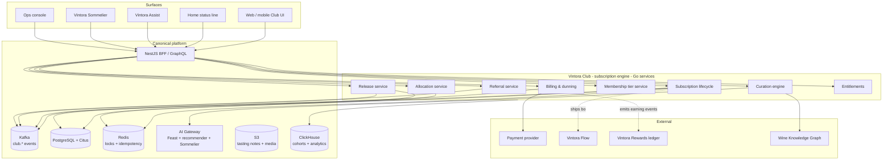
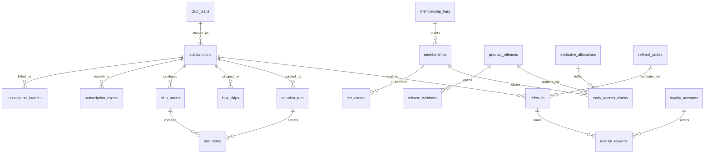
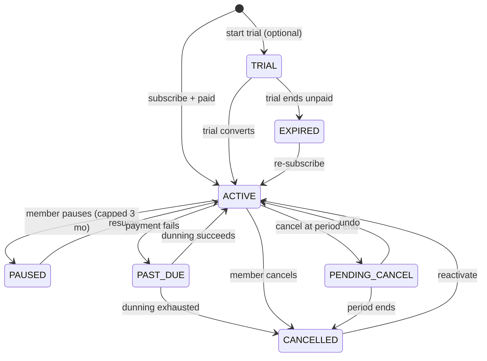
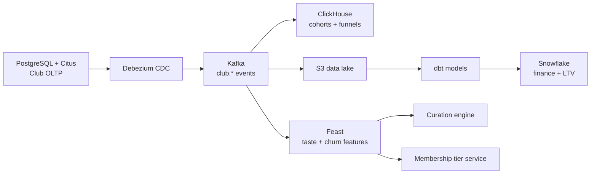

# VINTORA — Membership & Subscription Module (Vintora Club)

> **Companion documents:** `_canon.md`, `05-ui-ux-wireframes.md` (Screen 7 — Club picker, Screen 12 — Rewards), `04-database-design.md` (baseline `club_plans`, `subscriptions`, `club_boxes`, `loyalty_*`), `02-revenue-model.md` (Club tiers + unit economics), `06-ai-features.md` (§4 taste profile & recommender), `12-ai-sommelier-module.md`, `11-b2b-wholesale-module.md` (allocation supply), `16-logistics-delivery-module.md` (box shipping), `BUILDING.md`.
> This document is the **domain-level design authority for Vintora Club** — the premium subscription engine. It defines the subscription lifecycle, billing and dunning, personalized curation, exclusive allocation, VIP progression, early-access drops and the referral loop as Design-state specifications. `04-database-design.md` owns the canonical baseline tables; this document extends them as a target production subscription engine, not a live implementation.

---

## Canon snapshot (binding)

| Dimension | Canonical fact |
|---|---|
| Brand | VINTORA (prose: "Vintora"); *The World's Cellar, Intelligent.* |
| All modules | Vintora Market, Vintora Trade, Vintora Sommelier, Vintora Assist, Vintora Studio, Vintora Seller, Vintora Flow, Vintora Club, Vintora Vault, Vintora Rewards. |
| Module in scope | **Vintora Club** — curated monthly boxes + tasting experiences. Referral accrual settles through **Vintora Rewards**. |
| Mission fit | Democratize discovery, trade and enjoyment of fine wine and spirits worldwide through applied AI — protecting provenance, safety and responsible consumption. |
| Club tiers | **Good $29 / Better $59 / Best $119 / Icon $199 per month** with bottle counts **2 / 3 / 4 / 6**. |
| Positioning | Curation + ritual, **not a discount subscription**; age-gated, provenance-verified, skip/pause/change anytime. |
| Economics (estimates) | Blended ARPU **$79/mo**, CAC **$35**, contribution margin **40–50%**, LTV ~**$700**, LTV/CAC ~20x, payback ~1 mo; Club = **12% of Y5 revenue**. |
| UI reference | Wireframe Screen 7 (subscription picker) and Screen 12 (Rewards); tokens burgundy `#5B1A2B`, cream `#F7F1E6`, gold `#C9A227`, charcoal `#1C1917`, sage `#6B7A5E`. |
| Baseline schema | `club_plans`, `subscriptions`, `club_boxes`, `loyalty_accounts`, `loyalty_transactions`, `rewards` — `user_id`-partitioned in PostgreSQL + Citus. |
| AI | Taste-profile recommender (two-tower + transformers, bandits) drives tier + box curation; Sommelier explains value with grounded citations. |
| Guardrails | Age verification before shipment; no health/intoxication claims; price used for relevance, **never discriminatory pricing**; opt-out → non-personalized editorial curation. |
| Roadmap | Phase 3 (2028): Club v1; Rewards v1 in Phase 2 (Q3–Q4 2027). |
| Prototype | Home subscription-status line, Club picker view, Rewards points view; deterministic demo data, browser self-test passing (generated count). |

**Non-claims:** all ARPU, CAC, margin, LTV, churn and timeline figures are projections/estimates. No claim of live supplier allocations, real member counts or real referral payouts is made.

---

## 1. Product definition

### 1.1 Capability surface

| # | Feature | Core question answered | Engine domain | Primary workflow |
|---|---|---|---|---|
| F1 | **Monthly wine club** | What is my cadence, tier and next box, and can I skip? | Subscription lifecycle + billing | WF-01 Subscribe → renew |
| F2 | **Exclusive products** | Which bottles are reserved for members, and who gets them? | Allocation service | WF-04 Allocate |
| F3 | **Personalized boxes** | What goes in my box, and why these bottles? | Curation engine | WF-03 Curate box |
| F4 | **VIP membership** | What status do I hold, and what benefits unlock? | Membership tier service | WF-05 Progress |
| F5 | **Early access releases** | When can I buy a limited drop before the public? | Release service | WF-06 Drop |
| F6 | **Referral system** | Who invited me, and what reward do we both earn? | Referral service + Rewards | WF-07 Refer |

### 1.2 Members and postures

| Persona | Need | Typical tier | Key flow |
|---|---|---|---|
| Curious newcomer | "Is this worth it? Let me try 2 bottles." | Good | Quiz → Good → first box |
| Enthusiast | "Surprise me with good bottles and notes." | Better / Best | Taste profile → curated box |
| Collector | "Give me rare allocations and first refusal." | Icon | VIP + early access drops |
| Gifter | "Send a ritual, not a gift card." | Any (age-assured recipient) | Gift subscription |
| Lapsed member | "I paused — win me back." | Any | Win-back + tier reassessment |

### 1.3 Non-goals

- One-off retail checkout (Vintora Market).
- Custody/investment lots and fractional ownership (Vintora Vault).
- Points catalogue and partner interchange (Vintora Rewards owns the ledger; Club only emits earning events).
- Physical fulfilment execution (Vintora Flow picks and ships the box).

---

## 2. Subscription engine architecture

### 2.1 Service decomposition



### 2.2 Service responsibilities

| Service | Owns | Hard rules |
|---|---|---|
| **Subscription lifecycle** | Status, cadence, tier, next bill/box dates, skips, pauses, cancellations | All transitions audited; age verified before first shipment; no silent renewal after cancellation. |
| **Billing & dunning** | Invoices, payment attempts, retries, proration, refunds | Idempotent charges; card expiry warnings; failed payments never ship a box. |
| **Curation engine** | Box composition from taste profile + inventory + margin rules | Explainable picks; respect dietary/region exclusions; no personalized price discrimination. |
| **Allocation service** | Exclusive product inventory reservation for members | Tier-gated; FEFO/lot-aware; no oversubscription; fair allocation under demand. |
| **Membership tier service** | VIP status, progress, benefits, status protection | Tier derived from canonical rules; no manual backdating without audit. |
| **Release service** | Early-access drops, windows, claim queues | Tier-ordered windows; bots blocked; one claim per member per drop. |
| **Referral service** | Codes, attribution, reward accrual, abuse checks | Self-referral impossible; reward only after qualifying paid event; fraud hold. |
| **Entitlements** | Feature flags per tier/market | Single source for "can this member do X?"; mirrored to BFF gates. |

### 2.3 Domain model (ER diagram)



### 2.4 Core entities

| Entity | Grain | Key fields | Notes |
|---|---|---|---|
| `subscription` | one member subscription | tier, cadence, status, `next_bill_at`, `next_box_month`, preferences, `age_verified`, `payer_ref` | Baseline extended with billing + curation state. |
| `subscription_invoice` | one charge attempt | amount, currency, status, `attempt`, `psp_ref`, `paid_at` | Append-only; retries create new rows. |
| `subscription_event` | one state transition | `from_status`, `to_status`, `reason`, `actor`, `trace_id` | Append-only audit. |
| `box_skip` | one skipped month | `subscription_id`, `month`, `reason` | One per member/month; restores next box date. |
| `curation_run` | one AI curation pass | `model_version`, `prompt_version`, `score`, `rationale_json`, `accepted` | Immutable; powers "Why these?". |
| `box_item` | one bottle in a box | `product_id`, `lot_id`, `position`, `rationale`, `substitution_of` | Traceable to curation run. |
| `membership` | one VIP record | `tier`, `points_to_next`, `status_protected_until`, `lifetime_boxes` | Tier mirrors Rewards with eventual consistency. |
| `tier_event` | one tier change | `from_tier`, `to_tier`, `reason`, `effective_at` | Append-only. |
| `exclusive_allocation` | one reserved pool | `product_id`, `tier_min`, `quantity`, `released_at`, `expires_at` | Supply ring-fenced for members. |
| `product_release` | one limited drop | `name`, `product_ids`, `total_units`, `status`, `public_at` | Early-access master. |
| `release_window` | one tier window | `release_id`, `tier`, `opens_at`, `closes_at` | Icon → Best → Better → Good → public. |
| `early_access_claim` | one member claim | `release_id`, `member_id`, `units`, `status` | Unique per member/release. |
| `referral_code` | one code | `code`, `owner_id`, `status`, `uses`, `max_uses` | Human-readable, rate-limited. |
| `referral` | one attributed invite | `code_id`, `referrer_id`, `referee_id`, `status`, `qualifies_at` | Unique referee. |
| `referral_reward` | one earned reward | `referral_id`, `party`, `points`, `status`, `hold_until` | Settles to Rewards ledger. |

### 2.5 Immutability and money discipline

- `subscription_events`, `subscription_invoices`, `tier_events`, `curation_runs`, `referral_rewards` are append-only.
- All monetary rows use `*_minor` + `currency_code` + FX provenance; `club_plans` canonical prices are USD with locale conversion at charge time.
- Every external call logs `(request_id, adapter, endpoint, status, latency, trace_id)` to ClickHouse.
- Every state transition emits a Kafka event keyed by `event_id` for idempotent consumers.

---

## 3. Subscription lifecycle

### 3.1 State machine



| State | Billing | Box | Notes |
|---|---|---|---|
| `TRIAL` | No charge | Preview only | Age verified; optional per market. |
| `ACTIVE` | Recurring charge | Curate + ship | Normal state. |
| `PAUSED` | Suspended | No box | Max 3 consecutive months, then auto-resume. |
| `PAST_DUE` | Retry schedule | Box held | Dunning: day 0/3/7/12, then cancel. |
| `PENDING_CANCEL` | No further charge | Final box ships | Reversible until period end. |
| `CANCELLED` / `EXPIRED` | None | None | Retention campaign may target (consent required). |

### 3.2 Billing rules

| Rule | Behaviour |
|---|---|
| Cycle | Monthly default; quarterly/annual as entitlement options (discount bounded by margin floor). |
| Proration | Tier upgrades effective next cycle with credit for unused days; downgrades at cycle end. |
| Dunning | Retries at 0/3/7/12 days with card-update link; grace box held, never shipped unpaid. |
| Failed payment | Emit `club.payment.failed.v1`; pause curation; notify via Assist. |
| Refund | Full/partial via append-only adjustment; claw back any points accrued on the reversed charge. |
| Card expiry | Notify 30 days ahead; soft dunning before hard failure. |
| Idempotency | `idempotency_key = hash(subscription_id, invoice_id, attempt)` stored 30 days. |
| Age/licence | Charge and shipment blocked until age verification passes for destination market. |

---

## 4. Feature engines

### 4.1 Monthly club & cadence (F1)

- **Plan catalogue:** four canonical tiers (`club_plans` reference table), each with bottle count, inclusions (notes, premium, live experiences, concierge) and price.
- **Cadence engine:** computes `next_bill_at` (anchor = signup day, clamped for short months) and `next_box_month` from cadence + skips + pauses.
- **Skip/pause/change:** self-service, capped (skip ≤ 2 per 6 months; pause ≤ 3 consecutive), all emit events and recompute dates atomically.
- **Box lifecycle:** `PLANNED → CURATED → ALLOCATED → PACKED → SHIPPED → DELIVERED → CLOSED`, with a cut-off (e.g. 5 days before ship) after which tier/preference changes apply to the *next* box.

### 4.2 Personalized boxes (F3)

**Input features (Feast):** saved taste profile (body, regions, grapes, budget band, dietary constraints), purchase/consumption/review history, dwell and skip signals, seasonality, current inventory, margin rules, member feedback on past bottles (thumbs, ratings).

**Pipeline:** candidate generation from Knowledge Graph + vector similarity (two-tower + transformer) → hard filters (age market, dietary, exclusions, available lots, margin floor) → diversity constraints (no duplicate regions/vintages unless deliberate) → ranker scores fit × novelty × value → explainability payload → `curation_run` + `box_items`. Sommelier renders "Why these?" in plain language with citations.

```text
box_score = 0.50 · taste_fit + 0.20 · discovery_value
          + 0.15 · member_feedback + 0.15 · margin_efficiency

hard_filters = age_market_ok AND dietary_ok AND in_stock
             AND provenance_verified AND margin >= floor
             AND not_excluded_by_member
```

**Guardrails:** price band informs relevance only — never a different price for the same bottle to a different member. Opt-out switches to an editorially curated box of equal perceived quality. Every substitution is logged with `substitution_of`.

### 4.3 Exclusive products & allocation (F2)

- Supply is ring-fenced per tier (`exclusive_allocations` with `tier_min`) from Trade/seller lots or Vintora-sourced parcels.
- **Fair allocation:** when demand exceeds supply, allocate by tier priority then request time then a deterministic tie-break; never a random or opaque lottery. Members see their allocation status and waitlist position.
- **Substitution policy:** if a lot fails provenance or condition checks, offer a same-tier replacement with disclosure; never silently downgrade.
- **Provenance:** every exclusive bottle carries lot, custodian and verification evidence shared with Vintora Vault/Flow.

### 4.4 VIP membership (F4)

| Tier | Price | Bottles | VIP benefits (canonical escalation) |
|---|---|---|---|
| Good | $29/mo | 2 | Core box + tasting notes |
| Better | $59/mo | 3 | + expanded selection + notes |
| Best | $119/mo | 4 | + premium bottles + live tasting experiences |
| Icon | $199/mo | 6 | + rare allocations + concierge + exclusive events |

**Progression:** VIP status is derived from tenure, boxes received, lifetime spend and Rewards tier; computed nightly into `memberships` with `tier_events`. **Status protection** grants a grace window (e.g. 60 days at Best/Icon) on lapse to encourage reactivation. Benefits are entitlements, not vague perks — each maps to a flag in the Entitlements service. No paid "status upgrade" that bypasses the canonical tier rules.

### 4.5 Early access releases (F5)

- A `product_release` opens **tier-ordered windows**: Icon → Best → Better → Good → public, each with `opens_at`/`closes_at`.
- Members claim inside their window; claims are rate-limited and bot-protected (device/session checks, one claim per member per drop).
- Inventory decrements atomically against `exclusive_allocations`; oversubscription waits by deterministic fairness.
- Unclaimed units roll to the next tier window, then to public Market — disclosed in the drop terms.
- Every window open/close and claim emits `club.release.*.v1` events; reminders go through Assist with consent.

### 4.6 Referral system (F6)

```text
member A shares code → member B signs up with code
→ B completes qualifying event (first paid box delivered, age verified)
→ after holding period, both earn Rewards points via referral_reward
→ reward settles to Vintora Rewards ledger (loyalty_transactions)
```

**Rules:** codes are unique and rate-limited; self-referral and same-household/same-payment-instrument referrals are blocked; a referee can be attributed once; rewards are held through a return/cancellation window (`hold_until`) and clawed back on refund or fraud. Abuse signals (velocity, device, payment fingerprint) route to manual review. Reward currency is **Rewards points**, never cash discounts on regulated alcohol, and all copy respects age and responsible-drinking rules.

---

## 5. Workflows

Each workflow follows: **trigger → preconditions → steps → state transition → postconditions → failure paths → SLA**.

### 5.1 WF-01 Subscribe and first box

**Trigger:** member chooses a tier. **Preconditions:** age verification passes, destination shippable, payment method valid.

| # | Step | System action | Human action |
|---|---|---|---|
| 1 | Risk + age check | Verify age/gate, sanctions, shippable jurisdiction | — |
| 2 | Create subscription | Insert `subscription` (TRIAL/ACTIVE), anchor billing dates | — |
| 3 | Charge | Idempotent invoice via PSP | — |
| 4 | Activate | `ACTIVE`, emit `club.subscription.started.v1` | — |
| 5 | Curate | WF-03 runs for first `next_box_month` | — |
| 6 | Allocate + ship | WF-04 then Flow picks/ships | — |
| 7 | Welcome | Notes, "Why these?", referral code issued | Member may share code |

**Failure paths:** age fail → hard block; payment fail → dunning; out of stock → substitution or box delay with disclosure.
**SLA:** subscribe p95 ≤ 1.5 s; first curation ≤ 30 s.

### 5.2 WF-02 Monthly renewal and dunning

| # | Step | Detail |
|---|---|---|
| 1 | Pre-bill (T-3d) | Card validity check + reminder via Assist |
| 2 | Charge (T0) | Idempotent invoice; success → extend cycle |
| 3 | On failure | `PAST_DUE`, hold box, retry 0/3/7/12d |
| 4 | Card update | Self-service link resumes immediately |
| 5 | Exhausted | `CANCELLED`, emit `club.subscription.lapsed.v1` |
| 6 | Win-back | Consented retention offer + tier reassessment |

**States:** `ACTIVE → PAST_DUE → ACTIVE | CANCELLED`. **SLA:** charge p95 ≤ 2 s; box never ships without a paid invoice.

### 5.3 WF-03 Curate personalized box

| # | Step | Detail |
|---|---|---|
| 1 | Feature assemble | Pull Feast taste + feedback features |
| 2 | Candidate gen | Two-tower + transformer + KG retrieval |
| 3 | Hard filters | Age, dietary, stock, provenance, margin floor |
| 4 | Rank + diversity | Score fit/novelty/value; enforce diversity |
| 5 | Explain | Generate rationale + citations via Sommelier |
| 6 | Persist | `curation_run` + `box_items` (immutable) |
| 7 | Preview | Member sees "What's inside" with swap affordance |

**Failure paths:** insufficient candidates → relax novelty, then editorial fallback; model timeout → cached editor picks; no provenance → exclude bottle.
**SLA:** curation p95 ≤ 30 s; preview ready before box cut-off.

### 5.4 WF-04 Allocate exclusive products

| # | Step | Detail |
|---|---|---|
| 1 | Reserve pool | Ring-fence lots by tier in `exclusive_allocations` |
| 2 | Match | Member tier ≥ `tier_min`; one unit per member where scarce |
| 3 | Fairness | Demand > supply → tier priority, then request time, deterministic tie-break |
| 4 | Confirm | Create `box_items`/claim, decrement allocation atomically |
| 5 | Waitlist | Unallocated members see position + disclosure |
| 6 | Substitute | Failed provenance/condition → disclosed same-tier replacement |

**SLA:** allocation p95 ≤ 1 s; zero oversubscription.

### 5.5 WF-05 Progress VIP tier

Nightly job recomputes `memberships` from tenure, boxes, spend and Rewards tier → writes `tier_events` → emits `club.tier.changed.v1` → updates entitlements → renders benefits in UI. Status protection grants a grace window on lapse. All changes audited; retroactive changes require Ops approval.

### 5.6 WF-06 Early-access drop

| # | Step | Detail |
|---|---|---|
| 1 | Publish release | Create `product_release` + tier `release_windows` |
| 2 | Open Icon window | Notify Icon members (consent), claims accepted |
| 3 | Roll down | Unclaimed units open to Best → Better → Good → public |
| 4 | Claim | One per member; atomic stock decrement; bot checks |
| 5 | Fulfil | Allocate lot + route to Flow or add to next box |
| 6 | Close | Emit results; public sale at `public_at` |

**SLA:** window transition ≤ 5 s; claim p95 ≤ 1 s; no duplicate claims.

### 5.7 WF-07 Referral attribution and reward

| # | Step | Detail |
|---|---|---|
| 1 | Share | Member shares code (link, in-app, message) |
| 2 | Attribute | Referee applies code at signup; store `referral` |
| 3 | Qualify | Wait for first paid box delivered + age verified |
| 4 | Fraud check | Velocity, device, payment fingerprint, household rules |
| 5 | Hold | `hold_until` through return window |
| 6 | Reward | Emit `club.referral.rewarded.v1`; settle points to Rewards |
| 7 | Clawback | Refund/fraud → reverse reward (append-only) |

**Failure paths:** duplicate referee → ignore; self-referral → block; fraud → manual review hold. **SLA:** attribution p95 ≤ 500 ms; reward within 24 h of qualifying + hold.

---

## 6. API contracts (BFF GraphQL, abridged)

```graphql
type ClubPlan { code: ID!, price: Money!, bottles: Int!, inclusions: [String!]!, tier: Tier! }
type Subscription { id: ID!, tier: Tier!, status: SubscriptionStatus!, cadence: Cadence!,
  nextBillAt: DateTime, nextBoxMonth: Date, preferences: TastePreferences! }
type Box { id: ID!, month: Date!, status: BoxStatus!, items: [BoxItem!]!, rationale: [String!]! }
type BoxItem { productId: ID!, lotId: ID!, name: String!, position: Int!, reason: String! }
type Membership { tier: Tier!, progress: Float!, benefits: [String!]!, protectedUntil: DateTime }
type Release { id: ID!, name: String!, windows: [ReleaseWindow!]!, status: ReleaseStatus! }
type ReferralCode { code: String!, uses: Int!, maxUses: Int, rewardPoints: Int! }

type Query {
  clubPlans: [ClubPlan!]!
  mySubscription: Subscription
  myNextBox: Box
  myMembership: Membership!
  releases(status: ReleaseStatus): [Release!]!
  myReferralCode: ReferralCode!
}

type Mutation {
  subscribe(planCode: ID!, ageToken: String!): Subscription!
  changeTier(planCode: ID!): Subscription!
  skipMonth(month: Date!): Subscription!
  pause(cycles: Int!): Subscription!
  resume: Subscription!
  cancel(atPeriodEnd: Boolean!): Subscription!
  swapBoxItem(boxItemId: ID!, replacementProductId: ID!): Box!
  claimRelease(releaseId: ID!, units: Int!): EarlyAccessClaim!
  createReferralCode: ReferralCode!
}
```

**REST parity:** `/v1/club/*` for webhooks (PSP dunning, Flow delivery confirmations) and partner integrations. All routes require `x-tenant-id`, a verified member session, age token for subscribe/ship routes, and idempotency keys for charges and claims.

---

## 7. Event contracts

| Topic | Producer | Consumers | Payload essence |
|---|---|---|---|
| `club.subscription.started.v1` | Subscription | Billing, Curation, Rewards, Analytics | `subscription_id, user_id, tier, started_at` |
| `club.subscription.renewed.v1` | Billing | Curation, Rewards, Analytics | `subscription_id, invoice_id, period` |
| `club.payment.failed.v1` | Billing | Assist, Subscription, Analytics | `subscription_id, attempt, reason` |
| `club.subscription.lapsed.v1` | Billing | Retention, Analytics | `subscription_id, reason, lifetime_boxes` |
| `club.box.curated.v1` | Curation | UI, Ops, Analytics | `box_id, run_id, items[], rationale` |
| `club.box.shipped.v1` | Flow | Subscription, Rewards, Analytics | `box_id, tracking_number, shipped_at` |
| `club.tier.changed.v1` | Membership | Entitlements, Releases, UI, Analytics | `user_id, from, to, reason` |
| `club.release.opened.v1` | Release | Assist, UI, Analytics | `release_id, tier, opens_at, closes_at` |
| `club.release.claimed.v1` | Release | Allocation, Flow, Analytics | `claim_id, release_id, user_id, units` |
| `club.referral.attributed.v1` | Referral | Referral, Analytics | `referral_id, referrer_id, referee_id` |
| `club.referral.rewarded.v1` | Referral | Rewards, Analytics | `referral_id, party, points, hold_until` |
| `club.audit.v1` | all | SIEM, audit sink | `actor, entity, from, to, trace_id` |

At-least-once with idempotent consumers; DLQ depth > 50 alerts within 15 minutes.

---

## 8. Database architecture

### 8.1 Design principles

| # | Principle | Implementation |
|---|---|---|
| D1 | Tenant-first | `tenant_id` + `user_id` on all rows; Citus distribution by `user_id`; Postgres RLS defence in depth. |
| D2 | Append-only history | Invoices, events, curation runs, tier/reward rows are immutable; corrections are new rows. |
| D3 | Money discipline | `*_minor` + `currency_code` + FX provenance; canonical prices in `club_plans`. |
| D4 | Idempotency | Charge/claim/reward keys stored 30 days; consumer inbox dedupes by `event_id`. |
| D5 | Effective dating | Tier rules, release windows and entitlements are time-bounded, never overwritten. |
| D6 | Privacy | Taste profile is user-controllable with opt-out; no sensitive-attribute inference; age token, not raw DOB. |

### 8.2 Baseline vs new tables

| Domain | Baseline (`04-database-design.md`) | Added by this module |
|---|---|---|
| Plans | `club_plans` | — (extended via columns) |
| Subscription | `subscriptions`, `club_boxes` | `subscription_invoices`, `subscription_events`, `box_skips` |
| Curation | — | `curation_runs`, `box_items` |
| Membership | `loyalty_accounts` | `memberships`, `tier_events` |
| Exclusives | — | `exclusive_allocations`, `product_releases`, `release_windows`, `early_access_claims` |
| Referrals | `loyalty_transactions`, `rewards` | `referral_codes`, `referrals`, `referral_rewards` |

### 8.3 Indexing and query patterns

| Query | Index | Notes |
|---|---|---|
| My subscription by user | `(tenant_id, user_id, status)` | Single-row point lookup |
| Renewals due | `(tenant_id, status, next_bill_at)` partial `status IN ('ACTIVE','TRIAL','PAST_DUE')` | Drives billing cron |
| Box by month | `(subscription_id, month)` unique | Baseline `club_boxes` |
| Open release windows | `(release_id, tier, opens_at, closes_at)` | Release roll-down |
| Referral attribution | `referral_codes(code)` unique + `(tenant_id, referee_id)` unique | One referee only |
| Reward hold queue | `(tenant_id, status, hold_until)` partial `status='held'` | Settlement worker |
| Tier progress | `(tenant_id, user_id, effective_at DESC)` | Ledger read |

Citus: distribute all large tables on `user_id`; replicate `club_plans` as a reference table (already canonical). RLS template: `USING (user_id = current_setting('app.user_id')::uuid AND tenant_id = current_setting('app.tenant_id')::uuid)`.

### 8.4 Analytical pipeline



- Real-time widgets (next box, skip state, claims) read Citus; cohort/retention dashboards read ClickHouse with a 10-second freshness target.
- Revenue recognition for Club renewals reconciles with the revenue ledger (see `15-seller-dashboard-module.md`) daily.
- Retention: subscription history 7 years (financial), curation/feature data 13 months in ClickHouse.

---

## 9. Security, compliance and trust

- **Age verification:** required before first charge/ship; age token stored, raw DOB never kept in Club tables; gated by market rules from Trade jurisdiction data.
- **Responsible drinking:** no health/intoxication claims in box notes or referral copy; all marketing copy passes the Studio compliance gate (see `14-ai-content-generator-module.md`).
- **RLS + tenancy:** `user_id`/`tenant_id` on every table; service accounts scoped by table and operation.
- **Payment safety:** PSP references only, no card data stored; charges idempotent; MFA for Ops refunds above a threshold.
- **Referral integrity:** self/household/payment-instrument checks, velocity limits, fraud hold, append-only clawbacks.
- **Explainability & control:** "Why these?" rationale for every box, editable taste profile, non-personalized opt-out, export/delete rights.

---

## 10. Observability

| SLO | Target |
|---|---|
| Subscribe / claim API p95 | < 1.5 s / < 1 s |
| Renewal charge p95 | < 2 s |
| Curation p95 | < 30 s |
| Box shipping accuracy | 100% — never ship unpaid or age-failed |
| Oversubscription | Zero — atomic allocation |
| Referral attribution p95 | < 500 ms |
| Analytics freshness | ≤ 10 s |

**Dashboards:** subscriber funnel, MRR/ARPU by tier, skip/pause/churn rate, dunning recovery, curation acceptance, allocation waitlist, early-access conversion, referral qualified rate, fraud holds. Traces carry `tenant_id`, `user_id`, `subscription_id`, `screen_id`.

---

## 11. Rollout plan

| Phase | Window | Deliverables | Exit criteria |
|---|---|---|---|
| Phase 2 | Q3–Q4 2027 | Rewards ledger + referral code foundation | Points settle; fraud holds work |
| Phase 3 | 2028 | Club v1: tiers, billing, skips, curation, boxes, early access, VIP | Age gate green; zero oversubscription; dunning live |
| Phase 4 | 2029 | Advanced personalization, exclusive allocations, gifting, win-back | Curation acceptance tracked; churn dashboard live |
| Phase 5 | 2030–2034 | Global tiers, 60+ locales, local curation, experiences at scale | All SLOs green at target scale |

---

## 12. Prototype-to-production mapping

| Prototype element | Production destination |
|---|---|
| Home line "your Better box ships Sep 12" | `subscriptions.next_box_month` → `myNextBox` query |
| Club picker (4 tiers, exact prices/bottle counts) | `club_plans` reference table + `subscribe` mutation |
| "Skip / Pause / Change tier" controls | `box_skips`, `pause`, `changeTier` workflows |
| Sommelier "Better is your best value" | Curation run + Sommelier explanation |
| Rewards points view / "2x points on Club boxes" | `loyalty_transactions` + referral earning events |

---

## 13. Risks and open decisions

| Risk | Mitigation |
|---|---|
| Churn after first box | Onboarding quiz, "Why these?", skip/pause controls, win-back with consent |
| Box ships unpaid or underage | Charge-success + age-verified gates before allocation; hard checks in Flow handoff |
| Curation feels generic | Taste profile learning, feedback loop, novelty weighting, opt-out editorial fallback |
| Allocation disputes | Deterministic fairness, disclosed waitlist position, disclosed substitutions |
| Referral fraud | Self/household/payment checks, velocity limits, hold period, manual review |
| Over-discounting erodes premium | Curation uses price for relevance only; no discriminatory pricing; margin floors |

**Open decisions for Phase 3:**

1. Whether to offer a discounted annual cadence at launch or defer to Phase 4 (margin floor to be confirmed).
2. Skip/pause caps (proposed: 2 skips per 6 months, 3 consecutive pause months).
3. Whether Icon concierge is human or AI-assisted at launch.
4. Referral reward size in points and whether it scales with referee tier.
5. Trial availability by market (age/licensing dependent).
6. Whether early-access claims credit to the next box or ship separately.

---

## 14. Summary

Vintora Club is specified as a **target subscription engine** with seven proposed cooperating Go services — subscription lifecycle, billing/dunning, curation, allocation, membership tiers, releases and referrals — bound by an auditable state machine and an idempotent Kafka event fabric. The six requested features are first-class: the monthly club with skip/pause/change, tier-gated exclusive allocation, AI-personalized boxes with explainable "Why these?", VIP progression with status protection, tier-ordered early-access drops with bot protection, and a fraud-resistant referral loop that settles points into Vintora Rewards. The database extends the canonical `club_plans`/`subscriptions`/`club_boxes`/`loyalty_*` baseline with 14 tables covering invoices, events, skips, curation, box items, memberships, allocations, releases, claims and referrals — all `user_id`/`tenant_id` distributed with RLS, CDC into ClickHouse and Feast features feeding the curation loop. Guardrails keep the model responsible: age verification before ship, no health claims, no discriminatory pricing, user-controlled personalization and mandatory human review for referral fraud. All economics are estimates and no live member or payout figures are claimed.
