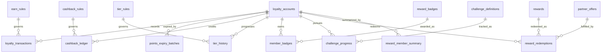
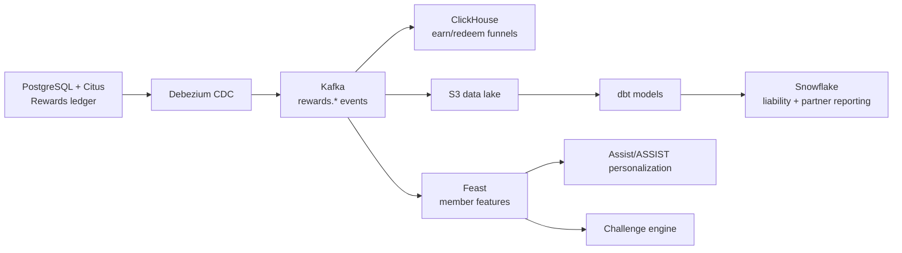

# VINTORA — Loyalty & Rewards Module (Vintora Rewards)

> **Companion documents:** `_canon.md`, `05-ui-ux-wireframes.md` (Screen 12 — Rewards/tier), `04-database-design.md` (baseline `loyalty_accounts`, `loyalty_transactions`, `rewards`), `02-revenue-model.md` (Rewards economics), `06-ai-features.md` (§§2, 5 personalization), `17-membership-subscription-module.md` (referral handoff), `01-business-plan.md`, `BUILDING.md`.
> This document is the **domain-level design authority for Vintora Rewards** — the member loyalty engine. It defines the points ledger, VIP tiers, cashback, referral rewards, badges and challenges as deterministic, auditable algorithms. `04-database-design.md` owns the canonical baseline tables; this document extends them with rules, ledgers and read models.

---

## Canon snapshot (binding)

| Dimension | Canonical fact |
|---|---|
| Brand | VINTORA (prose: "Vintora"); *The World's Cellar, Intelligent.* |
| All modules | Vintora Market, Vintora Trade, Vintora Sommelier, Vintora Assist, Vintora Studio, Vintora Seller, Vintora Flow, Vintora Club, Vintora Vault, Vintora Rewards. |
| Module in scope | **Vintora Rewards** — unified points, tiers, experiences, partner network. |
| Mission fit | Democratize discovery, trade and enjoyment of fine wine and spirits worldwide through applied AI — protecting provenance, safety and responsible consumption. |
| Revenue | Partner interchange, co-branded cards, anonymized privacy-safe insights; **3% of Y5 revenue ($22.5M)**, contribution margin 70–90% (estimate). |
| VIP tiers | **Bronze / Silver / Gold / Platinum** (wireframe Screen 12); gold accent reserved for tier marks. |
| UI reference | Screen 12: points + tier always visible; progress bar with exact threshold (`12,480 / 20,000`); concrete checkmarked benefits (2× Club points, Vault early access, free delivery, birthday bottle); experiences redeem points, not just discounts. |
| Baseline schema | `loyalty_accounts` (`user_id`, `tier`, `points_balance`, `lifetime_points`, `streak_months`), `loyalty_transactions` (`type`, `points`, `source_module`, `reference_id`, `idempotency_key`), `rewards` catalog — `user_id`-partitioned in PostgreSQL + Citus. |
| Referral handoff | Vintora Club owns `referrals` / `referral_rewards`; Rewards consumes `club.referral.rewarded.v1` and settles points into the loyalty ledger. **No parallel referral tables.** |
| Guardrails | Age verification; **no incentives for excessive consumption** (qualify on spend, not volume); no cash payout where rebates on alcohol are prohibited; no health/intoxication claims; no sensitive-attribute inference; privacy-safe insights only. |
| Roadmap | Phase 2 (Q3–Q4 2027): Rewards v1 (ledger, tiers, catalogue). Phase 3: personalization. Phase 4: partner network at scale. |
| Prototype | Rewards points/tier view, "2× points on Club boxes", earn-more actions; deterministic demo data, browser self-test passing (generated count). |

**Non-claims:** all earn rates, thresholds, cap values, redemption rates and revenue figures are design estimates or targets. No claim of live partner contracts, card issuance, member counts or payouts is made.

---

## 1. Product definition

### 1.1 Capability surface

| # | Feature | Core question answered | Engine domain | Primary workflow |
|---|---|---|---|---|
| F1 | **Points** | What did I earn, what expires, and what is my balance? | Earn engine + append-only ledger | WF-01 Accrue, WF-06 Expire |
| F2 | **VIP tiers** | What tier am I, what unlocks, how far to the next? | Tier engine | WF-02 Recompute tiers |
| F3 | **Cashback** | What credit did I earn, where can I use it? | Cashback engine | WF-03 Cashback credit |
| F4 | **Referral rewards** | What do I get for inviting someone? | Event consumer + dual-sided credit | WF-04 Referral settlement |
| F5 | **Badges** | What have I achieved and collected? | Badge rule engine | WF-05 Badge evaluation |
| F6 | **Challenges** | What can I do this month for extra points? | Challenge engine | WF-07 Challenge progress |

### 1.2 Design stance: "Starbucks-style, adapted for alcohol"

| Consumer pattern | Vintora adaptation | Why |
|---|---|---|
| Earn points per dollar | Points per **net merchandise spend**, source-weighted | Rewards value, not consumption volume |
| Tier ladder | Bronze → Silver → Gold → Platinum by **qualifying spend** | No "drink more, rise higher" incentive |
| Redeem catalogue | Bottles, tasting experiences, merchandise, partner offers | Premium positioning; experiences over discounts |
| Bonus stars on behaviours | 2× Club boxes, reviews, tasting notes, Sommelier sessions | Rewards curation and knowledge contribution |
| Free birthday drink | **Birthday bottle / tasting** (age-verified, jurisdiction-checked) | Ritual, responsible framing |
| Cashback | Wallet credit, market-gated, partner-funded | Avoids prohibited alcohol rebates |

### 1.3 Non-goals

- Referral attribution/fraud adjudication (Vintora Club owns it; Rewards only settles the award).
- Payment processing and interchange acquisition (Payment/Partnerships own the commercial deals).
- Subscription lifecycle and Club benefits (Vintora Club owns `memberships`; Rewards mirrors tier where needed).
- Points-as-currency outside Vintora (no transfer, no cash-out, no resale).

---

## 2. Reward algorithms

This section is the normative specification for the algorithms. All are deterministic, versioned, and replayable from the append-only ledger.

### 2.1 Points accrual (earn)

**Trigger:** a qualifying `source_module` event (order delivered, Club box shipped, review accepted, tasting note approved, Sommelier session completed, Vault trade settled, partner spend posted).

```text
FUNCTION accrue_points(event):
    IF NOT idempotent(event.event_id):          -- reward_event_inbox dedupe
        RETURN already_applied

    rule = active_earn_rule(event.source_module, event.market, event.occurred_at)
    IF rule IS NULL OR NOT rule.enabled: RETURN no_earn

    IF NOT member.age_verified AND rule.requires_age: RETURN blocked_age
    IF event.market NOT IN rule.allowed_markets:       RETURN blocked_market
    IF is_excluded_sku(event.sku) OR rule.exclude_luxury AND event.is_luxury:
        RETURN excluded

    base = floor(event.net_amount_minor / 100) * rule.points_per_usd
    tier_mult = tier_multiplier(member.tier, rule.source_module)   -- e.g. Gold = 1.5x
    quality_mult = rule.quality_multiplier                          -- e.g. 2x Club box
    raw = base * tier_mult * quality_mult

    points = min(round(raw), rule.per_event_cap)                    -- anti-abuse cap
    IF period_earned(member, rule.source_module, current_month) + points
            > rule.per_period_cap:
        points = max(0, rule.per_period_cap - period_earned(...))

    expires_at = event.occurred_at + rule.expiry_months              -- FIFO
    APPEND loyalty_transactions(type='earn', points=points,
                                source_module, reference_id, expires_at,
                                rule_version=rule.version)
    APPEND reward_event_inbox(event_id)                              -- exactly-once effect
    RETURN points
```

**Canonical defaults (estimates, versioned in `earn_rules`):**

| Source | Points per $1 | Quality multiplier | Notes |
|---|---|---|---|
| Market order | 10 | 1.0 | On net merchandise after refunds |
| Club box | 10 | 2.0 | The canonical "2× points on Club boxes" |
| Vault trade fee | 5 | 1.0 | On fee, not lot value |
| Accepted review | 0 | flat +50 | Non-purchase contribution |
| Approved tasting note | 0 | flat +25 | Feeds knowledge graph |
| Sommelier session completed | 0 | flat +10 | Capped 5/month |
| Referral (via Club event) | 0 | flat +500 dual-sided | See §2.4 |
| Partner spend | partner rule | partner rule | Interchange-funded |

**Rounding:** truncate to whole points after multiplying; never award fractional points. **Caps:** per-event and per-period caps are mandatory for all non-purchase sources to prevent gaming.

### 2.2 VIP tier computation

Qualification uses a **rolling 12-month qualifying-points** measure, where 1 qualifying point = $1 of net eligible spend (distinct from redeemable points). This keeps tiers tied to value, not volume.

```text
FUNCTION qualifying_points(member, as_of):
    RETURN SUM(net_eligible_minor) / 100
           FROM orders
           WHERE user_id = member
             AND delivered_at BETWEEN as_of - 12 months AND as_of
             AND status = 'delivered'
             AND NOT refunded

FUNCTION compute_tier(qp, member, as_of):
    new_tier = HIGHEST tier WHERE tier_rules.threshold <= qp
                             AND effective_from <= as_of
                             AND (effective_to IS NULL OR effective_to > as_of)

    IF member.status_protected_until > as_of
       AND new_tier < member.tier:
        new_tier = member.tier                      -- grace window; no abrupt drop

    IF new_tier != member.tier:
        APPEND tier_history(from, to, reason='recompute', qp, as_of)
        UPDATE loyalty_accounts SET tier = new_tier
        EMIT rewards.tier.changed.v1

    RETURN new_tier, next_threshold(qp), progress_pct(qp)
```

| Tier | Threshold (rolling 12-mo qualifying $) | Illustrative benefits |
|---|---|---|
| Bronze | $0 | Base earn, points catalogue |
| Silver | $500 | 1.25× earn, free standard delivery |
| Gold | $2,000 | 1.5× earn, Vault early access, birthday bottle, 2× Club points |
| Platinum | $5,000 | 1.75× earn, concierge, exclusive experiences, highest caps |

Tier is recomputed **nightly** and on every delivered order (idempotently). Downgrades are softened by a 60-day status-protection window mirroring Club's VIP protection. `progress_pct = clamp((qp - current_threshold) / (next_threshold - current_threshold), 0, 1)` — this drives the exact-threshold progress bar in wireframe Screen 12.

### 2.3 Cashback

Cashback is a **wallet credit** (never cash), primarily funded by partner interchange and co-branded-card spend. On own-marketplace alcohol purchases it is market-gated.

```text
FUNCTION accrue_cashback(event):
    rule = active_cashback_rule(event.market, member.tier, event.source)
    IF rule IS NULL OR NOT rule.market_allows_rebate: RETURN not_eligible

    gross = event.net_amount_minor * rule.rate                -- basis points / 10_000
    credit = min(round_to_minor(gross), rule.per_event_cap_minor)

    IF period_cashback(member, year) + credit > rule.annual_cap_minor:
        credit = max(0, rule.annual_cap_minor - period_cashback(...))

    APPEND cashback_ledger(amount_minor=credit, currency,
                           source, rule_version, expires_at)
    EMIT rewards.cashback.credited.v1
    RETURN credit
```

| Tier | Partner / card spend | Own-marketplace (where permitted) |
|---|---|---|
| Bronze | 0.5% | 0% |
| Silver | 1.0% | 0% |
| Gold | 1.5% | 0.5% (capped $50/yr) |
| Platinum | 2.0% | 1.0% (capped $100/yr) |

In markets where rebates on alcohol are prohibited, the cashback rule returns `not_eligible` and the member is offered equivalent points or an experience instead. Wallet credit never transfers, cashes out or resells, and is not applied to age-restricted baskets where local rule forbids it.

### 2.4 Referral rewards (dual-sided settlement)

Vintora Club owns attribution and fraud; Rewards consumes the settled event. **No parallel referral tables** — `reference_id` on the ledger entry points to Club's `referral_rewards.id`.

```text
ON club.referral.rewarded.v1:
    IF NOT idempotent(event.event_id): RETURN                    -- exactly-once
    IF event.status != 'settled': RETURN                         -- respect hold period

    reference = event.referral_reward_id
    APPEND loyalty_transactions(type='referral', points=event.points,
                                source_module='club',
                                reference_id=reference,
                                idempotency_key=event.event_id)

ON club.referral.clawed_back.v1:                                  -- refund/fraud
    APPEND loyalty_transactions(type='clawback',
                                points=-event.points,
                                reference_id=reference,
                                idempotency_key=event.event_id + ':cb')
```

Rewards never re-decides fraud or qualification. Clawbacks are append-only negatives; balances are derived from the ledger, never from a mutable counter alone.

### 2.5 Badges

Badges are deterministic achievements defined as predicates over member events. Evaluation runs after every scored event and nightly for cumulative criteria.

```text
FUNCTION evaluate_badges(member, event):
    FOR badge IN active_badges:
        IF member_badges EXISTS (member, badge): CONTINUE          -- idempotent
        IF NOT badge.predicate(member, event, history): CONTINUE
        IF badge.requires_age AND NOT member.age_verified: CONTINUE
        APPEND member_badges(member, badge, earned_at, rule_version)
        IF badge.bonus_points > 0:
            APPEND loyalty_transactions(type='badge', points=badge.bonus_points,
                                        reference_id=badge.id, ...)
        EMIT rewards.badge.earned.v1
```

| Badge | Predicate | Rarity | Bonus |
|---|---|---|---|
| First Bottle | First delivered order | Common | 0 |
| Explorer | Purchased from ≥ 5 regions | Rare | +100 |
| Vintage Hunter | ≥ 10 distinct vintages in history | Rare | +150 |
| Tasting Note Contributor | ≥ 25 approved tasting notes | Epic | +250 |
| Sommelier Scholar | ≥ 10 completed pairing sessions | Rare | +100 |
| Club Loyalist | 6 consecutive boxes, no skips | Epic | +300 |
| Collector | ≥ 1 settled Vault investment | Epic | +200 |
| Polymath | Active in Market, Club, Trade, Vault, Rewards | Legendary | +500 |

**Guardrail:** no badge rewards consumption volume, ABV, or spend rank. Display is opt-in; badges are non-comparative (no public leaderboard that encourages over-consumption).

### 2.6 Challenges

Time-bound goals with progress and a deterministic reward. Members opt in; concurrent challenges are capped (default 3).

```text
FUNCTION update_challenges(member, event):
    FOR progress IN active_challenges(member):
        IF event.occurred_at > progress.ends_at: mark 'expired'; CONTINUE
        delta = progress.definition.metric(event)                  -- e.g. count distinct regions
        IF delta <= 0: CONTINUE
        new_value = min(progress.value + delta, progress.target)
        APPEND challenge_progress(...)                             -- versioned snapshots
        IF new_value >= progress.target AND progress.status = 'active':
            SET status='completed'
            APPEND loyalty_transactions(type='challenge',
                                        points=definition.reward_points,
                                        reference_id=definition.id, ...)
            EMIT rewards.challenge.completed.v1
```

| Challenge | Metric | Target | Window | Reward |
|---|---|---|---|---|
| Regional Tour | Distinct regions purchased | 3 | 30 days | +250 |
| Note Taker | Approved tasting notes | 5 | 30 days | +150 |
| Pairing Pro | Sommelier sessions completed | 3 | 14 days | +100 |
| Curious Collector | New grape varieties tried | 4 | 60 days | +300 |
| Friend of the Cellar | Referred member reaches first box | 1 | 90 days | +500 |

**Anti-gaming:** challenges exclude refunded orders, duplicate SKUs within a window, and self-referrals; each challenge can be completed at most once per 90 days per member.

### 2.7 Points expiry

Points expire **12 months after they were earned** (FIFO), extended by a rolling 12-month activity window.

```text
FUNCTION expire_points(member, as_of):
    active = EXISTS qualifying_event(member, as_of - 12 months, as_of)
    IF active: RETURN no_expiry                                  -- activity saves points
    expired = SUM(points FROM loyalty_transactions
                   WHERE type='earn' AND expires_at <= as_of
                     AND NOT already_expired(reference_id))
    IF expired > 0:
        APPEND loyalty_transactions(type='expire', points=-expired,
                                    reason='inactivity_12m', ...)
        EMIT rewards.points.expired.v1
```

Members are notified 30 days before expiry via Vintora Assist with a reachable redemption action. Tier status protection and expiry are independent: a lapsed tier does not accelerate points expiry.

### 2.8 Ledger invariants

1. `loyalty_transactions` is **append-only**; balance changes are rows, never updates.
2. `SUM(points)` over all rows for a user **must equal** `loyalty_accounts.points_balance` (daily reconciliation).
3. Every row has a unique `idempotency_key`; replays are no-ops.
4. Redeem/clawback/expire rows are negative; a redeem cannot drive balance below zero.
5. All earning carries `rule_version` and `expires_at`; historical points can be re-derived.
6. `reward_event_inbox` stores `event_id` for 30 days to guarantee exactly-once effects from Kafka.

---

## 3. Database architecture

### 3.1 Design principles

| # | Principle | Implementation |
|---|---|---|
| D1 | User-partitioned, tenant-aware | `user_id` + `tenant_id` on all rows; Citus by `user_id`; RLS defence in depth. |
| D2 | Append-only ledger | Points, cashback, tier, badge, challenge and expiry history are immutable. |
| D3 | Effective-dated rules | Earn, cashback and tier rules are versioned data, never code constants. |
| D4 | Money discipline | `*_minor` + `currency_code` + FX provenance on all cashback rows. |
| D5 | Exactly-once effects | Inbox dedupe by `event_id`; idempotency keys on every ledger write. |
| D6 | Privacy | Aggregated, anonymized insights only; no sensitive-attribute inference; raw PII stays in identity. |

### 3.2 Baseline vs new tables

| Domain | Baseline (`04-database-design.md`) | Added by this module |
|---|---|---|
| Account | `loyalty_accounts` | extended with `tenant_id`, caps, protection fields |
| Points ledger | `loyalty_transactions` | extended with `direction`, `expires_at`, `rule_version`, balance-after; `points_expiry_batches` |
| Catalogue | `rewards` | `reward_redemptions`, `partner_offers` |
| Rules | — | `earn_rules`, `cashback_rules`, `tier_rules` |
| Cashback | — | `cashback_ledger` |
| Tiers | — | `tier_history` |
| Badges | — | `reward_badges`, `member_badges` |
| Challenges | — | `challenge_definitions`, `challenge_progress` |
| Read models | — | `reward_member_summary`, `reward_event_inbox` |

### 3.3 ER diagram



### 3.4 Indexing and query patterns

| Query | Index | Notes |
|---|---|---|
| Balance + tier (Screen 12) | `loyalty_accounts(user_id)` PK + `reward_member_summary(user_id)` | Single point read |
| Ledger history | `(tenant_id, user_id, created_at DESC)` | Virtualised list |
| Points expiring soon | `(tenant_id, expires_at)` partial `type='earn'` | Expiry job |
| Expiry batch audit | `(tenant_id, ran_at DESC)` | Reconciliation + support |
| Event dedupe | `reward_event_inbox(event_id)` unique | Exactly-once |
| Active challenges | `(tenant_id, user_id, status, ends_at)` | Progress worker |
| Badge eligibility | `member_badges(user_id, badge_id)` unique | Idempotent award |
| Redemption status | `(tenant_id, user_id, status)` | Support console |

Citus: distribute all large tables on `user_id`; replicate `earn_rules`, `cashback_rules`, `tier_rules`, `rewards`, `reward_badges`, `challenge_definitions`, `partner_offers` as reference tables. RLS: `USING (user_id = current_setting('app.user_id')::uuid AND tenant_id = current_setting('app.tenant_id')::uuid)`.

### 3.5 Analytical pipeline



Unredeemed points are a **deferred liability**; the finance model in Snowflake values the outstanding balance daily using a breakage-adjusted rate (estimate). Partner revenue and interchange reconcile monthly against partner statements.

---

## 4. Workflows

| Workflow | Trigger | Steps | SLA |
|---|---|---|---|
| WF-01 Accrue points | Qualifying module event | Dedupe → rule lookup → guards → compute → cap → append ledger → emit | ≤ 1 s |
| WF-02 Recompute tier | Delivered order / nightly | Qualifying sum → threshold → protection → append history → update tier → emit | ≤ 5 s |
| WF-03 Cashback credit | Partner/card/eligible order event | Market gate → rate → cap → append cashback ledger → emit | ≤ 2 s |
| WF-04 Referral settlement | `club.referral.rewarded.v1` / clawback | Dedupe → status check → append points → emit | ≤ 2 s |
| WF-05 Badge evaluation | Scored event / nightly | Predicates → age gate → idempotent award → bonus points → emit | ≤ 5 s |
| WF-06 Expire points | Daily job (+30d notice) | Activity check → FIFO expiry → append negative row → emit | Daily 03:00 local |
| WF-07 Challenge progress | Scored event | Metric deltas → snapshot → completion → reward → emit | ≤ 2 s |
| WF-08 Redeem | Member selects reward | Eligibility → balance check → decrement ledger → fulfil (code/experience/credit) → emit | ≤ 3 s |

Every workflow emits `rewards.audit.v1` with `actor`, `entity`, `from`, `to`, `trace_id`.

---

## 5. API contracts (BFF GraphQL, abridged)

```graphql
type RewardAccount { userId: ID!, tier: Tier!, points: Int!, lifetimePoints: Int!,
  qualifyingSpend: Money!, nextTier: Tier!, pointsToNext: Int!, progress: Float! }
type Badge { code: String!, name: String!, rarity: Rarity!, earnedAt: DateTime }
type Challenge { id: ID!, name: String!, value: Int!, target: Int!,
  endsAt: DateTime!, rewardPoints: Int!, status: ChallengeStatus! }
type CashbackLedgerEntry { id: ID!, amount: Money!, source: String!, createdAt: DateTime! }
type RewardCatalogueItem { code: String!, name: String!, type: RewardType!,
  pointsCost: Int, partnerName: String }

type Query {
  myRewards: RewardAccount!
  myBadges: [Badge!]!
  myChallenges(status: ChallengeStatus): [Challenge!]!
  myCashback: [CashbackLedgerEntry!]!
  rewardCatalogue: [RewardCatalogueItem!]!
}

type Mutation {
  enroll: RewardAccount!
  redeem(rewardCode: String!): Redemption!
  joinChallenge(challengeId: ID!): Challenge!
  claimChallengeReward(challengeId: ID!): Redemption!
  updatePrivacy(preferences: PrivacyInput!): RewardAccount!
}
```

**REST parity:** `/v1/rewards/*` for partner issuers, co-branded card feeds and internal event consumers; all require `x-tenant-id` and idempotency keys on writes.

---

## 6. Event contracts

| Topic | Producer | Consumers | Payload |
|---|---|---|---|
| `rewards.points.earned.v1` | Earn engine | UI, Analytics, Feast | `user_id, points, source_module, reference_id` |
| `rewards.points.redeemed.v1` | Redemption | Fulfilment, Analytics, Finance | `redemption_id, points, reward_code` |
| `rewards.points.expired.v1` | Expiry job | Assist, Analytics | `user_id, points, expired_at` |
| `rewards.tier.changed.v1` | Tier engine | Club, Vault, Entitlements, UI | `user_id, from, to, reason` |
| `rewards.cashback.credited.v1` | Cashback | Wallet, Analytics, Finance | `user_id, amount_minor, currency, source` |
| `rewards.badge.earned.v1` | Badge engine | UI, Analytics | `user_id, badge_code, rarity` |
| `rewards.challenge.completed.v1` | Challenge | Earn engine, UI, Analytics | `user_id, challenge_id, reward_points` |
| `rewards.referral.settled.v1` | Referral consumer | Club, Analytics | `referral_reward_id, points, party` |
| `rewards.audit.v1` | all | SIEM, audit sink | `actor, entity, from, to, trace_id` |

Inbound `club.referral.rewarded.v1`, `order.delivered.v1`, `review.accepted.v1`, `vault.trade.settled.v1` and partner-spend events drive the engines. All consumers dedupe by `event_id`.

---

## 7. Security, compliance and trust

- **Age & responsibility:** earning on age-restricted purchases requires a verified age token; no badge, challenge or tier is based on consumption volume or ABV; no leaderboards that celebrate quantity.
- **Rebate law:** cashback is market-gated; where alcohol rebates are prohibited, substitute points or experiences. No cash-out, transfer or resale.
- **Privacy:** insights shared with partners are aggregated/anonymized and privacy-safe (canonical); no sensitive-attribute inference; opt-out yields a non-personalized catalogue of equal value.
- **Ledger integrity:** append-only rows, unique idempotency keys, daily balance reconciliation, dual approval for manual adjustments.
- **Partner isolation:** issuer feeds are scoped per partner with rate limits and signed payloads; secrets in vault, never in DB or logs.
- **User control:** balance and tier always visible with exact thresholds; export/delete rights; challenge and badge display opt-in.

---

## 8. Observability

| SLO | Target |
|---|---|
| Balance read p95 | < 200 ms (canonical API target) |
| Points accrual / redemption p95 | < 1 s / < 3 s |
| Event effect latency | ≤ 2 s |
| Ledger reconciliation | 100% daily; zero unexplained variance |
| Duplicate event effects | Zero |
| Cashback liability accuracy | 100% monthly partner reconciliation |

**Dashboards:** earn/redeem funnel, points liability, tier distribution, challenge completion, badge rarity distribution, cashback by market, referral settlement lag, expiry notices sent, reconciliation variance. Traces carry `tenant_id`, `user_id`, `account_id`.

---

## 9. Rollout plan

| Phase | Window | Deliverables | Exit criteria |
|---|---|---|---|
| Phase 2 | Q3–Q4 2027 | Rewards v1: points ledger, tiers, catalogue, referral settlement | Ledger reconciles 100%; age gates green |
| Phase 3 | 2028 | Cashback, badges, challenges, Assist personalization | Challenge completion tracked; no duplicate effects |
| Phase 4 | 2029 | Partner offers, co-branded card feeds, experiences at scale | Partner reconciliation monthly; privacy audit passed |
| Phase 5 | 2030–2034 | 60+ markets, localized earn/cashback rules | All SLOs green at target scale |

---

## 10. Prototype-to-production mapping

| Prototype element | Production destination |
|---|---|
| Points/tier header (`12,480` / Gold) | `reward_member_summary` → `myRewards` query |
| Progress bar `12,480 / 20,000` to Platinum | `compute_tier()` progress formula |
| "2× points on Club boxes" | Earn rule with `quality_multiplier = 2.0` |
| Checkmarked benefits | `tier_rules.benefits` entitlement list |
| "Refer a friend" earn action | `club.referral.rewarded.v1` → dual-sided ledger credit |
| "Complete a review +50" | Flat-point earn rule for `review.accepted.v1` |
| "Book a tasting / partner offers" | `rewards` catalogue + `partner_offers` |

---

## 11. Risks and open decisions

| Risk | Mitigation |
|---|---|
| Points liability over-issuance | Per-event/period caps, versioned rules, daily reconciliation, breakage model |
| Gaming / duplicate earning | Event inbox, idempotency keys, caps, refund exclusions, fraud review |
| Rebate-law violation | Market gates, legal review of rules, points/experience substitution |
| Tier churn perception | Status protection, exact-threshold progress bar, clear benefit list |
| Partner reconciliation drift | Append-only cashback ledger, monthly statement matching, dual approval |
| Privacy concern with personalization | Anonymized insights only, opt-out, no sensitive inference |

**Open decisions for Phase 2:**

1. Exact tier thresholds (proposed $500 / $2,000 / $5,000 qualifying spend) and whether to localize by market.
2. Point value for liability (breakage-adjusted estimate) — CFO to confirm.
3. Whether cashback launches in Phase 2 or defers to Phase 3 pending legal review.
4. Badge visibility: private by default vs opt-in sharing.
5. Points expiry policy: 12-month inactivity vs 12-month FIFO without activity extension.
6. Whether partner offers can be combined with other promotions.

---

## 12. Summary

Vintora Rewards is specified as a **deterministic, ledger-first loyalty engine** with six first-class features: points accrual, VIP tiers, cashback, referral rewards, badges and challenges. Its core is an append-only `loyalty_transactions` ledger versioned by effective-dated earn/cashback/tier rules, with exactly-once event effects via an inbox and idempotency keys — balance is derived, never mutated in place. The reward algorithms in §2 give explicit formulas for each feature: spend-weighted earn with 2× Club boxes, rolling-12-month qualifying-spend tier computation with status protection, market-gated wallet-credit cashback, dual-sided referral settlement consumed from Vintora Club, predicate-driven badges, time-boxed challenges, and FIFO points expiry with activity extension. The database extends the canonical `loyalty_accounts`/`loyalty_transactions`/`rewards` baseline with 14 tables covering rules, ledgers, history, badges, challenges and read models — user/tenant distributed with RLS, CDC into ClickHouse and Feast features for personalization. Guardrails keep the programme responsible: age verification, qualification on spend rather than consumption volume, no cash-out where rebates are restricted, anonymized partner insights, and full user control. All rates, thresholds and economics are estimates; no live member, partner or liability figures are claimed.
