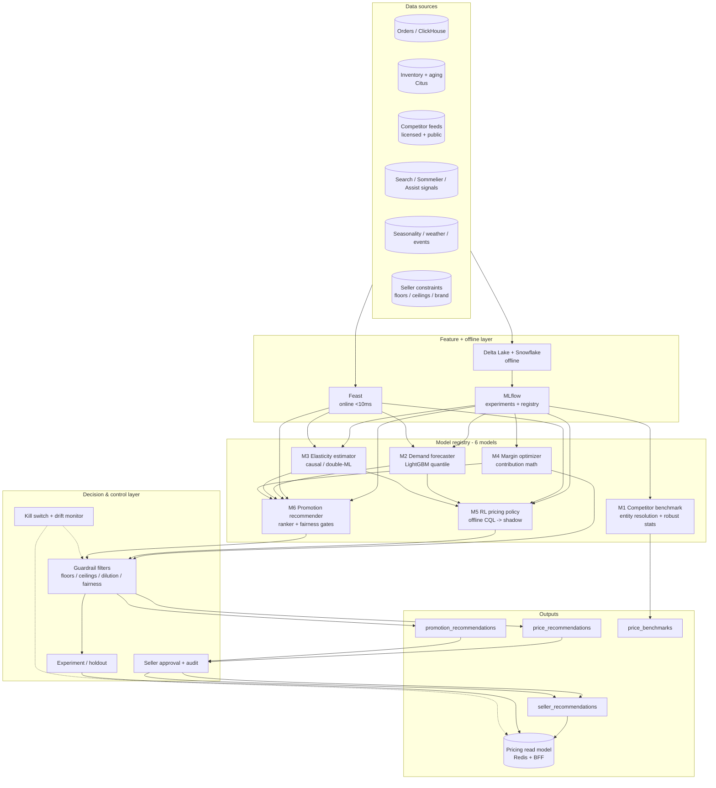
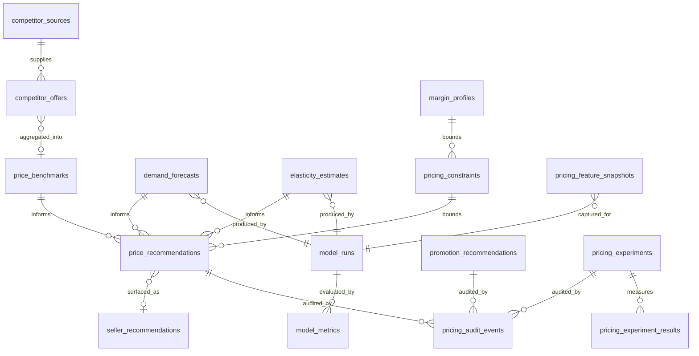
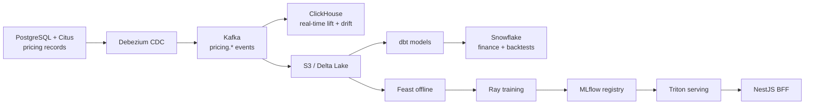

# VINTORA — AI Pricing Engine (Market / Seller)

> **Companion documents:** `_canon.md`, `06-ai-features.md` (§7 dynamic pricing & promos), `03-technical-architecture.md` (AI platform, FX engine), `04-database-design.md`, `15-seller-dashboard-module.md` (`price_benchmarks`, `seller_recommendations`), `17-membership-subscription-module.md` (Club/VIP), `18-loyalty-rewards-module.md` (cashback market gates), `02-revenue-model.md` (take rates), `05-ui-ux-wireframes.md` (Screens 6 & 9), `BUILDING.md`.
> This document is the **domain-level design authority for Vintora's AI Pricing Engine** — the cross-module intelligence that proposes prices and promotions across the 10M-SKU catalogue. It defines six models, seven workflows, the decision/control layer, evaluation gates and the supporting schema. `06-ai-features.md` §7 remains the canonical AI capability statement; this document is its implementation specification.

---

## Canon snapshot (binding)

| Dimension | Canonical fact |
|---|---|
| Brand | VINTORA (prose: "Vintora"); *The World's Cellar, Intelligent.* |
| All modules | Vintora Market, Vintora Trade, Vintora Sommelier, Vintora Assist, Vintora Studio, Vintora Seller, Vintora Flow, Vintora Club, Vintora Vault, Vintora Rewards. |
| Engine in scope | Cross-cutting AI Pricing Engine serving Market, Seller, Trade, Club and Rewards. |
| Mission fit | Democratize discovery, trade and enjoyment of fine wine and spirits worldwide through applied AI — protecting provenance, safety and responsible consumption. |
| Canonical method | Elasticity models estimate demand curves per SKU/segment; **RL policy offline-trained, then shadow-mode**, sets price/promos within seller floors and ceilings. Reward balances GMV, margin, inventory turnover and a **brand-dilution penalty**. |
| Take rates | B2C commission **12–20%** by category; premium/luxury **8–12%**. Seller processing **0.5–2%**. |
| Guardrails | Hard price floors/ceilings per seller; **sellers approve pricing changes**; no personalized price discrimination on protected attributes; disclosed offer terms; luxury SKUs excluded from aggressive discounting. |
| FX | Locked-rate quotes (15 min at checkout) are owned by the **Payments/FX layer**, not the pricing model; pricing consumes locked rates with provenance. |
| AI stack | XGBoost/LightGBM forecasting, RL pricing, two-tower/transformer recommenders, Feast (online/offline), MLflow (experiments), Ray (training), Triton (serving), Delta Lake/Snowflake (offline). |
| Evaluation | GMV and margin lift vs holdout, inventory turnover, brand-dilution guardrail (discount depth/frequency within allowed bands). |
| Baseline schema | `price_benchmarks` (p25/median/p75, `sample_size`, `as_of`) and `seller_recommendations` (`price_change`, `discount`) in migration `0003`. |
| Roadmap | Phase 1 rule-based suggestions; Phase 2 elasticity; Phase 3 shadow-mode RL with opt-in; Phase 4 controlled rollout; Phase 5 at scale with continuous monitoring. |
| Scale | 10M SKU target, 135+ currencies, 200+ markets, 1.2M orders/day peak; dashboard API p95 < 200 ms. |

**Non-claims:** all model architectures, weights, thresholds, latency and lift figures are design specifications or targets. No claim of live model accuracy, real holdout results or deployed autonomous pricing is made.

---

## 1. Product definition

### 1.1 Capability surface

| # | Capability | Core question | Model | Primary workflow |
|---|---|---|---|---|
| C1 | **Dynamic pricing** | What price should this SKU carry in this market now? | M3 Elasticity + M5 RL policy | WF-04 |
| C2 | **Competitor analysis** | Where do we sit versus the market, reliably? | M1 Benchmark engine | WF-01 |
| C3 | **Demand forecasting** | How many units will sell, and when? | M2 Demand forecaster | WF-02 |
| C4 | **Margin optimization** | What price/discount maximises contribution? | M4 Margin optimizer | WF-04, WF-05 |
| C5 | **Promotion recommendations** | Which offer, for whom, how deep, how long? | M6 Promotion recommender | WF-05 |

### 1.2 Consumers and surfaces

| Consumer | Surface | What it receives |
|---|---|---|
| Seller | Seller SELL-02/05 copilot | "2 prices below market", suggested band, margin impact, one-click approve |
| Market checkout | PDP / cart | Clear final price with **labelled** promotion; no hidden personal price |
| Trade copilot | RFQ response | Price guidance within contract/floor bands |
| Club curation | Box economics | Value band guardrail; no price discrimination between members |
| Rewards | Offer eligibility | Promotion terms compatible with cashback market gates |
| Vintora Ops | Pricing console | Experiment arms, drift alerts, kill switch |

### 1.3 Non-goals

- Setting FX rates or capturing payments (Payments/FX layer).
- Autonomously changing a published listing price without seller approval (see §5).
- Personalised prices for different members on the same SKU (explicitly prohibited).
- Inventory replenishment execution (Vintora Seller/Trade own it; pricing consumes inventory signals).

---

## 2. Model architecture

### 2.1 System diagram



### 2.2 Model inventory

| ID | Model | Type / framework | Output | Offline metric | Online metric | Cadence |
|---|---|---|---|---|---|---|
| M1 | Competitor benchmark | Entity resolution + robust statistics (Python) | `price_benchmarks` p25/median/p75 | Match precision/recall, coverage | Benchmark freshness | Hourly |
| M2 | Demand forecaster | LightGBM quantile (canonical stack) | p50/p90 demand by SKU/market/horizon | WMAPE, pinball loss, bias | Forecast error vs actual | Daily + online |
| M3 | Elasticity estimator | Double-ML / causal (XGBoost + IV) | ε with CI per SKU/segment | Coefficient stability, backtest profit | Realised lift vs holdout | Weekly |
| M4 | Margin optimizer | Deterministic contribution math | Feasible price band + p* | Reconciliation accuracy | Contribution margin delta | On demand |
| M5 | RL pricing policy | Conservative Q-Learning (offline) | Price action within band | Off-policy eval (IS/Doubly Robust) | GMV/margin lift, dilution | Shadow → opt-in |
| M6 | Promotion recommender | Ranker + rules + bandit exploration | Offer design + terms | NDCG-style offer relevance | Incremental margin, redemption | Daily |

---

## 3. Model cards

### 3.1 M1 — Competitor benchmark engine

**Purpose:** turn noisy, multi-source competitor observations into a trustworthy market price band per SKU/market.

- **Inputs:** competitor offer (raw title, producer, appellation, vintage, volume, condition, currency, observed price, source, captured_at), our listings, `exchange_rates` (locked-rate provenance), `price_benchmarks` history.
- **Pipeline:**
  1. **Entity resolution** — normalise title; match producer/vintage/appellation/volume using a frozen embedding plus deterministic rules; require a match score ≥ threshold or route to manual review.
  2. **Currency + condition normalisation** — convert to target currency at a dated FX rate; adjust for bottle condition, pack size and shipping inclusion; record adjustment factors.
  3. **Outlier rejection** — drop implausible values (e.g., below cost floor or > 5× median) and stale observations (> 30 days).
  4. **Robust aggregation** — compute p25 / median / p75 with `sample_size` and a confidence score from source diversity and dispersion.
- **Output:** upsert `price_benchmarks` (extends canonical table) with `confidence`, `source_count`, `methodology_version`, `observed_at`.
- **Guardrails:** use only licensed or permitted public sources (respect ToS); never fabricate a benchmark from fewer than the minimum sample; mark low-confidence bands explicitly.
- **Metrics:** match precision ≥ target (measured on a labelled set), benchmark coverage by SKU/market, staleness p95.

### 3.2 M2 — Demand forecasting

**Purpose:** predict the demand distribution for a SKU in a market over 7/14/30-day horizons.

- **Features (Feast):** trailing sales (7/14/30/90d), price and price changes, stockout minutes, search impressions/CTR, Sommelier mentions, Assist cart adds, seasonality (day-of-week, holidays), weather/events, channel mix, inventory level and aging, promotion flags, market/currency.
- **Architecture:** LightGBM quantile models (q50/q90) with hierarchical reconciliation SKU → region → market; separate cold-start model using product attributes + KG embedding for SKUs with < 14 days of history.
- **Training:** rolling-origin backtests; retrain weekly; champion/challenger in MLflow; features served online from Feast/Redis (< 10 ms).
- **Output:** `demand_forecasts` rows (p50, p90, horizon, model_version, trained_at).
- **Metrics:** WMAPE, pinball loss for q90, bias by segment; blind holdout by time period.

### 3.3 M3 — Elasticity estimation

**Purpose:** estimate the demand curve so price changes have a defensible expected effect.

- **Method:** log–log demand model `ln Q = α + ε · ln p + β·X + γ·promo + δ·stockout + fixed effects`, with **double-ML / instrumental variables** to reduce confounding from promotions and stockouts. Use controlled experiments where available as the gold standard.
- **Output:** elasticity ε with confidence interval, segment (SKU / category / market), method, `experiment_backed` flag.
- **Guardrails:** if the CI spans zero or the estimate is unstable, fall back to category-level prior; never extrapolate beyond the observed price support.
- **Formula (optimal price under constant elasticity):**

```text
Q(p) = Q0 · (p / p0)^ε                  (ε < -1 for an interior optimum)
π(p) = (p - c) · Q(p) - fixed_cost
p*   = c · ε / (ε + 1) = c · |ε| / (|ε| - 1)
```

where `c` is the SKU/market landed unit cost from M4. `p*` is a **candidate**, clipped to the seller's floor/ceiling and the brand band before it ever reaches a human.

### 3.4 M4 — Margin optimizer

**Purpose:** compute true landed contribution and the feasible price band; prevent a "GMV win" that loses money.

- **Cost stack:** unit cost + inbound/Flow freight + duties/tax + storage/aging + processing (0.5–2%) + marketplace commission (12–20%; 8–12% premium/luxury) + expected returns + FX spread.
- **Output:** `margin_profiles` per SKU/market/currency with `cost_minor`, fee breakdown, contribution at current price, break-even price.
- **Formula:**

```text
contribution(p) = p · (1 - commission_rate - processing_rate)
                - unit_cost - freight - duty - storage - expected_returns
break_even      = total_variable_cost / (1 - commission_rate - processing_rate)

feasible_band = [ max(seller_floor, break_even · (1 + min_margin)),
                  min(seller_ceiling, brand_ceiling) ]
```

- **Guardrail:** any recommendation outside `feasible_band` is rejected before ranking, not merely penalised.

### 3.5 M5 — RL pricing policy (advisory)

**Purpose:** choose a price action inside the feasible band that balances competing objectives.

- **Training:** offline **Conservative Q-Learning** on logged historical decisions (avoids extrapolation), evaluated with importance-sampling and doubly-robust off-policy estimates; promoted to **shadow mode** before any seller opt-in.
- **State:** inventory level/aging, days to target turn, demand forecast (M2), elasticity (M3), competitor position (M1), contribution (M4), seasonality, brand tier, current discount depth/frequency.
- **Action:** discrete bounded adjustment (e.g., −5%…+5% in 1% steps, or hold), always clipped to `feasible_band`.
- **Reward (versioned weights):**

```text
r = 0.35 · ΔGMV_norm + 0.30 · Δmargin_norm + 0.20 · turnover_norm
  - 0.10 · brand_dilution - 0.05 · price_churn_risk

brand_dilution = f(discount_depth, discount_frequency, brand_tier)
               + luxury_hard_penalty   (luxury SKUs excluded from aggressive discount)
```

- **Output:** a proposed price plus rationale (concrete signals: "stock 42d cover, competitor p25 −6%, ε = −1.8, margin +9%") written to `price_recommendations`.
- **Guardrail:** the policy **never writes a listing price**. It emits a proposal; §5 governs approval.

### 3.6 M6 — Promotion recommender

**Purpose:** design a promotion that is incremental, disclosed, fair and brand-safe.

- **Inputs:** elasticity, demand forecast, inventory aging, margin profile, Club membership context, Rewards eligibility (including cashback market gates from `18-loyalty-rewards-module.md`), seasonality, competitor position.
- **Candidate types:** mixed case/bundle, volume discount (capped), loyalty-points boost, early-access release (Club), free standard delivery (tier benefit), editorially curated feature.
- **Ranking:** estimate incremental contribution = `margin(promo) − margin(baseline)` using the elasticity model; rank by incremental margin × confidence, subject to fairness and disclosure filters.
- **Formula for a discount decision:**

```text
incremental_contribution = (p·(1-d) - c) · Q0·((p·(1-d))/p)^ε - (p - c)·Q0
promote only if incremental_contribution > 0
and d <= discount_ceiling(brand_tier)
and frequency(window) <= max_frequency(brand_tier)
```

- **Guardrails:** no protected-attribute targeting; identical published terms for all eligible members; luxury SKUs excluded from aggressive discounting; all offers labelled with clear terms and end date; Rewards cashback never offered where alcohol rebates are prohibited.

---

## 4. Workflows

Each workflow: **trigger → preconditions → steps → output → failure paths → SLA**.

### 4.1 WF-01 Competitor data ingest & benchmark build

**Trigger:** scheduled hourly feed or manual refresh. **Preconditions:** licensed source configured, FX rates available.

| # | Step | Detail |
|---|---|---|
| 1 | Fetch | Pull competitor observations from permitted sources with rate limits |
| 2 | Normalize | Entity resolution, currency/condition adjustment (M1) |
| 3 | Reject | Outliers, stale and low-confidence matches to manual queue |
| 4 | Aggregate | p25/median/p75 + confidence + sample size |
| 5 | Persist | Upsert `price_benchmarks`; emit `pricing.benchmark.updated.v1` |
| 6 | Signal | Flag "price below market p25" for Seller copilot |

**Failure paths:** source down → use last benchmark with freshness stamp; FX missing → skip market; low sample → mark low-confidence. **SLA:** ingest → benchmark ≤ 15 min; benchmark p95 freshness ≤ 2 h.

### 4.2 WF-02 Demand forecast generation

**Trigger:** nightly batch + hourly online refresh. **Steps:** assemble Feast features → LightGBM q50/q90 → hierarchical reconcile → write `demand_forecasts` → emit `pricing.forecast.ready.v1`. **Failure paths:** feature gap → last-known forecast with warning; cold start → attribute-based model. **SLA:** nightly batch complete by 03:00 local; online inference p95 ≤ 200 ms.

### 4.3 WF-03 Elasticity estimation

**Trigger:** weekly + after a controlled experiment concludes. **Steps:** assemble treatment/control observations → double-ML/IV estimate → confidence check → fallback to category prior if unstable → write `elasticity_estimates` → emit `pricing.elasticity.updated.v1`. **SLA:** weekly job ≤ 2 h.

### 4.4 WF-04 Price recommendation & seller approval

**Trigger:** benchmark update, forecast update, inventory threshold, or seller request. **Preconditions:** seller has opted into pricing assistance; valid floors/ceilings.

| # | Step | System / Human |
|---|---|---|
| 1 | Assemble | Pull M1–M4 outputs + constraints (system) |
| 2 | Propose | M5 proposes bounded price action (system) |
| 3 | Guardrails | Clip to feasible band; reject dilution/fairness violations (system) |
| 4 | Explain | Rationale with concrete signals + expected GMV/margin/turnover (system) |
| 5 | Present | Create `price_recommendations` + `seller_recommendations` (price_change) (system) |
| 6 | Decide | Seller approves / rejects / snoozes (human) |
| 7 | Apply | On approval, write price to Listing service with audit event (system) |
| 8 | Measure | Track realised lift vs holdout (system) |

**Failure paths:** no feasible price → "no safe change" with reason; expired recommendation → re-score; seller rejects → suppress same SKU for 30 days. **SLA:** proposal ≤ 5 s; apply ≤ 2 s after approval.

### 4.5 WF-05 Promotion recommendation

**Trigger:** inventory aging, slow mover, seasonal window, Rewards/Club campaign. **Steps:** M6 generates candidates → margin incrementality check → fairness/disclosure/dilution gates → write `promotion_recommendations` → seller/ops approval → publish labelled offer → measure redemption and incremental margin. **Failure paths:** negative incrementality → drop; frequency cap hit → suppress; market cashback prohibited → substitute points. **SLA:** proposal ≤ 5 s.

### 4.6 WF-06 Shadow-mode evaluation & controlled rollout

**Trigger:** new model version promoted in MLflow.

| Phase | Behaviour | Exit criteria |
|---|---|---|
| Offline eval | Backtest + off-policy eval vs champion | Lift positive, dilution within band, no regression |
| Shadow | Model scores live traffic, **no price applied** | ≥ 4 weeks stable; drift within tolerance |
| A/B with holdout | Opt-in sellers; small % traffic; hard caps | GMV/margin lift significant; guardrails green |
| Controlled rollout | Expand traffic gradually; kill switch armed | All SLOs green at scale |

Every arm writes `pricing_experiments` / `pricing_experiment_results`; a guardrail breach automatically halts the arm and reverts to champion.

### 4.7 WF-07 Feedback & retraining

**Trigger:** experiment result, weekly schedule, or drift alert. **Steps:** capture point-in-time features + decisions + outcomes to `pricing_feature_snapshots` → compute realised reward → update `model_metrics` → retrain in Ray → register in MLflow → re-run eval gates → promote or reject. **SLA:** weekly retrain ≤ 4 h; drift alert ≤ 15 min.

---

## 5. Decision & control layer

| Control | Rule |
|---|---|
| **Human approval** | No listing price changes without named seller approval. The RL policy is advisory. |
| **Hard bands** | Seller floor/ceiling + brand band + break-even + minimum margin; enforced before ranking. |
| **Fairness** | No personalised prices; eligible members see identical published terms; no protected attributes in any targeting feature. |
| **Brand safety** | Discount depth/frequency caps by tier; luxury SKUs excluded from aggressive discounting; dilution penalty in reward. |
| **Disclosure** | Promotions labelled with terms, discount and end date; no hidden or member-specific pricing. |
| **FX** | Pricing consumes locked FX rates from Payments, with provenance; never quotes or hedges itself. |
| **Kill switch** | Ops can halt all or one model version in < 1 min; fallback to champion or rule-based price. |
| **Audit** | Every proposal, approval, application and revert is append-only in `pricing_audit_events`. |

**Autonomy stance:** even in Phase 4–5, any bounded auto-apply requires a **standing, revocable seller authorization**, per-change caps and a kill switch. Fully autonomous price changes are out of scope for this design.

---

## 6. Database architecture

### 6.1 Design principles

| # | Principle | Implementation |
|---|---|---|
| D1 | Tenant-first | `tenant_id` on all rows; Citus distribution by `tenant_id`; RLS defence in depth. |
| D2 | Point-in-time correctness | `pricing_feature_snapshots` stores the exact features behind every decision for audit/replay. |
| D3 | Append-only decisions | Recommendations, audit events and experiment results are immutable. |
| D4 | Money discipline | `*_minor` + `currency_code` + FX provenance; commission/processing stick to canon. |
| D5 | Model versioning | Every output carries `model_version`, `prompt_version`/`method_version`, `trained_at`. |
| D6 | Effective dating | Constraints and benchmarks are time-bounded, never silently overwritten. |

### 6.2 Baseline vs new tables

| Domain | Baseline | Added by this module |
|---|---|---|
| Benchmarks | `price_benchmarks` (0003) | extended with confidence/source lineage; `competitor_sources`, `competitor_offers` |
| Forecasting | — | `demand_forecasts` |
| Elasticity | — | `elasticity_estimates` |
| Margin | — | `margin_profiles`, `pricing_constraints` |
| Decisions | `seller_recommendations` (0003) | `price_recommendations`, `promotion_recommendations` |
| Experiments | — | `pricing_experiments`, `pricing_experiment_results` |
| MLOps | — | `model_runs`, `model_metrics`, `pricing_feature_snapshots` |
| Audit | — | `pricing_audit_events` |

### 6.3 ER diagram



### 6.4 Indexing and query patterns

| Query | Index | Notes |
|---|---|---|
| Benchmark by SKU/market | `(tenant_id, sku_id, market, as_of DESC)` | Extends canonical PK |
| Forecast by SKU/horizon | `(tenant_id, sku_id, horizon, as_of DESC)` | Serve latest only |
| Current constraints | `(tenant_id, sku_id, market, effective_from DESC)` | Effective-dated |
| Open price recommendations | `(tenant_id, status, created_at DESC)` partial `status='proposed'` | Seller inbox |
| Experiment arms | `(experiment_id, arm, started_at)` | Holdout analysis |
| Feature replay | `(tenant_id, model_run_id, sku_id, captured_at)` | Audit + training |
| Audit trail | `(tenant_id, sku_id, occurred_at DESC)` | Compliance |

Citus: distribute large tables on `tenant_id`; replicate `competitor_sources`, `price_benchmarks`, `model_runs` (small/shared) where appropriate. RLS: `USING (tenant_id = current_setting('app.tenant_id')::uuid)` with a scoped ops role for experiments.

### 6.5 Analytical pipeline



---

## 7. API contracts (BFF GraphQL, abridged)

```graphql
type PriceBenchmark { skuId: ID!, market: String!, p25: Money!, median: Money!,
  p75: Money!, confidence: Float!, observedAt: DateTime! }
type DemandForecast { skuId: ID!, horizon: String!, p50: Int!, p90: Int!, modelVersion: String! }
type PriceRecommendation { id: ID!, skuId: ID!, currentPrice: Money!, proposedPrice: Money!,
  expectedGmvLift: Float!, expectedMarginLift: Float!, rationale: [String!]!,
  confidence: Float!, status: RecStatus! }
type PromotionRecommendation { id: ID!, skuId: ID!, kind: PromoKind!, discountBps: Int!,
  durationDays: Int!, terms: String!, incrementalMargin: Money!, status: RecStatus! }
type Experiment { id: ID!, status: ExperimentStatus!, arms: [ExperimentArm!]! }

type Query {
  priceBenchmark(skuId: ID!, market: String!): PriceBenchmark
  priceRecommendations(status: RecStatus): [PriceRecommendation!]!
  promotionRecommendations(status: RecStatus): [PromotionRecommendation!]!
  experiments: [Experiment!]!
}

type Mutation {
  approvePriceRecommendation(id: ID!): PriceRecommendation!
  rejectPriceRecommendation(id: ID!, reason: String!): PriceRecommendation!
  approvePromotion(id: ID!): PromotionRecommendation!
  setPricingConstraints(skuId: ID!, floor: Money!, ceiling: Money!, brandBand: Money!): PricingConstraints!
  haltModel(modelVersion: String!, reason: String!): Boolean!
}
```

**REST parity:** `/v1/pricing/*` for internal services, seller API (Enterprise) and experiment control; all writes require idempotency keys and an audit actor.

---

## 8. Event contracts

| Topic | Producer | Consumers | Payload essence |
|---|---|---|---|
| `pricing.benchmark.updated.v1` | M1 | Seller copilot, M5, Analytics | `sku_id, market, p25, median, p75, confidence` |
| `pricing.forecast.ready.v1` | M2 | M5, M6, Inventory, Analytics | `sku_id, horizon, p50, p90, model_version` |
| `pricing.elasticity.updated.v1` | M3 | M5, M6, Analytics | `sku_id, segment, epsilon, ci_low, ci_high` |
| `pricing.recommendation.created.v1` | Control | Seller inbox, Analytics | `rec_id, sku_id, proposed_price, model_version` |
| `pricing.recommendation.acted.v1` | Seller | Listing service, Analytics, Audit | `rec_id, action, actor, applied_price` |
| `pricing.promotion.created.v1` | M6 | Assist, Club, Rewards, Analytics | `promo_id, sku_id, kind, terms, caps` |
| `pricing.experiment.started.v1` | Control | BFF, Analytics, Audit | `experiment_id, arms, holdout_pct` |
| `pricing.experiment.result.v1` | Analytics | MLflow, Ops, Audit | `experiment_id, arm, gmv_lift, margin_lift, dilution` |
| `pricing.model.promoted.v1` | MLflow | Serving, Ops | `model_version, stage, eval_summary` |
| `pricing.drift.alert.v1` | Monitor | Ops, Kill switch | `model_version, metric, observed, threshold` |
| `pricing.audit.v1` | all | SIEM, audit sink | `actor, entity, from, to, trace_id` |

---

## 9. Evaluation & monitoring

### 9.1 Offline gates (before any promotion)

| Gate | Metric | Rule |
|---|---|---|
| Forecast quality | WMAPE, pinball loss | Must beat seasonal baseline by target margin |
| Elasticity stability | CI width, backtest profit | CI must exclude pathological values; positive backtest profit |
| Off-policy value | IS / doubly-robust estimate | Estimated lift > 0 with confidence |
| Brand safety | Discount depth/frequency | Within allowed bands; luxury exclusions verified |
| Fairness | Protected-attribute proxy audit | No disparate impact on protected groups |
| Latency/cost | p95 inference, cost per 1k decisions | Within budget |

### 9.2 Online monitoring

| Signal | Alert |
|---|---|
| GMV/margin lift vs holdout | Negative lift for 3 consecutive days → halt arm |
| Dilution index | Discount depth/frequency above band → hard block |
| Forecast drift | WMAPE > threshold for 2 days → retrain trigger |
| Feature drift | PSI > threshold on top features → model review |
| Price churn | SKU changed > N times in 30 days → suppress |
| Recommendation acceptance rate | Sudden drop → explainability/UX review |

**SLOs:** price proposal p95 < 5 s; application p95 < 2 s; online inference p95 < 200 ms; kill switch < 1 min; audit completeness 100%.

---

## 10. Security, compliance and fairness

- **No price discrimination:** identical published price/terms for the same SKU to all eligible members; protected attributes and sensitive proxies excluded from all targeting features.
- **Age/licensing:** price and promotion recommendations skipped for markets where the seller lacks a valid licence; age-gated listings never promoted to unverified users.
- **Responsible drinking:** promotion caps prevent volume incentives that encourage excess; no health/intoxication language in generated offer copy (Studio compliance gate).
- **Data use:** competitor data from permitted sources only; ToS and licence tracked in `competitor_sources`; no personal data in pricing features beyond consented, aggregated signals.
- **Auditability:** every decision carries features, model version and rationale; append-only audit events; replayable via feature snapshots.
- **Access control:** ops experiment/kill-switch roles require MFA; Enterprise pricing API keys scoped and rate-limited.

---

## 11. Rollout plan

| Phase | Window | Deliverables | Exit criteria |
|---|---|---|---|
| Phase 1 | 2027 | Rule-based suggestions + benchmarks + seller copilot | Benchmark coverage target; seller adoption |
| Phase 2 | 2028 | Elasticity + demand forecasting + margin optimizer | Backtest gates passed |
| Phase 3 | 2028–2029 | RL shadow mode with opt-in sellers | ≥ 4 weeks stable; no guardrail breach |
| Phase 4 | 2029 | A/B with holdout + controlled rollout | Positive lift; dilution within band |
| Phase 5 | 2030–2034 | At-scale continuous optimization | All SLOs green across 200+ markets |

---

## 12. Prototype-to-production mapping

| Prototype element | Production destination |
|---|---|
| Seller copilot "2 prices below market" | `price_benchmarks` + M1 signal → `seller_recommendations` |
| "Replenish / discount" AI cards | M6 promotion recommendations with margin guardrails |
| Product price with demo FX | M4 margin profile + Payments locked FX (provenance) |
| Stock/velocity warnings in Seller | Feast inventory velocity → M2 forecast |
| Studio promo copy | M6 terms → Studio compliance gate |

---

## 13. Risks and open decisions

| Risk | Mitigation |
|---|---|
| Bad competitor data | Entity-resolution thresholds, outlier rejection, confidence scores, source lineage |
| Model extrapolates badly | Offline CQL, clipped actions, feasible-band hard filter, fallback to champion |
| Brand dilution | Dilution penalty, depth/frequency caps, luxury exclusions |
| Unfair personalization | No personal prices; identical terms; proxy audits |
| FX/margin error | Payments-owned locked rates; margin reconciliation; break-even floor |
| Alert fatigue | Grouped drift alerts, suppression windows, clear kill switch |

**Open decisions:**

1. Whether bounded auto-apply is ever permitted, or approval remains mandatory in all phases.
2. Final reward weights (proposed 0.35/0.30/0.20/0.10/0.05) and normalization scheme.
3. Discount depth/frequency caps by brand tier and luxury exclusion list.
4. Competitor data providers and licensing per launch market.
5. Minimum benchmark sample size before a band is published.
6. Holdout percentage and minimum experiment duration for significance.

---

## 14. Summary

Vintora's AI Pricing Engine is specified as **six cooperating models behind a hard guardrail and approval layer**. M1 builds trustworthy competitor benchmarks from noisy feeds; M2 forecasts demand with LightGBM quantiles; M3 estimates causal elasticity; M4 computes landed contribution and the feasible price band; M5 is an offline-trained conservative RL policy that proposes bounded price actions; M6 designs promotions with incremental-margin, fairness and brand-safety filters. Seven workflows cover benchmark build, forecasting, elasticity, price recommendation and seller approval, promotion recommendation, shadow-mode evaluation with holdouts, and the retraining feedback loop. The database extends canonical `price_benchmarks` and `seller_recommendations` with 14 tables covering competitor sources/offers, forecasts, elasticity, margin profiles, constraints, recommendations, experiments, model runs/metrics, feature snapshots and audit — tenant-partitioned with RLS, CDC into ClickHouse and MLflow/Ray/Triton for the model lifecycle. Every price change requires named seller approval, no member ever sees a personal price, FX stays with Payments, and a kill switch plus drift monitoring bound model risk. All architectures, weights and lift targets are design specifications; no live accuracy or deployment claim is made.
