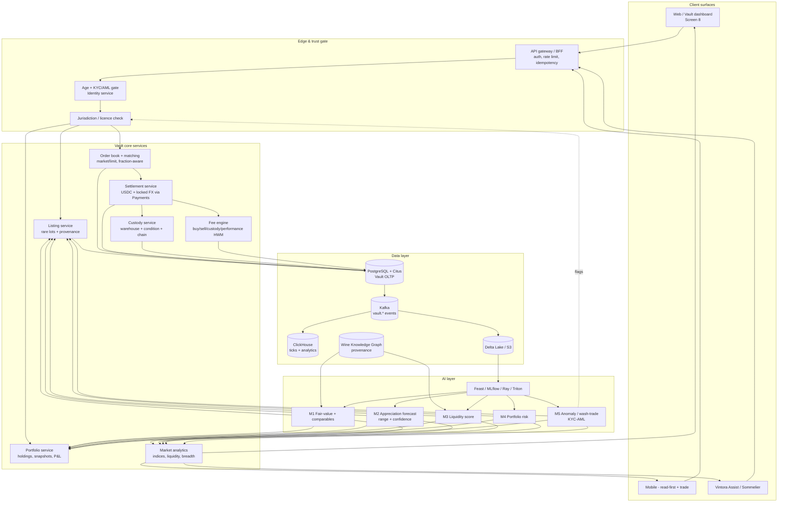
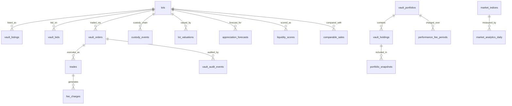
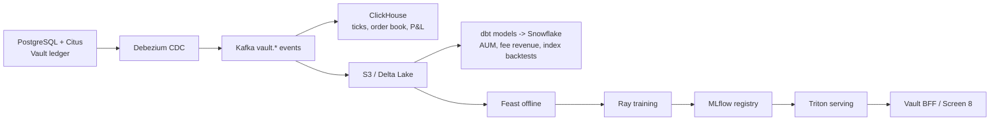

# VINTORA — Wine Investment Marketplace (Vintora Vault)

> **Companion documents:** `_canon.md`, `02-revenue-model.md` (§4.5 fee schedule, Vault economics), `04-database-design.md` (baseline `lots`, `vault_holdings`, `trades`), `05-ui-ux-wireframes.md` (Screen 8 — Vault dashboard & lot detail), `06-ai-features.md` (§11 wine investment analytics, §12 authenticity), `03-technical-architecture.md` (FX, USDC settlement), `18-loyalty-rewards-module.md` (Vault earns + referral handoff), `19-ai-pricing-engine.md` (Vault price signals), `01-business-plan.md`, `BUILDING.md`.
> This document is the **domain-level design authority for Vintora Vault** — the fine-wine investment marketplace. It defines the business model and platform architecture for a stock-trading-style experience (order book, portfolio, forecasts, secondary market, analytics) adapted to an asset that is physical, illiquid and custody-bound. `02-revenue-model.md` §4.5 owns the canonical fee schedule; this document is its implementation specification.

---

## Canon snapshot (binding)

| Dimension | Canonical fact |
|---|---|
| Brand | VINTORA (prose: "Vintora"); *The World's Cellar, Intelligent.* |
| All modules | Vintora Market, Vintora Trade, Vintora Sommelier, Vintora Assist, Vintora Studio, Vintora Seller, Vintora Flow, Vintora Club, Vintora Vault, Vintora Rewards. |
| Module in scope | **Vintora Vault** — fractional/whole-lot fine-wine investing, insured custody, continuous secondary market. |
| Mission fit | Democratize discovery, trade and enjoyment of fine wine and spirits worldwide through applied AI — protecting provenance, safety and responsible consumption. |
| Fee schedule (canonical) | **1.5% buy-side**, **2% sell-side**, **0.5% p.a. custody**, **5–15% performance fee above high-water mark**, **fractional minimum $25**. |
| Revenue | Vault fees = **10% of Y5 revenue ($75M)**, **12% of Y8 revenue ($300M)**. Contribution margin 85–95% (revenue model estimate); unit-economics contribution 70% (estimate). |
| Unit economics (estimate) | CAC **$600**; **$700/yr on ~$28k AUM** (blended 2.5% yield incl. performance); LTV ~$4,900; LTV/CAC 8.2x; payback ~15 mo. |
| Settlement | **USDC settlement** for Vault (canonical); 135+ currencies; locked-rate FX engine owned by Payments. |
| Custody | Insured, bonded warehouses (40+ in network per AI canon); condition grading (e.g., 94/100), provenance chain, custody-events audit. |
| AI (canonical §11) | Gradient-boosted price models + comparables → fair value; liquidity score (time-to-sell, bid depth); portfolio risk (exposure, correlation, drawdown); anomaly detection for wash trades, spoofing, KYC/AML. |
| UX reference | Screen 8: darker, data-forward; portfolio value/chart lead; tabular performance; holdings drill-in; trust triad = custody, condition, provenance; liquidity score with explainable tooltip; fee schedule stated on lot. |
| Baseline schema | `lots`, `vault_holdings`, `trades` in migration `0001`; richer conceptual `lots`/`investments`/`vault_holdings`/`trades`/`custody_events` in `04-database-design.md`. |
| Roadmap | Phase 4 (2029): Vault launch with core analytics; Phase 5: secondary-market liquidity scoring + advanced fraud detection. |
| Guardrails | Predictions are **ranges with confidence, never guarantees**; never assert authenticity as certain; age + KYC/AML before trading; no investment advice without licence; responsible-drinking framing. |

**Non-claims:** all forecasts, indices, liquidity scores, AUM figures and unit economics are design estimates or targets. No claim of live price accuracy, realised returns, regulatory approval, licensed broker-dealer status, real AUM or trading volume is made. Whether fractional interests are regulated securities is a **per-jurisdiction legal question** requiring counsel (see §11).

> **Prototype boundary:** Vault is a **non-live blueprint**. There is **no real USDC settlement** in any prototype, local/test or staging environment; no wallet, key custody, custodian agreement, title opinion, securities/commodities advice, suitability process, independent reconciliation, order, trade, fund transfer or custody movement is implemented. Settlement, custody, trading, ownership and investment-advice concerns are separated. Forecasts are ranges with confidence, never promises, target prices, yield or performance guarantees. `Prototype mode — no real orders are placed.`

---

## 1. Product definition

### 1.1 Capability surface

| # | Feature | Core question | Engine / model | Primary workflow |
|---|---|---|---|---|
| F1 | **Rare wine listings** | What can I invest in, and is it real? | Listing curation + provenance/condition | WF-01, WF-02 |
| F2 | **Portfolio tracking** | What do I own, what is it worth, what did it cost? | Holdings + mark-to-market + snapshots | WF-05 |
| F3 | **Asset appreciation forecasts** | What might this lot be worth, with what uncertainty? | M1 valuation + M2 forecast | WF-04 |
| F4 | **Secondary trading** | How do I buy/sell fractions with a fair, auditable match? | Order book + matching + USDC settlement | WF-03 |
| F5 | **Market analytics** | How is the market moving and how liquid is my position? | M3 liquidity + M4 risk + indices | WF-06 |

### 1.2 "Stock trading, adapted for wine" — design mapping

| Stock-trading pattern | Vintora Vault adaptation | Why it differs |
|---|---|---|
| Ticker / symbol | **Lot** (producer + appellation + vintage + format + warehouse) | Each bottle is unique; no fungible share class |
| Order book + bid/ask | **Lot-level order book** with fractional quantities | Thin liquidity; matching is patient, not continuous for all lots |
| Market / limit orders | **Market / limit / best-execution** with disclosed fees | Execution price shown before confirm; no hidden spread |
| Portfolio + P&L | **Mark-to-market** with cost basis and high-water mark | Physical assets; monthly independent valuations, not tick-by-tick for every lot |
| Price forecast | **Valuation range + confidence**, never a target price | Alternative asset; uncertainty must be visible |
| Liquidity metric | **Liquidity score 0–100** (time-to-sell, bid depth) | Explanatory tooltip required by Screen 8 |
| Index / benchmark | **Vintora Fine Wine Index (VFWI)** — projected, methodology published | Proprietary index must be reproducible and audited |
| Custody at broker | **Insured bonded warehouse + custody chain + condition grade** | Physical provenance is the asset, not a bookkeeping entry |
| Settlement (T+2) | **USDC settlement** on Vault, with locked-rate FX for funding | Canon: USDC settlement; FX owned by Payments |
| Management fee | **0.5% p.a. custody + 5–15% performance above high-water mark** | Canon fee schedule; performance fee never on losses |

### 1.3 Non-goals

- Acting as a licensed broker-dealer, investment adviser, exchange or clearing house without the required licences (see §11).
- Guaranteeing returns, offering principal protection, or presenting forecasts as promises.
- Holding consumer funds in a Vintora omnibus wallet (settlement uses the licensed payment/settlement layer).
- Setting listing prices autonomously (Vintora AI Pricing Engine proposes; sellers/investors and the order book decide).
- Authenticity certification as certainty — outputs are "consistent with provenance checks", with human adjudication for high-value lots.

---

## 2. Business model

### 2.1 Revenue streams (canonical fee schedule)

| Stream | Rate | Trigger | Payer | Recognition |
|---|---|---|---|---|
| Buy-side execution | **1.5%** | Purchase execution | Buyer | Transaction at trade date |
| Sell-side execution | **2%** | Secondary sale | Seller | Transaction at trade date |
| Custody | **0.5% p.a.** | Assets under custody | Holder | Accrued daily, billed monthly |
| Performance | **5–15%** | Gain **above high-water mark** | Holder | Accrued on net new gains, charged per performance period |
| Fractional entry | **$25 minimum** | First fraction | Investor | Not a fee — accessibility floor |
| Ancillary (estimate) | FX spread, financing against custodied assets (subject to licence), collector events | Various | Various | Ancillary; not in canonical fee schedule |

**Fee integrity rules:** the execution price is shown before confirmation; there is no hidden spread; the performance fee is calculated **only on realised-or-marked gains above the prior high-water mark**, never on losses or on a recovery from a loss back to break-even. Custody and performance fees are disclosed on every lot (Screen 10 callout ⑩).

### 2.2 Fee mechanics (worked examples, illustrative)

```text
Example A — buy-side only
  Lot price $1,000 · buy 1 fraction
  Execution fee = 1,000 × 1.5% = $15
  Total debit = $1,015 (+ any funding FX, quoted by Payments)

Example B — secondary sale with gain
  Bought at $1,000 (all-in cost basis $1,015)
  Sold at $1,300
  Sell-side fee  = 1,300 × 2% = $26        -> net proceeds $1,274
  Gain above HWM = 1,300 - 1,000 = $300
  Performance fee (10% illustrative) = $30
  Net gain to investor = 1,274 - 1,015 - 30 = $229

Example C — loss, no performance fee
  Bought at $1,000, sold at $900
  Sell-side fee = $18; performance fee = $0 (no gain above HWM)
```

High-water mark is tracked **per holding per performance period** in `performance_fee_periods`; it is not a portfolio-wide netting unless the product terms explicitly say so.

### 2.3 Unit economics (estimates, canonical)

| Metric | Value | Source |
|---|---|---|
| CAC | **$600** | `02-revenue-model.md` §5 |
| Revenue per investor | **~$700/yr on ~$28k AUM** (blended 2.5% yield incl. performance) | `02-revenue-model.md` §5 |
| Contribution margin | 70% (unit economics) / 85–95% (fee gross margin expectation) | `02-revenue-model.md` §2 & §5 |
| LTV (contribution) | ~$4,900 | `02-revenue-model.md` §5 |
| LTV/CAC | 8.2x | `02-revenue-model.md` §5 |
| Payback | ~15 months | `02-revenue-model.md` §5 |
| Y5 / Y8 revenue | 10% of $18M×? → **$75M** Y5; 12% → **$300M** Y8 | `02-revenue-model.md` §Y5/Y8 mix |

**Why this works:** custody and performance fees are recurring on AUM, so revenue compounds with retained assets rather than requiring new GMV each period. The $25 fractional minimum lowers the acquisition barrier while the 1.5%/2% execution fees keep each transaction accretive. The 8.2x LTV/CAC estimate is a target to be validated, not a reported result.

### 2.4 Cost structure

| Cost | Driver | Control |
|---|---|---|
| Warehouse / insurance | AUM under custody, 40+ bonded sites | Volume contracts, insured-value pricing passed through per canon Logistics insurance 0.3–1.2% |
| Payment / settlement | USDC network + on/off-ramp, card costs | Licensed settlement partner; fees in execution rates |
| Independent valuation | Per-lot periodic appraisal | Model-first with human review for high-value lots; sampling |
| KYC/AML + compliance | Per investor, per jurisdiction | Shared Identity/KYC service across all modules |
| Technology | ML training/serving, custody ledger | Shared Feast/MLflow/Ray/Triton platform (canonical) |
| Fraud / chargebacks | Wash trading, spoofing, identity fraud | Anomaly models + manual review queue |

### 2.5 Flywheel and strategic fit

1. **Market** purchases generate provenance and condition data → improves Vault comparables and valuation.
2. **Vault** price and liquidity signals feed Vintora AI Pricing Engine (document 19) and Sommelier explanations.
3. **Club** early access to Vault lots (canonical benefit) drives qualified investor onboarding.
4. **Rewards** awards points on settled Vault trade fees (see `18-loyalty-rewards-module.md`, Vault trade fee earn rule) — one balance across modules.
5. **Reinvestment** of realised gains and custody recurrence grows AUM → compounding fee base.
6. **Data moat** — custody chain + price prints + condition grades deepen the 300M-edge knowledge graph (canon).

---

## 3. Platform architecture

### 3.1 System diagram


### 3.2 Service responsibilities

| Service | Owns | Does **not** own |
|---|---|---|
| Listing | Lot curation, rare-listing metadata, provenance/condition attachment, availability | Pricing decisions (AI Pricing Engine proposes; seller accepts) |
| Order book + matching | Bids/asks, fractional quantities, market/limit orders, best execution, price-time priority | Funds movement |
| Settlement | USDC settlement via licensed partner, locked-rate FX for funding, trade confirmation | Price discovery |
| Custody | Warehouse allocation, condition grades, custody events, insurance evidence | Ownership ledger (Portfolio owns) |
| Fee engine | Buy/sell fees, daily custody accrual, performance fee above HWM, fee ledger | Trade execution |
| Portfolio | Holdings, cost basis, HWM, snapshots, P&L, allocation, risk display | Valuation model outputs (AI owns) |
| Analytics | Indices, market breadth, liquidity display, comparables, volume stats | Advice or recommendations to buy/sell |
| Trust/Anomaly | Wash-trade, spoofing, KYC/AML flags, human review queue | Final adjudication (compliance team) |

### 3.3 Stock-trading-style mechanics with physical constraints

- **Order types:** market, limit, and "best execution within N days" (patient matching for illiquid lots). Every order binds to a **specific lot**, not a fungible ticker.
- **Fraction precision:** `fraction` in `[0,1]`, 6 decimals in baseline `vault_holdings`; a lot can be split across many holders. Integer-fraction rounding is resolved deterministically with remainder to the last fill.
- **Matching:** price-time priority; self-trades blocked; wash-trade and spoofing flags (M5) can pause an order **before** match, with human review.
- **Settlement:** USDC on Vault per canon; funding FX uses Payments' locked rate with provenance; settlement is atomic with fee charging and ownership transfer (single DB transaction + outbox event).
- **Custody:** ownership transfer does **not** move bottles between warehouses — the custody chain records a beneficial-owner change against the same stored lot, preserving condition and provenance continuity.
- **Corporate actions equivalent:** condition downgrades, provenance disputes, recall/insurance events are recorded as custody events and can trigger revaluation — analogous to a corporate action affecting an equity position.

---

## 4. AI models (Vault analytics)

These implement canonical `06-ai-features.md` §11. **Every output is a range or score with confidence and explanation — never a guarantee.**

### 4.1 M1 — Fair-value & comparables

- **Inputs:** historical trade prints, bid/ask, knowledge-graph comparables (producer, appellation, vintage, format, condition), custody/condition records, provenance completeness, macro signals.
- **Method:** gradient-boosted regressor + kNN comparables over embeddings; output `fair_value_minor` with p10/p50/p90 range and `confidence`.
- **Guardrail:** low-confidence or thin-comparable lots fall back to last-trade with a stale flag; never assert authenticity — "consistent with provenance checks" only.

### 4.2 M2 — Appreciation forecast

- **Method:** quantile gradient boosting over horizon 1y/3y/5y, features = vintage age, producer tier, appellation demand, scarcity, condition, liquidity, index momentum, storage quality.
- **Output:** `appreciation_forecasts` rows with `low_bps`, `mid_bps`, `high_bps`, `confidence`, `model_version`, `as_of`.
- **Formula (displayed as a range, not a point promise):**

```text
forecast_value(horizon) = current_fair_value · (1 + r_mid) , r ∈ [r_low, r_high]
r = f(age, producer_tier, appellation_demand, scarcity, condition, liquidity, index_momentum)
display = "Estimated +4% to +11% over 3y (mid +7%, confidence 0.62)" — never a guaranteed return
```

- **Evaluation:** price-prediction MAE (canonical) and calibration of the stated intervals; blind holdout by time period.

### 4.3 M3 — Liquidity score

- **Method:** model time-to-sell and bid depth from order-book history, comparable turnover, lot rarity, price band and seasonality; calibrate to a 0–100 score.
- **Output:** `liquidity_scores` with `score`, `expected_days_to_sell`, `bid_depth`, `confidence` and an **explainable tooltip** (Screen 8 requirement).
- **Guardrail:** the score is an estimate of market conditions, not a promise of sale; low sample → "insufficient data" state.

### 4.4 M4 — Portfolio risk

- **Outputs:** exposure by region/producer/vintage, correlation clusters, concentration flags, drawdown estimate, value-at-risk range.
- **Use:** displayed in Portfolio and used by Assist for plain-language explanation. **No "sell this" instruction** — risk information, not advice.

### 4.5 M5 — Anomaly / wash-trade / KYC-AML

- **Method:** graph + rules over orders, trades, accounts and devices; flags self-trades, circular trading, spoofing (large orders cancelled near match), layering, and KYC anomalies.
- **Action:** `flag` → pause affected order → human review queue; append-only `vault_audit_events`; never auto-accuse a user of fraud without evidence chain.
- **Metrics:** fraud/anomaly precision-recall (canonical), false-positive rate reviewed weekly.

---

## 5. Workflows

### 5.1 WF-01 Rare lot onboarding & listing

**Trigger:** seller (producer, merchant, or existing holder) submits a lot. **Preconditions:** KYC/licence, warehouse intake.

| # | Step | Detail |
|---|---|---|
| 1 | Intake | Warehouse receives bottles; condition grade + photos (canonical CV grading) |
| 2 | Provenance | Build chain: producer → vineyard → vintage → bottle → custody; evidence hashes |
| 3 | Verify | Authenticity "consistent with" check; high-value lots → human adjudication |
| 4 | Curate | Rarity score, comparables, fair-value range from M1 |
| 5 | List | Create `vault_listings` with fraction size, minimum $25 entry, disclosed fees |
| 6 | Audit | `vault.audit.v1` with actor, evidence, trace |

**Failure paths:** provenance gap → "unverified" status, no listing; low condition → regrade; dispute → hold. **SLA:** standard lot ≤ 24 h; high-value human review ≤ 5 business days.

### 5.2 WF-02 Investor onboarding (age + KYC/AML)

**Trigger:** first investment intent. **Steps:** age assurance (jurisdiction-aware) → KYC/AML → licence/financial-promotion eligibility check → risk acknowledgement ("capital at risk; forecasts not guarantees") → wallet/USDC funding setup. **Failure:** any gate fails → no order ability, with plain-language reason. **SLA:** ≤ 10 min automated; manual review ≤ 2 business days.

### 5.3 WF-03 Order, matching, settlement

| # | Step | System |
|---|---|---|
| 1 | Place order | Investor submits market/limit order on a specific lot with fraction |
| 2 | Pre-trade check | KYC status, licence, funds, self-trade, M5 anomaly flag |
| 3 | Match | Price-time priority against `vault_bids` / `vault_listings`; partial fills allowed |
| 4 | Price | Execution price shown before confirm; no hidden spread |
| 5 | Settle atomically | USDC transfer via licensed partner + locked FX if funding; fee engine charges 1.5%/2%; ownership transfer; custody event |
| 6 | Confirm | `vault.trade.settled.v1`; update holdings, HWM, portfolio snapshot |
| 7 | Post-trade | M5 surveillance; M1 valuation refresh; Rewards points credit |

**Failure paths:** settlement fail → order cancelled, no fee; anomaly flag → pause + review; FX rate expiry → re-quote. **SLA:** match ≤ 1 s; settlement confirmation ≤ 60 s after funds available.

### 5.4 WF-04 Valuation & forecast refresh

**Trigger:** daily batch + after each trade + monthly independent review for high-value lots. **Steps:** assemble Feast features → M1 fair value → M2 appreciation range → M3 liquidity → write `lot_valuations`, `appreciation_forecasts`, `liquidity_scores` → emit `vault.valuation.updated.v1`. **SLA:** nightly by 03:00 local; per-trade refresh ≤ 5 s.

### 5.5 WF-05 Portfolio mark-to-market

**Trigger:** valuation update, trade, or fee accrual. **Steps:** recompute each holding at latest fair value → cost basis + HWM → realised/unrealised P&L → allocation → risk (M4) → write `portfolio_snapshots` → emit `vault.portfolio.updated.v1`. **SLA:** ≤ 5 s per event; snapshot daily.

### 5.6 WF-06 Fee accrual (custody + performance)

```text
DAILY:  custody_fee = AUM × 0.5% / 365     -> append fee_charges (accrue)
MONTHLY: bill accrued custody fees

PERFORMANCE PERIOD (quarterly):
  period_gain = closing_value - max(high_water_mark, opening_value)
  IF period_gain <= 0: fee = 0; carry HWM forward
  ELSE: fee = period_gain × performance_rate(5–15% by tier/AUM)
  APPEND fee_charges(type='performance', ...)
  APPEND performance_fee_periods(opening_hwm, closing_hwm, gain, fee, rate)
  EMIT vault.fee.charged.v1
```

Custody accrual and performance fees are computed from **independent fair values**, not from a trader's own quote. All fee rows are append-only and idempotent per period.

### 5.7 WF-07 Market analytics & index build

**Trigger:** daily + intraday for liquid lots. **Steps:** aggregate trades/orders → Vintora Fine Wine Index (VFWI, methodology versioned), breadth, volume, bid/ask spread → write `market_indices`, `market_analytics_daily` → emit `vault.index.updated.v1`. **SLA:** daily index by 04:00 local; intraday 15 min for active lots.

### 5.8 WF-08 Surveillance & review

**Trigger:** M5 flag. **Steps:** pause related orders → evidence snapshot → human review → resolve (release / cancel / escalate to compliance) → append audit → feedback labels to M5. **SLA:** flag-to-pause ≤ 5 s; review ≤ 1 business day.

---

## 6. Database architecture

### 6.1 Design principles

| # | Principle | Implementation |
|---|---|---|
| D1 | Tenant + user scope | `tenant_id` on all rows; Citus by `user_id`/`tenant_id`; RLS defence in depth. |
| D2 | Append-only money | Orders, trades adjustments, fee charges, custody events, snapshots are immutable. |
| D3 | Fee integrity | HWM and fee periods are explicit tables; performance fee never on loss. |
| D4 | Money discipline | `*_minor` + `currency_code` + FX provenance; USDC settlement reference. |
| D5 | Model versioning | Every valuation/forecast/score carries `model_version`, `as_of`, `confidence`. |
| D6 | Auditability | Evidence hashes, audit events, trace ids on all custody and trade operations. |

### 6.2 Baseline vs new tables

| Domain | Baseline (`0001` / `04-database-design.md`) | Added by this module |
|---|---|---|
| Lots | `lots` | extended with tenant, lot code, vintage, rarity, valuation, provenance scores |
| Holdings | `vault_holdings` | extended with tenant, HWM, fees basis |
| Trades | `trades` | extended with tenant, side, fees, status, settlement ref |
| Listings/orders | — | `vault_listings`, `vault_bids`, `vault_orders` |
| Portfolio | — | `vault_portfolios`, `portfolio_snapshots` |
| Valuation | — | `lot_valuations`, `appreciation_forecasts`, `liquidity_scores`, `comparable_sales` |
| Analytics | — | `market_indices`, `market_analytics_daily` |
| Fees | — | `fee_charges`, `performance_fee_periods` |
| Custody/audit | conceptual in `04` | `custody_events`, `vault_audit_events` |

### 6.3 ER diagram



### 6.4 Indexing and query patterns

| Query | Index | Notes |
|---|---|---|
| Active listings by lot | `(tenant_id, lot_id, status, created_at DESC)` | Discover lots |
| Order book for lot | `(tenant_id, lot_id, side, price_minor, created_at)` | Price-time priority |
| Holdings for portfolio | `(tenant_id, user_id, lot_id)` | Mark-to-market |
| Latest valuation | `(tenant_id, lot_id, as_of DESC)` | Screen 8 |
| Forecast horizon | `(tenant_id, lot_id, horizon, as_of DESC)` | Forecast display |
| Fee period open | `(tenant_id, holding_id, period_end DESC)` | HWM calc |
| Custody chain | `(tenant_id, lot_id, occurred_at)` | Provenance view |
| Audit trail | `(tenant_id, entity_id, occurred_at DESC)` | Compliance |

Citus: distribute `vault_listings`, `vault_bids`, `vault_orders`, `vault_holdings`, `portfolio_snapshots`, `fee_charges` on `user_id`/`tenant_id`; replicate `market_indices`, `market_analytics_daily`, `liquidity_scores` as reference/small tables. RLS: `USING (tenant_id = current_setting('app.tenant_id')::uuid ...)` with user scope on holdings/orders/fees.

### 6.5 Analytical pipeline



Unrealised gains are **not recognised revenue**; only accrued custody and charged performance fees are. AUM and fee revenue reconcile daily against holdings and the fee ledger.

---

## 7. API contracts (BFF GraphQL, abridged)

```graphql
type Lot { id: ID!, producer: String!, appellation: String!, vintage: Int,
  conditionScore: Int!, provenanceScore: Int!, liquidityScore: Int!,
  fairValue: MoneyRange!, minimumFraction: Float! }
type Portfolio { id: ID!, totalValue: Money!, costBasis: Money!, unrealisedPnl: Money!,
  realisedPnl: Money!, highWaterMark: Money!, allocation: [Allocation!]! }
type Holding { lotId: ID!, fraction: Float!, value: Money!,
  costBasis: Money!, forecast: ForecastRange!, liquidity: Int! }
type OrderBook { bids: [Order!]!, asks: [Order!]!, lastTrade: Trade }
type MarketIndex { code: String!, value: Float!, changeBps: Int!, asOf: Date! }

type Query {
  rareLots(filter: LotFilter): [Lot!]!
  lot(id: ID!): Lot
  myPortfolio: Portfolio!
  myHoldings: [Holding!]!
  orderBook(lotId: ID!): OrderBook!
  marketIndices: [MarketIndex!]!
  appreciationForecast(lotId: ID!, horizon: Horizon!): ForecastRange!
}

type Mutation {
  placeOrder(lotId: ID!, side: Side!, fraction: Float!, limitPrice: Money): Order!
  cancelOrder(id: ID!): Order!
  acknowledgeRisk(version: String!): Boolean!
}
```

**REST parity:** `/v1/vault/*` for order entry, portfolio, index and admin surveillance; writes require idempotency keys and KYC context.

---

## 8. Event contracts

| Topic | Producer | Consumers | Payload essence |
|---|---|---|---|
| `vault.lot.listed.v1` | Listing | Discovery, Sommelier, Analytics | `lot_id, rarity, provenance_score, condition_score` |
| `vault.order.placed.v1` | Order book | Matching, Surveillance, UI | `order_id, lot_id, side, fraction, limit_price` |
| `vault.trade.settled.v1` | Settlement | Portfolio, Fee engine, Rewards, Analytics | `trade_id, lot_id, price, fraction, buyer, seller` |
| `vault.valuation.updated.v1` | M1/M2 | Portfolio, UI, Index | `lot_id, fair_value, forecast, model_version` |
| `vault.liquidity.updated.v1` | M3 | UI, Analytics | `lot_id, score, expected_days, confidence` |
| `vault.portfolio.updated.v1` | Portfolio | UI, Assist, Risk | `user_id, total_value, pnl, as_of` |
| `vault.fee.charged.v1` | Fee engine | Finance, UI, Audit | `user_id, fee_type, amount_minor, period` |
| `vault.index.updated.v1` | Analytics | UI, Media/API, Analytics | `code, value, change_bps, methodology_version` |
| `vault.anomaly.flagged.v1` | M5 | Surveillance, Ops, Audit | `entity_id, flag_type, severity, evidence_ref` |
| `vault.audit.v1` | all | SIEM, audit sink | `actor, entity, from, to, trace_id` |

Inbound: `order.delivered.v1` (provenance completion), `rewards.tier.changed.v1` (VIP benefits), `club.referral.rewarded.v1`-style handoffs, and Payments settlement confirmations.

---

## 9. Security, compliance and trust

- **Regulatory posture (explicit open risk):** fractional interests in fine wine may be treated as regulated securities, collective investments or financial promotions in some jurisdictions. Vault launches only in markets where counsel confirms a compliant structure; otherwise only whole-lot, non-fractional or non-investment surfaces render. **No claim of broker-dealer or investment-adviser authorisation is made.**
- **Age + KYC/AML:** jurisdiction-aware age assurance and KYC/AML before any order (shared Identity service); USDC settlement through a licensed partner; sanctions screening.
- **No advice / no guarantees:** the UI labels forecasts as estimates with confidence and ranges; risk acknowledgement at onboarding; Assist never instructs a user to buy/sell, only explains data.
- **Authenticity honesty:** "consistent with provenance checks", never "authentic"; human adjudication for high-value lots; no counterfeit accusation without evidence.
- **Market integrity:** wash-trade/spoofing surveillance, self-trade blocking, order-pause authority, append-only audit, per-order idempotency.
- **Fee transparency:** fee schedule on every lot; HWM-based performance fee; no hidden spread; reconciled fee ledger.
- **Custody assurance:** insured bonded warehouses, condition grades, unbroken custody-event chain, evidence hashes; disputes trigger holds and revaluation.
- **Data privacy:** investor identities isolated from analytics; published indices aggregate only; no sensitive-attribute inference.

---

## 10. Observability

| SLO / control | Target |
|---|---|
| Order match p95 | < 1 s |
| Settlement confirmation | ≤ 60 s after funds available |
| Portfolio / valuation read p95 | < 200 ms (canonical API target) |
| AUM ↔ holdings ↔ fee ledger reconciliation | 100% daily, zero unexplained variance |
| Performance-fee calculation errors | Zero (HWM regression tests) |
| Anomaly flag → order pause | ≤ 5 s |
| Forecast calibration | Within stated confidence bands on rolling holdout |
| Audit completeness | 100% |

**Dashboards:** AUM, net inflows, buy/sell volume, bid/ask spread by lot, liquidity-score distribution, VFWI vs benchmark, fee revenue by type, HWM breaches, anomaly flags and review SLA, custody coverage, forecast MAE.

---

## 11. Rollout plan

| Phase | Window | Deliverables | Exit criteria |
|---|---|---|---|
| Phase 4 | 2029 | Vault launch: rare listings, whole + fractional lots, custody, fee engine, core analytics (M1, M3), KYC | Legal clearance per market; custody chain verified; fee reconciliation green |
| Phase 5 | 2030–2034 | Appreciation forecasts (M2), portfolio risk (M4), advanced anomaly (M5), secondary-market liquidity scoring, VFWI API | Forecast calibration measured; surveillance SLA met; all SLOs green |

---

## 12. Prototype-to-production mapping

| Prototype element | Production destination |
|---|---|
| Vault dashboard KPIs (portfolio, lots, liquidity, custody) | `vault_portfolios` + `portfolio_snapshots` + `liquidity_scores` → `myPortfolio` |
| 10-year portfolio chart + allocation by region | `portfolio_snapshots` + M4 exposure model |
| Holdings table (value, 12m change, liquidity, custody) | `vault_holdings` joined to `lot_valuations` + `liquidity_scores` |
| "Market open · USDC settlement" pill | Settlement service status + canonical USDC settlement |
| Fee line on lot ("1.5 / 2 / 0.5 / 5–15%") | Fee engine + `fee_charges` + `performance_fee_periods` |
| Sommelier "liquidity score 88/100, provenance 99/100" | M3 score + provenance chain + explainable tooltip |
| Vault trade fee → Rewards points | `vault.trade.settled.v1` → earn rule in `18-loyalty-rewards-module.md` |

---

## 13. Risks and open decisions

| Risk | Mitigation |
|---|---|
| Regulatory classification of fractional wine interests | Per-jurisdiction counsel; whole-lot fallback; financial-promotion controls |
| Illiquidity / price opacity | Liquidity score, patient order types, published methodology, last-trade staleness flags |
| Valuation model error | Ranges with confidence, comparables, human review, blind holdouts |
| Wash trading / spoofing | M5 surveillance, order pause, append-only audit, human review |
| Custody / condition loss | Insured bonded warehouses, unbroken custody chain, condition regrading triggers |
| Performance-fee disputes | Per-holding HWM, explicit periods, append-only ledger, disclosure |
| Counterfeit / provenance gaps | Evidence chain, "consistent with" language, human adjudication |

**Open decisions:**

1. Jurisdictions cleared for fractional offerings vs whole-lot only (legal counsel).
2. Licence structure for order matching / settlement (partner vs own entity).
3. Performance-fee tiers: exact 5–15% band by AUM, holding period, or investor tier.
4. Whether VFWI is published externally and under what governance/audit.
5. Independent valuation cadence for high-value lots (monthly vs quarterly).
6. Whether Vault-linked lending against custodied assets is enabled (subject to licence).
7. Fractional precision and minimum increment beyond the $25 entry floor.

---

## 14. Summary

Vintora Vault is specified as a **stock-trading-style marketplace adapted to physical, custody-bound fine wine**. The business model monetises a canonical fee schedule — 1.5% buy / 2% sell / 0.5% p.a. custody / 5–15% performance above high-water mark with a $25 fractional minimum — targeting 10% of Y5 revenue ($75M) and 12% of Y8 revenue ($300M) at 85–95% fee gross margin (estimate), with $600 CAC, ~$700/yr per investor on ~$28k AUM and 8.2x LTV/CAC (all estimates). The platform comprises listing, order-book/matching, USDC settlement, insured custody, fee, portfolio and analytics services behind an age/KYC/licence trust gate, with 15 new tables extending the baseline `lots`/`vault_holdings`/`trades` — tenant/user RLS, Citus distribution, append-only ledgers and Kafka CDC into ClickHouse/dbt/Snowflake. Five AI models (fair value + comparables, appreciation ranges, liquidity score, portfolio risk, wash-trade/KYC anomaly) implement canonical §11; all outputs are ranges or scores with confidence and explanation, never guarantees. The design keeps execution transparent, performance fees strictly above the high-water mark, authenticity expressed as "consistent with provenance checks", and treats fractional-security classification as an explicit open legal risk. No live AUM, return, accuracy or licence claim is made.
})
