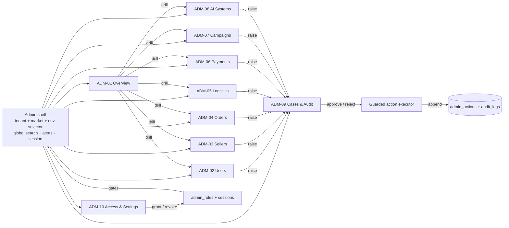
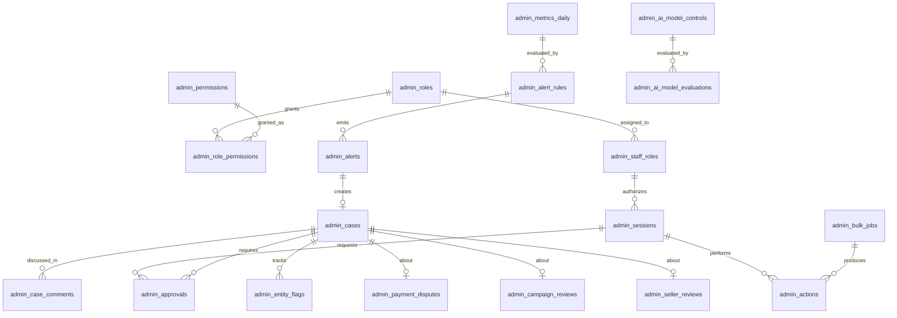
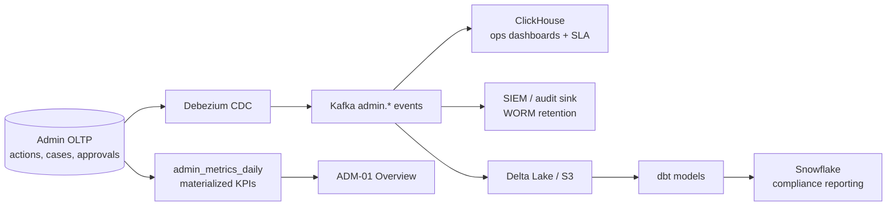

# VINTORA — Admin Panel Module (Super Admin Control Center)

> **Companion documents:** `_canon.md`, `03-technical-architecture.md` (zero trust, RBAC, break-glass, audit, SLOs), `04-database-design.md` (`users`, `sellers`, `orders`, `shipments`, `payments`, `marketing_campaigns`, `audit_logs`), `06-ai-features.md` (§§12–13 governance, red teaming), `14-ai-content-generator-module.md` (compliance gate, human approval), `15-seller-dashboard-module.md` (seller review), `16-logistics-delivery-module.md` (Flow operations), `17-membership-subscription-module.md` (Club), `18-loyalty-rewards-module.md` (ledger adjustments), `19-ai-pricing-engine.md` (kill switch), `20-wine-investment-marketplace.md` (surveillance), `BUILDING.md`.
> This document is the **domain-level design authority for Vintora's internal Admin Panel** — the super-admin control center for operating the platform. It is an **internal operations plane serving all ten canonical modules**, not an eleventh market-facing module. The exact module list remains: Vintora Market, Vintora Trade, Vintora Sommelier, Vintora Assist, Vintora Studio, Vintora Seller, Vintora Flow, Vintora Club, Vintora Vault, Vintora Rewards.

---

## Canon snapshot (binding)

| Dimension | Canonical fact |
|---|---|
| Brand | VINTORA (prose: "Vintora"); *The World's Cellar, Intelligent.* |
| Canonical modules | Ten, unchanged. Admin Panel is internal tooling that **operates** them. |
| Scope | Super-admin control center with **19 internal workspaces (ADM-01…ADM-19)** spanning platform, commerce, customer/growth, operations, governance and intelligence. |
| Security model | Design target (not current implementation): zero trust with SSO + **hardware MFA**, least privilege, **just-in-time elevation**, **break-glass time-boxed + audit-logged design target**, Istio mTLS, SPIFFE-style workload identities. The prototype simulates these controls locally. |
| Isolation | `tenant_id` mandatory at every layer; repository injects tenant predicate; queries without tenant context **fail closed**; RLS defence in depth. Platform access is break-glass. |
| Compliance | Target frameworks and planned controls: SOC 2 Type II (change management, access reviews, incident response, audit logging), ISO 27001, GDPR/CCPA/LGPD/PIPL and age/KYC/licensing before order acceptance (ADR-008). No current certification or regulatory approval is claimed. |
| Approval rules | No refund above threshold without human approval; no account-changing action without authentication; human approval before any marketing asset publish; no autonomous writes to financial or identity systems. |
| AI governance | MLflow registry, model cards + datasheets + owners + SLOs, offline eval gates, canary + rollback, quarterly red teaming, fairness audits, **kill switch < 1 min**. |
| Observability | OpenTelemetry traces, Prometheus/Grafana SLO dashboards, Datadog APM, PagerDuty; JSON logs with `trace_id`, `tenant_id`, pseudonymous `user_id`, `request_id`, `module`. |
| Marketing guardrail | No health or intoxication claims; age gating per region; minors never targeted; **advertising ≤ 8% of revenue by design**. |
| Baseline schema | `users`, `sellers`, `orders`, `shipments`, `payments`, `marketing_campaigns`, `audit_logs` in `0001_initial.sql`. |
| Prototype | Interactive, deterministic admin simulation at `http://localhost:8123/?view=admin` or `#admin` (and the API origin). Eighteen workspaces, guarded actions, four-eyes approvals, JIT/break-glass elevation, AI kill switch, saved-view filters, bulk dry runs and a `⌘K` command palette are simulated locally; state persists in `localStorage`. No real users, PII, orders, payments, campaigns or spend. Production mapping is documented in §11. |

**Non-claims:** all SLO targets, threshold values, role definitions and dashboard layouts are design specifications. No claim of live incident volume, real admin headcount, realised audit findings or deployed authorisation is made.

---

## 0. Implemented console scope (local build)

The local console exposes exactly 19 internal workspaces. These are operations screens, **not** additional market-facing modules; the canonical ten-module list remains unchanged.

| Code | Workspace | Group | Code | Workspace | Group |
|---|---|---|---|---|---|
| ADM-01 | Super Admin Dashboard | Platform | ADM-10 | Marketing Management | Customer & Growth |
| ADM-02 | User Management | Platform | ADM-11 | Loyalty Program Management | Customer & Growth |
| ADM-03 | Role & Permissions | Platform | ADM-12 | Subscription Management | Customer & Growth |
| ADM-04 | Product Management | Commerce | ADM-13 | Logistics Management | Operations |
| ADM-05 | Seller Management | Commerce | ADM-14 | Compliance Management | Governance |
| ADM-06 | Order Management | Commerce | ADM-15 | Customer Support Management | Operations |
| ADM-07 | Inventory Management | Commerce | ADM-16 | AI Operations Center | Intelligence |
| ADM-08 | CRM | Customer & Growth | ADM-17 | Security Center | Governance |
| ADM-09 | Finance & Accounting | Operations | ADM-18 | Global Operations Center | Governance |
| ADM-19 | Ultimate AI TechOps | Intelligence | | | |

### 0.1 Simulation and DB boundary

- **Local simulation:** every screen renders deterministic demo rows. All mutations — including case assignment, approvals, model transitions, bulk apply, evidence export and elevation — are simulated and appended to a local audit trail. No publish, ad spend, email send, payment movement or live model change occurs.
- **DB-backed read:** `GET /v1/admin/coverage` is role-gated and returns only counts and labels for ADM-01…ADM-19. Each module reports `db-backed`, `partial` or `simulated` status, plus a note and per-table counts. `ADM-19` is explicitly `simulated` with no live telemetry.
- **Scope labels:** counts are tagged `rls-tenant`, `explicit-tenant`, `single-tenant-demo` or `shared-reference`. Tables protected by `tenant_user_isolation` (loyalty accounts, member subscriptions, vault positions) are excluded because the Admin context sets only `app.tenant_id`, not `app.user_id`.
- **Response contract:** `computedAt`, `source`, `asOf`, `environment`, a disclaimer, `summary` and `modules[]`. The source is `seeded-postgres-demo`; zero counts mean no seeded demo rows, never a live business signal.
- **No live claims:** `admin_metrics_daily` values are seeded projection constants, not computed telemetry. Provider labels, readiness states and model evaluations are illustrative.

### 0.2 Guard policy in the local console

Tier-3 and tier-4 actions are blocked until the session is elevated, then require a reason and an approver distinct from the actor. This includes approvals, refund/payout holds, policy publication, model promotion/rollback, **and both directions of the AI kill switch**. Break-glass entry is the sole exception: it validates the same T4 reason/distinct-approver pair without a prior JIT elevation, because it is itself the elevation path. The kill switch remains an emergency control: guard completion is immediate, and the documented `< 1 min` propagation target is a design SLO, not a measured result. Session elevation is time-boxed (15 minutes JIT, 2 hours break-glass) and auto-demotes on expiry. The append-only audit receives every privileged action with tier, actor, approver and reason.

---

## 1. Product definition

### 1.1 Capability surface

| # | Domain | Core question | Admin capability | Primary workflow |
|---|---|---|---|---|
| A1 | **Users** | Who is on the platform, and are they safe/verified? | Search, KYC/age state, flags, consent, restriction, erasure handoff | WF-02 |
| A2 | **Sellers** | Which merchants are compliant and healthy? | Onboarding review, licence/KYC, tier, payout hold, performance | WF-03 |
| A3 | **Orders** | Is anything stuck, wrong or abusive? | Order timeline, cancellation, refund approval, exception queue | WF-04 |
| A4 | **Logistics** | Where are shipments and what is at risk? | Shipment board, carrier SLA, excursions, warehouse exceptions | WF-05 |
| A5 | **Payments** | What failed, is disputed or needs reconciliation? | Payment states, disputes, chargebacks, payout holds, ledger recon | WF-06 |
| A6 | **Marketing campaigns** | Is every campaign compliant and approved? | Campaign review queue, compliance flags, pause, market restrictions | WF-07 |
| A7 | **AI systems** | Are models healthy, fair, within budget and controllable? | Model inventory, eval gates, rollout, spend caps, kill switch, red team | WF-08 |

### 1.2 Cross-cutting capabilities

| Capability | Description |
|---|---|
| Command palette (`⌘K`) | Jump to any entity, case, model or action by ID/name; every result tenant-scoped |
| Global search | Unified search across users, sellers, orders, shipments, payments, campaigns, models |
| Case queue | One triage queue for all seven domains with severity, SLA and assignee |
| Approvals | Four-eyes workflow for high-risk actions; requester ≠ approver |
| Action log | Append-only record of every view of PII and every mutation, with reason + evidence |
| Saved views | Per-staff filters (market, tenant, severity, status); no cross-staff leakage |
| Bulk jobs | Bounded, previewed, reversible operations with dry-run and progress |
| Alert centre | Rule-driven alerts routed into cases; acknowledgment + silence with expiry |

### 1.3 Personas & least-privilege roles

| Role | Domains | Typical actions | Elevated? |
|---|---|---|---|
| `super_admin` | All | Full read; high-risk writes still need approval | JIT + MFA |
| `trust_safety` | Users, Orders, Campaigns | Flag, restrict, review, escalate | JIT for restriction |
| `ops_support` | Orders, Logistics | Cancel, reship, exception handling | JIT for refund initiation |
| `finance_ops` | Payments, Sellers | Disputes, payout holds, reconciliation | Dual approval for adjustments |
| `seller_ops` | Sellers | Onboarding review, tier, licence verification | Dual approval for suspension |
| `growth_ops` | Campaigns | Review, pause, market restriction | No publish without named human approval |
| `ai_ops` | AI systems | Promote, rollback, halt, spend caps | Dual approval for production promote |
| `auditor` | All (read-only) | Read logs, export evidence | No writes, ever |

### 1.4 Non-goals

- Being an eleventh consumer-facing module or changing the canonical module list.
- Granting silent, unattributable super-user access; **every action is attributable**.
- Storing raw card data, passwords or encryption keys in the admin store.
- Allowing an admin to alter a loyalty or Vault ledger by direct row update (documented adjustment workflows only).
- Automated adverse decisions without a human appeal path.

---

## 2. Dashboard architecture

### 2.1 Information architecture



> The diagram above shows the original seven-domain grouping. The implemented local console expands this into the 19 workspaces enumerated in §0 while preserving the same shell, drilldown, case/approval and guarded-executor flow.

### 2.2 Global shell

| Element | Rule |
|---|---|
| Header | Environment badge (`PROD` in red), tenant + market selector, `trace_id` of current session |
| Session timer | JIT elevation countdown; auto-demote at expiry; "Extend" requires fresh MFA |
| Break-glass banner | Full-width amber banner while elevated, naming approver, scope and expiry |
| Global search | Tenant-scoped; results show entity type + status; PII masked until purpose recorded |
| Alert bell | Open alerts by severity; one click creates a case |
| Command palette | `⌘K` / `Ctrl+K`; actions require the same approvals as their button equivalents |
| Detail drawer | Every list row opens a right-side drawer with timeline, related records and actions |
| Reason field | **Mandatory** on every mutation and on every raw-PII view |
| Impersonation | Read-only, banner in app, time-boxed, logged; never inherits write rights |

### 2.3 ADM-01 Overview (landing)

```
┌──────────────────────────────────────────────────────────────────────────┐
│ VINTORA ADMIN · PROD   [Tenant: All ▾] [Market: All ▾]   ⌘K   🔔 12  ⏱ 14:32│
├──────────────┬───────────────────────────────────────────────────────────┤
│ Overview     │  PLATFORM PULSE                        Last 24h  ▾        │
│ Users        │  ┌─────────┬─────────┬─────────┬─────────┬─────────┐      │
│ Sellers      │  │ Users   │ Sellers │ Orders  │ Payments│ AI models│     │
│ Orders       │  │ 2.4M    │ 18,420  │ 91,208  │ 99.2% ok│ 6 / 1 halt│    │
│ Logistics    │  │ ▲0.8%   │ ▲2.1%   │ ▼1.4%   │ ▲0.1pp  │ 1 drift   │    │
│ Payments     │  └─────────┴─────────┴─────────┴─────────┴─────────┘      │
│ Campaigns    │  OPEN CASES BY SEVERITY     ── SLA BREACHES: 3            │
│ AI Systems   │  P1 ███ 4   P2 ████████ 12   P3 ████████████ 21           │
│ Cases & Audit│  QUEUES: KYC 8 · Seller review 5 · Refund 11 · Dispute 6  │
│ Access       │  RECENT PRIVILEGED ACTIONS (all attributed)               │
├──────────────┤  14:31 finance_ops · payout hold · seller-882 · approved   │
│ ⏱ Elevated   │  14:28 ai_ops · halt model forecast-v7 · auto             │
│ Scope: all   │  14:22 support · refund $240 · case-901 · pending approval │
│ Expires 14:47│  [Open full action log →]                                  │
└──────────────┴───────────────────────────────────────────────────────────┘
```

Design rules: tabular figures for all numbers; no vanity charts; every KPI links to its filtered queue; numbers labelled with time window and source; a degraded data feed shows "last updated" timestamp rather than a stale green indicator.

### 2.4 Screen specifications

| Screen | Primary widgets | Key actions | Drill-down |
|---|---|---|---|
| ADM-02 Users | User table (status, KYC, age, jurisdiction, flags, last activity), KYC funnel, risk flags | View profile, restrict, request re-verification, erasure handoff | Age verifications, orders, sessions, consent |
| ADM-03 Sellers | Reviews queue, licence expiry list, tier, GMV, payout state, dispute rate | Approve/reject onboarding, suspend (dual), place payout hold | Listings, payouts, KYC evidence |
| ADM-04 Orders | Exception board (stuck, refund requested, anomaly), order timeline, SLA heatmap | Cancel, initiate refund (approval), re-route, add note | Payment, shipment, items, audit |
| ADM-05 Logistics | Shipment board by status/carrier, exceptions, temperature excursions, warehouse capacity | Reship, carrier escalation, warehouse transfer, claim | Tracking, custody events, insurance |
| ADM-06 Payments | Failed payments, disputes/chargebacks, reconciliation variance, payout queue | Refund (approval), dispute response, payout hold, reconcile | Ledger entries, processor reference, FX |
| ADM-07 Campaigns | Review queue, compliance flags (PASS/WARN/BLOCK), brand-voice score, market reach, spend | Approve/reject, force re-review, pause, market restriction | Generated assets, audience, terms |
| ADM-08 AI Systems | Model inventory with version/stage/metrics, drift & cost panels, eval gate results, red-team status | Promote (dual), rollback, halt/kill switch, set spend cap, request eval | Model card, runs, feature snapshots, incidents |
| ADM-09 Cases & Audit | Unified case queue, SLA timers, assignment, evidence viewer, append-only action log | Assign, resolve, escalate, export evidence | Linked entities, actor, before/after JSON |
| ADM-10 Access & Settings | Roles, permissions matrix, staff assignments, elevation policy, alert rules, saved views | Grant/revoke (dual), rotate policy, edit alert thresholds | Session history, approval history |

### 2.5 Design tokens & interaction rules

- Tokens inherited from `05-ui-ux-wireframes.md`: burgundy `#5B1A2B`, cream `#F7F1E6`, gold `#C9A227`, charcoal `#1C1917`, sage `#6B7A5E`. Admin uses a neutral, denser surface; **gold is reserved for tier marks** and must not signal admin authority.
- Dangerous actions are never one-click: they show impact preview, require a reason, and require approval when above threshold.
- Every destructive or privileged action is **reversible where technically possible** (e.g., a restriction can be lifted, a model rolled back); irreversible actions are explicitly labelled.
- All tables are server-side paginated, tenant-scoped and exportable only through an audited export job.

---

## 3. Access control & governance

### 3.1 Permission model

```text
permission = { domain, action, scope }
  domain: users | sellers | orders | logistics | payments | campaigns | ai | cases | audit | settings
  action: read | search | flag | modify | approve | export | impersonate | elevate
  scope:  global | tenant:<id> | market:<code> | module:<canonical-module>

effective_permission = intersection(role_permissions, staff_scope, active_elevation)
DENY by default. No wildcard role. Queries without tenant predicate fail closed.
```

### 3.2 Elevation & break-glass

| Control | Rule |
|---|---|
| SSO + hardware MFA | Mandatory for all admin access; session bound to device and IP reputation |
| JIT elevation | Standard admin is read-only; write scope granted on demand with named reason and ticket |
| Break-glass | Time-boxed (default 2 h), requires pre-approved approver, full-width banner, auto-expiry |
| Four-eyes | Requester cannot approve own action; two distinct identities for financial/identity/model-promote actions |
| Impersonation | Read-only, time-boxed, banner in the target app; never grants write capability |
| Access review | Quarterly recertification of roles and scopes; dormant accounts auto-disable at 30 days |
| Audit | Every grant, revoke, elevation, PII view and mutation append-only with `trace_id` |

### 3.3 Risk tiers for actions

| Tier | Examples | Requirements |
|---|---|---|
| T0 Read | View dashboard, search masked entities | SSO + MFA; PII masked |
| T1 Low | Add note, assign case, saved view | Reason; logged |
| T2 Moderate | Cancel order, pause campaign, request re-verification | Reason + JIT elevation |
| T3 High | Refund above threshold, restrict user, suspend seller, payout hold, halt model | Reason + dual approval + evidence |
| T4 Critical | Bulk restriction, PII export, ledger adjustment, production model promote, permission grant | Reason + dual approval + security review + post-action audit |

---

## 4. Workflows

### 4.1 WF-01 Admin session & authorization

**Trigger:** sign-in. **Steps:** SSO → hardware MFA → resolve roles/scopes → apply default read-only → log session. Any write request triggers JIT elevation with reason + ticket; T3/T4 additionally require an approver. **Failure:** MFA fail, expired elevation or missing scope → deny with reason and audit entry. **SLA:** auth ≤ 500 ms; elevation decision ≤ 2 s.

### 4.2 WF-02 User management

**Trigger:** alert, case or search. **Steps:** open masked profile → record purpose for PII reveal → review KYC/age state, flags, order history → decide (no action / re-verify / restrict / escalate). Restriction is T3 (dual approval) and emits `admin.user.restricted.v1`. Erasure requests hand off to the Identity privacy pipeline — the admin never deletes records directly.

### 4.3 WF-03 Seller review

**Trigger:** new application, licence expiry, KYC anomaly, dispute-rate alert. **Steps:** verify legal entity + licence + KYC evidence → review performance and payout state → approve / reject / request info / suspend (T3 dual). Suspension places an automatic payout hold and notifies Vintora Seller. Whole-lot/Vault sellers additionally require custody/provenance check.

### 4.4 WF-04 Order exceptions

**Trigger:** stuck order, refund request, anomaly flag. **Steps:** inspect order timeline + payment + shipment → classify → act (re-route, cancel, initiate refund). Refunds above threshold are T3 dual approval; the payment service executes, never the admin DB. All actions emit `admin.order.action.v1` and append to the case.

### 4.5 WF-05 Logistics exceptions

**Trigger:** carrier SLA breach, temperature excursion, damaged/undelivered shipment, warehouse capacity alert. **Steps:** inspect tracking + Flow events → choose reship / carrier claim / warehouse transfer → execute through Flow service → update case. Insurance claims reference insured value; no manual payout from the admin panel.

### 4.6 WF-06 Payments & disputes

**Trigger:** failed payment, chargeback, reconciliation variance, payout exception. **Steps:** load payment + processor reference + ledger → classify → refund / respond to dispute / hold payout / open reconciliation job. Financial adjustments are T3/T4 with dual approval and immutable `admin_actions` rows. Daily reconciliation must reach zero unexplained variance.

### 4.7 WF-07 Campaign compliance review

**Trigger:** Studio submits a campaign for approval. **Steps:** check compliance result (`PASS`/`WARN`/`BLOCK`), brand-voice score, audience and market → verify age gating and prohibited-claim rules → approve / reject / force re-review. **Guardrails:** no publish without named human approval; minors never targeted; no health or intoxication claims; market-specific ad restrictions enforced; advertising spend stays within the ≤ 8% of revenue design cap.

### 4.8 WF-08 AI systems governance

**Trigger:** new model version, drift alert, red-team finding, cost anomaly. **Steps:** review model card + eval gates + fairness/red-team results → decide (promote to shadow / canary / production, rollback, halt, cap spend). Production promote is T4 dual approval. Kill switch halts any model version in < 1 min with automatic fallback to champion or curated rule-based behaviour. Every decision appends to model control state and `admin_actions`.

### 4.9 WF-09 Case lifecycle & audit

**Trigger:** alert, user report, or manual creation. **Steps:** create case with severity + SLA → route by domain → assign → investigate (evidence references, not copied PII) → resolve/escalate → record outcome → close. Audit export is T4 and produces a hash-manifest for chain of custody.

---

## 5. Database architecture

### 5.1 Design principles

| # | Principle | Implementation |
|---|---|---|
| D1 | Tenant-first | `tenant_id` on all admin rows; repository predicate + RLS; fail closed. |
| D2 | Append-only accountability | `admin_actions` and `admin_approvals` are immutable; no UPDATE/DELETE in app code. |
| D3 | Least privilege data | PII masked by default; reveal requires recorded purpose; evidence stored by reference/hash. |
| D4 | Time-bounded privilege | Sessions, elevations, impersonations and silences have explicit expiry. |
| D5 | Separation of duties | Requester ≠ approver enforced in DB via CHECK/trigger and application policy. |
| D6 | Model versioning | Model controls reference exact `model_version`, `eval_summary` and `method_version`. |

### 5.2 Baseline vs new tables

| Domain | Baseline (`0001`) | Added by this module |
|---|---|---|
| Identity | `users`, `age_verifications` | `admin_entity_flags` |
| Sellers | `sellers` | `admin_seller_reviews` |
| Orders | `orders` | extended via cases/flags |
| Logistics | `shipments` | extended via cases/flags |
| Payments | `payments` | `admin_payment_disputes` |
| Campaigns | `marketing_campaigns` | `admin_campaign_reviews` |
| AI | — | `admin_ai_model_controls`, `admin_ai_model_evaluations` |
| Governance | `audit_logs` | `admin_roles`, `admin_permissions`, `admin_role_permissions`, `admin_staff_roles`, `admin_sessions`, `admin_approvals`, `admin_actions` |
| Workflow | — | `admin_cases`, `admin_case_comments`, `admin_bulk_jobs` |
| Alerting/metrics | — | `admin_alert_rules`, `admin_alerts`, `admin_metrics_daily` |

### 5.3 ER diagram



### 5.4 Indexing and query patterns

| Query | Index | Notes |
|---|---|---|
| Open case queue | `(tenant_id, status, severity, sla_due)` partial `status<>'closed'` | Default landing |
| Staff effective roles | `(staff_user_id, active, expires_at)` | Session auth |
| Action log by actor/time | `(tenant_id, actor_id, occurred_at DESC)` | Audit browse |
| Action log by entity | `(tenant_id, entity_type, entity_id, occurred_at DESC)` | Entity timeline |
| Pending approvals | `(tenant_id, status, requested_at)` partial `status='pending'` | Approver inbox |
| Active elevations | `(tenant_id, staff_user_id, expires_at DESC)` | Auto-demote job |
| Model controls | `(tenant_id, model_key, model_version)` | Kill switch lookup |
| Alert dedupe | `(tenant_id, rule_id, entity_id, status)` | Avoid alert storms |

Citus: distribute `admin_actions`, `admin_cases`, `admin_alerts`, `admin_metrics_daily` on `tenant_id`; keep RBAC tables small and replicated as reference tables with tenant scoping in RLS. RLS: `USING (tenant_id = current_setting('app.tenant_id')::uuid)` — admin roles **do not bypass** RLS; break-glass is implemented by a separately audited role with a time-bound setting, never by a blanket `BYPASSRLS`.

### 5.5 Analytical pipeline



---

## 6. API contracts (BFF GraphQL, abridged)

```graphql
type AdminSession { id: ID!, roles: [String!]!, scopes: [String!]!,
  elevationExpiresAt: DateTime, breakGlass: Boolean!, approverId: ID }
type Case { id: ID!, domain: AdminDomain!, severity: Severity!, status: CaseStatus!,
  assigneeId: ID, slaDueAt: DateTime!, entityRef: String! }
type Approval { id: ID!, action: String!, tier: RiskTier!, requesterId: ID!,
  approverId: ID, status: ApprovalStatus!, evidence: [Evidence!]! }
type ModelControl { id: ID!, modelKey: String!, modelVersion: String!,
  stage: String!, status: String!, rolloutPct: Int!, spendCapUsd: Float!,
  evalSummary: JSON!, killSwitch: Boolean! }
type AdminAction { id: ID!, actorId: ID!, action: String!, reason: String!,
  before: JSON, after: JSON, traceId: String!, occurredAt: DateTime! }

type Query {
  adminMe: AdminSession!
  cases(status: CaseStatus, severity: Severity, domain: AdminDomain): [Case!]!
  approvals(status: ApprovalStatus): [Approval!]!
  actions(entityType: String, entityId: ID, actorId: ID): [AdminAction!]!
  users(filter: AdminFilter): [AdminUser!]!
  sellers(filter: AdminFilter): [AdminSeller!]!
  orders(filter: AdminFilter): [AdminOrder!]!
  shipments(filter: AdminFilter): [AdminShipment!]!
  payments(filter: AdminFilter): [AdminPayment!]!
  campaigns(filter: AdminFilter): [AdminCampaign!]!
  aiModels: [ModelControl!]!
}

type Mutation {
  elevate(scope: String!, reason: String!, ticket: String!): AdminSession!
  requestAction(action: String!, entityRef: String!, payload: JSON!, reason: String!): Approval!
  approveAction(id: ID!, reason: String!): AdminAction!
  rejectAction(id: ID!, reason: String!): Approval!
  assignCase(id: ID!, assigneeId: ID!): Case!
  resolveCase(id: ID!, outcome: String!): Case!
  setModelControl(modelVersion: String!, input: ModelControlInput!): ModelControl!
  haltModel(modelVersion: String!, reason: String!): ModelControl!
}
```

**REST parity:** `/v1/admin/*` for internal automation, with idempotency keys, `x-tenant-id`, `x-actor-id`, `x-reason` and `x-trace-id` headers required on all writes.

---

## 7. Event contracts

| Topic | Producer | Consumers | Payload essence |
|---|---|---|---|
| `admin.session.elevated.v1` | Auth | Audit, SIEM | `actor_id, scope, approver_id, expires_at` |
| `admin.case.created.v1` | Case service | Notification, queues, Analytics | `case_id, domain, severity, sla_due` |
| `admin.case.resolved.v1` | Case service | Analytics, Audit | `case_id, outcome, resolver, duration` |
| `admin.action.executed.v1` | Executor | Audit, module services, SIEM | `action, entity_ref, before, after, reason` |
| `admin.approval.requested.v1` | Executor | Approver inbox, SIEM | `approval_id, tier, requester, action` |
| `admin.user.restricted.v1` | Admin | Identity, Sessions, Audit | `user_id, restriction, reason, actor` |
| `admin.seller.suspended.v1` | Admin | Seller, Payments, Audit | `seller_id, payout_hold, reason` |
| `admin.payment.dispute.opened.v1` | Admin | Payments, Finance, Audit | `dispute_id, payment_id, amount_minor` |
| `admin.campaign.reviewed.v1` | Admin | Studio, Growth, Audit | `campaign_id, decision, compliance_flags` |
| `admin.model.halted.v1` | Admin | Serving, MLflow, Ops | `model_version, reason, fallback, actor` |
| `admin.alert.triggered.v1` | Alert engine | Case service, Notification | `rule_id, severity, entity_ref, evidence` |
| `admin.audit.v1` | all | SIEM, WORM audit sink | `actor, entity, from, to, trace_id` |

---

## 8. Security, compliance and trust

- **Zero trust:** SSO + hardware MFA, Istio mTLS, default-deny, JIT elevation; admin roles never bypass RLS.
- **Data minimization:** PII masked by default; reveal requires recorded purpose and is logged; evidence stored as references/hashes, not copied personal data; respect crypto-shredding and erasure.
- **Separation of duties:** requester ≠ approver enforced in policy and data; dual approval for T3/T4; no self-approval.
- **No autonomous adverse decisions:** restrictions, suspensions, fraud blocks and model halts are human-decided with an appeal path.
- **Financial integrity:** no direct ledger updates; refunds, payouts and adjustments execute through the owning service; append-only action records; daily reconciliation.
- **Compliance alignment:** SOC 2 Type II change management/access review/audit logging; ISO 27001 ISMS; GDPR/CCPA/LGPD/PIPL privacy rights; age/KYC/licensing checks remain synchronous in the order state machine (ADR-008) and cannot be bypassed from admin.
- **Responsible drinking:** campaign approval enforces no health/intoxication claims, age gating and no minor targeting; advertising ≤ 8% of revenue by design.
- **Retention:** action and audit logs to WORM storage with defined retention class; exports produce a hash manifest.

---

## 9. Observability

| SLO / control | Target |
|---|---|
| Admin page p95 | < 300 ms |
| Global search p95 | < 500 ms (tenant-scoped) |
| Authorization decision | ≤ 500 ms |
| Elevation decision | ≤ 2 s |
| Kill switch propagation | < 1 min (canonical AI requirement) |
| Case SLA breach detection | ≤ 1 min |
| Action log completeness | 100%; zero unaudited privileged actions |
| Reconciliation variance | Zero unexplained; daily |
| Quarterly access review | 100% of admin roles recertified |

**Dashboards:** admin action volume by tier, pending approvals and age, case backlog/SLA, restriction and suspension counts, refund/dispute rates, campaign BLOCK rate, model drift/halt events, spend vs AI budget, failed admin auths, PII reveals by purpose. Traces carry `tenant_id`, `actor_id`, `trace_id`, `module`.

---

## 10. Rollout plan

| Phase | Window | Deliverables | Exit criteria |
|---|---|---|---|
| Foundation | 2027 | RBAC, MFA, action log, case queue, ADM-01/09/10 | 100% privileged actions audited; access review green |
| Domain rollout | 2028 | Users, Sellers, Orders, Logistics, Payments screens | SLA queues live; dual approval enforced |
| Growth & AI | 2029 | Campaigns and AI Systems screens, kill switch, spend caps | Kill switch < 1 min; approval gates green |
| Scale | 2030–2034 | Cross-region admin, automated alert-to-case, SOC 2/ISO evidence packs | All SLOs green; quarterly audits clean |

---

## 11. Prototype-to-production mapping

| Prototype behaviour | Production destination |
|---|---|
| Interactive admin simulation (`?view=admin` or `#admin`), 19 workspaces + `⌘K` palette | Admin BFF + ADM-01…ADM-19 screens |
| Deterministic demo rows, search/filters and live queue counts | Tenant-scoped OLTP + append-only action log |
| Simulated T1–T4 actions, reason + distinct-approver guard, JIT/break-glass timers | Guarded action executor, four-eyes approvals, purpose-bound PII reveal |
| Simulated AI kill switch and promotion (both T4-guarded) | Kill switch with < 1 min propagation, dual-approval model promotion |
| Local `localStorage` state, simulated evidence export with hash manifest | Append-only audit store and tamper-evident evidence export |
| PII masked; no real records are read or written | RLS never bypassed; tenant context mandatory and fail-closed |
| Count-only `/v1/admin/coverage` with explicit scope labels | Warehouse/catalogue coverage service with freshness, source and data-contract tests |
| Self-test asserting invariants (`?selftest=1`) | CI contract tests + admin policy regression suite |
| Deterministic seller RFQ/shipment/payment previews | Admin exception queues for real Orders/Logistics/Payments |
| Studio compliance-checked preview | `admin_campaign_reviews` human approval gate |
| Assistant "explain Vault fees" | Read-only admin help plus audited model controls |
| Canonical ten-module list in nav | Admin operates the ten modules; never adds an eleventh |

---

## 12. Risks and open decisions

| Risk | Mitigation |
|---|---|
| Privileged access abuse | JIT + MFA + dual approval + full audit + quarterly review |
| PII overexposure in admin | Mask by default, purpose recording, evidence by hash, export T4 |
| Approval fatigue | Tiered risk model, sensible thresholds, bulk preview with per-item approval |
| Cross-tenant leakage | Mandatory tenant predicate, RLS, fail-closed queries, per-tenant indices |
| Stale dashboard decisions | Explicit "last updated" stamps; degraded-feed states; no silent stale-green |
| Model rollback failure | Champion fallback, canary rollout, < 1 min kill switch |
| Audit volume/cost | Tiered retention, WORM cold storage, partition by month |

**Open decisions:**

1. Exact refund, payout-hold and ledger-adjustment thresholds for T3/T4.
2. Break-glass duration default (proposed 2 h) and approver rotation.
3. Whether `auditor` may export evidence or only view it in-place.
4. Admin data residency per region (dual HQ Singapore + New York, hubs).
5. Which alert rules auto-create cases vs require triage.
6. Whether impersonation is ever permitted for write-support (current design: read-only).
7. Integration boundary with external SIEM and identity provider.

---

## 13. Summary

Vintora's Admin Panel is specified as a **zero-trust internal control center** that operates all ten canonical modules without becoming an eleventh. Its 19 workspaces (ADM-01…ADM-19) cover platform, commerce, customer/growth, operations, governance and intelligence, unified by a global shell, command palette, case queue, approval workflow, count-only DB coverage read and append-only action log. ADM-19 Ultimate AI TechOps coordinates 24 specialist agents across delivery, reliability, security, data, compliance, support and growth. Governance is the core: least-privilege roles, SSO with hardware MFA, just-in-time elevation, time-boxed break-glass with full-width banners, read-only impersonation, four-eyes approval for high-risk actions, and a four-tier risk model where financial, identity and model-promote actions always require two distinct humans. The data model extends the `0001` baseline with **19 new tables** covering RBAC, sessions/approvals/actions, cases, entity flags, seller reviews, payment disputes, campaign reviews, AI model controls and evaluations, alerting and daily metrics — tenant-scoped with RLS that admin roles never bypass, and CDC into ClickHouse/SIEM/Snowflake. Domain workflows enforce canonical guardrails: compliance-before-order (ADR-008), human approval before campaign publish, no autonomous adverse decisions, no direct ledger writes, and a < 1 min AI kill switch. All layouts, thresholds and SLOs are design targets; no live incident, headcount or audit claim is made.
