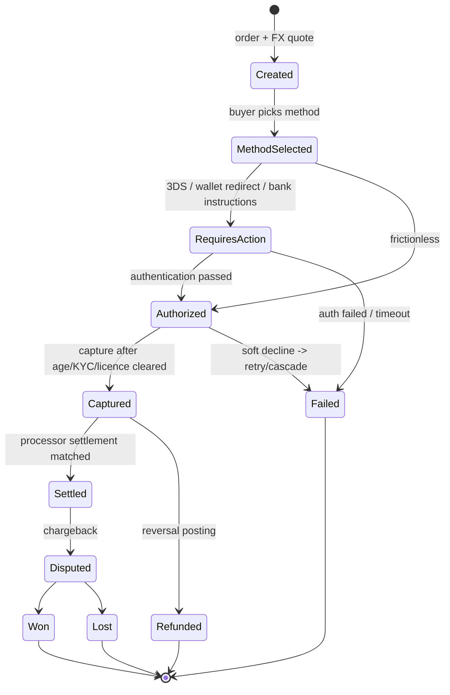
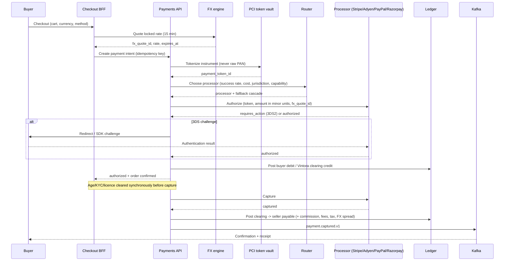
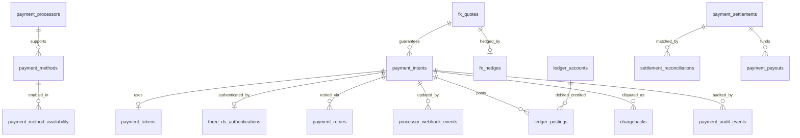
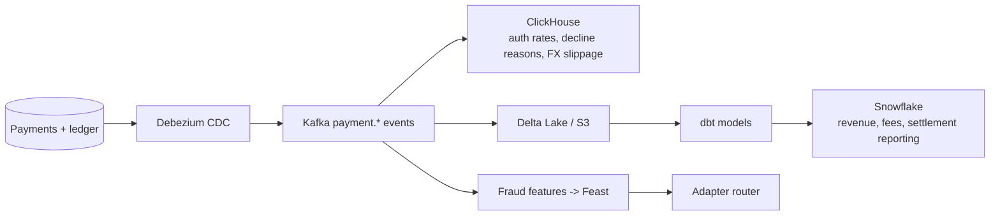

# VINTORA — Global Payments Module

> **Companion documents:** `_canon.md`, `03-technical-architecture.md` (§9 Payments and FX architecture, §14 compliance), `04-database-design.md` (§2.5 payments context, FX table, double-entry ledger), `02-revenue-model.md` (FX, processing fees), `05-ui-ux-wireframes.md` (Screen 6 cart & multi-currency checkout), `15-seller-dashboard-module.md` (payouts), `20-wine-investment-marketplace.md` (USDC settlement), `21-admin-panel-module.md` (payment disputes, refund approvals), `BUILDING.md`.
> This document is the **domain-level design authority for Vintora's Global Payments layer** — the shared payment, FX and ledger orchestration used by all transactional modules. It is internal platform infrastructure, not an eleventh market-facing module. `03-technical-architecture.md` §9 owns the canonical architecture statement; this document specifies the workflows, adapters and security design.

---

## Canon snapshot (binding)

| Dimension | Canonical fact |
|---|---|
| Brand | VINTORA (prose: "Vintora"); *The World's Cellar, Intelligent.* |
| Canonical modules | Vintora Market, Vintora Trade, Vintora Sommelier, Vintora Assist, Vintora Studio, Vintora Seller, Vintora Flow, Vintora Club, Vintora Vault, Vintora Rewards — unchanged. Payments is shared infrastructure serving the transactional modules. |
| Processors | **Stripe + Adyen** in a live **60/40 split**, routed by success rate, cost and jurisdiction. |
| Requested adapters | **Stripe, PayPal, Apple Pay, Google Pay, Razorpay, bank transfers, multi-currency**. Apple/Google Pay are already canonical local methods; **PayPal and Razorpay are additive adapters** to the canonical set (PayPal = global wallet; Razorpay = India/UPI). Canon Stripe+Adyen remain primary. |
| Canon local methods | Alipay, WeChat Pay, iDEAL, Klarna, Pix, UPI, SEPA, Apple Pay, Google Pay. Bank transfers: SEPA / SEPA Instant, ACH & wire, local rails. |
| FX | **Locked rate valid 15 minutes at checkout**, stored with cart/order, hedged with treasury; 135+ currencies; daily `exchange_rates`; no capture at a stale rate. |
| Ledger | Double-entry postings: buyer debit / Vintora clearing credit at authorization; clearing → seller payable at capture; plus commission, processing fee, tax, shipping and FX spread. Refunds are reversing postings, never deletes. |
| Vault | **USDC settlement**; regulated partners run fiat ramps; wallet keys in HSM custody with multi-party approval; fractional minimum $25. |
| Security | PCI DSS L1, tokenization, segmented CDE, quarterly ASV scans, pen tests; SOC 2 Type II; ISO 27001; zero trust, mTLS; AES-256 KMS at rest, TLS 1.3 in transit, HSM for payment tokenization. |
| 3DS / SCA | **3DS2 follows SCA rules and risk score, preferring frictionless**; smart retries use network tokens and issuer cascades. |
| UX reference | Screen 6: locked rate + ISO pair with expiry; duties/taxes itemized; local methods listed; age-at-delivery explicit; error state "Rate expired — refresh to continue". |
| Baseline schema | `payments`, `payment_attempts`, `refunds` in `0001_initial.sql`; richer conceptual `payments` in `04-database-design.md` (`three_ds_version`, `idempotency_key`, `ledger_entries`). |
| Guardrails | No card data in logs; no stale-rate capture; no capture before age/KYC/licence clearance; no autonomous refund above threshold; "offline purchase is not permitted". |

**Non-claims:** all routing splits, success-rate targets, fraud thresholds and SLOs are design specifications. No claim of live processor contracts, actual authorisation rates or real payment volume is made.

---

## 1. Product definition

### 1.1 Capability surface

| # | Capability | Core question | Component | Primary workflow |
|---|---|---|---|---|
| P1 | Method orchestration | Which method can this buyer use here? | Adapter registry + availability engine | WF-01 |
| P2 | Payment execution | Did we authorise and capture exactly once? | Payment intents + router | WF-02, WF-03 |
| P3 | Multi-currency | What is the guaranteed total and rate? | FX quote engine | WF-04 |
| P4 | 3DS / SCA | Is strong authentication satisfied with least friction? | 3DS2 orchestrator | WF-02 |
| P5 | Retries & cascades | Can we recover a soft decline safely? | Retry engine | WF-03 |
| P6 | Ledger & settlement | Did money and records agree? | Double-entry ledger + reconciliation | WF-05, WF-06 |
| P7 | Refunds & disputes | How do we reverse money correctly? | Refund/dispute engine | WF-07 |
| P8 | Seller payouts | When does the seller get paid? | Payout service | WF-08 |
| P9 | Vault settlement | How do USDC trades settle? | USDC adapter + HSM custody | WF-09 |

### 1.2 Non-goals

- Storing raw PAN, CVV or bank credentials in Vintora systems (tokenization only; PCI-scoped vault).
- Acting as a bank or money transmitter without the necessary licences; regulated partners handle fiat ramps and USDC on/off-ramps.
- Setting product prices (Vintora AI Pricing Engine owns recommendations) or product FX margins (Payments/FX engine owns them canonically).
- Overriding age/KYC/licence checks — those remain synchronous in the order state machine (ADR-008).

---

## 2. Payment method & processor matrix

| Method | Adapter / processor | Typical markets | Flow | 3DS / SCA | Refund | Settlement |
|---|---|---|---|---|---|---|
| **Stripe** | Stripe (primary, 60%) | Global | Card, wallets, local methods | 3DS2 / SCA as required | Full/partial | Processor settlement batch |
| **Adyen** | Adyen (primary, 40%) | Global, strong EU | Card, wallets, locals | 3DS2 / SCA as required | Full/partial | Processor settlement batch |
| **PayPal** | PayPal (additive adapter) | Global wallet | Redirect / wallet confirm | Wallet authentication | Full/partial | Processor settlement |
| **Apple Pay** | Via Stripe/Adyen | iOS devices, global | Native wallet token, biometric confirm | Wallet token = strong Customer Authentication | Full/partial | Processor settlement |
| **Google Pay** | Via Stripe/Adyen | Android/web, global | Wallet token, device confirm | Wallet token = SCA | Full/partial | Processor settlement |
| **Razorpay** | Razorpay (additive adapter) | India | UPI, cards, netbanking, wallets | RBI/Razorpay mandates + 3DS for cards | Full/partial | Processor settlement |
| **Bank transfer** | SEPA / SEPA Instant, ACH, wire, local rails | EU, US, global | Async credit with reference | Out-of-band bank authentication | Manual/return | Direct bank settlement |
| Canon locals | Alipay, WeChat Pay, iDEAL, Klarna, Pix, UPI | Regional | Processor capability selected by country/currency/history | Per method rules | Per method | Processor settlement |
| **USDC (Vault)** | Regulated partner + HSM custody | Vault markets | Wallet transfer, multi-party approval | KYC + wallet approval | On-chain reversal via partner | USDC settlement |

**Adapter contract (every adapter implements):**

```text
Adapter {
  id, processor, capabilities[], markets[], currencies[],
  supports_auth_only, supports_capture, supports_partial_refund,
  supports_3ds2, supports_network_tokens, supports_webhooks
}
authorize(intent, token, fx_quote, risk) -> Authorization
capture(authorization_id, amount)        -> Capture
refund(capture_id, amount, reason)       -> Refund
status(processor_reference)              -> Status
verify_webhook(signature, payload)       -> Event
```

No adapter may log or persist raw instrument data. Tokens are created in the PCI-scoped vault and referenced by opaque IDs.

---

## 3. Payment workflow

### 3.1 State machine



### 3.2 End-to-end sequence (card / wallet)



### 3.3 WF-01 Method selection & availability

**Trigger:** checkout opened. **Steps:** resolve jurisdiction (geo → age gate → licence) → list methods whose `markets`, `currencies`, `capabilities` and buyer history match → show only allowed methods with final landed cost → record selection. **Failure:** no eligible method → "No available payment method for this market" with support path. **SLA:** ≤ 200 ms.

### 3.4 WF-02 Authorization & 3DS2

**Trigger:** buyer confirms. **Steps:** idempotency check → validate FX quote still live → tokenize → route → authorize → 3DS2 if required (frictionless preferred, challenge on risk/SCA) → post authorization ledger entries → emit `payment.authorized.v1`. **Failure:** soft decline → WF-03; hard decline → explicit reason + alternative method. **SLA:** authorization p95 < 2 s (canonical payment service 200 ms internal budget).

### 3.5 WF-03 Smart retries & issuer cascade

```text
ON soft decline (insufficient_funds_retryable, issuer_unavailable, timeout):
    IF attempt_no >= max_attempts: STOP -> Failed
    IF delay_elapsed < backoff(attempt_no): SCHEDULE
    IF network_token_available: retry with network token on SAME processor
    ELSE: cascade to next processor in jurisdiction-ranked list
    ALWAYS reuse original idempotency key + fx_quote_id
    NEVER retry a hard decline, a 3DS failure, or after capture
```

Every attempt is recorded in `payment_attempts` and `payment_retries` with processor, result, decline code and latency. Retries never create a second charge because the idempotency key and FX quote are unchanged.

### 3.6 WF-04 FX quote & re-pricing

**Trigger:** cart/currency change or quote expiry. **Steps:** compute landed total from daily `exchange_rates` + treasury margin → create `fx_quotes` with `expires_at = now + 15 min` → cache in Redis with 15-min TTL → display ISO pair, rate and countdown (Screen 6) → hedge with treasury. **On expiry:** UI shows "Rate expired — refresh to continue"; a one-tap refresh creates a new quote; **no capture at a stale rate**. Currency switch recalculates the entire summary. DCC (dynamic currency conversion at the processor) is disabled — Vintora shows one guaranteed total.

### 3.7 WF-05 Capture & ledger posting

Capture occurs only after age/KYC/licence clearance. Postings (double-entry, balanced):

```text
AUTHORIZATION:  Dr Buyer Receivable        Cr Vintora Clearing
CAPTURE:        Dr Vintora Clearing        Cr Seller Payable
                Dr Seller Payable          Cr Commission Revenue (12–20%; 8–12% premium)
                Dr Seller Payable          Cr Processing Fee Recovery (0.5–2% seller)
                Dr Seller Payable          Cr Tax Payable / Shipping Clearing
FX:             Dr/Cr FX Spread Revenue    (locked-rate difference vs treasury hedge)
REFUND:         reversing postings, never deletes
```

### 3.8 WF-06 Settlement & reconciliation

Processor settlement batches land in `payment_settlements`; daily jobs match expected vs actual by processor, currency and date into `settlement_reconciliations`. Any break pages Payments via `admin.payment.dispute.opened.v1`-style alert and is visible in ADM-06; zero unexplained variance is the target. Payouts to sellers follow `0003` payout schedules with holds controlled by Admin (T3 approval).

### 3.9 WF-07 Refunds & chargebacks

Full/partial refunds create a `refunds` row and reversing ledger postings; above-threshold refunds require Admin T3 approval (document 21). Chargebacks open `chargebacks` with due date, evidence and representment status; automated alerts drive the dispute queue. No refund is executed by direct DB mutation.

### 3.10 WF-08 Seller payouts

Scheduled from settled captures minus commission, processing, tax, holds and refunds; executed via bank transfer/processor payout; each payout records a reference and ledger posting. Suspended sellers place an automatic payout hold (Admin WF-03).

### 3.11 WF-09 Vault USDC settlement

Lot purchases and secondary trades settle in USDC through regulated partners; wallet keys in HSM custody with multi-party approval; on/off-ramp events post to the same ledger with `settlement_asset = 'USDC'`; custody events reference the settlement. No Vintora-held omnibus fiat wallet.

---

## 4. Security design

### 4.1 Control layers

| Layer | Controls |
|---|---|
| Cardholder data | Tokenization in PCI-scoped vault; **no raw PAN/CVV in Vintora systems or logs**; segmented CDE; quarterly ASV scans; annual pen tests; PCI DSS L1. |
| Transport & identity | TLS 1.3, Istio mTLS, SPIFFE workload IDs; processor webhooks verified by signature + timestamp tolerance; replay window enforced. |
| Authentication | 3DS2/SCA frictionless preferred, challenge by risk; Apple/Google Pay wallet tokens count as strong authentication; biometrics for high-value mobile confirmation. |
| Secrets & keys | Managed secret store, envelope encryption, 90-day rotation and immediate on exposure; AES-256 KMS at rest; **HSM** for payment tokenization and Vault wallet keys; multi-party approval. |
| Fraud & abuse | Velocity limits, device fingerprint, issuer cascades, anomaly models; self-trade/ Wash-trade controls in Vault; manual review for high-risk. |
| Compliance gates | Age/KYC/licence synchronous before capture (ADR-008); KYC/AML for bank transfers and Vault; sanctions screening; responsible-drinking rules at checkout. |
| Least privilege | Admin actions JIT + MFA + dual approval for refund/payout/dispute; no direct ledger writes; append-only audit. |
| Logging | JSON logs with `trace_id`, `tenant_id`, pseudonymous `user_id`, `module`; payment spans sampled 100%; **no instrument data**; 30d hot / 1y cold. |

### 4.2 Threat model

| Threat | Mitigation |
|---|---|
| Card data leakage | Tokenization, CDE segmentation, log redaction, DLP scans |
| Replay / duplicate charge | Idempotency keys on intent + adapter calls, webhook event inbox, FX quote binding |
| Man-in-the-middle | TLS 1.3 + mTLS + HSTS; signed webhooks with timestamp tolerance |
| Stale-rate capture | 15-min quote expiry enforced server-side before authorize and capture |
| Account takeover | 3DS2, device signals, velocity checks, step-up MFA |
| Processor impersonation | Allow-listed endpoints, certificate pinning where supported, signature verification |
| Insider refund fraud | T3 dual approval, append-only action log, reconciliation |
| Chargeback abuse | Evidence capture at authorization, dispute workflow, fraud scoring |
| Crypto custody loss (Vault) | HSM multi-party approval, regulated on/off-ramp partners, no omnibus fiat wallet |

### 4.3 Idempotency guarantees

1. Client generates `idempotency_key` at cart → intent creation; reused across retries and webhooks.
2. `payment_intents` and baseline `payments` enforce uniqueness on `(tenant_id, idempotency_key)`.
3. Webhook events are deduped in `processor_webhook_events` by `(processor, event_id)`.
4. FX quote ID is bound to the intent; a new quote requires a new intent.
5. Ledger postings carry `idempotency_key` and reject duplicates.

---

## 5. Database architecture

### 5.1 Baseline vs new tables

| Domain | Baseline (`0001` / `04`) | Added by this module |
|---|---|---|
| Payment core | `payments`, `payment_attempts`, `refunds` | `payment_intents`, `payment_tokens`, `payment_retries`, `three_ds_authentications` |
| Adapters | — | `payment_processors`, `payment_methods`, `payment_method_availability`, `processor_webhook_events` |
| FX | conceptual `exchange_rates` | `fx_quotes`, `fx_hedges` |
| Ledger | conceptual double-entry | `ledger_accounts`, `ledger_postings` |
| Money movement | — | `payment_settlements`, `settlement_reconciliations`, `chargebacks`, `payment_payouts` |
| Audit | `audit_logs` | `payment_audit_events` |

### 5.2 ER diagram



### 5.3 Indexing & distribution

| Query | Index |
|---|---|
| Idempotent intent lookup | `(tenant_id, idempotency_key)` unique |
| Webhook dedupe | `(processor, event_id)` unique |
| Active FX quote | `(tenant_id, fx_quote_id, expires_at)` |
| Attempt history | `(tenant_id, payment_intent_id, attempt_no)` |
| Ledger account balance | `(tenant_id, account_id, posted_at DESC)` |
| Settlement match | `(tenant_id, processor, settlement_date)` |
| Dispute queue | `(tenant_id, status, due_at)` |

Citus: distribute `payment_intents`, `ledger_postings`, `payment_settlements`, `chargebacks`, `payment_payouts` on `tenant_id`; `payment_processors`, `payment_methods`, `ledger_accounts`, `fx_quotes` as reference tables where safe. RLS: `tenant_id = current_setting('app.tenant_id')::uuid`; PCI-scoped vault is a separate service/store, never in this OLTP schema.

### 5.4 Analytical pipeline



---

## 6. API contracts (BFF GraphQL, abridged)

```graphql
type FxQuote { id: ID!, base: String!, quote: String!, rate: Decimal!,
  expiresAt: DateTime!, lockedTotal: Money! }
type PaymentMethod { code: String!, label: String!, processor: String!,
  markets: [String!]!, currencies: [String!]!, iconToken: String! }
type PaymentIntent { id: ID!, status: PaymentStatus!, amount: Money!,
  fxQuote: FxQuote!, method: PaymentMethod!, nextAction: NextAction }
type LedgerPosting { id: ID!, account: String!, direction: String!,
  amountMinor: BigInt!, currency: String!, reference: String! }

type Query {
  availableMethods(cartId: ID!, market: String!): [PaymentMethod!]!
  fxQuote(cartId: ID!, currency: String!): FxQuote!
  paymentIntent(id: ID!): PaymentIntent!
  paymentLedger(paymentId: ID!): [LedgerPosting!]!
}

type Mutation {
  createPaymentIntent(cartId: ID!, methodCode: String!, idempotencyKey: String!): PaymentIntent!
  confirmPayment(id: ID!, token: String!): PaymentIntent!
  refreshFxQuote(cartId: ID!, currency: String!): FxQuote!
  capturePayment(id: ID!): PaymentIntent!
  refundPayment(id: ID!, amount: Money!, reason: String!): Refund!
}
```

**REST parity:** `/v1/payments/*`, `/v1/fx/*`, `/v1/ledger/*` with `x-idempotency-key`, `x-tenant-id`, `x-trace-id`; webhook endpoints `/v1/webhooks/{processor}` are signature-verified.

---

## 7. Event contracts

| Topic | Producer | Consumers | Payload essence |
|---|---|---|---|
| `payment.method.selected.v1` | Checkout | Router, Analytics | `method, processor, market, currency` |
| `payment.fx.quoted.v1` | FX engine | Checkout, Treasury, Ledger | `fx_quote_id, pair, rate, expires_at` |
| `payment.fx.expired.v1` | FX engine | Checkout, Analytics | `fx_quote_id, expired_at` |
| `payment.authorized.v1` | Payments | Orders, Ledger, Fraud | `intent_id, amount_minor, processor, risk` |
| `payment.captured.v1` | Payments | Orders, Ledger, Fulfilment, Rewards | `intent_id, capture_id, amount_minor` |
| `payment.failed.v1` | Payments | Checkout, Analytics | `intent_id, decline_code, retryable` |
| `payment.retry.scheduled.v1` | Retry engine | Router, Analytics | `intent_id, attempt, processor` |
| `payment.3ds.challenged.v1` | 3DS | Checkout, Analytics | `intent_id, version, result` |
| `payment.settled.v1` | Reconciliation | Finance, Seller payouts | `settlement_id, processor, date` |
| `payment.refunded.v1` | Refunds | Ledger, Orders, Admin | `refund_id, amount_minor, reason` |
| `payment.chargeback.opened.v1` | Disputes | Admin, Finance, Fraud | `chargeback_id, amount_minor, due_at` |
| `payment.payout.paid.v1` | Payouts | Seller, Finance | `payout_id, seller_id, amount_minor` |
| `payment.vault.settled.v1` | Vault adapter | Vault, Ledger, Custody | `trade_id, settlement_ref, asset=USDC` |
| `payment.audit.v1` | all | SIEM, audit sink | `actor, entity, from, to, trace_id` |

---

## 8. Observability & SLOs

| Metric | Target |
|---|---|
| Payment API p95 | < 200 ms internal (canonical service budget) |
| Authorization p95 | < 2 s end-to-end |
| Checkout page p95 | < 300 ms |
| Payment success rate | Tracked by processor/method/market; routing optimises it (no fabricated target) |
| Duplicate charges | Zero |
| Stale-rate captures | Zero |
| Settlement reconciliation | 100% daily; zero unexplained variance |
| Webhook processing lag | ≤ 30 s p95 |
| Chargeback response | Before processor due date, 100% |
| PCI controls | Quarterly ASV clean; annual pen test passed |

**Dashboards:** success/decline by processor & method, 3DS frictionless vs challenge, retry/cascade effectiveness, FX quote expiry rate, settlement breaks, chargeback ageing, payout status, fraud flags, cost per payment.

---

## 9. Compliance

- **PCI DSS L1** — tokenization, segmented CDE, ASV scans, pen tests, no card data in logs.
- **SCA / PSD2** — 3DS2 frictionless by default, challenge by risk and jurisdiction.
- **Regional** — RBI/Razorpay for India; SEPA/SEPA Instant and iDEAL for EU; UPI/Pix local rails; per-market licensing (geo gate); sanctions/KYC/AML for bank transfers and Vault.
- **Privacy** — GDPR/CCPA/LGPD/PIPL; pseudonymous IDs in logs; crypto-shredding for erasure; data residency per region.
- **Alcohol governance** — age/KYC/licence clearance before capture; responsible-drinking disclosure at checkout; no purchase without verified age.
- **Financial controls** — dual approval for refunds above threshold and payouts; append-only ledger; no manual ledger edits.

---

## 10. Rollout plan

| Phase | Window | Deliverables | Exit criteria |
|---|---|---|---|
| Foundation | 2027 | Stripe/Adyen primary, FX quotes, ledger, Apple/Google Pay, bank transfers (SEPA/ACH) | Idempotency and reconciliation green; PCI scope validated |
| Expansion | 2028 | PayPal, canon local methods (Alipay, WeChat Pay, iDEAL, Klarna, Pix, UPI), 135 currencies | Method coverage by market; success-rate routing live |
| Regional | 2029 | Razorpay/UPI India, local bank rails, Vault USDC settlement | KYC/AML green; HSM custody validated |
| Scale | 2030–2034 | Full adapter matrix, advanced fraud/cascades, 200+ markets | All SLOs green; zero unexplained settlement breaks |

---

## 11. Prototype-to-production mapping

| Prototype element | Production destination |
|---|---|
| Multi-currency cart summary with locked rate | `fx_quotes` + FX engine (15-min lock) |
| "🔒 Locked FX rate" notice | Screen 6 disclosure with ISO pair + countdown |
| "SEPA / ACH / local methods / USDC" method tiles | `payment_methods` + `payment_method_availability` |
| Demo FX conversion in `money()` | Payments-owned FX engine (pricing never sets rates) |
| Checkout button + order confirmation | `createPaymentIntent` → authorize → capture → `payment.captured.v1` |
| No real payment in prototype | Real adapters behind tokenization + PCI-scoped vault |

**Prototype fix applied:** demo copy previously said 30 minutes for the locked rate; canon is **15 minutes**. The three i18n strings were corrected accordingly.

---

## 12. Risks and open decisions

| Risk | Mitigation |
|---|---|
| Processor concentration | 60/40 Stripe/Adyen split + fallback cascade + additive regional adapters |
| PCI scope creep | Tokenization, CDE segmentation, no raw data in app tier |
| FX loss on expiry/volatility | 15-min lock, treasury hedge, explicit re-pricing, no stale capture |
| Duplicate charge | Idempotency at intent/adapter/webhook/ledger layers |
| Chargeback cost | Fraud scoring, evidence capture, timely representment |
| Regulatory fragmentation | Geo/licence gate, regional adapters, per-market legal review |
| Settlement break | Daily reconciliation, paging, append-only ledger |

**Open decisions:**

1. Whether PayPal/Razorpay are direct contracts or via Stripe/Adyen connectivity in each market.
2. Final 60/40 routing split policy and rebalance frequency (canon baseline: 60/40).
3. Refund/payout approval thresholds by jurisdiction.
4. Which markets get SEPA Instant vs ACH/wire vs local rails at launch.
5. Treasury hedge instrument and margin policy for the 135-currency table.
6. Whether USDC settlement is available to all investor tiers or gated by KYC level.
7. DCC policy confirmation (design assumes disabled in favour of one guaranteed total).

---

## 13. Summary

Vintora's Global Payments layer is specified as a **single orchestrating Payments API with a processor-adapter registry and a double-entry ledger**. It supports the requested methods — Stripe, PayPal, Apple Pay, Google Pay, Razorpay, bank transfers and multi-currency — while preserving canon: Stripe + Adyen remain primary in a 60/40 split, Apple/Google Pay are canonical wallet methods, and PayPal/Razorpay are additive regional adapters. The workflow covers method availability, tokenized authorization with 3DS2/SCA, smart retries and issuer cascades, a **15-minute locked FX quote** with treasury hedging and explicit re-pricing, capture only after age/KYC/licence clearance, double-entry postings with commission/processing/tax/FX spread, daily settlement reconciliation, refunds/chargebacks, seller payouts and USDC Vault settlement through regulated HSM-backed custody. Security design enforces PCI DSS L1 tokenization and CDE segmentation, no raw card data in logs, mTLS and signed webhooks, HSM key custody, idempotency at four layers, and dual approval for refunds/payouts. The schema adds **18 tables** to the `0001` payments baseline, tenant-scoped with RLS and CDC into ClickHouse/Snowflake. All splits, thresholds and SLOs are design targets; no live processor contract, authorisation rate or payment volume is claimed.
