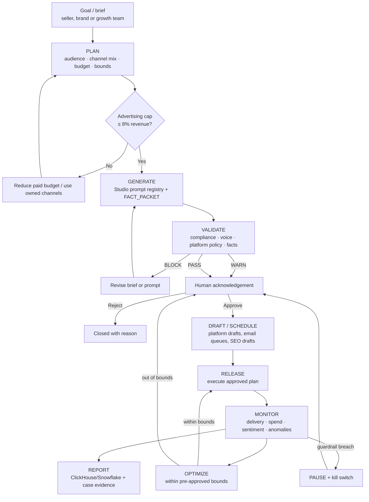
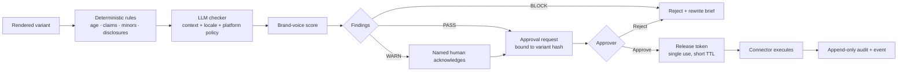
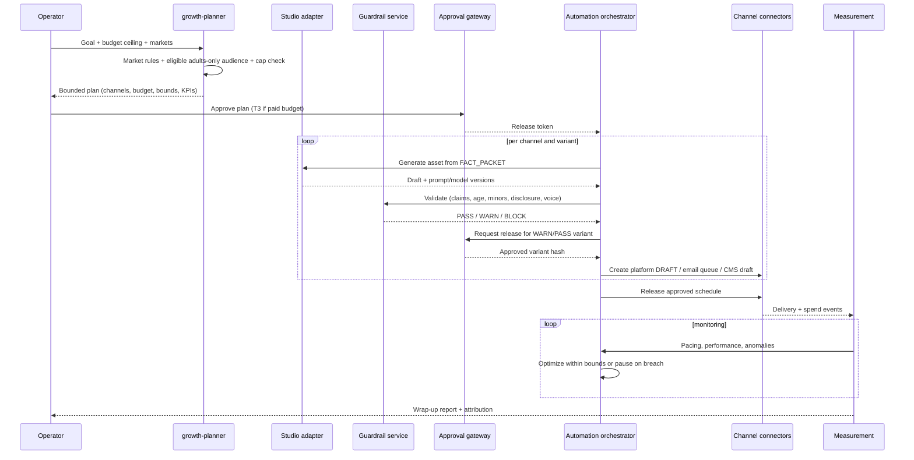
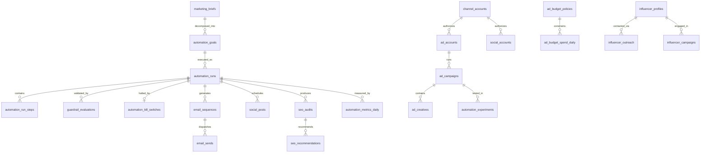
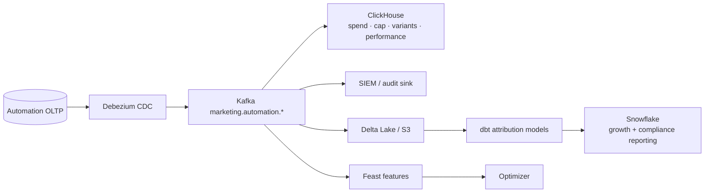

# VINTORA — AI Marketing Automation Module

> **Companion documents:** `_canon.md`, `06-ai-features.md` (§10 generative marketing), `14-ai-content-generator-module.md` (Vintora Studio — content authority, compliance ruleset, prompt library), `02-revenue-model.md` (advertising cap), `07-marketing-strategy.md`, `09-growth-strategy.md`, `15-seller-dashboard-module.md`, `18-loyalty-rewards-module.md` (audience segments), `21-admin-panel-module.md` (campaign review, approvals, AI controls), `BUILDING.md`.
> This document is the **domain-level design authority for Vintora's AI Marketing Automation layer** — the execution and optimization engine that operates *on top of* Vintora Studio. It automates the marketing lifecycle end to end **inside the canonical guardrail envelope**: the machine generates, validates, plans, schedules, drafts, monitors and optimizes; a **named human releases** anything that is published, sent or spent. It is shared platform capability, **not an eleventh market-facing module**.

---

## Canon snapshot (binding)

| Dimension | Canonical fact |
|---|---|
| Brand | VINTORA (prose: "Vintora"); *The World's Cellar, Intelligent.* |
| Canonical modules | Vintora Market, Vintora Trade, Vintora Sommelier, Vintora Assist, Vintora Studio, Vintora Seller, Vintora Flow, Vintora Club, Vintora Vault, Vintora Rewards — unchanged. |
| Module in scope | **Vintora Studio** owns generation and the compliance gate (doc 14). This document owns **automation orchestration, execution, optimization and measurement** for the growth engine. |
| Mission fit | Democratize discovery, trade and enjoyment of fine wine and spirits worldwide through applied AI — protecting provenance, safety and responsible consumption. |
| Guardrails | No health or intoxication claims; age gating per region (US 21+, UK/EU/SG 18+); minors never targeted; imagery reviewed; **no autonomous publishing, ad spend or email send**; human approval before publish. |
| Spend cap | **Advertising ≤ 8% of revenue by design.** Y5 revenue mix includes **Ads/data/API 3%** (projection). The engine enforces the cap as a hard runtime control, not a reporting note. |
| Studio tiers | Creator `$199` / Brand `$599` / Enterprise `$2,999` per month + usage credits; feature gating as in doc 14. Automation capabilities are gated by the same tiers. |
| Compliance engine | Versioned, effective-dated rules returning `{PASS, WARN, BLOCK}` with findings and required actions; `BLOCK` requires brief change, `WARN` requires human acknowledgement (doc 14 §3). |
| Human release | Studio "**never spends budget or submits campaigns to ad platforms automatically**; it produces drafts for a human to upload" (doc 14 §5.7). Automation may create platform *drafts* and execute a **human-approved plan**; it may never self-approve a release. |
| AI governance | Model cards/owners/SLOs, offline eval gates, canary + rollback, quarterly red teaming, fairness audits, **kill switch < 1 min** (docs 06, 21). |
| Observability | OpenTelemetry traces, JSON logs with `trace_id`, `tenant_id`, pseudonymous `user_id`, `module`, `run_id`; Kafka → ClickHouse/SIEM/Snowflake. |
| Baseline schema | `marketing_campaigns`, `campaign_metrics` in `04-database-design.md`; `marketing_campaigns` in `0001_initial.sql`; `admin_approvals`, `admin_campaign_reviews` in `0009_admin_panel.sql`. |
| Prototype | `viewStudio()` / `generateStudio()` produce a deterministic, compliance-checked campaign preview; no real publishing or spend. No prototype change is required by this document. |

**Non-claims:** all success-rate, CTR, conversion, spend and timeline figures in this document are illustrative design targets. No claim of real campaign performance, live ad spend, brand partnerships, influencer contracts or measured uplift is made.

**Enforced prototype control plane:** [`MARKETING_RELEASE_CONTROLS.md`](./MARKETING_RELEASE_CONTROLS.md) and `npm run marketing:check` constrain the design above to advisory drafts. The shared evaluator denies restricted geographies/audiences, prohibited claims, missing provenance, alcohol-validation failures, budget increases and releases; only simulated pause/rollback state is recorded in the append-only audit. No live ad platform, budget API, email sender or automatic publishing exists.

---

## 1. Product definition

### 1.1 What the growth engine does

Vintora Studio answers *"what should we say?"*. AI Marketing Automation answers *"what should we do, where, when, for whom, with which variant, and how do we improve it — within the rules?"*. It takes a seller/brand goal ("launch this Rioja to UK members in September") and produces a bounded, reviewable plan, generates every asset through Studio, validates it, routes it for human release, executes the approved plan across channels, and continuously optimizes inside pre-approved limits.

### 1.2 Capability surface

| # | Requested automation | Engine capability | Studio dependency | Workflow |
|---|---|---|---|---|
| A1 | **Generate ads** | Variant generation, headline/description matrix, platform-specific drafts, sponsored-listing creatives | `studio.ad.*`, FACT_PACKET, voice + compliance | WF-04 |
| A2 | **Run campaigns** | Goal → channel mix → budget allocation → schedule → execution → pacing → optimization → wrap-up; automatic pause on breach | All content types | WF-03 |
| A3 | **Create emails** | Lifecycle sequences, subject/preheader variants, send-time optimization, consent + suppression enforcement, deliverability checks | `studio.email.*` | WF-05 |
| A4 | **Post social content** | Platform-native posts, carousels, captions, scheduling, comment/moderation routing, disclosure enforcement | `studio.social.*` | WF-06 |
| A5 | **Optimize SEO** | Keyword clustering, metadata + schema.org generation, content-gap detection, technical recommendations, on-page update drafts | `studio.seo.*` | WF-07 |
| A6 | **Influencer outreach** | Creator discovery, fit/brand-safety scoring, audience-age checks, personalized outreach drafts, disclosure + contract tracking | `studio.email.*` + fact packets | WF-08 |

### 1.3 Automation envelope (canon reconciliation)

The word "automatically" is interpreted **within** the canonical Studio guardrails (doc 14 §§1.4, 5.7), not as permission for unsupervised publishing. The engine automates everything **up to release**, and executes everything **inside an approved plan**:

```text
AUTOMATED BY MACHINE              ALWAYS BY A NAMED HUMAN
─────────────────────              ──────────────────────
brief parsing                     approve a plan / asset / policy
audience selection (eligible)     approve first release
fact compilation                  acknowledge WARN findings
variant generation                approve budget allocation
brand-voice scoring               approve influencer contracts
compliance validation             approve out-of-bounds changes
channel + send-time planning
platform DRAFT creation
scheduling
delivery of an approved plan
pacing / bid optimization in bounds
monitoring / anomaly pause
optimization recommendations
```

**Result:** "runs campaigns" and "posts social content" mean the engine **executes a human-approved plan automatically**; it does not mean the engine authorizes its own publications. No automation level permits self-approval, and the engine never moves money outside the approved budget envelope or performs identity/age checks itself.

### 1.4 Automation levels

| Level | Name | Machine does | Human does | Status |
|---|---|---|---|---|
| L0 | Assisted | Suggests drafts | Reviews, edits, publishes, spends | Baseline |
| L1 | Generated | Generates + validates + drafts | Reviews each item and releases it | Studio today |
| **L2** | **Approved-plan execution** | Executes an approved plan end to end, re-validates every item deterministically, optimizes within bounds, pauses on breach | Approves the plan, budget and bounds; handles escalations | **Default target for this module** |
| L3 | Delegated standing authorization | Executes a standing policy without per-item release | Approves the policy; receives full audit | **Proposal only — requires canon amendment + legal review; not assumed here** |

### 1.5 Design principles

| # | Principle | Implementation |
|---|---|---|
| G1 | **Facts first** | Every asset is generated from a versioned `FACT_PACKET`; no invented awards, scores or provenance. |
| G2 | **Compliance is a gate** | Deterministic rules + LLM checker re-run at generation, at approval and at release. |
| G3 | **Human release** | Nothing reaches an audience without an approval record referencing the exact rendered variant. |
| G4 | **Bounded autonomy** | Each approved plan declares allowed channels, markets, budget, audience, variants and optimization bounds. |
| G5 | **Hard spend cap** | Advertising ≤ 8% of trailing revenue is enforced at budget allocation *and* at execution. |
| G6 | **Reversible by default** | Drafts, scheduled posts and campaigns can be paused/rolled back; kill switch < 1 min. |
| G7 | **Full attribution** | Each run, variant, approval, send, post and spend event carries `run_id` + `trace_id`. |
| G8 | **Market-local, not translated** | Age thresholds, units, idioms, platform policies and disclosures are resolved per market. |

### 1.6 Non-goals

- Autonomous publishing, ad spend, email send or social posting without human release.
- Health, wellness, intoxication, performance or minor-targeting content.
- Fabricated endorsements, influencer audiences, awards or engagement.
- Bypassing age/KYC/licence checks (ADR-008) or the ≤ 8% advertising cap.
- Replacing legal review in restricted markets, or acting as an ad network / agency of record.

---

## 2. Master architecture

### 2.1 Control loop



### 2.2 Service decomposition

| Service | Responsibility | Reuses |
|---|---|---|
| `growth-planner` | Turns a goal into a bounded plan: audience, channel mix, budget, schedule, KPIs | Rewards segments, taste profiles, `marketing_campaigns` |
| `automation-orchestrator` | Durable state machine for runs/steps; retries, compensation, kill switch | Kafka, temporal-style workflow engine |
| `studio-adapter` | Calls Studio generation with FACT_PACKET, voice profile and prompt versions | doc 14 services |
| `guardrail-service` | Deterministic rules + LLM checker, platform policy, disclosure and cap checks | doc 14 compliance ruleset |
| `approval-gateway` | Creates approvals, enforces requester ≠ approver, binds approval to a rendered hash | `admin_approvals` (doc 21) |
| `channel-connectors` | Ad platforms, ESP, social networks, CMS, influencer tooling — **draft-first** | Signed webhooks, token vault |
| `optimizer` | Bandit/contextual models for variant, send-time and bid decisions within bounds | Feast features, MLflow registry |
| `measurement` | Attribution, experiments, spend accounting, cap accounting | `campaign_metrics`, ClickHouse |

### 2.3 Model governance

- Every model (planner,voice scorer,optimizer,compliance checker,image/video) has a **model card, named owner, SLO, eval gate and version** in the MLflow registry.
- Cheap classification tasks route to self-hosted models; frontier models are used for long-form generation only (doc 14 §6.2).
- Offline eval gates + canary rollout; automatic rollback on regression; quarterly red teaming and fairness audits by market/language.
- **No model may write directly to a publishing, spend or identity system** — all writes pass through the approval gateway and guardrail service.

---

## 3. Specified automation flows

### 3.1 WF-01 Goal intake & plan generation

A seller/brand or growth operator submits a brief: objective, product/lot SKUs, markets, audience, window, channel preferences, budget ceiling and constraints. The planner resolves market rules (age gate, restricted categories, platform policies), selects eligible audiences from Rewards/taste segments **with adults-only filters**, proposes channel mix, allocates a budget, and declares optimization bounds. The output is an `automation_goals` + `automation_runs` record that is itself the approval artifact. **No asset is generated before the goal is validated against the cap and market rules.**

### 3.2 WF-02 Guardrail & release flow



Each approval binds to the **SHA-256 hash of the rendered variant plus its prompt/model versions**; if the variant changes, the approval is invalidated. Approval records live in `admin_approvals` (doc 21) and are mirrored in `guardrail_evaluations` for evidence.

### 3.3 WF-03 Campaign automation ("run campaigns")



Campaign states: `draft → planned → approved → scheduled → live → optimizing → paused → completed | cancelled`. Pausing is always available and never requires approval; resuming a paused campaign after a guardrail breach does.

### 3.4 WF-04 Ad generation & paid optimization

1. **Generate** 3–15 headlines, descriptions and CTAs per ad group via `studio.ad.*`, plus image/video variants where the tier allows.
2. **Validate** character limits, sponsored labelling, age gate, prohibited claims, price/tax disclosure where required, and platform alcohol policy.
3. **Budget** is allocated from the approved plan, checked against the ≤ 8% trailing-revenue cap at allocation *and* before each daily spend increment.
4. **Draft** is created on the ad platform by connector; no campaign is submitted or funded without human release.
5. **Optimize** bids, variant weighting and pacing within pre-approved bounds; eliminate underperformers, shift to winners, respect frequency caps and geo exclusions.
6. **Breach** of cap, age-gate or platform policy → immediate pause, case in ADM-07/ADM-09, and human review. Sponsored listings are labelled and never presented as organic results.

### 3.5 WF-05 Email automation

1. Select recipients from consented, **age-verified adult** segments; apply suppression, unsubscribe, frequency cap and jurisdiction rules before rendering.
2. Generate subject/preheader/body/CTA variants via `studio.email.*`; insert mandatory responsible-drinking footer where alcohol is referenced.
3. Validate links, disclose sponsored content, check deliverability (SPF/DKIM/DMARC alignment, spam-word score), and simulate across clients.
4. Human releases the sequence; after release the engine executes sends, optimizes send time per recipient with a contextual bandit, and holds back any send whose recipient state changed (consent withdrawn, age unverified).
5. Bounce/complaint spikes or a compliance finding trigger an automatic send pause and case.

### 3.6 WF-06 Social posting

1. Generate platform-native variants (Instagram, X, LinkedIn, TikTok, Facebook) via `studio.social.*`; respect character limits, aspect ratios, caption and hashtag conventions.
2. Enforce age-restricted account settings where supported, **no minor targeting**, `#ad`/sponsored disclosure for paid or incentivized content, and image appropriateness review.
3. Human approves the exact rendered post; connector creates a scheduled draft, then publishes **only at the approved time**.
4. Monitor comments with a moderation classifier; route potential health claims, minor signals, abuse or legal risk to a human queue. The engine never auto-replies on sensitive topics.
5. Platform policy change or negative-sentiment spike → pause scheduled posts and escalate.

### 3.7 WF-07 SEO optimization

1. Crawl Market/Seller catalogue and brand editorial; cluster keywords and detect gaps using search-console-style data where licensed.
2. Generate meta titles/descriptions, `schema.org` structured data (`Product`, `Offer`, `Review` only where genuine), image alt text and landing copy via `studio.seo.*`.
3. Validate: **facts only** (no fabricated awards/scores/provenance), canonical URLs, no cloaking or doorway pages, no keyword stuffing, age-appropriate landings, and local-language quality review.
4. Human approves a batch of on-page changes; the engine submits **drafts** to the CMS and releases on approval, then tracks indexation, rankings and traffic.
5. Ranking/traffic regressions or a manual-action signal roll back the batch and open a case.

### 3.8 WF-08 Influencer outreach

1. **Discover** creators from licensed/compliant sources; score fit by audience age distribution, market, brand safety, engagement authenticity and past disclosure behaviour.
2. **Screen** for minors, fake engagement, prohibited-content history and Restricted-market exposure; hard-block any creator failing age or brand-safety rules.
3. **Generate** personalized outreach via `studio.email.*` using public, factual creator information only; no invented flattery or fabricated audience metrics.
4. **Contract & disclosure**: human approves every term; require `#ad`/sponsored disclosure per market (FTC/ASA equivalents), usage rights and responsible-drinking language. No contract is signed by the engine.
5. **Track** deliverables, approvals of creator content, disclosure compliance and payment against the approved budget; payouts execute through Global Payments (doc 22) with Admin dual approval (doc 21).

### 3.9 WF-09 Measurement, optimization & reporting

Attribution joins delivery/spend events to orders and GMV using campaign IDs and locked FX rates from Global Payments. Experiments are versioned and pre-registered; optimistic results are labelled **directional** until significance and guardrail checks pass. Reports are labelled "projected/illustrative" when they extrapolate beyond observed data — consistent with the canon's projection-only discipline.

---

## 4. Guardrails & compliance

| Guardrail | Runtime enforcement | Failure action |
|---|---|---|
| No health/intoxication/performance claims | Deterministic lexicon + LLM checker on every variant | BLOCK |
| Age gate per market | Rules table (US 21+, UK/EU/SG 18+, restricted = hard block) | BLOCK |
| Minors never targeted | Audience filter + audience-age check for influencers + creative classifier | BLOCK |
| Human approval before publish | Approval gateway with variant hash + requester ≠ approver | Release token denied |
| Advertising ≤ 8% of revenue | Allocation check + per-increment spend check | Pause campaign |
| Sponsored/ad labelling | Connector pre-flight + compliance rule | BLOCK |
| Imagery appropriateness | Image classifier + human review | BLOCK |
| Consent / unsubscribe / suppression | Pre-send eligibility service | Skip send |
| No fabricated claims | FACT_PACKET allow-list + source check | Strip or BLOCK |
| Kill switch < 1 min | Orchestrator halt + connector revocation | All runs paused |
| Auditability | Append-only action log + evidence manifest | Case + SIEM |

**Privacy:** GDPR/CCPA/LGPD/PIPL; pseudonymous IDs in logs; audience segments referenced by ID, never copied into the automation store; crypto-shredding and erasure respected through the Identity pipeline. **Responsible drinking:** mandatory footer, no linking to excess, age-gated landings, market-specific legal copy supplied by legal — never invented by the model (doc 14 §3.3).

---

## 5. Database architecture

### 5.1 Baseline vs new tables

| Area | Existing | Added by this module |
|---|---|---|
| Campaign core | `marketing_campaigns`, `campaign_metrics` | extended with automation provenance + cap fields |
| Planning | — | `marketing_briefs`, `automation_goals`, `automation_runs`, `automation_run_steps` |
| Connectivity | — | `channel_accounts`, `ad_accounts`, `social_accounts` |
| Ads | — | `ad_campaigns`, `ad_creatives`, `ad_budget_policies`, `ad_budget_spend_daily` |
| Email | — | `email_sequences`, `email_sends` |
| Social | — | `social_posts` |
| SEO | — | `seo_audits`, `seo_recommendations` |
| Influencers | — | `influencer_profiles`, `influencer_campaigns`, `influencer_outreach` |
| Governance | `admin_approvals`, `admin_campaign_reviews` | `guardrail_evaluations`, `automation_experiments`, `automation_metrics_daily`, `automation_kill_switches` |

### 5.2 ER diagram



### 5.3 Indexing & distribution

| Query | Index |
|---|---|
| Active runs | `(tenant_id, status, started_at DESC)` partial `status<>'completed'` |
| Step execution log | `(tenant_id, run_id, step_no)` |
| Guardrail evidence | `(tenant_id, run_id, stage, decided_at DESC)` |
| Approval lookup | `(tenant_id, approval_id)` |
| Budget cap accounting | `(tenant_id, budget_policy_id, spend_date)` |
| Email eligibility/sends | `(tenant_id, sequence_id, scheduled_at)` |
| Social schedule | `(tenant_id, status, scheduled_at)` |
| SEO batch | `(tenant_id, audit_id, priority)` |
| Influencer screening | `(tenant_id, status, fit_score DESC)` |

Citus: distribute `automation_runs`, `automation_run_steps`, `guardrail_evaluations`, `email_sends`, `social_posts`, `ad_budget_spend_daily`, `automation_metrics_daily` on `tenant_id`; keep policy/config tables as replicated reference tables with tenant scoping in RLS. RLS: `tenant_id = current_setting('app.tenant_id')::uuid` on every table; no `BYPASSRLS` grants.

### 5.4 Analytical pipeline



---

## 6. API contracts (BFF GraphQL, abridged)

```graphql
type AutomationGoal { id: ID!, objective: String!, markets: [String!]!,
  budgetCeilingMinor: BigInt!, channels: [String!]!, bounds: JSON!,
  status: GoalStatus!, approvalId: ID }
type AutomationRun { id: ID!, goalId: ID!, status: RunStatus!,
  steps: [AutomationStep!]!, killSwitch: Boolean!, startedAt: DateTime }
type GuardrailResult { status: GuardrailStatus!, findings: [Finding!]!,
  variantHash: String!, approvalId: ID }
type ChannelDraft { id: ID!, channel: String!, platformRef: String!,
  status: DraftStatus!, releasedAt: DateTime }

type Query {
  automationGoals(sellerId: ID, status: GoalStatus): [AutomationGoal!]!
  automationRun(id: ID!): AutomationRun!
  guardrailEvidence(runId: ID!): [GuardrailResult!]!
  adSpendCap(): SpendCapStatus!
}
type Mutation {
  createGoal(input: GoalInput!): AutomationGoal!
  approvePlan(goalId: ID!, reason: String!): AutomationGoal!
  generateVariants(runId: ID!, channel: String!): [ChannelDraft!]!
  releaseDraft(draftId: ID!, approvalId: ID!): ChannelDraft!
  pauseRun(runId: ID!, reason: String!): AutomationRun!
  activateKillSwitch(scope: String!, reason: String!): AutomationRun!
}
```

**REST parity:** `/v1/growth/*`, `/v1/automation/*` with `x-tenant-id`, `x-actor-id`, `x-reason`, `x-trace-id` on all writes. Connector webhooks are signature-verified and deduped.

---

## 7. Event contracts

| Topic | Producer | Consumers | Payload essence |
|---|---|---|---|
| `marketing.goal.created.v1` | planner | orchestrator, Analytics | `goal_id, objective, markets, budget_ceiling_minor` |
| `marketing.plan.approved.v1` | approval gateway | orchestrator, Audit | `goal_id, approver, bounds` |
| `marketing.run.started.v1` | orchestrator | Analytics, Audit | `run_id, goal_id, channels` |
| `marketing.variant.generated.v1` | Studio adapter | guardrail, Analytics | `run_id, asset_id, prompt_version, model_hash` |
| `marketing.guardrail.evaluated.v1` | guardrail | approval gateway, Audit | `run_id, status, findings, variant_hash` |
| `marketing.asset.released.v1` | approval gateway | connectors, Audit | `draft_id, approval_id, variant_hash` |
| `marketing.draft.created.v1` | connectors | orchestrator, Analytics | `draft_id, channel, platform_ref` |
| `marketing.ad.spend.ticked.v1` | connectors | cap service, Measurement | `campaign_id, amount_minor, currency` |
| `marketing.cap.breached.v1` | cap service | orchestrator, Admin | `cap_pct, revenue_base, action=pause` |
| `marketing.email.sent.v1` | ESP connector | Measurement, Rewards | `send_id, sequence_id, recipient_hash` |
| `marketing.social.posted.v1` | social connector | Measurement, moderation | `post_id, platform, disclosure_ok` |
| `marketing.seo.batch.released.v1` | CMS connector | Analytics, Audit | `audit_id, recommendation_ids` |
| `marketing.influencer.screened.v1` | guardrail | outreach, Admin | `creator_id, fit_score, verdict` |
| `marketing.run.paused.v1` | orchestrator | connectors, Admin | `run_id, reason, kill_switch` |
| `marketing.audit.v1` | all | SIEM, WORM sink | `actor, entity, from, to, trace_id` |

---

## 8. Observability & SLOs

| Metric | Illustrative target |
|---|---|
| Plan generation p95 | < 2 s |
| Guardrail decision p95 | < 500 ms (deterministic pass) |
| Variant generation p95 | < 20 s per batch |
| Release token TTL | ≤ 15 min, single use |
| Kill switch propagation | < 1 min (canonical AI requirement) |
| Cap breach detection | ≤ 1 min; automatic pause |
| Approval coverage | 100% of published items bound to an approval |
| Spend cap adherence | Advertising ≤ 8% of revenue; zero over-cap spend |
| Audit completeness | 100% of runs, variants and releases logged |
| Unsubscribe/suppression compliance | 100% of sends pre-checked |

**Dashboards:** runs by state, approval queue age, BLOCK/WARN rate by market and language, cap utilization vs 8%, spend by channel, variant performance with significance labels, send-time lift, social moderation queue, SEO indexation, influencer screening outcomes, kill-switch events.

---

## 9. Rollout plan

| Phase | Window | Deliverables | Exit criteria |
|---|---|---|---|
| Foundation | 2027–2028 | Studio integration, guardrail service, approval gateway, L1/L2 for ad copy + email, cap enforcement | 100% approval coverage; cap green |
| Channels | 2028–2029 | Social posting, campaign orchestration, SEO, measurement + experiments | Kill switch < 1 min; no minor-targeting findings |
| Influencers | 2029–2030 | Discovery, screening, outreach, disclosure tracking | Legal review complete; contract approval green |
| Scale | 2030–2034 | Full localization, advanced optimization, cross-region admin evidence | All SLOs green; quarterly audits clean |

---

## 10. Prototype-to-production mapping

| Prototype element | Production destination |
|---|---|
| `viewStudio()` brief + channel/voice controls | `marketing_briefs` + `automation_goals` |
| `generateStudio()` deterministic compliance-checked preview | `automation_runs` → Studio adapter → `guardrail_evaluations` |
| Compliance toast on generation | `PASS / WARN / BLOCK` release gate + `admin_approvals` |
| Local-only state, no publishing or spend | Human release + channel connectors + cap service |
| Ten canonical modules in nav | Automation serves Studio/Seller/Market/Rewards; never adds an eleventh |
| browser self-test invariants (generated count) | CI contract tests + guardrail regression suite |

No prototype change is required: the offline demo already models the deterministic, compliance-checked preview and does not publish or spend.

---

## 11. Risks & open decisions

| Risk | Mitigation |
|---|---|
| Automation outruns guardrails | Deterministic re-validation at generation, approval and release; automatic pause |
| Approval fatigue | Plan-level approval with per-item hash binding; batch review; clear risk tiers |
| Spend cap drift | Dual enforcement at allocation and per-increment; daily accounting |
| Platform policy change | Versioned rules + connector pre-flight + kill switch |
| Brand-safety / minor exposure | Audience-age filters, creator screening, creative classifiers, human review |
| Attribution error | Pre-registered experiments, significance labels, locked FX from Payments |
| Model regression | Eval gates, canary, rollback, quarterly red teaming |

**Open decisions:**

1. Whether L3 delegated standing authorization is ever acceptable, and under what legal review (canon currently forbids autonomous publishing — default remains L2).
2. Which ad platforms and ESPs are first-party contracts vs aggregator connectivity.
3. Exact cap-margin policy (e.g. trigger pause at 7.5% to protect the ≤ 8% ceiling).
4. Whether influencer payments require reusable contracts in Global Payments or per-campaign approvals.
5. Which markets require legal sign-off beyond the deterministic ruleset (AE and dry/restricted markets are candidates).
6. Ownership boundary between Studio prompt versions and automation plan versions.
7. Whether social comment moderation is in-scope for L2 or stays human-only.

---

## 12. Summary

The AI Marketing Automation layer is specified as a **bounded execution engine on top of Vintora Studio**. It covers all six requested capabilities — ad generation, campaign running, email creation, social posting, SEO optimization and influencer outreach — through a single control loop: plan → generate → validate → human release → execute → monitor → optimize → report. Automation is explicitly **L2 approved-plan execution**: the machine performs generation, validation, drafting, scheduling, delivery and in-bounds optimization, while a named human approves every plan and every released variant bound by hash. The canonical guardrails are runtime controls, not prose: no health/intoxication claims, age gating by market, minors never targeted, human approval before publish, and an enforced **advertising ≤ 8% of revenue** ceiling with automatic pause on breach and a **< 1 min kill switch**. The schema adds **23 tables** extending `marketing_campaigns`, tenant-scoped with RLS and CDC into ClickHouse/SIEM/Snowflake. All targets and timelines are design specifications and projections; no real campaign performance, spend, contract or partnership is claimed.
