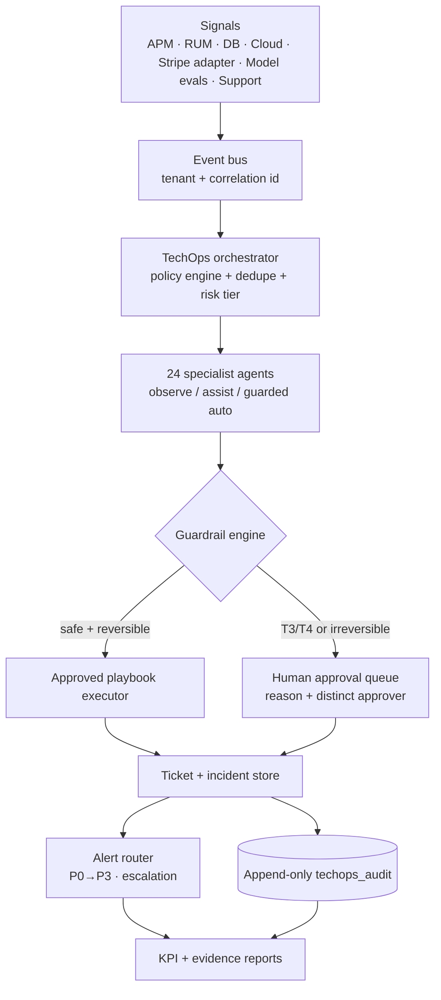
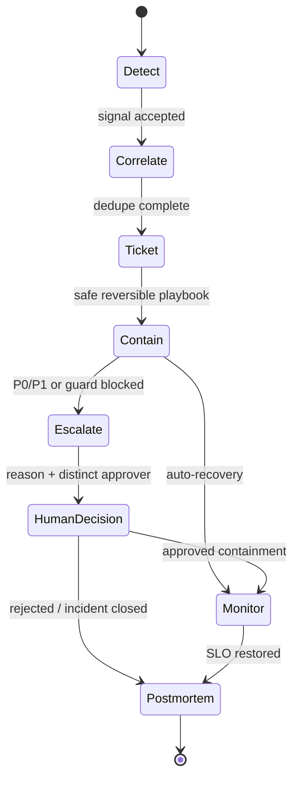

# VINTORA — Ultimate AI TechOps Team (Internal Operations Plane)

> **Companion documents:** `_canon.md`, `03-technical-architecture.md`, `04-database-design.md`, `21-admin-panel-module.md`, `22-global-payments-module.md`, `23-ai-marketing-automation-module.md`, `BUILDING.md`.
>
> **Positioning:** This is an **internal operations/platform layer**, not an eleventh market-facing module. The canonical ten modules remain: Vintora Market, Trade, Sommelier, Assist, Studio, Seller, Flow, Club, Vault and Rewards.

---

## 0. Canon and non-claims

| Dimension | Canonical fact |
|---|---|
| Name | **Ultimate AI TechOps** — the internal AI-assisted technology operations capability for the Vintora ecosystem; autonomous operation is not authorised. |
| Admin ID | `ADM-19`, grouped under **Intelligence** in the Admin console. |
| Purpose | Coordinate specialised agents across delivery, reliability, security, data, compliance, support, product and growth. |
| Operating model | 24/7 **design target**. The local console is a deterministic simulation; agents do not run continuously. |
| Autonomy | `OBSERVE` (read), `ASSIST` (propose) and `AUTO-SAFE` (pre-approved, reversible playbooks only). `GUARDED` is the default mode. |
| Human control | No autonomous publishing, ad spend, email send, adverse customer decision, ledger write or model promotion. T3/T4 actions require elevation, reason and a distinct approver. |
| AI kill switch | Target `< 1 minute` propagation — a design SLO, not a measured result. |
| Independent agent kill switch | Separate from model controls, engaged by default, human-only engage with a distinct approver; reset blocked in the prototype. Drill outstanding. |
| Scale target | Enterprise design for **100M+ global users**, multi-region, tenant-isolated and Citus/RLS-backed. |
| Stack contract | Next.js, React, Node.js, Supabase, PostgreSQL, OpenAI adapter, Azure, Stripe adapter, FlutterFlow. Live providers are not contacted in this build. |

**Non-claims:** agent uptime, MTTD/MTTR, incident volume, cost savings, model accuracy, provider integrations and audit findings in the prototype are deterministic demo values. No real autonomous operation, live telemetry, campaign, payment or model action is asserted.

**Enforced control plane:** the 24 UI agents are advisory at runtime. [`config/agent-autonomy-policy.json`](./config/agent-autonomy-policy.json), [`AGENT_AUTONOMY_CONTROLS.md`](./AGENT_AUTONOMY_CONTROLS.md) and `npm run agents:check` constrain tools, approvals, credentials, untrusted output, audit and safe-stop behaviour. `agent_decision_audit` is append-only and RLS-protected; no live worker, external tool, timed kill-switch drill, sandbox/canary/replay evidence or high-impact tool review record exists.

---

## 1. Agent architecture

### 1.1 Roster (24 specialists)

| # | Agent | Code | Domain | Default mode | Max tier | Primary responsibility |
|---:|---|---|---|---|---|---|
| 1 | CTO Agent | `CTO-01` | Architecture | Assist | T4 | Architecture decisions, guardrail ownership, escalation synthesis |
| 2 | DevOps Agent | `DEV-01` | Delivery | Guarded auto | T3 | Builds, canaries, pipeline health, rollback preparation |
| 3 | Site Reliability Engineer (SRE) Agent | `SRE-01` | Reliability | Guarded auto | T3 | SLOs, error budgets, incident detection, safe containment |
| 4 | QA Agent | `QA-01` | Quality | Assist | T2 | Test selection, regression risk, release quality gates |
| 5 | Security Agent | `SEC-01` | Security | Guarded auto | T4 | Threat signals, secret hygiene, access anomalies, containment |
| 6 | Database Agent | `DBA-01` | Data | Guarded auto | T3 | Query latency, vacuum/index health, schema drift, backup checks |
| 7 | API Agent | `API-01` | Platform | Guarded auto | T2 | Contract checks, latency budgets, idempotency and rate limits |
| 8 | Mobile App Agent | `MOB-01` | Clients | Observe | T2 | FlutterFlow release health, crash/ANR signals, store readiness |
| 9 | Web App Agent | `WEB-01` | Clients | Assist | T2 | Next.js/React performance, hydration and Core Web Vitals |
| 10 | Cloud Agent | `CLD-01` | Infrastructure | Guarded auto | T3 | Azure capacity, autoscaling, regional failover, quotas |
| 11 | Technical Support Agent | `SUP-01` | Support | Assist | T1 | Ticket triage, customer-impact summaries, reply drafts |
| 12 | Cost Optimization Agent | `COST-01` | FinOps | Assist | T2 | Unit economics, spend variance, rightsizing candidates |
| 13 | Release Management Agent | `REL-01` | Delivery | Assist | T3 | Release trains, approvals, change calendar, post-release review |
| 14 | AI Model Monitoring Agent | `MDL-01` | AI Ops | Guarded auto | T4 | Drift, eval gates, fallback, model-card and spend-cap checks |
| 15 | Compliance Agent | `CMP-01` | Governance | Assist | T4 | Evidence packs, age/KYC/licence controls, policy delta review |
| 16 | AI Product Manager Agent | `PM-01` | Product | Assist | T2 | Backlog synthesis, outcome framing, stakeholder digests |
| 17 | AI Scrum Master Agent | `SCRUM-01` | Delivery | Assist | T1 | Flow metrics, blocked-work detection, ceremony summaries |
| 18 | AI Business Analyst Agent | `BA-01` | Product | Observe | T1 | Requirement tracing, process maps, acceptance-criteria checks |
| 19 | AI Data Analyst Agent | `DA-01` | Data | Assist | T2 | Metric definitions, anomaly narratives, experiment readouts |
| 20 | AI Revenue Optimization Agent | `REV-01` | Growth | Assist | T3 | Pricing/fee opportunity analysis within approved guardrails |
| 21 | AI Fraud Detection Agent | `FRD-01` | Risk | Guarded auto | T3 | Velocity, chargeback and account-takeover signal correlation |
| 22 | AI Compliance & License Verification Agent | `LIC-01` | Governance | Assist | T3 | Seller/trade licence matching, expiry tracking, payout-hold evidence |
| 23 | AI Vendor Management Agent | `VEN-01` | Vendor | Observe | T2 | Provider status, SLA evidence, alternate-source readiness |
| 24 | AI Marketplace Quality Control Agent | `MQC-01` | Quality | Assist | T2 | Listing provenance, content claims, seller quality sampling |

### 1.2 Control plane shape



### 1.3 Agent contract

Every agent implements one interface and emits one event shape:

```ts
interface TechOpsAgent {
  code: string;
  domain: string;
  mode: 'observe' | 'assist' | 'guarded-auto';
  maxTier: 'T1' | 'T2' | 'T3' | 'T4';
  observe(signal: SignalEnvelope): Promise<Observation[]>;
  decide(observation: Observation): Promise<Proposal>;
  act(proposal: Proposal, approval?: Approval): Promise<ActionReceipt>;
}

interface SignalEnvelope {
  tenantId: string;
  correlationId: string;
  source: string;
  severity: 'P0' | 'P1' | 'P2' | 'P3';
  occurredAt: string;
  payload: Record<string, unknown>; // redacted before persistence
}
```

- **Observe** never writes.
- **Assist** writes proposals and tickets only; no external mutation.
- **Guarded auto** may execute only allow-listed, reversible playbooks under a spend cap and change budget.
- All tiers log input hash, decision, approver, output hash and correlation ID.

---

## 2. Multi-agent workflows

| Workflow | Trigger | Agent chain | Guardrail | Target |
|---|---|---|---|---|
| `WF-INC` Incident | SLO breach / anomaly | SRE → Security → Support → CTO | P0 pages human; T4 for critical escalation | P0 acknowledge 5m |
| `WF-REL` Release | Release candidate | DevOps → QA → Security → Release Mgr | Named human approval before production | Canary 5% → progressive |
| `WF-COST` Cost | Spend variance > 10% | Cost → Cloud → Database | T3 for infrastructure change | 24h rightsizing review |
| `WF-FRD` Fraud | Velocity / chargeback | Fraud → Revenue Ops → Security | No autonomous adverse decision | P1 review 15m |
| `WF-MDL` Model | Drift / eval gate breach | Model Monitoring → CTO → Compliance | T4 dual approval for promotion | Halt target < 1 min |
| `WF-LIC` Licence | Expiry / registry mismatch | Licence Verification → Marketplace QC → Compliance | T3 payout hold; human verification | Same-day review |

### 2.1 Incident state machine



---

## 3. Dashboard layouts

### 3.1 ADM-19 console

```text
┌─────────────────────────────────────────────────────────────────────────┐
│ VINTORA ADMIN · ADM-19 ULTIMATE AI TECHOPS     [GUARDED]  ⌘K  Elevate │
├─────────────────────────────────────────────────────────────────────────┤
│ 24 agents │ 6 workflows │ 6 open alerts │ GUARDED mode                │
├─────────────────────────────────────────────────────────────────────────┤
│ Next.js React Node.js Supabase PostgreSQL OpenAI Azure Stripe Flutter │
├───────────────────────────────────────┬─────────────────────────────────┤
│ ALERT & INCIDENT CONSOLE              │ AGENT ARCHITECTURE (24)         │
│ ID Sev Source Agent Summary State     │ ID Agent Domain State Mode Tier │
│ [ ] OPS-501 P1 API SRE latency  Open  │ CTO-01   CTO  Arch Healthy ...        │
│ [ ] OPS-502 P2 Cost COST egress Ack   │ ...                                   │
│ Ack · Create ticket · Self-heal (T3)  │ Check · Runbook                       │
├───────────────────────────────────────┼─────────────────────────────────┤
│ MULTI-AGENT WORKFLOWS                 │ INCIDENT RESPONSE TIMELINE      │
│ WF-INC Detect→Triage→Ticket→Escalate  │ 14:42 EU latency · containing   │
│ WF-REL Build→Canary→QA→Security→Ship  │ 14:28 Drift · champion fallback │
├───────────────────────────────────────┼─────────────────────────────────┤
│ ENTERPRISE SCALE TARGETS              │ GUARDRAILS & REPORTS            │
│ RLS · shards · event bus · audit      │ No silent autonomy · evidence   │
└───────────────────────────────────────┴─────────────────────────────────┘
```

### 3.2 Drilldown drawer

- **Agent runbook:** owner, mode, tier, last run, recent checks, linked alerts, escalation path, evidence hash.
- **Alert detail:** signal source, correlation ID, dedupe key, auto-action attempted, ticket, approver requirement.
- **Workflow detail:** ordered steps, participating agents, SLA, guard tier, failure policy.
- **Report detail:** cadence, owner, format, rows, manifest hash.

---

## 4. Database design

### 4.1 Core tables

| Table | Purpose | Key columns | Retention |
|---|---|---|---|
| `techops_agents` | Agent registry | `id`, `tenant_id`, `code`, `domain`, `mode`, `max_tier`, `active` | Versioned, soft delete |
| `techops_agent_runs` | One invocation per agent | `id`, `tenant_id`, `agent_id`, `trigger`, `signal_hash`, `decision`, `outcome`, `duration_ms` | 90d hot / 7y WORM |
| `techops_workflows` | Orchestration definitions | `id`, `tenant_id`, `code`, `steps_json`, `guard_tier`, `owner_agent_id` | Versioned |
| `techops_alerts` | Deduped signals | `id`, `tenant_id`, `severity`, `source`, `dedupe_key`, `status`, `ticket_id` | 1y hot |
| `techops_incidents` | Incident lifecycle | `id`, `tenant_id`, `alert_id`, `state`, `commander_id`, `started_at`, `resolved_at` | 7y |
| `techops_tickets` | Work items | `id`, `tenant_id`, `title`, `priority`, `assignee_id`, `sla_due_at` | 7y |
| `techops_reports` | Report definitions/results | `id`, `tenant_id`, `name`, `cadence`, `format`, `manifest_hash` | 7y |
| `techops_kpi_snapshots` | KPI time series | `tenant_id`, `metric`, `value`, `window`, `captured_at` | 13mo rollup |
| `techops_playbooks` | Allow-listed reversible actions | `id`, `tenant_id`, `code`, `steps_json`, `risk_tier`, `spend_cap_usd` | Versioned |
| `techops_approvals` | Four-eyes decisions | `id`, `tenant_id`, `run_id`, `requester_id`, `approver_id`, `reason`, `decision` | 7y |
| `techops_audit` | Append-only action log | `id`, `tenant_id`, `actor`, `correlation_id`, `action`, `tier`, `before_hash`, `after_hash` | WORM 7y |

### 4.2 SQL sketch

```sql
CREATE TABLE techops_agent_runs (
  id             uuid PRIMARY KEY,
  tenant_id      uuid NOT NULL,
  agent_id       uuid NOT NULL REFERENCES techops_agents(id),
  correlation_id text NOT NULL,
  severity       text NOT NULL CHECK (severity IN ('P0','P1','P2','P3')),
  signal_hash    text NOT NULL,
  decision       jsonb NOT NULL,
  outcome        text NOT NULL,
  duration_ms    integer NOT NULL CHECK (duration_ms >= 0),
  created_at     timestamptz NOT NULL DEFAULT now()
) PARTITION BY RANGE (created_at);

CREATE INDEX techops_agent_runs_tenant_time_idx
  ON techops_agent_runs (tenant_id, created_at DESC);
CREATE UNIQUE INDEX techops_alerts_dedupe_idx
  ON techops_alerts (tenant_id, dedupe_key);

ALTER TABLE techops_agent_runs ENABLE ROW LEVEL SECURITY;
CREATE POLICY tenant_isolation ON techops_agent_runs
  USING (tenant_id = current_setting('app.tenant_id', true)::uuid);

-- Append-only: revoke UPDATE/DELETE from application roles; inserts only via service role.
```

- **Citus distribution:** distribute fact tables on `tenant_id`; colocate `techops_agent_runs`, `techops_alerts` and `techops_audit`.
- **Reference tables:** `techops_agents`, `techops_workflows`, `techops_playbooks` are reference/replicated tables with tenant override where required.
- **Supabase/PostgreSQL:** RLS is defence in depth; the API must always set `app.tenant_id` and `app.user_id` where user-scoped.
- **Partitioning:** monthly fact partitions; roll KPI snapshots to hourly/daily continuous aggregates.
- **Idempotency:** every agent run and ticket creation uses `correlation_id` as an idempotency key.

---

## 5. Alerting system

| Severity | Definition | Route | Auto action | Human requirement |
|---|---|---|---|---|
| P0 | Multi-region checkout/auth failure or data-integrity risk | Immediate on-call page + incident bridge | Safe freeze/fallback only | Human commander required |
| P1 | Single-market SLO breach, fraud cluster, model drift | On-call page within 15m | Canary isolate, trace capture, ticket | T3/T4 approval for changes |
| P2 | Cost anomaly, degraded vendor, licence expiry | Team queue within 1h | Rightsizing proposal, evidence pack | T2/T3 review |
| P3 | Advisory, stale status, minor QA drift | Daily digest | Enrichment only | Next business day |

**Flow:** normalize → dedupe (`tenant + source + fingerprint`) → correlate with change/model/vendor events → assign severity → open ticket → execute allow-listed playbook → notify → escalate if unacknowledged. Suppression windows require an owner and expiry. Alert storms are grouped into one incident with child signals.

Prototype labels such as `OPS-501` are deterministic examples. No webhook, pager, email or SMS is sent by the local build.

---

## 6. Logging system

Structured JSON on every event:

```json
{
  "ts": "2026-11-19T14:42:00Z",
  "level": "warn",
  "tenant_id": "…",
  "correlation_id": "…",
  "agent": "SRE-01",
  "workflow": "WF-INC",
  "action": "safe_contain",
  "tier": "T3",
  "target": "checkout-edge-eu",
  "decision": "isolate_canary",
  "result": "success",
  "duration_ms": 412,
  "evidence_hash": "sha256:…"
}
```

- Fields: timestamp, level, tenant, user (pseudonymous), correlation/request/trace IDs, agent, workflow, tier, action, target, decision, result, duration, evidence hash.
- Redaction: no raw PAN/CVV, passwords, tokens, full DOB, licence numbers or raw PII. Store hashes and masked previews only.
- Append-only: API roles may `INSERT` only; corrections are compensating events. Hot search 30–90 days; WORM/cold archive 7 years.
- Privacy: purpose recorded for every PII view; GDPR/CCPA/LGPD/PIPL deletion workflows tombstone identities while preserving non-identifying audit evidence.

---

## 7. Monitoring strategy

### 7.1 SLO targets (design)

| Layer | SLI | Target |
|---|---|---|
| Storefront API | Availability | 99.99% monthly |
| Checkout | p99 latency | < 400ms regional |
| Age/KYC adapter | Assertion latency | < 800ms |
| Payments adapter | Success classification | > 99.9% simulated |
| Database | Replication lag | < 2s |
| Event bus | Consumer lag | < 30s |
| AI adapters | Eval gate pass | 100% before promotion |
| AI kill switch | Propagation | < 1 min |
| Audit | Privileged actions logged | 100% |
| Cost | Advertising/revenue | ≤ 8% |

### 7.2 Instrumentation

- **Golden signals:** latency, traffic, errors, saturation per tenant, region and route.
- **RUM / synthetic:** Next.js/React Web Vitals, FlutterFlow crash/ANR probes, scheduled checkout journeys.
- **DB:** query latency histograms, locks, deadlocks, vacuum health, index bloat, replication lag, connection saturation.
- **Cloud:** Azure quota headroom, autoscaling events, regional failover readiness, egress and unit cost.
- **AI:** drift, fairness, red-team, spend caps, eval gates, model card freshness, fallback readiness.
- **Business guardrails:** ad spend cap, age-gate coverage, licence validity, fraud false-positive review rate.
- **Error budgets:** burn-rate alerts at 2×/6×; feature freezes are human decisions.

---

## 8. Security framework

- **Zero trust:** SSO + hardware MFA, short-lived workload identity, mTLS between services, deny by default.
- **RBAC:** least privilege by agent domain; `auditor` is read-only; writes require `super_admin` plus four-eyes for T3/T4.
- **JIT/break-glass:** 15-minute JIT / 2-hour break-glass, full banner, reason, distinct approver, auto-demote.
- **Tenant isolation:** mandatory `tenant_id`, RLS on every fact table, fail-closed queries; user-scoped tables also require `app.user_id`.
- **Secrets:** environment variables/secret manager only; placeholders in source; rotation evidenced, not printed.
- **Supply chain:** SBOM, signed images, dependency scanning, pinned actions, staged rollout and documented rollback.
- **Data protection:** encryption in transit/at rest, column-level masking, tokenisation of processor references, no raw card data in logs.
- **Agent safety:** allow-listed tools, spend and rate caps, prompt-injection isolation, output validation, human approval for irreversible actions.
- **Audit:** append-only evidence with before/after hashes; export produces a hash manifest.

---

## 9. Incident response process

| Phase | Owner agent | Action | Exit criterion |
|---|---|---|---|
| Detect | SRE / Security / Model Monitoring | Correlate signals, assign severity, dedupe | Incident record with correlation ID |
| Triage | CTO / Support / Data Analyst | Assess blast radius, tenant and market impact | Impact statement and commander assigned |
| Contain | DevOps / Cloud / Database / SRE | Run reversible allow-listed playbook | SLO stable or safe fallback active |
| Ticket | Technical Support Agent | Create/update ticket, customer-safe summary | Ticket linked to incident |
| Escalate | CTO + Compliance | T3/T4 reason and distinct approver for irreversible change | Human decision recorded |
| Recover | Release / QA / Web / Mobile | Canary validation and progressive restore | SLO restored for defined window |
| Postmortem | CTO / Compliance / Product | Timeline, root cause, actions, evidence manifest | Blameless report approved |

**Escalation clock:** P0 page immediately and human commander within 5 minutes; P1 within 15 minutes; P2 within 1 hour; P3 digest. Missed acknowledgement re-pages an alternate human owner. No agent may close a P0/P1 incident without human confirmation.

---

## 10. Scale to 100M+ users

- **Data plane:** tenant-sharded PostgreSQL/Citus; regional read replicas; Supabase-compatible RLS; partitioned event and audit tables.
- **Compute:** stateless Node.js services on Azure with autoscaling; queue-backed agent workers; idempotent retries with jitter.
- **Edge:** regional Next.js/React delivery, cached reference data, per-market FX and age-rule pinning.
- **Eventing:** at-least-once delivery, schema registry, dead-letter queues, replayable correlation IDs.
- **Cost:** per-tenant unit economics, budget caps per agent, rightsizing proposals, advertising cap enforced separately.
- **Resilience:** multi-AZ by default, regional failover drills, champion fallback for models, manual break-glass path.
- **Governance:** quarterly access review, model card refresh, red-team cycle, evidence export and immutable audit retention.

All capacity numbers are design targets for the stated scale; the local prototype uses seeded rows and no live load.

---

## 11. Prototype-to-production mapping

| Prototype behaviour | Production destination |
|---|---|
| ADM-19 roster of 24 agents | Containerised agent workers with policy engine and tool registry |
| Deterministic alerts and self-heal toasts | Signal bus, dedupe engine and allow-listed playbook executor |
| Local ticket/report generation | `techops_tickets`, `techops_reports` and immutable evidence packs |
| GUARDED mode and T3/T4 reason gates | JIT elevation, four-eyes approvals and policy-as-code |
| Local audit timeline | `techops_audit` with WORM retention and hash manifest |
| Design SLO labels | SLO dashboards, burn-rate alerts and human incident command |
| Simulated stack labels | Real adapters behind the same interfaces, subject to separate approval |

---

## 12. Summary

Ultimate AI TechOps adds an internal ADM-19 workspace where 24 specialist agents coordinate incident response, release, reliability, security, data, cost, fraud, licence, vendor, support and product workflows. The design provides an agent contract, multi-agent orchestration, dashboard layouts, tenant-isolated schema, severity-based alerting, redacted structured logs, SLO-driven monitoring, zero-trust security and a human-led incident process. Autonomy remains bounded: self-heal is limited to reversible playbooks, critical actions require reason and a distinct approver, and no publisher, spender, model promoter or adverse decider operates without human authority. All local values are deterministic simulation and design targets, not claims of live operations.
