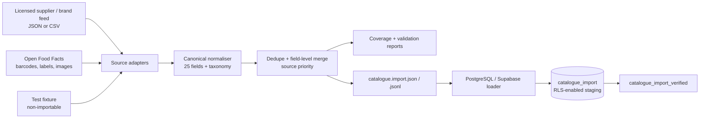

# VINTORA — Verified Catalogue Data Pipeline

> **Companion documents:** `_canon.md`, `03-technical-architecture.md`, `04-database-design.md`, `21-admin-panel-module.md`, `BUILDING.md`.
>
> **Positioning:** Internal data-operations capability for the AI-powered marketplace. It does **not** add a market-facing module and does not change the canonical ten-module list.

---

## 0. Scope and non-claims

This document defines a **verified ingestion pipeline**, not a pre-filled catalogue.

- No real product records, prices, barcodes, awards or official URLs are bundled with this repository.
- No value is generated to satisfy a coverage target. Missing facts remain `null` or `[]`.
- Open Food Facts rows are source-verified for brand/name/barcode/label/image fields only. Its images are stored as `provenance.source_image_url`, **not** as official brand images.
- Licensed supplier or brand feeds are the only source for MSRP, average global retail price, awards, tasting notes, food pairings, official websites/pages/images and luxury segmentation.
- Derived values are limited to taxonomy mapping, parsed units and generated internal SKUs; every one is labelled `derived` in provenance.
- All pricing and popularity values in examples are empty. No claim of real supplier contracts, licences, partnerships or live catalogue accuracy is made.

Requested coverage goals are recorded in `packages/db/config/catalogue-taxonomy.json`:

| Group | Requested minimum |
|---|---:|
| Wine | 500 |
| Whisky & Whiskey | 300 |
| Vodka | 200 |
| Gin | 150 |
| Rum | 150 |
| Tequila & Mezcal | 150 |
| Brandy & Cognac → Cognac | 100 |
| Beer | 300 |
| **Total target** | **1,850** |

The pipeline reports progress against these goals but does not fabricate records to reach them.

---

## 1. Architecture



### Source priority

1. `licensed-feed` — highest. Supplies commercially licensed facts.
2. `openfoodfacts` — supplies public product identity and barcode/image evidence.
3. `fixture` — test only; excluded from the verified view and from default loader output.

When records collide on barcode or normalised brand + product name, the higher-priority record is kept and missing fields are filled from lower-priority records. Each merged field retains its own confidence label.

---

## 2. Adapter contracts

### 2.1 Licensed feed adapter

Accepts a JSON array, or an object with `records[]` / `data[]`, or CSV with a header row. Optional top-level `license` and `retrieved_at` metadata are preserved.

```bash
node scripts/catalogue-ingest.mjs --licensed-feed ./feeds/supplier-a.json
node scripts/catalogue-ingest.mjs --licensed-feed ./feeds/supplier-a.csv
```

Every row must carry its own `source_url` where the supplier provides one. The adapter never invents one. `examples/licensed-feed.example.json` documents the exact field contract using reserved `example.invalid` URLs and obvious `REPLACE ME` values, which the normaliser deliberately rejects.

### 2.2 Open Food Facts adapter

Queries the public search endpoint with an identified `User-Agent`, honours configurable page size/delay and yields raw records with:

- `source: openfoodfacts`
- `source_url`: the OFF product page
- `licence: ODbL-1.0`
- `retrieved_at`
- `provenance.source_image_url`: OFF-hosted image, when present

```bash
node scripts/catalogue-ingest.mjs --openfoodfacts --off-query red-wine --off-query bourbon
```

OFF **cannot** supply: MSRP, global retail price, awards, official brand/product pages, official brand images, tasting notes, food pairings, luxury segment or popularity. Those fields stay empty for OFF-only rows.

### 2.3 Fixture adapter

Local, synthetic records for tests only. Fixture values use `FIXTURE` prefixes and `example.invalid` URLs where applicable. Fixture rows are labelled `source: fixture` and excluded by the loader unless `--include-fixtures` is explicitly passed.

---

## 3. Canonical import contract

Each emitted row contains the 25 requested fields plus `provenance` and the helper `bottle_size_ml`.

| # | Field | Source rule |
|---:|---|---|
| 1 | `category` | Licensed value, or derived taxonomy classification |
| 2 | `subcategory` | Licensed value, or derived taxonomy classification |
| 3 | `brand_name` | Source value; never guessed |
| 4 | `product_name` | Source value; never guessed |
| 5 | `country_of_origin` | Source value or mapped country tag |
| 6 | `region` | Source value only |
| 7 | `producer_distillery` | Source value only |
| 8 | `abv_pct` | Parsed numeric ABV, 0–100 |
| 9 | `bottle_size` | Source size string or parsed source quantity |
| 10 | `tasting_notes` | Source value only |
| 11 | `food_pairing` | Source value only |
| 12 | `awards` | Source array only |
| 13 | `product_description` | Source description only |
| 14 | `msrp_price_usd` | Licensed source only |
| 15 | `average_global_retail_price_usd` | Licensed source only |
| 16 | `product_sku` | Source SKU, otherwise derived internal `VIN-…` SKU |
| 17 | `barcode` | Source barcode; must be 8–14 digits |
| 18 | `official_brand_website` | Licensed source only |
| 19 | `official_product_page` | Licensed source only |
| 20 | `official_product_image_url` | Licensed source only |
| 21 | `additional_gallery_images` | Licensed gallery or source-hosted images |
| 22 | `product_tags` | Source tags or mapped public labels |
| 23 | `premium_luxury_segment` | Licensed source only |
| 24 | `popularity_score` | Licensed source only |
| 25 | `ai_recommendation_tags` | Licensed values plus derived category/subcategory tags |

JSON Schema: `packages/db/schemas/catalogue.import.schema.json`.

### Provenance block

```json
{
  "source": "openfoodfacts",
  "source_record_id": "…",
  "source_url": "https://world.openfoodfacts.org/product/…",
  "licence": "ODbL-1.0",
  "retrieved_at": "2026-11-19T…Z",
  "source_priority": 60,
  "source_image_url": "https://…",
  "unclassified": false,
  "confidence": { "brand_name": "verified", "country_of_origin": "derived", "awards": "missing" },
  "overall_confidence": 0.62,
  "notes": ["No field is synthesised to satisfy catalogue targets."]
}
```

Confidence levels:

- `verified` — supplied directly by the source.
- `derived` — taxonomy mapping, unit parsing or generated internal identifier.
- `missing` — source did not supply the value.

`overall_confidence` is a weighted score across all canonical fields. The loader defaults to `>= 0.70`.

---

## 4. Workflows

### 4.1 Ingest and validate

```bash
npm run catalogue:ingest -- --licensed-feed ./feeds/supplier-a.json
npm run catalogue:ingest -- --openfoodfacts --off-query red-wine --off-query bourbon
npm run catalogue:selftest
```

Outputs:

- `packages/db/output/catalogue.import.json`
- `packages/db/output/catalogue.import.jsonl`
- `packages/db/output/catalogue.coverage.json`
- `packages/db/output/catalogue.validation.json`

Quality gates:

- `--strict` fails on invalid or unclassified rows.
- `--require-targets` fails if verified coverage is below the 1,850 goal.
- `--min-confidence 0..1` filters emitted rows without altering the reports.

### 4.2 Import to PostgreSQL / Supabase

```bash
npm run with-env -- npm run catalogue:import -- --input packages/db/output/catalogue.import.json
```

The loader applies `packages/db/sql/catalogue_import.sql`, then upserts by `product_sku` in one transaction. It skips fixtures and rows below the confidence threshold unless explicitly allowed.

Supabase notes:

- `catalogue_import` has RLS enabled with no public policies — read it through a service-role job or a controlled view.
- Use `catalogue_import_verified` for downstream reads; it excludes fixtures and requires `overall_confidence >= 0.70`.
- Arrays map to PostgreSQL `text[]`; awards, gallery images and provenance map to `jsonb`.

---

## 5. Monitoring and governance

| Control | Implementation |
|---|---|
| Attribution | Every row carries source, source ID, source URL, licence and retrieval time |
| Field integrity | Confidence label per field; nulls are explicit |
| Duplicate handling | Barcode-first, then normalised brand + product name |
| Licence traceability | Feed-level `license` metadata copied to provenance |
| Rate politeness | OFF `User-Agent`, page limit and configurable delay |
| Privacy | Product data only; no personal data ingested |
| Immutability | Re-ingestion upserts by SKU; historical provenance is overwritten with a new retrieval time |
| Fail-closed quality | Strict and target gates return non-zero exit codes |

Open Food Facts data is licensed under ODbL-1.0; preserve attribution and share-alike obligations when redistributing derived datasets. Supplier feeds may have stricter terms — record the exact licence in feed metadata before import.

---

## 6. Path to the 1,850-record target

The target is reached only by adding verified sources:

1. Signed supplier/brand catalogue extracts for MSRP, awards, official URLs and segment data.
2. Open Food Facts query batches for barcode/image enrichment, merged by SKU.
3. Manual quality review of unclassified rows and field conflicts.
4. `--strict --require-targets` in CI once confidence and coverage thresholds are agreed.

The pipeline will report honest deficits until those sources exist. It will not invent a single product.

---

## 7. Summary

This pipeline replaces an untrustworthy bulk-generated catalogue with an auditable, source-bound ingestion system. It supports licensed supplier feeds, Open Food Facts enrichment and test fixtures; normalises to the 25-field import contract; records per-field provenance and confidence; validates and reports coverage against the requested 1,850 products; and loads only qualified rows into a Supabase/PostgreSQL staging table. Real catalogue scale is a data-acquisition milestone, not something the code can assert by itself.
