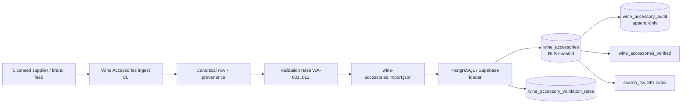

# VINTORA — Wine Accessories Catalogue Module

> **Companion documents:** `_canon.md`, `03-technical-architecture.md`, `04-database-design.md`, `21-admin-panel-module.md`, `25-catalogue-data-pipeline.md`, `BUILDING.md`.
>
> **Positioning:** A catalogue domain inside **Vintora Market**, not an eleventh market-facing module and not a twentieth Admin workspace. It uses the same asset authorisation discipline as the verified beverage catalogue pipeline.

---

## 0. Scope and non-claims

- No real accessory products, prices, image URLs, licences, authorisations or moderation approvals are bundled.
- `examples/wine-accessories.fixture.json` is synthetic, test-only and uses reserved `example.invalid` URLs. It is excluded from import by default.
- Official image URLs and backups enter only through licensed supplier/brand feeds or first-party asset registries with explicit authorisation metadata.
- Open Food Facts is **not** used for accessories; it cannot establish image rights, MSRP, regional pricing, materials or care instructions.
- SEO, bundles and cross-sells are deterministic, rule-based suggestions labelled `derived`. No live model or accuracy claim is made.
- Compliance notes are review obligations, not legal advice or certifications.

---

## 1. Categories

The nine configured categories are:

| # | Category |
|---:|---|
| 1 | Glassware |
| 2 | Decanters |
| 3 | Corkscrews |
| 4 | Aerators |
| 5 | Chillers |
| 6 | Storage Racks |
| 7 | Preservation Systems |
| 8 | Gift Sets |
| 9 | Cleaning Tools |

Taxonomy and category-specific cross-sell map: `packages/db/config/wine-accessories-taxonomy.json`.

---

## 2. Canonical item contract

Each emitted row contains the requested commercial fields plus provenance, search, AI enrichment, moderation, validation and audit data.

| Field | Type | Rule |
|---|---|---|
| `sku` | string | Source SKU, or derived `WA-…` internal SKU labelled derived |
| `category` | enum | One of the nine approved categories |
| `brand` | string/null | Source value only |
| `product_name` | string/null | Source value only |
| `materials` | string[] | Source declarations only; never inferred |
| `dimensions` | object | Source length/width/height/weight + units; at least one positive number |
| `care_instructions` | string[] | Source value only |
| `tags` | string[] | Source tags, or derived taxonomy/material tags labelled derived |
| `compliance_notes` | object[] | Source notes plus derived review obligations |
| `msrp_usd` | number/null | Licensed source only |
| `regional_prices` | object[] | Region, currency, amount, price type, effective date and source |
| `assets` | object[] | Image URL, role, licence, authorising party, reference, authorisation flag, moderation |
| `official_image_url` | string/null | First authorised official asset URL |
| `backup_image_urls` | string[] | Authorised backup asset URLs |
| `image_moderation` | object | Row-level status derived from per-asset statuses |
| `search_index` | object | Search document, keywords, normalised brand/name, category path |
| `ai_enrichment` | object | Deterministic SEO, bundle and cross-sell suggestions |
| `cross_sells` | object[] | Source SKUs plus derived category suggestions |
| `bundles` | object[] | Source bundles plus derived category suggestions |
| `provenance` | object | Source, source record, URL, licence, retrieval time, field confidence |
| `validation` | object | Valid flag, errors, warnings and rules version |
| `audit_log` | object[] | Append-ready create/ingest/deduplicate entries |

JSON Schema: `packages/db/schemas/wine-accessories.import.schema.json`.

### Example shape

```json
{
  "sku": "FIXTURE-GLASS-001",
  "category": "Glassware",
  "brand": "FIXTURE BRAND",
  "product_name": "FIXTURE Crystal Wine Glass Set",
  "materials": ["Lead-free crystal"],
  "dimensions": { "height": 22, "width": 8, "linear_unit": "cm", "weight": 180, "weight_unit": "g" },
  "care_instructions": ["Hand wash only"],
  "tags": ["stemware"],
  "compliance_notes": [{ "text": "Verify food-contact evidence.", "origin": "derived", "reference": null }],
  "msrp_usd": 49,
  "regional_prices": [{ "region": "US", "currency": "USD", "amount": 49, "source_url": "https://…" }],
  "official_image_url": "https://…",
  "backup_image_urls": ["https://…"],
  "image_moderation": { "status": "approved", "asset_statuses": [] },
  "search_index": { "search_document": "…", "search_keywords": ["Glassware"] },
  "ai_enrichment": { "provider": "deterministic", "confidence": "derived", "seo": { "title": "…" } },
  "cross_sells": [{ "type": "category", "value": "Decanters", "origin": "derived" }],
  "bundles": [],
  "provenance": { "source": "licensed-feed", "overall_confidence": 0.92 },
  "validation": { "valid": true, "errors": [], "warnings": [], "rules_version": "1.0.1" },
  "audit_log": [{ "action": "create", "sku": "FIXTURE-GLASS-001" }]
}
```

The values above are illustrative only; the bundled fixture uses `example.invalid` URLs and must never be imported.

---

## 3. Licensed and authorised assets only

Every image asset must carry:

| Asset field | Requirement |
|---|---|
| `role` | `official` or `backup`; at least one `official` is required |
| `url` | Absolute `http(s)` URL, not a reserved/test domain by default |
| `licence` | `OWNED`, `COMMERCIAL_LICENSED`, `SUPPLIER_AUTHORIZED` or `AGENCY_LICENSED` |
| `authorized` | Explicit `true` |
| `authorizing_party` | Named licensor or rights holder |
| `authorization_reference` | Required for every non-`OWNED` asset |
| `moderation.status` | `approved`, `pending` or `rejected`; import requires `approved` by default |
| `moderation.checked_at` / `checked_by` | Required when status is `approved` |
| `source_url` | Supplier/asset-registry record where available |
| `checksum_sha256` | Optional integrity check |

Reserved domains (`example.invalid`, `.test`, `.localhost`, `example.com`, etc.) fail asset validation unless `--allow-test-fixtures` is passed for local testing. The production loader never enables this by default. Fixture rows are additionally excluded by source.

---

## 4. Search and deterministic AI enrichment

### Search indexing

`search_index.search_document` combines brand, product name, category, materials and tags. `search_index.search_keywords` adds normalised tokens. PostgreSQL stores a generated `tsvector` column (`search_tsv`) with a GIN index.

### AI enrichment

`ai_enrichment` is generated by `vintora-wine-accessories-rules-v1`:

- `seo.title`, `seo.description`, `seo.slug`, `seo.keywords`
- `bundles`: source bundles plus derived category pairings
- `cross_sells`: source SKUs plus category suggestions from the taxonomy cross-sell map

All generated values are labelled `derived` or `confidence: "derived"`. No claim of a live LLM, trained model or measured accuracy is made.

---

## 5. Validation rules

The same `WA-001`…`WA-012` rules run in the ingestion CLI and the PostgreSQL loader, and are persisted to `wine_accessory_validation_rules`.

| Rule | Severity | Gate |
|---|---|---|
| WA-001 | error | Valid SKU present |
| WA-002 | error | Category in the nine-category taxonomy |
| WA-003 | error | Brand and product name present |
| WA-004 | error | Materials and care instructions present |
| WA-005 | error | At least one positive numeric dimension |
| WA-006 | error | MSRP and at least one allowed-currency regional price |
| WA-007 | error | Tags and compliance notes present |
| WA-008 | error | At least one official image asset; backups optional |
| WA-009 | error | Allowed licence, explicit authorisation, non-reserved URL |
| WA-010 | error | Approved moderation with reviewer metadata |
| WA-011 | error | Search index and deterministic enrichment present |
| WA-012 | error | Provenance and create audit entry present |

Quality gates:

- `--strict`: non-zero exit on invalid rows.
- `--require-categories`: non-zero exit if any configured category is absent.
- `--allow-pending-moderation`: explicitly relaxes WA-010 for review workflows; the loader requires a matching flag.
- `--allow-test-fixtures`: local-only relaxation for reserved test URLs; never used in default import.

---

## 6. Workflows

### 6.1 Ingest

```bash
npm run accessories:ingest -- --feed ./feeds/wine-accessories.json --strict --require-categories
```

Local fixture test:

```bash
npm run accessories:selftest
npm run accessories:ingest -- --fixture packages/db/examples/wine-accessories.fixture.json --allow-test-fixtures --strict --require-categories
```

Outputs:

- `packages/db/output/wine-accessories.import.json`
- `packages/db/output/wine-accessories.import.jsonl`
- `packages/db/output/wine-accessories.coverage.json`
- `packages/db/output/wine-accessories.validation.json`
- `packages/db/output/wine-accessories.audit.json`

### 6.2 Import to PostgreSQL / Supabase

```bash
npm run with-env -- npm run accessories:import -- --input packages/db/output/wine-accessories.import.json
```

The loader:

1. Applies `packages/db/sql/wine_accessories.sql`.
2. Upserts the 12 validation rules.
3. Revalidates each row.
4. Skips fixtures, low-confidence rows, unauthorised assets and unapproved moderation.
5. Upserts by `sku` in one transaction.
6. Writes an `import` audit entry; row-level triggers write `insert`/`update` entries.

Use `wine_accessories_verified` for downstream reads. It excludes fixtures, requires approved moderation and requires `validation->>'valid' = 'true'`.

---

## 7. Database layout



Indexes cover category/brand/name, source/moderation, full-text search, tags, search keywords, provenance, assets and AI enrichment.

---

## 8. Audit log for updates

Rows carry an in-band `audit_log` with `create`, `ingested` and optional `deduplicated` entries. The database adds server-side entries to `wine_accessory_audit` on insert, update and delete. A `BEFORE UPDATE OR DELETE` trigger raises on attempts to mutate the audit table, making it append-only.

Each audit entry records:

- `sku`
- `action`
- `at`
- `actor`
- `source`
- `reason`
- `row_hash`
- `before` / `after` JSON where applicable

---

## 9. Governance summary

| Control | Implementation |
|---|---|
| Asset rights | Allowed licence list, authorising party, authorisation reference, explicit authorised flag |
| Image moderation | Per-asset status plus row-level summary; approved required by default |
| Provenance | Source, source record, source URL, licence, retrieval time, field confidence |
| No fabrication | Missing facts stay null/empty; reserved and example values are rejected |
| Search | Generated tsvector + keyword arrays |
| AI transparency | Rule-based enrichment labelled derived |
| Updates | Append-only audit trigger plus import batch entry |
| RLS | Enabled with no public policies on tables |
| Fail-closed gates | Strict, category, licence and moderation gates return non-zero exit codes |

Real catalogue scale is a data-acquisition milestone. This module is ready to accept licensed, authorised data; it does not claim that such data or rights already exist.
