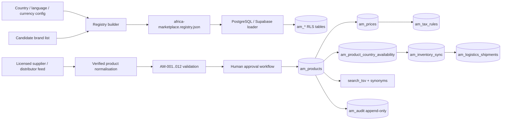

# VINTORA — Africa Marketplace Blueprint

> **Companion documents:** `_canon.md`, `03-technical-architecture.md`, `04-database-design.md`, `21-admin-panel-module.md`, `25-catalogue-data-pipeline.md`, `26-wine-accessories-module.md`, `BUILDING.md`.
>
> **Positioning:** A market expansion and catalogue domain inside **Vintora Market**. It does not create an eleventh market-facing module or a twentieth Admin workspace. The canonical ten-module list is unchanged.

---

## 0. Scope and non-claims

This deliverable provides the **marketplace foundation**: country registry, catalog structure, onboarding, approval, pricing, inventory, logistics, search, localisation and compliance architecture.

It does **not** claim:

- real supplier contracts, distributor agreements or brand authorisations;
- real product listings, prices, barcodes, awards or official image URLs;
- live local payment integrations;
- verified country-specific legal rules;
- real customers, orders or traction.

The supplied brand names are registered as **candidate brands**. Every product field that requires evidence is `null` or empty until a licensed/authorised source is attached and approved.

---

## 1. Launch markets

| Code | Market | Currency | Languages |
|---|---|---|---|
| ZA | South Africa | ZAR | English |
| NG | Nigeria | NGN | English |
| KE | Kenya | KES | English, Swahili |
| GH | Ghana | GHS | English |
| TZ | Tanzania | TZS | English, Swahili |
| UG | Uganda | UGX | English, Swahili |
| RW | Rwanda | RWF | English, French, Swahili |
| MA | Morocco | MAD | Arabic, French |
| EG | Egypt | EGP | Arabic |
| AO | Angola | AOA | Portuguese |
| BW | Botswana | BWP | English |
| NA | Namibia | NAD | English |
| ZM | Zambia | ZMW | English |
| MZ | Mozambique | MZN | Portuguese |

Scale target: **54 African countries**; the 14 above are **target-market records**, not an active launch configuration. All are classified `target`, assigned to no canonical launch phase, and remain `blocked` pending local counsel review and jurisdiction clearance.

---

## 2. Languages and localisation

Configured languages: **English, French, Arabic, Portuguese, Swahili**.

- Arabic is marked RTL; UI and PDF/export templates must mirror layout.
- `am_search_synonyms` stores language-scoped search synonyms.
- SEO metadata carries language variants; none are populated until native-speaker and legal review pass.
- Localisation workflow: `draft → translating → reviewing → approved`.
- Guardrails: native-speaker review, RTL layout check for Arabic, legal copy review.

---

## 3. Product catalog structure

The canonical listing template exposes every requested field:

| Field | Implementation |
|---|---|
| Brand Name | `brand_name` from candidate brand registry |
| Product Name | `product_name` — null until sourced |
| Category | `category` — Wine or Spirits hint from the brief |
| Subcategory | `subcategory` — null until classified from verified data |
| Country of Origin | `country_of_origin`; separate `country_of_origin_hint` |
| Region | `region` |
| Alcohol Percentage | `abv_pct` |
| Bottle Size | `bottle_size` |
| Product Description | `product_description` |
| Tasting Notes | `tasting_notes` |
| Food Pairings | `food_pairings[]` |
| Awards | `awards[]` |
| SKU | `sku` |
| Barcode | `barcode` |
| Wholesale Price | `wholesale_price` |
| Retail Price | `retail_price` |
| Distributor Price | `distributor_price` |
| African Market Price | `african_market_price.entries[]` by market |
| Availability by Country | `product_availability_by_country[]` |
| Official Website | `official_website` |
| Official Product URL | `official_product_url` |
| Official Product Images | `official_product_images[]` |
| Lifestyle Images | `lifestyle_images[]` |
| SEO Metadata | `seo_metadata` |
| AI Recommendation Tags | `ai_recommendation_tags[]` |

Additional governance fields: `provenance`, `validation`, `assets_policy`, `listing_status` and `audit_log`.

### Candidate brand coverage

- **Global wines:** Moët & Chandon, Dom Pérignon, Penfolds, Robert Mondavi, Yellow Tail, Jacob's Creek, Barefoot, Antinori.
- **Global spirits:** Johnnie Walker, Chivas Regal, Macallan, Glenfiddich, Jameson, Hennessy, Rémy Martin, Martell, Bacardi, Captain Morgan, Don Julio, Patrón, Absolut, Grey Goose, Belvedere, Tanqueray, Bombay Sapphire.
- **South African wines:** KWV, Nederburg, Durbanville Hills, Robertson Winery, Four Cousins, Stellenbosch Vineyards.
- **African spirits:** Amarula, Bain's Whisky, Three Ships Whisky, Viceroy Brandy, Kenya Cane, plus the category groups “Nigeria-produced spirits” and “Ghana premium spirits”.

The last two are **not brands**; they are flagged `needs_brand_resolution: true` and must be resolved to specific licensed brands before listing.

---

## 4. Marketplace architecture



---

## 5. Generated systems

### 5.1 Marketplace database schema

`packages/db/sql/africa_marketplace.sql` creates:

- reference: `am_currencies`, `am_languages`, `am_countries`, `am_country_languages`
- commerce: `am_brands`, `am_product_templates`, `am_products`, `am_product_country_availability`, `am_prices`, `am_tax_rules`
- operations: `am_distributors`, `am_distributor_brand_authorizations`, `am_compliance_records`, `am_approval_workflows`, `am_inventory_sync`, `am_logistics_shipments`
- discovery: `am_search_synonyms`, generated `search_tsv`, GIN indexes
- governance: `am_validation_rules`, `am_workflow_definitions`, append-only `am_audit`

RLS is enabled on every `am_*` table with no public policies. Downstream reads use controlled views such as `am_products_approved` and `am_product_templates_review`.

### 5.2 Product catalog structure

Draft templates live in `am_product_templates`. Only source-backed, approved records are promoted to `am_products`. Official and lifestyle images are JSON arrays with rights metadata; no image URL is generated.

### 5.3 Brand onboarding

`candidate → identity_verified → rights_verified → asset_review → approved`

Guards: brand identity evidence, trademark/authorisation evidence and a distinct approver. Candidate names never become approved brands automatically.

### 5.4 Distributor onboarding

`candidate → kyc → licence_review → territory_review → approved`

Tables: `am_distributors` and `am_distributor_brand_authorizations`. Guards: business KYC, licence evidence, brand authorisation and distinct approver.

### 5.5 Country management

`am_countries` holds currency, default language, age-gate flag, regulatory profile and review status. `am_country_languages` supports multilingual markets. Country activation requires legal, tax and payment review.

### 5.6 Product approval workflow

`template → source_attached → data_validation → compliance_review → asset_moderation → approved → published`

Publication requires a human publisher. No autonomous publishing occurs.

### 5.7 Pricing management workflow

`draft → fx_quote → tax_review → margin_review → approved → active`

Guards: 15-minute FX lock, reviewed tax rule reference and human approver. `am_prices` stores wholesale, retail, distributor and African-market prices by country and currency.

### 5.8 Inventory synchronization

`scheduled → fetching → reconciling → done | failed`

`am_inventory_sync` is keyed by product, country and distributor, with an idempotent cursor and exception review guard. Availability defaults to `unverified`.

### 5.9 Logistics integration

`created → pickup_scheduled → in_transit → customs_review → out_for_delivery → delivered`

`am_logistics_shipments` tracks origin/destination, carrier, customs reference and events. Guardrails: age-assured delivery, customs documents and destination regulation check.

### 5.10 Search and filtering architecture

- `search_document` combines source-backed brand, product, category and tags.
- Generated `search_tsv` with GIN index on products and templates.
- `am_search_synonyms` supports language-specific terms.
- Filters available through indexed columns: country, currency, availability, price type, category, brand, ABV, subcategory and moderation status.
- AI recommendation tags are rule-derived until a reviewed model is introduced.

---

## 6. Compliance and regulation

`am_compliance_records` stores evidence by entity and country. `am_tax_rules` stores reviewed tax rates with effective dates and sources. `am_countries.regulatory_profile` is `local_counsel_review_required` by default.

The checklist in the registry covers age verification, KYC, import permits, label review, excise/VAT, advertising review, distributor authorisation, tax verification, payment diligence and customs documents.

No exact legal rule or rate is asserted by this repository.

---

## 7. Scale strategy

| Target | Approach |
|---|---|
| 10,000 brands | `am_brands` with status/source indexes; deterministic brand IDs; Citus distribution by `brand_id` when enabled |
| 500,000 products | `am_products` with brand/category/status indexes and generated full-text search; partition or shard by `brand_id` |
| 54 countries | Country registry, country-language join table and per-country price/availability tables |
| Millions of customers | Stateless API tier, session auth, read replicas, cache layer, append-only audit streams |
| Multi-currency | 14 market currencies plus USD reference (15 configured currency codes); no currency is active outside local/test; FX quotes locked for 15 minutes in the design |
| Local payments | Candidate adapters only; credentials in environment variables; no live claim |

Prototype mode remains `Prototype mode — no real orders are placed.` until real payment, KYC and logistics providers are explicitly configured and legally reviewed.

---

## 8. Build and import

```bash
npm run africa:selftest      # generated offline assertion count
npm run africa:build

npm run with-env -- npm run africa:import
```

Verified local results:

- `africa:selftest`: generated assertion count passes; totals are registered in `config/test-counts.json`.
- Registry build: 14 target-market records, 38 candidate names, 38 draft templates, 12 rules, 10 workflows; phase unassigned and activation blocked.
- Database import: 14 countries, 15 currencies, 5 languages, 4 gateway candidates, 38 candidate brands, 38 draft templates, 12 rules and 10 workflows.
- `am_products` and `am_products_approved` remain empty; no draft template is promoted.
- 21 `am_*` tables have RLS enabled; generated `search_tsv` matches source-backed brand text.
- `am_audit` rejects updates with `am_audit is append-only`.
- Browser self-test reports generated pass/skip/fail totals at both `localhost:4000` and `localhost:8123`; the Africa Marketplace panel renders on the Home sub-section of Vintora Market.

Outputs:

- `packages/db/output/africa-marketplace.registry.json`
- `packages/db/output/africa-marketplace.registry.jsonl`
- `apps/prototype/src/africa-snapshot.js` (generated storefront snapshot)

The registry contains countries, languages, currencies, gateways, candidate brands, draft product templates, workflows, validation rules and scale targets. The storefront snapshot is consumed by the **Africa Marketplace** sub-section on the Vintora Market Home view. It is read-only, contains no product facts, and preserves the ten-module canon by avoiding a new top-level module.

---

## 9. Governance summary

| Control | Implementation |
|---|---|
| No fabricated listings | All product facts null/empty until sourced |
| Rights discipline | Official/lifestyle assets require licensed or authorised records |
| Human release | Product, pricing and compliance workflows require named approvers |
| Distinct approver | Approval tables enforce `approver <> requested_by` |
| Append-only audit | `am_audit` rejects updates and deletes |
| Country governance | Regulatory profile defaults to local counsel review |
| Payment safety | Gateway candidates are not integrations; no credentials in JSON |
| Search transparency | Full-text index plus labelled rule-derived tags |
| Fail-closed design | Draft templates never auto-promote to products |

Real marketplace scale is a data-acquisition and legal-operations milestone. This repository supplies the architecture and ingestion path; it does not assert that the required rights, licences, feeds or integrations already exist.
